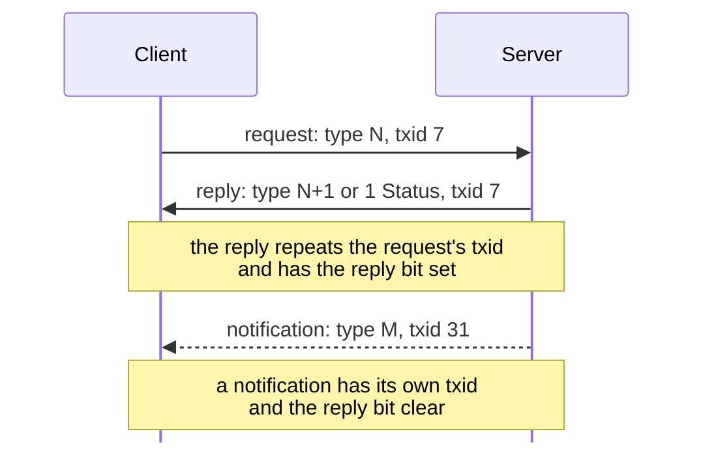

# KDX Protocol

The reference for the Haxial KDX protocol as spoken by KDX Server 1.620, KDX
Client 1.600 and 1.620 beta 5, and Tracker 1.110. It is built from lab
captures and static reading of the binaries.

This page covers the protocol's shape: the connection types, the message
header, and the catalog of every message type. Each message is described in
detail on the page for its area, linked below.

## Read in this order

1. [Conventions](#conventions), below: tags, hex, and structs.
2. [handshake.md](handshake.md): how a connection starts, then
   [framing.md](framing.md): the encryption and the message header.
3. [sequences.md](sequences.md): whole exchanges, such as login.
4. [messages/README.md](messages/README.md): the index of every message type,
   then the page for the area you need.
5. [encodings.md](encodings.md) and [privileges.md](privileges.md): the
   shared record formats and the privilege bits the messages refer to.
6. [server.md](server.md), [transfers.md](transfers.md),
   [tracker.md](tracker.md) with [udp.md](udp.md), [dcc.md](dcc.md), and
   [gconsole.md](gconsole.md): one page for each kind of connection.

## Where to read

### Connections

| To learn about | Read |
|---|---|
| How a connection starts: hello, proof, challenge tables | [handshake.md](handshake.md) |
| Message encryption, framing, and the header scramble over TCP | [framing.md](framing.md) |
| The UDP datagram a server sends to register with a tracker | [udp.md](udp.md) |
| File transfers and view display on their own connection | [transfers.md](transfers.md) |
| The client-server connection | [server.md](server.md) |
| The tracker and its TCP browse connection | [tracker.md](tracker.md) |
| Client to client (DCC): private chat and voice | [dcc.md](dcc.md) |
| GConsole, the remote console | [gconsole.md](gconsole.md) |

### Message pages

| To learn about | Read |
|---|---|
| Every message type, with the connections that use it | [messages/README.md](messages/README.md) |
| Login, user list, server info, ping, SKPK (100 to 118) | [messages/session.md](messages/session.md) |
| The connection monitor (140 to 143) | [messages/monitoring.md](messages/monitoring.md) |
| Disconnects, broadcasts, settings, history (150 to 191) | [messages/administration.md](messages/administration.md) |
| Chat rooms (200 to 223) | [messages/chat.md](messages/chat.md) |
| Private messages (300 to 301) | [messages/private-messages.md](messages/private-messages.md) |
| File listings, folders, downloads, uploads, volumes, and search (400 to 453) | [messages/files.md](messages/files.md) |
| Accounts, classes, and passwords (502 to 551) | [messages/accounts.md](messages/accounts.md) |
| News (600 to 614) | [messages/news.md](messages/news.md) |
| Processes (800 to 804) | [messages/processes.md](messages/processes.md) |
| View display, the remote screen (900 to 905) | [messages/view-display.md](messages/view-display.md) |
| Voice between clients (1000 to 1003) | [messages/voice.md](messages/voice.md) |
| Folder access rules (1100 to 1107) | [messages/folder-access.md](messages/folder-access.md) |
| The [1 Status](messages/status.md#m1) reply, on every connection (1) | [messages/status.md](messages/status.md) |
| Error codes carried by 1 Status | [Error codes](messages/status.md#error-codes) |
| Tracker messages (700 to 721) | [messages/tracker.md](messages/tracker.md) |
| GConsole messages (4000 to 4201) | [messages/gconsole.md](messages/gconsole.md) |

### Reference

| To learn about | Read |
|---|---|
| Privilege bits | [privileges.md](privileges.md) |
| Whole exchanges: login, flood ban, posting news | [sequences.md](sequences.md) |
| Strings, times, paths, and the user and chat records | [encodings.md](encodings.md) |
| How the work is planned | [PLAN.md](../PLAN.md) |

## Conventions

These apply to every page of the spec.

**Evidence tags.** Each claim carries its evidence in a bold tag:

- **[O]** observed in a capture or lab probe. The lab probes are in
  `captures/probe.pcapng` (see `captures/probe.md`).
- **[S]** read in a binary, with the function address when there is one.
- **[I]** inferred, from neither of the above directly.

Unmarked rows in a layout table share the tag in the message's heading line.

A tag lists its evidence in the order S, I, O, separated by semicolons, as in
``**[S `FUN_08085a04`, `FUN_0808584c`; I; O `captures/probe.pcapng` frames 3
to 9]**``. The S part names the functions, separated by commas; a binary name
(client, server, tracker) may come before a function. Each O part names a
capture and its frames, written `frame 7`, `frames 7, 9`, or `frames 7 to 9`.
Leave out the capture when the page already names it, and the frames when the
whole capture shows the fact. Start a second O part for a second capture.
Write no commas between the letters and no remark inside a tag; put a remark
such as "not captured" in the text before the tag.

**Hex.** A number written with a `0x` prefix is hex, as in 0x40071. Offsets in
struct tables are hex, and sizes are decimal. Ports, counts, and the message
type numbers are decimal. A run of bytes is written as hex pairs in a code span,
as in `00 00`. A message is named by its type and title, as in
[412 Download File](messages/files.md#m412).

**Endianness.** All multi-byte numbers are big-endian unless the page says
otherwise. The one exception is a placeholder in the UDP datagram, which
[udp.md](udp.md) says is stored little-endian.

**Structs.** Every message payload, and every record used inside one, is
described by a struct table. A message section that has a payload holds one or
more struct tables; one with none holds the line `No payload.` instead. The
shape is enforced by `ci/check-docs.py`.

Put a caption line, then a blank line, then the table. The caption is
``Struct `Name` (N bytes):`` for a fixed size, with N in decimal, or
``Struct `Name` (dynamic):`` otherwise. Name is CamelCase and unique across
`docs/protocol/*.md` and `docs/protocol/messages/*.md`. Use the Rust type name
from `crates/kdx-proto/src/msg/` when there is one. Define a record that other
structs use as a type in the section where it first appears.

The header row is exactly `| Off | Size | Type | Field | Notes |`, and the
separator is `|---|---|---|---|---|`. Each row is one field:

- Off: the offset from the start of the struct, in lowercase `0x` hex. It is
  empty on every row after the first dynamic row.
- Size: the field's size in decimal bytes, or for a field of variable size
  `rest`, for everything to the end of the payload; `pad4`, for zero to three
  bytes that reach a multiple of 4, counted from the start of the struct; or
  the Field name of an earlier row that holds its length. A variable size
  makes the row dynamic. A `str`, a `u8[]` and a single struct have a
  `<field>_len` that counts bytes. Any other array has a `<field>_count` that
  counts elements. The rows with variable size follow the order of the bytes
  on the wire, which can differ from the order of their length rows, as in
  [203 Chat Window Info](messages/chat.md#m203).
- Type: a primitive, or the Name of a struct defined elsewhere, followed by
  `[N]` for a fixed array of N elements, as in `u8[12]`, or `[]` for an array
  of variable size, as in `u8[]`. A string of variable size is the type `str`,
  and `str[N]` is N of them whose lengths are the N elements of one `u8[N]` row,
  as in `groups_len`.
- Field: the field's name in snake_case. When `kdx-proto` has a type of the
  same Name, a field it stores has the Rust field's name. The
  [special names](#special-field-names) below are for the other bytes.
- Notes: anything else, with evidence tags. It may be empty. An unmarked row
  shares the tag in the message's heading line. For a Rust type, a row that
  is not a Rust field says "Rust `field`" for the Rust field it holds part of,
  as in `address`, or "not stored." for a constant that `kdx-proto` checks
  and does not keep.

The primitives are `u8`, `u16`, `u32`, `u48`, `u64`, `i8`, `i16`, `i32`,
`i64`, and `char`, which is one byte of ASCII, as in a magic. `u48` is a 6
byte number that is big-endian, like all other numbers. Type two adjacent length fields that
together form one 48 bit length as one `u48` row, and say in Notes that it is
split.

A fixed array holds elements that mean the same thing, such as the six group
names of `groups`. Elements with different meanings are one row each, named
for what they are.

`str` is text of variable size. Its Size is `rest`, `pad4` or the Field name
of a length, counted in bytes, and `kdx-proto` keeps it as bytes. The text is
UTF-8 in Client 1.2 and later and in the servers of that age **[S]**. Before
1.2 it was in a charset that the archives do not give, probably Mac OS Roman
from a Mac and a Windows code page from a PC **[I]**. Nothing in the protocol
says which one a peer uses. [encodings.md](encodings.md#strings) has the evidence.

### Special field names

Bytes that `kdx-proto` does not store as a field have one of these names:

| Name | Meaning |
|---|---|
| `ignored_NN` | The receiver never reads these bytes, so any value is accepted. NN is the hex offset. Notes say what is known of them, such as "0 as sent". A struct with only one such row calls it `ignored`. |
| `reserved_NN` | The receiver requires these bytes to be zero. A struct with only one such row calls it `reserved`. |
| `padding` | Zero to three bytes up to a multiple of 4. |
| `<field>_len` | The length in bytes of the later row `<field>`, which names it in its Size. It is a row of its own at its wire offset, even when several lengths run together, so a table is in offset order. |
| `<field>_count` | The number of elements of the later array row `<field>`. |

The checker enforces these rules:

- Any table in `docs/` whose first column is Off, or whose first row starts
  at 0x00, lays out bytes, so it has the struct header row and a caption.
- The first Off is 0x00, and each Off is the previous Off plus the previous
  Size, until the first dynamic row.
- A fixed row's Size is the primitive's size, or the fixed struct's size,
  times the integer in `[N]`.
- A `[]` row has a Size of `rest`, `pad4` or an earlier Field name, and no
  row follows a `rest` row. A row that is not an array has an empty Size only
  when its Type is a dynamic struct.
- A fixed struct's last Off plus Size equals N in its caption. A struct with
  a dynamic row says `(dynamic)`, and a struct that says `(dynamic)` has one.
- Every Name used as a Type has a caption.
- Every Field is unique within its table, and the Field names of a struct
  that `kdx-proto` also defines match its fields: each Rust field is a Field
  or named in a Notes cell, and each Field is a Rust field, a length,
  `ignored_NN`, `reserved_NN`, `padding`, or says why in Notes.

Here is a small example, a record with ignored and reserved bytes, a name and padding:

Struct `ExampleRecord` (dynamic):

| Off | Size | Type | Field | Notes |
|---|---|---|---|---|
| 0x00 | 4 | u32 | user_id |  |
| 0x04 | 2 | u8[2] | ignored |  |
| 0x06 | 2 | u8[2] | reserved |  |
| 0x08 | 1 | u8 | name_len |  |
| 0x09 | name_len | str | name |  |
|  | pad4 | u8[] | padding |  |

A message section is a heading `## NNN Name` with exactly
one message anchor. Headings with several anchors and other headings are
exempt from the payload check.

**Diagrams.** Sequence diagrams are for an exchange of messages. A solid arrow
is a request or its reply, and a dashed arrow is a notification or file data.
On a message page, the diagram of a message's exchange comes first in its
section, right after the `Initiator:` paragraph and before the struct table.

## Protocol overview

KDX is a client/server system for chat, private messages, file sharing,
news, and server administration. Trackers list servers.

Every connection opens with a hello from each side that names a protocol, a
sub-protocol, and a sub-version. The protocol is always `%TXP`. The sub-protocol
is `%KDX`, or `%HGC` for GConsole. The sub-version says what the sender is,
and so what kind of connection the receiver has:

| Sub-protocol | Sub-version | The sender is | Connection | Page |
|---|---|---|---|---|
| `%KDX` | 0x10 | a client | client to client (DCC) | [dcc.md](dcc.md) |
| `%KDX` | 0x20 | a server | client to server | [server.md](server.md) |
| `%KDX` | 0x30 | a tracker | client to tracker | [tracker.md](tracker.md) |
| `%HGC` | 0x40 | a GConsole peer | client to GConsole | [gconsole.md](gconsole.md) |

A client always sends 0x10 and decides what it has reached from the hello
that comes back. Each server type accepts only the sub-versions it serves and
rejects the rest with 0x40071, 0x40072 or 0x40073
([handshake.md](handshake.md#connection-types)).

| Port | Transport | Use |
|---|---|---|
| 10600 | TCP | client to client (DCC): private chat and voice; the client advertises its port in the user record **[S; O]**; see [dcc.md](dcc.md) |
| 10700 | TCP | client to server: every message, and file transfers on extra connections **[O]**; see [server.md](server.md) |
| 10800 | UDP, TCP | tracker: server registration (UDP, see [udp.md](udp.md)) and listing (TCP, see [tracker.md](tracker.md)) **[S]** |
| 10900 | TCP | GConsole, a Haxial remote console the client can open; no KDX server or tracker serves it **[S]**; see [gconsole.md](gconsole.md) |

A connection has two phases, and the second carries every message:

1. **Handshake.** Both sides exchange a cleartext hello (protocol `%TXP`,
   a sub-protocol, a version, a sub-version, a nonce, and the login name).
   Each side then proves knowledge of the account key and of a challenge
   table built into the programs. See [handshake.md](handshake.md).
2. **Session.** Every message after that is a 16-byte header plus a payload,
   each block encrypted with Twofish-256 in ECB mode under the account key.
   See [framing.md](framing.md).

## Messages

### Header

Every message starts with a 16-byte header: the txid (4 bytes, nonzero, counted
up by each side from its own random start), the message type (4), a zero byte,
a flags byte (bit 0 set on a reply), and the payload length, one 48 bit number
(`u48`). The payload is padded to a multiple of 16 before encryption, and the
length gives the real size. The full `Header` struct is in
[framing.md](framing.md#header), and the limits for each connection type are in
the [Length limits table](framing.md#length-limits).

### Requests, replies, and notifications

- A **request** carries the sender's next txid, with the reply bit (bit 0 of
  the flags byte) clear.
- A **reply** reuses the request's txid and sets the reply bit. The server
  sets it exactly when it answers a request (`FUN_080863b4` receives the
  request's txid) **[S; O]**.
- A **notification** is a message the server sends on its own, with its own txid
  and the reply bit clear. For example,
  [103 User Joined](messages/session.md#m103) goes to everyone else when a user
  logs in **[O]**.
- The server only handles messages with the reply bit clear. Replies
  arriving from a client are dropped **[S `FUN_080528c8`]**.
- Every message except [108 Ping](messages/session.md#m108),
  [142 Get Connection Monitor Info](messages/monitoring.md#m142), and
  [609 Get News Message](messages/news.md#m609) resets the sender's idle timer
  **[S `FUN_080528c8`]**.

Message types come in pairs: request N gets reply N+1. A request that fails gets
the generic **[1 Status](messages/status.md#m1)** reply instead. Some requests
have no reply on success **[S; O]**.

## Message types

[messages/README.md](messages/README.md) lists every message type with the
connection that carries it, who sends it, and the page that describes it.
Each message's page gives its handler. The names come from the server's name
table (`FUN_08049d14`, jump table at 0x080abc6c) **[S]**. In that table, (R)
means reply, (D) data, (C) complete, and (S) status. A type the dispatcher
doesn't know is ignored without a reply **[S]**. 4000 to 4201 belong to
GConsole, not the server, so their names are provisional; see
[gconsole.md](gconsole.md).

## Not yet documented

- Client-to-client (DCC) [1003 Voice Data](messages/voice.md#m1003) is read
  statically but not captured: the voice call in
  `captures/linux-dcc-voice-failed.pcapng` fails before any voice data. See
  [dcc.md](dcc.md).
