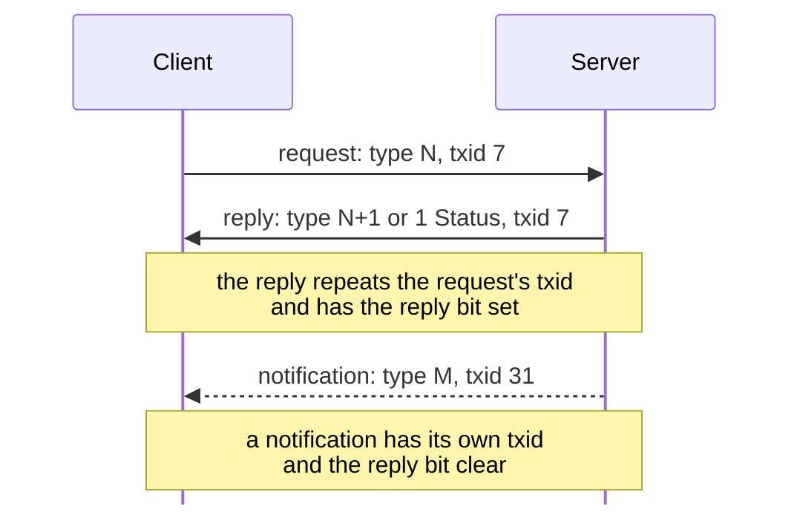

# KDX Protocol

This is the reference for the Haxial KDX protocol, as KDX Server 1.620, KDX
Client 1.600 and 1.620 beta 5, and Tracker 1.110 speak it. It comes from lab
captures and from static analysis of the binaries.

This page gives the shape of the protocol: the connection types, the message
header, and how requests and replies pair up. Each message has its own section
on the page for its area, linked below.

## Read in this order

1. [Conventions](#conventions), below: hex, byte order, and structs.
2. [handshake.md](handshake.md): how a connection starts, then
   [framing.md](framing.md): the encryption and the message header.
3. [sequences.md](sequences.md): whole exchanges, such as login.
4. [messages/README.md](messages/README.md): the index of every message type,
   then the page for the area you need.
5. [encodings.md](encodings.md) and [privileges.md](privileges.md): the shared
   record formats and the privilege bits the messages refer to.
6. [server.md](server.md), [transfers.md](transfers.md),
   [tracker.md](tracker.md) with [udp.md](udp.md), [dcc.md](dcc.md), and
   [gconsole.md](gconsole.md): one page for each kind of connection.

## Where to read

### Connections

| To learn about | Read |
|---|---|
| How a connection starts: hello, proof, challenge tables | [handshake.md](handshake.md) |
| Message encryption, framing, and the header scramble over TCP | [framing.md](framing.md) |
| The UDP datagram a server sends to register with a tracker | [udp.md](udp.md) |
| File transfers and view display on their own connection | [transfers.md](transfers.md) |
| The client-server connection | [server.md](server.md) |
| The tracker and its TCP browse connection | [tracker.md](tracker.md) |
| Client to client (DCC): private chat and voice | [dcc.md](dcc.md) |
| GConsole, the remote console | [gconsole.md](gconsole.md) |

### Message pages

| To learn about | Read |
|---|---|
| Every message type, with the connections that use it | [messages/README.md](messages/README.md) |
| Login, user list, server info, ping, SKPK (100 to 118) | [messages/session.md](messages/session.md) |
| The connection monitor (140 to 143) | [messages/monitoring.md](messages/monitoring.md) |
| Disconnects, broadcasts, settings, history (150 to 191) | [messages/administration.md](messages/administration.md) |
| Chat rooms (200 to 223) | [messages/chat.md](messages/chat.md) |
| Private messages (300 to 301) | [messages/private-messages.md](messages/private-messages.md) |
| File listings, folders, downloads, uploads, volumes, and search (400 to 453) | [messages/files.md](messages/files.md) |
| Accounts, classes, and passwords (502 to 551) | [messages/accounts.md](messages/accounts.md) |
| News (600 to 614) | [messages/news.md](messages/news.md) |
| Processes (800 to 804) | [messages/processes.md](messages/processes.md) |
| View display, the remote screen (900 to 905) | [messages/view-display.md](messages/view-display.md) |
| Voice between clients (1000 to 1003) | [messages/voice.md](messages/voice.md) |
| Folder access rules (1100 to 1107) | [messages/folder-access.md](messages/folder-access.md) |
| The [1 Status](messages/status.md#m1) reply, on every connection (1) | [messages/status.md](messages/status.md) |
| Error codes carried by 1 Status | [Error codes](messages/status.md#error-codes) |
| Tracker messages (700 to 721) | [messages/tracker.md](messages/tracker.md) |
| GConsole messages (4000 to 4201) | [messages/gconsole.md](messages/gconsole.md) |

### Reference

| To learn about | Read |
|---|---|
| Privilege bits | [privileges.md](privileges.md) |
| Whole exchanges: login, flood ban, posting news | [sequences.md](sequences.md) |
| Strings, times, paths, and the user and chat records | [encodings.md](encodings.md) |
| How the work is planned | [PLAN.md](../PLAN.md) |

## Conventions

These conventions apply to every page of the spec.

**Evidence.** The source of each page gives the evidence for each claim in an
HTML comment, which the rendered page hides. [Writing these
pages](#writing-these-pages) describes the format. When the evidence for a claim
is only an inference, the text says so with a word such as "probably".

**Hex.** A number with a `0x` prefix is hex, as in 0x40071. Struct offsets are
hex, and sizes are decimal. Ports, counts, and message types are decimal. A run
of bytes is hex pairs in a code span, as in `00 00`. A message is named by its
type and title, as in [412 Download File](messages/files.md#m412).

**Byte order.** All multi-byte numbers are big-endian, unless the page says
otherwise. The only exception is a placeholder in the UDP datagram, which is
little-endian; see [udp.md](udp.md).

**Structs.** A struct table describes each message payload, and each record
inside one. A message with no payload says `No payload.` instead.

A caption names each struct and gives its size: ``Struct `Name` (N bytes):`` for
a fixed size, or ``Struct `Name` (dynamic):`` otherwise. Where `kdx-proto` has a
type for the struct, the two names are the same. Each row of the table is one
field:

- **Off** is the offset from the start of the struct, in hex. After the first
  field of variable size, offsets are no longer fixed, so the column is empty.
- **Size** is the size in bytes. A field of variable size has one of these
  instead:
  - `rest`: the field runs to the end of the payload.
  - `pad4`: zero to three bytes, up to a multiple of 4 from the start of the
    struct.
  - The name of an earlier field that holds the length, in backticks. A `str`,
    a `u8[]`, or a single struct has a `<field>_len` that counts bytes. Any
    other array has a `<field>_count` that counts elements.
- **Type** is a primitive or the name of a struct. `[N]` after it makes an array
  of N elements, as in `u8[12]`, and `[]` makes an array of variable size. `str`
  is text of variable size. `str[N]` is N strings, whose lengths are the N
  elements of an earlier `u8[N]` field, as in `groups_len`.
- **Field** is the name of the field in backticks, the same as in `kdx-proto`
  where it has one.
- **Notes** holds anything else. "Rust `field`" names the `kdx-proto` field that
  a row is part of, and "not stored" marks a constant that `kdx-proto` checks
  but does not keep.

Length fields come at their offset on the wire. Fields of variable size follow
the order of their bytes, which can be different from the order of their
lengths, as in [203 Chat Window Info](messages/chat.md#m203).

The primitives are `u8`, `u16`, `u32`, `u48`, `u64`, `u128`, `i8`, `i16`,
`i32`, `i64`, and `char`. A `char` is one byte of ASCII, as in a magic. A `u48`
is a 6-byte number. Some lengths are two adjacent fields that together make one
48-bit number; such a length is one `u48` row, and its Notes say that it is
split.

All the elements of an array mean the same thing, such as the six group names in
`groups`. Bytes with different meanings are separate rows.

`kdx-proto` keeps each `str` as bytes. The text is UTF-8 in Client 1.2 and
later, and in servers of the same age. <!-- [S] --> Before 1.2, the text was in
a charset that the archives do not give, probably Mac OS Roman on a Mac and a
Windows code page on a PC. <!-- [I] --> Nothing in the protocol says which
charset a peer uses. [encodings.md](encodings.md#strings) has the evidence.

### Special field names

Bytes that `kdx-proto` does not keep as a field have one of these names:

| Name | Meaning |
|---|---|
| `ignored_NN` | The receiver never reads these bytes, so any value is accepted. NN is the hex offset. Notes say what is known about them, such as "0 as sent". If a struct has only one such row, its name is `ignored`. |
| `reserved_NN` | The receiver requires these bytes to be zero. If a struct has only one such row, its name is `reserved`. |
| `padding` | Zero to three bytes, up to a multiple of 4. |
| `<field>_len` | The length in bytes of the later field `<field>`. |
| `<field>_count` | The number of elements in the later array `<field>`. |

This example is a record with ignored and reserved bytes, a name, and padding:

Struct `ExampleRecord` (dynamic):

| Off | Size | Type | Field | Notes |
|---|---|---|---|---|
| 0x00 | 4 | u32 | `user_id` |  |
| 0x04 | 2 | u8[2] | `ignored` |  |
| 0x06 | 2 | u8[2] | `reserved` |  |
| 0x08 | 1 | u8 | `name_len` |  |
| 0x09 | `name_len` | str | `name` |  |
|  | pad4 | u8[] | `padding` |  |

**Diagrams.** A sequence diagram shows an exchange of messages. A solid arrow is
a request or its reply. A dashed arrow is a notification or file data.

## Protocol overview

KDX is a client-server system for chat, private messages, file sharing, news,
and server administration. Trackers list servers.

Each connection starts with a hello from each side. The hello names a protocol,
a sub-protocol, and a sub-version. The protocol is always `%TXP`. The
sub-protocol is `%KDX`, or `%HGC` for GConsole. The sub-version tells what the
sender is, and thus what kind of connection the receiver has:

| Sub-protocol | Sub-version | The sender is | Connection | Page |
|---|---|---|---|---|
| `%KDX` | 0x10 | a client | client to client (DCC) | [dcc.md](dcc.md) |
| `%KDX` | 0x20 | a server | client to server | [server.md](server.md) |
| `%KDX` | 0x30 | a tracker | client to tracker | [tracker.md](tracker.md) |
| `%HGC` | 0x40 | a GConsole peer | client to GConsole | [gconsole.md](gconsole.md) |

A client always sends 0x10, and learns what it has reached from the hello that
comes back. Each type of server accepts only the sub-versions that it serves. It
rejects the others with 0x40071, 0x40072, or 0x40073; see
[handshake.md](handshake.md#connection-types).

| Port | Transport | Use |
|---|---|---|
| 10600 | TCP | Client to client (DCC): private chat and voice. The client gives its port in its user record. <!-- [S; O] --> See [dcc.md](dcc.md). |
| 10700 | TCP | Client to server: all messages, and file transfers on more connections. <!-- [O] --> See [server.md](server.md). |
| 10800 | UDP, TCP | Tracker: server registration over UDP ([udp.md](udp.md)), and the server list over TCP ([tracker.md](tracker.md)). <!-- [S] --> |
| 10900 | TCP | GConsole, a Haxial remote console that the client can open. No KDX server or tracker serves it. <!-- [S] --> See [gconsole.md](gconsole.md). |

A connection has two phases:

1. **Handshake.** Each side sends a hello in cleartext. The hello holds the
   protocol `%TXP`, a sub-protocol, a version, a sub-version, a nonce, and the
   login name. Then each side proves that it knows the account key and a
   challenge table built into the programs. See [handshake.md](handshake.md).
2. **Session.** All later messages are a 16-byte header and a payload.
   Twofish-256 in ECB mode encrypts each block, with the account key as the key.
   See [framing.md](framing.md).

## Messages

### Header

Each message starts with a 16-byte header. The header holds these fields:

- the txid (4 bytes). It is not zero. Each side counts up from its own random
  start.
- the message type (4 bytes)
- a zero byte
- a flags byte. Bit 0 is set in a reply.
- the payload length, a 48-bit number (`u48`)

The payload is padded to a multiple of 16 before encryption, and the length
gives its real size. [framing.md](framing.md#header) has the full `Header`
struct, and the [length limits](framing.md#length-limits) for each type of
connection.

### Requests, replies, and notifications



- A **request** has the next txid of the sender, and the reply bit (bit 0 of the
  flags byte) is clear.
- A **reply** has the txid of its request, and the reply bit is set. The server
  sets the bit only when it answers a request. <!-- [S; O] FUN_080863b4 receives
  the request's txid. -->
- A **notification** is a message that the server sends on its own. It has its
  own txid, and the reply bit is clear. For example, when a user logs in, the
  server sends [103 User Joined](messages/session.md#m103) to all other
  users. <!-- [O] -->
- The server handles only messages with a clear reply bit. It drops replies from
  a client. <!-- [S `FUN_080528c8`] -->
- All messages reset the idle timer of the sender, except [108
  Ping](messages/session.md#m108), [142 Get Connection Monitor
  Info](messages/monitoring.md#m142), and [609 Get News
  Message](messages/news.md#m609). <!-- [S `FUN_080528c8`] -->

Message types come in pairs: request N gets reply N+1. If a request fails, the
reply is [1 Status](messages/status.md#m1) instead. Some requests get no reply
when they succeed. <!-- [S; O] -->

## Message types

[messages/README.md](messages/README.md) lists all message types. For each type,
it gives the connection that carries it, the sender, and the page that describes
it. The names come from the name table in the server. <!-- [S] FUN_08049d14,
jump table at 0x080abc6c. --> In those names, (R) means reply, (D) data, (C)
complete, and (S) status. The server ignores a type that it does not know, and
sends no reply. <!-- [S] --> Types 4000 to 4201 belong to GConsole, not to the
server, so their names are provisional; see [gconsole.md](gconsole.md).

## Not yet documented

- [1003 Voice Data](messages/voice.md#m1003) between clients comes from static
  analysis only. The voice call in `captures/linux-dcc-voice-failed.pcapng`
  fails before any voice data, so no capture shows it. See [dcc.md](dcc.md).

## Writing these pages

These rules are for writers. `ci/check-docs.py` enforces most of them.

### Evidence tags

Each claim has a tag for its evidence, in an HTML comment right after the claim:

- `[O]`: seen in a capture or a lab probe. The lab probes are in
  `captures/probe.pcapng`; see `captures/probe.md`.
- `[S]`: read in a binary, with the function address when there is one.
- `[I]`: inferred, from neither of the above directly.

A tag gives its evidence in the order S, I, O, with semicolons between them, as
in this example:

```
<!-- [S `FUN_08085a04`, `FUN_0808584c`; I; O `captures/probe.pcapng` frames 3 to 9] -->
```

The S part names the functions, with commas between them. A binary name (client,
server, or tracker) can come before a function. Each O part names a capture and
its frames: `frame 7`, `frames 7, 9`, or `frames 7 to 9`. Leave out the capture
when the page already names it, and leave out the frames when the whole capture
shows the fact. Start a new O part for each capture. Put no other text inside
the brackets. A remark, such as "not captured", can follow the brackets inside
the comment.

A heading's tag goes on its own line below the heading. A struct row with no tag
shares the tag of its message's `Initiator:` line.

### Structs

- Put a caption line, a blank line, and then the table. Write N in decimal. Use
  a CamelCase name that is unique across `docs/protocol/`, and the Rust type
  name from `crates/kdx-proto/src/msg/` when there is one. Define a record in
  the section where it first appears.
- The header row is exactly `| Off | Size | Type | Field | Notes |`, and the
  separator is `|---|---|---|---|---|`.
- Offsets are lowercase `0x` hex. Each offset is the previous offset plus the
  previous size, until the first row of variable size.
- A fixed row's size is the size of its primitive or fixed struct, times N in
  `[N]`.
- A `[]` row has a size of `rest`, `pad4`, or an earlier field name. No row
  follows a `rest` row. A row that is not an array has an empty size only when
  its type is a dynamic struct.
- The last offset plus size of a fixed struct equals N in its caption. A struct
  with a row of variable size says `(dynamic)`, and a struct that says
  `(dynamic)` has one.
- Each type name has a caption somewhere.
- Each field name is unique in its table. If `kdx-proto` defines the struct,
  each Rust field is a field or is named in a Notes cell. Each field is a Rust
  field, a length, `ignored_NN`, `reserved_NN`, or `padding`, or its Notes say
  why it is not.
- Any table in `docs/` whose first column is Off, or whose first row starts at
  0x00, lays out bytes. It must have the struct header row and a caption.
- A message section is a heading `## <a id="mNNN"></a>NNN Name` with exactly one
  message anchor. The payload check does not apply to headings with more than
  one anchor, or to other headings.

### Diagrams

On a message page, the diagram of a message's exchange comes first in its
section: after the `Initiator:` paragraph, and before the struct table.
