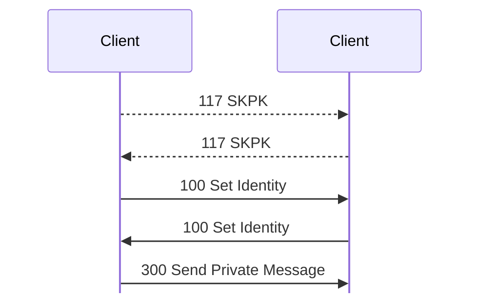
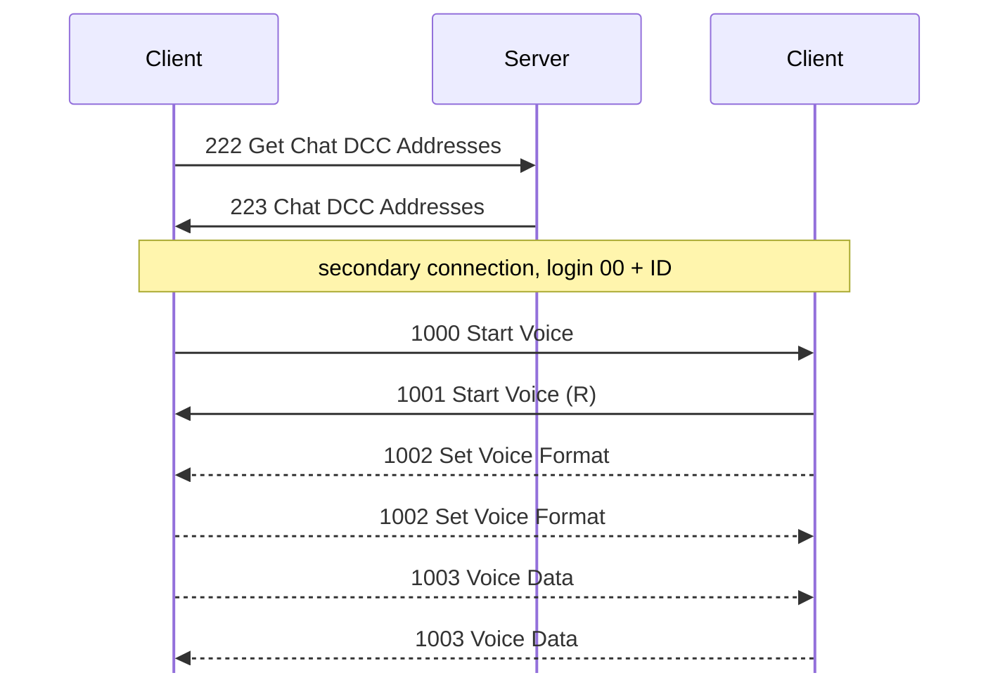

# Client-to-client (DCC) and voice

For hex and field notation, see [Conventions](README.md#conventions).

KDX Client 1.620 beta 5 for Linux has its own listener for direct connections
between clients, which the client calls DCC. Private chat and voice use it. Most
of this page comes from the client's code. <!-- [S] --> In
`captures/linux-dcc-voice-failed.pcapng`, two copies of that client talk to each
other, up to a voice call that fails before any voice data. <!-- [O] --> Frame
numbers on this page are from that capture.

## Listener

When its preference is on, the client listens on TCP port 10600 by
default. <!-- [S `FUN_0808fae4`] --> It puts that port in its [user
record](encodings.md#user-record) at offset 0x0a, so the server can give it out
in [223 Chat DCC Addresses](messages/chat.md#m223). With the listener off, the
port is 0. <!-- [S `FUN_0804d654`] --> The client can also ask a UPnP router for
a TCP mapping named `KDXClientDCC`. <!-- [S `FUN_08090344`] --> That is the
client's only use of UDP.

A DCC connection uses the same handshake as a server connection; see
[handshake.md](handshake.md). It has sub-protocol `%KDX`, sub-version 0x10 (the
only one it accepts), and the same challenge table, and its messages are framed
and encrypted as [framing.md](framing.md) describes. <!-- [S `FUN_0808f77c`] -->
The listener accepts a payload of at most 0x80000 bytes, and fewer than 6
connections from one address.

## Logins

The login callback is `FUN_0808efcc`: <!-- [S] -->

- **An empty login makes a primary connection.** The listener checks the proof
  with the key of the empty password. Then it makes the connection's own key K:
  the key of the empty password, with a random value in place of its first u32.
- **`00` and a u32 connection ID (5 bytes) make a secondary connection.** The
  connection attaches to the primary connection with that ID. The listener
  checks the proof with that connection's K, and the peer must connect from the
  same address. Voice uses this.

This is like the server's transfer connections, which attach to a session with a
login of `00` and an ID.

In the capture, a login named `admin` gets a proof with status 1, and closes
(frames 1 to 11). The empty login opens a primary connection (frames 13 to 28).
`00 00000002` and `00 00000004` open secondary connections, whose proofs match
with the peer's K from [117 SKPK](messages/session.md#m117) (frames 30 to 42 and
125 to 141). <!-- [O] -->

## Primary connection

After the login, each side sends [117 SKPK](messages/session.md#m117), then [100
Set Identity](messages/session.md#m100) with a normal user record. <!-- [S
`FUN_0808f3e0`; O frames 22 to 26] --> Then the primary connection handles these
messages: <!-- [S] -->

| Type | Handler | Action |
|---:|---|---|
| [1 Status](messages/status.md#m1) | | status |
| [100 Set Identity](messages/session.md#m100) | `FUN_0808fbc0` | the peer's nick, icon, and info |
| [117 SKPK](messages/session.md#m117) | `FUN_0808ff64` | see [117 SKPK](messages/session.md#m117) |
| [300 Send Private Message](messages/private-messages.md#m300) | | a chat line: a u32, 12 bytes, then the text, more than 0x10 bytes in all |

The [300 Send Private Message](messages/private-messages.md#m300) in frame 28 is
u32 1, 12 zero bytes, and then "dcc message body". <!-- [O] -->

This is the exchange after the login, up to a chat line (frames 22 to 28):

A user opens a primary connection from the Connect dialog, with Type "Client".
When a user joins a voice chat, the client also opens one to each address in
[223 Chat DCC Addresses](messages/chat.md#m223): the member who joins calls the
members who are already there (frames 108 to 123). If the user joins again while
those connections are open, the client opens none (frames 148 to 155). <!-- [O]
--> The listener of the user who joins is not needed.

## Voice

A voice chat is a server chat with flag bit 1 set; see the [chat
record](encodings.md#chat-record). When the client joins, it sends [222 Get Chat
DCC Addresses](messages/chat.md#m222), and gets the `ip:port` of each other
member. Then voice runs over TCP between the clients, not over UDP.

The caller opens a secondary connection to the peer's DCC port. The login is
`00` and the connection ID from the peer's [117 SKPK](messages/session.md#m117)
(0x24), with the peer's key K. <!-- [S `FUN_08092240`] --> After the login:

1. The caller sends [1000 Start Voice](messages/voice.md#m1000).
2. The peer answers with [1001 Start Voice (R)](messages/voice.md#m1001).
3. If the value in [1001 Start Voice (R)](messages/voice.md#m1001) is 0, both
   sides send [1002 Set Voice Format](messages/voice.md#m1002). If not, the
   caller stops.
4. Both sides send [1003 Voice Data](messages/voice.md#m1003) while they record.

The capture confirms steps 1 to 3. <!-- [O] --> With the peer's Voice Controls
closed, the peer answered [1000 Start Voice](messages/voice.md#m1000) with [1001
Start Voice (R)](messages/voice.md#m1001) 0x00640007 (frames 39 and 40). With
them open, it answered 0, and then both sides sent 1002 (frames 134 to 138). The
lab sandbox has no sound devices, so each client answered the other's [1002 Set
Voice Format](messages/voice.md#m1002) with status 0x10004 (unimplemented), and
logged "Operation is unimplemented. (ID 1/4 @ S101)" (frames 139 to 141). So no
[1003 Voice Data](messages/voice.md#m1003) was sent.

## Open questions

- Capture [1003 Voice Data](messages/voice.md#m1003). It could not start in the
  sandbox; see `.scratch/capture-gaps/issues/07-dcc-voice.md`.
