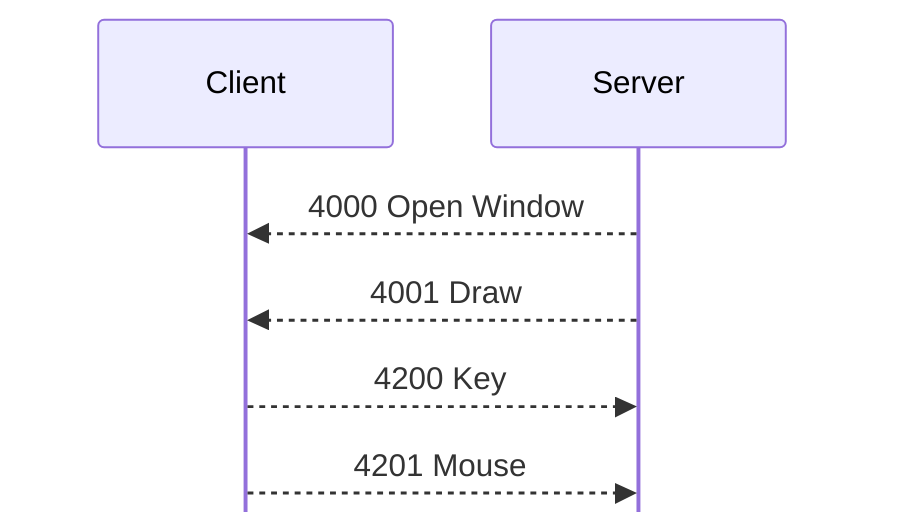

# GConsole

For hex and field notation, see [Conventions](README.md#conventions).

GConsole is a Haxial remote console. It is connection type 4 in the client's
Connect dialog, on TCP port 10900; see
[handshake.md](handshake.md#connection-types). `FUN_08095c84` handles the
client's side. <!-- [S] --> No KDX server or tracker has GConsole, and the
clients are only the display end. They check for a `%HGC` hello, but never send
one. They handle [4000 Open Window](messages/gconsole.md#m4000) and [4001
Draw](messages/gconsole.md#m4001), but never send them. <!-- [S] -->

## Handshake

The client sends its usual hello (`%KDX`, sub-version 0x10), with the login from
the GConsole Login dialog. The peer's hello decides the type of connection; see
[handshake.md](handshake.md#connection-types). A GConsole peer sends `%HGC`
(0x25484743) with sub-version 0x40. <!-- [S `FUN_0804b824`] --> `%HGC` with any
other sub-version fails with 0x40072 (lower) or 0x40073 (higher). On `%HGC`,
before the client checks the peer's proof, it changes the connection to a second
challenge table and a second header scramble: <!-- [S `FUN_0804b824`] -->

- The challenge table is the [GConsole story](handshake.md#the-gconsole-story),
  which only the clients hold. The client uses it exactly as it uses the KDX
  story; see [Challenge tables](handshake.md#challenge-tables). In
  `captures/linux-gconsole.pcapng`, the peer's challenge, 2832 (frame 6), is
  past the end of the KDX story, and the client's proof answers it from the
  GConsole story (frame 8). <!-- [O] -->
- The header scramble (`FUN_0809aefc`) has the shape of the [`%KDX`
  scramble](framing.md#header-scramble), with other rotations and masks. Before
  encryption, it changes the header words h0 to h3 to these values:

  | Word | Value |
  |---|---|
  | 0 | `rotl(h1, 15) ^ 0x5f547a17` |
  | 1 | `rotr(h2, 4) ^ 0x69c83e35` |
  | 2 | `rotl(h0, 7) ^ 0x1b20e200` |
  | 3 | `rotr(h3, 5) ^ 0x8022e8d1` |

All else follows the `%KDX` handshake and session. When the proofs are correct,
the client shows "Logged in. Opening GConsole...".

## Messages

[messages/gconsole.md](messages/gconsole.md) describes the messages. The peer
opens the window and draws, and the client sends its input back. The diagram
shows the peer as Server:

## Compared with view display

View display (900 to 905) and GConsole both show a remote screen in a client
window, and send input back. They have little else in common: <!-- [S] -->

| | View display | GConsole |
|---|---|---|
| Peer | a KDX server, on a transfer connection to its port | any program that answers `%HGC` on port 10900 |
| Access | privileges 66 and 67. [902 View Display Params](messages/view-display.md#m902) says if input is allowed. | the GConsole login |
| Size | in each [903 View Display Update](messages/view-display.md#m903). A new size allocates a new frame buffer. | once, in [4000 Open Window](messages/gconsole.md#m4000) |
| Picture | the server's whole screen as RGB555 pixels, compared with the last frame, and compressed with runs and two-color codes | draw records into objects: fills, gradients, lines, polygons, text, and copies. Colors are u32, with a transparency byte. |
| Updates | on a timer every 1500 ms, and less than 100 ms after a click or key | whenever the peer sends [4001 Draw](messages/gconsole.md#m4001) |
| Mouse | [904 View Display Mouse](messages/view-display.md#m904): kinds 1 down, 2 up, 3 move, 4 wheel | [4201 Mouse](messages/gconsole.md#m4201): kinds 5 down, 6 up, 10 wheel, and no moves |
| Keyboard | [905 View Display Keyboard](messages/view-display.md#m905): kinds 1, 2, 3 | [4200 Key](messages/gconsole.md#m4200): kinds 1, 2, 3 |

The input messages carry the same client input event. <!-- [S `FUN_0806fc68`,
`FUN_0806f1f4`, `FUN_08096188`, `FUN_0809607c`] --> 904 and 4201 send its
modifiers, x, y, button, and wheel. 905 and 4200 send its modifiers, character,
and key code. GConsole adds the client's clock and a 4-byte character, and
leaves out moves. The servers make the event again from 904 and 905. <!-- [S
`FUN_0805c344`, `FUN_0805c498`] --> No GConsole record uses the 903 decoder,
which only the 903 handler calls. <!-- [S `FUN_0806f864`] -->

The servers grab the screen into 32-bit pixels: a zero byte, then red, green,
and blue. <!-- [S `FUN_0041ffd0`] --> This is the layout of a 4001 color, so
both are probably Haxial's one image format. <!-- [I] -->

## Open questions

- What do the u16 at 0x02 of kinds 100, 101, 103, and 105 to 109, and the 8
  bytes at 0x0c of kinds 105 and 106, mean?
- What is kind 3 of [4200 Key](messages/gconsole.md#m4200) (window event 7)?
