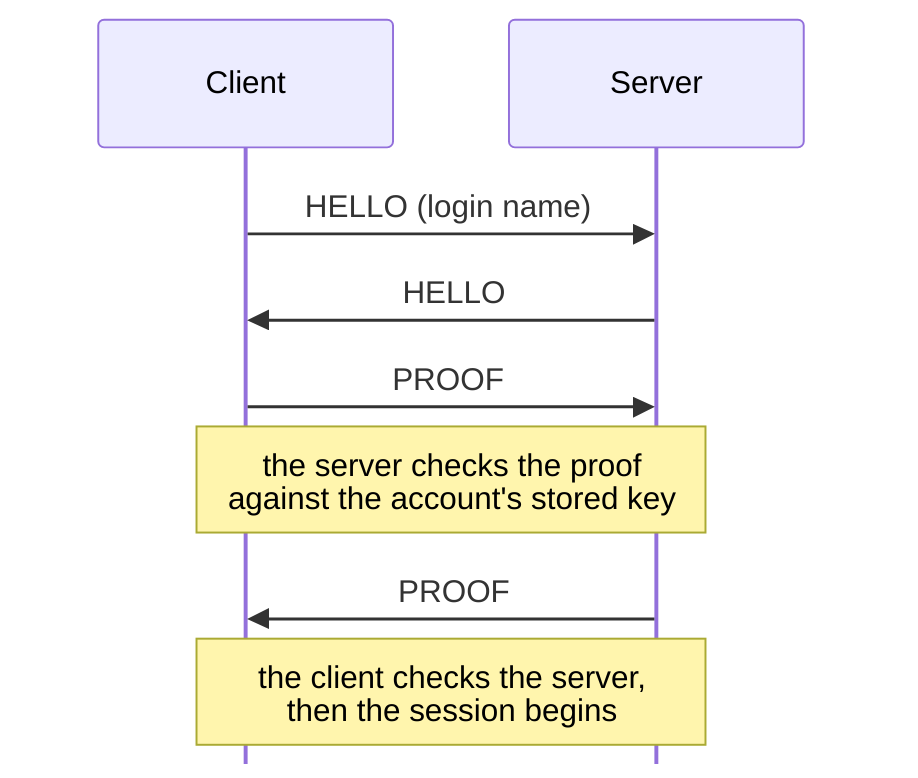
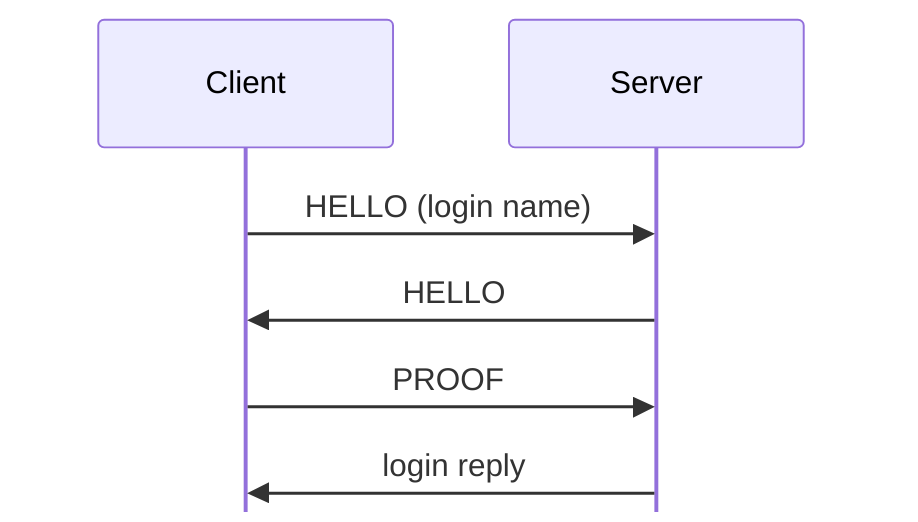

# Connection handshake and login

Tags, hex, and field notation: see [Conventions](README.md#conventions).

Every KDX TCP connection starts with a symmetric two-message handshake. It
also serves as login: the client proves it knows the account's
password-derived key, and the server proves it knows the same key. The
password itself never crosses the wire.

Evidence tags: **[O]** means observed in a capture, **[S]** means found
statically in a binary, **[I]** means inferred.
- Capture: `captures/first-connect.pcapng`. The Win32 Client 1.600 logs in as
  `admin` to Server 1.620. Frames 16 (C→S hello), 18 (S→C hello), 20 (C→S
  proof), 21 (S→C proof).
- Static: `KDXServer.lexe` 1.620 Linux. Addresses are virtual addresses in the
  Ghidra project (see `re/README.md`).

All multi-byte integers are big-endian.

## XOR layer

Both messages are sent as `key(4) | body`. `body` is a whole number of 32-bit
words, each XORed with a key stream **[S `FUN_080872f4`, `FUN_0808751c`; O]**:

```
k = key
for each 32-bit word w in body:  k = (k << 1) + 0x4878 (mod 2^32);  w ^= k
```

The stream runs continuously over the hello header and its body. The key is
random for the hello, and for the proof it equals the proof's first 4 bytes
(see below).

## Sequence



The client and server each send a hello, then each sends a proof. The server
checks the client's proof against the account's stored key, and the client
checks the server's proof, before the session begins.

**[O]** The server's hello waits for the client's hello. **[S]** The server
also sends its own hello before reporting an error, if it hasn't sent one yet.

## HELLO

Total length: `(name_len + pad_len + skipped_len + 0x27) & ~3`. It must be at
most 0x800 **[S `FUN_080876e8`]**.

Struct `Hello` (dynamic):

| Off | Size | Type | Field | Notes |
|---|---|---|---|---|
| 0x00 | 4 | u32 | key | not stored. Random XOR key, sent in the clear |
| 0x04 | 4 | char[4] | protocol | not stored. `"%TXP"` (0x25545850). Anything else gives error 0x40071 at TRN line 941 (lab probe) **[S; O]** |
| 0x08 | 4 | char[4] | sub_protocol | `"%KDX"` (0x254b4458) for client/server **[S; O]**; `"%HGC"` (0x25484743) from a GConsole peer, which a client accepts with sub-version 0x40 ([gconsole.md](gconsole.md#handshake)) **[S `FUN_0804b824`; O]** |
| 0x0c | 1 | u8 | version | `1`. A value of 0 means "peer too old" (0x40072), and >1 means "peer too new" (0x40073) **[S]** |
| 0x0d | 1 | u8 | sub_version | Client 1.600 and Client 1.620 beta 5 send `0x10`, Server 1.620 sends `0x20` **[O `captures/linux-first-connect.pcapng` frames 8, 10]**, Tracker 1.110 sends `0x30` **[S]**, and a GConsole peer `0x40` **[S; O]**. Server 1.620 and Tracker 1.110 accept only sub-protocol `%KDX` (else 0x40071) with sub-version exactly `0x10` (0x40072 below, 0x40073 above) in the version callback at +0x88 **[S server `0x080526e0`, tracker `FUN_0804bb4c`]** |
| 0x0e | 1 | u8 | pad_len | sent as 0 **[S; O]** |
| 0x0f | 1 | u8 | name_len | 0..31; the receiver keeps at most 31 bytes **[S `FUN_08085a04`]** |
| 0x10 | 4 | u8[4] | ignored | 0 as sent **[S `FUN_08085a04`; O]** |
| 0x14 | 2 | u16 | skipped_len | sent as 0 **[S; O]** |
| 0x16 | 2 | u16 | challenge | offset of the 0x14 bytes of the receiver's challenge table that the receiver's proof must echo; see Challenge tables **[S; O]** |
| 0x18 | 12 | u8[12] | nonce | per-connection value. It looks time-based (both sides' nonces share bytes) **[O]**. A peer that echoes our nonce is treated as a connection to ourselves and rejected (0x40074) **[S]** |
| 0x24 | pad_len | u8[] | pad | not stored. Bytes the receiver skips before the name **[S `FUN_08085a04`]** |
|  | skipped_len | u8[] | skipped | not stored. More bytes the receiver skips before the name **[S `FUN_08085a04`]** |
|  | name_len | str | name | login name (client) or empty (server 1.620) **[O]**. See "Login names" |
|  | pad4 | u8[] | padding |  |

The receiver adds `pad_len` and `skipped_len` and skips that many bytes, so
the split between `pad` and `skipped` is not visible on the wire
**[S `FUN_08085a04`]**.

The field names follow the server's error text: a wrong protocol or
sub-protocol raises 0x40071, "The network protocol is unknown", and a
version or sub-version out of range raises 0x40072 or 0x40073, "The
protocol version of the remote host is too OLD" or "…more recent"
**[S `FUN_08066d04`]**. The sub-version also tells the peer's role: 0x10 a
client, 0x20 a server, 0x30 a tracker, and 0x40 a GConsole peer.

## PROOF

Struct `Proof` (44 bytes):

| Off | Size | Type | Field | Notes |
|---|---|---|---|---|
| 0x00 | 20 | u8[20] | auth | the first 4 bytes double as the XOR key for the rest |
| 0x14 | 20 | u8[20] | response | the 20 bytes of the challenge table at the offset from the **peer's** hello |
| 0x28 | 1 | u8 | status | `0x10` OK, `2` unknown protocol or sub-protocol, `3` peer too old, `4` peer too new **[S]** |
| 0x29 | 3 | u8[3] | ignored | 0 as sent **[S `FUN_08085a04`; O]** |

Bytes 0x04..0x2b are XORed with the stream keyed by bytes 0..3.

When the status isn't OK, `auth` is all zeros except the key word, which is
`peer_nonce[4..8] XOR 0x201f7790` **[S `FUN_0808751c`]**.

Verified on both proofs in the capture, reproduced exactly **[O]**:

```
secret = account_key(password)                 # 32 bytes, below
n      = PEER's hello nonce                    # 12 bytes
input  = s[0:4] n[0:4] s[4:12] n[4:8] s[12:20] n[8:12] s[20:32]     # 44 bytes
d      = SHA-1(input)                          # 20 bytes
auth   = Twofish-256(key = secret).encrypt(d[0:16]) || d[16:20]
```

The receiver recomputes `auth` with its own nonce and compares all 20 bytes,
then compares the 20 challenge bytes with its own table **[S `FUN_08085a04`,
`FUN_0808584c`]**. A failure is error 0x40070.

### account_key(password) **[S `FUN_080669cc`; O]**

```
password empty: fixed bytes  da39a3ee caaebe6e 5e6b4b0d ba8e29ba 3255bfef 18a2b5c4 95601890 afd80709
otherwise:      d = SHA-1(password)
                d[0:20] || d[0:8] || BE32(fnv1(password, seed = 1))
fnv1(h, b) = (h * 0x01000193) ^ b   for each byte, starting at h = 1
```

The empty-password constant isn't what the formula gives for an empty input.
Words 0, 2, 4, 6 and 7 are the five words of SHA-1(""), and words 1, 3 and 5 are
other values. Use the bytes exactly as written above. Guest logins use it on
both sides (the `kdx` CLI on port 40434 in `kdx-news`, and Client 1.620 beta 5
in `linux-accounts-news`) **[O `captures/kdx-news.pcapng`; O
`captures/linux-accounts-news.pcapng` frames 94 to 100]**.

The server stores this 32-byte key per account, so the password can't be
recovered from `Accounts.dat` alone **[I]**.

## Connection types

The client's Connect dialog has a Type menu **[S `FUN_0804bac0`]**:

| Value | Type | Default port |
|---:|---|---:|
| 0 | Auto-Detect | none; needs a port |
| 1 | Server | 10700 |
| 2 | Client (DCC) | 10600, see [dcc.md](dcc.md) |
| 3 | Tracker | 10800, see [tracker.md](tracker.md) |
| 4 | GConsole | 10900, see [gconsole.md](gconsole.md) |

The peer's hello decides what kind of connection it is
**[S `FUN_0804b824`, `FUN_0804b938`]**:

| Sub-protocol | Sub-version | Connection |
|---|---:|---|
| `%KDX` | 0x10 | Client (DCC) |
| `%KDX` | 0x20 | Server |
| `%KDX` | 0x30 | Tracker |
| `%HGC` (0x25484743) | 0x40 | GConsole |

## Login names **[S `FUN_0805270c`]**

- Empty: the server substitutes `guest`.
- `0x00` followed by a big-endian 32-bit ID (name_len 5): this attaches to the
  existing session with that ID, using that session's key and requiring the
  same peer IP. It opens a file-transfer connection; see
  [transfers.md](transfers.md) **[S `FUN_0805270c`; O]**.
- Anything else: an account login. The account's stored key is used to check
  the proof.

## Challenge tables

Each connection object holds a pointer to its table at +0xa4 and the table's
length, a u16, at +0xa0 **[S client `FUN_080ea000`, server `FUN_0808529c`]**.
Everything that touches the table reads those two fields, so every table works
the same way in the client **[S]**:

- `FUN_080ec058` picks the challenge for our hello: a random offset modulo
  `len - 0x13`.
- `FUN_080ec280` answers the peer's challenge with the 20 bytes at its
  offset, if it is at most `len - 0x14`.
- `FUN_080ea768` checks the peer's response against the 20 bytes at our
  own challenge.

Both rules come to `offset + 0x14 <= len`, where `len` is the length of the
table that side holds when it acts. On a GConsole connection the client's
table changes between the two, as described below.

There are three tables:

| Table | Length | Used by |
|---|---:|---|
| the KDX story, below | 1739 (0x6cb) | every connection the client, server, and tracker create **[S]** |
| the GConsole story, below | 3193 (0xc79) | a client connection whose peer says `%HGC` 0x40 **[S `FUN_0804b824`; O]** |
| `All your base are belong to us!` | 31 (0x1f) | a connection created with no table; no caller in the client or server does that **[S `FUN_0808529c`]** |

Every connection starts with the KDX story, passed to the constructor
(client `FUN_080ea08c`, nine callers; server `FUN_08085328`, one caller in
`FUN_08052ad0`) **[S]**. The client swaps in the GConsole story after the
peer's hello, so the challenge it already sent was drawn from the KDX
story's length but is answered from the GConsole story. The 31-byte
default is in every client, server, and tracker build, but no caller in
Client 1.620 beta 5 or Server 1.620 passes a length of 0 **[S]**.

### The KDX story

A 1739-byte blob, identical in every client, server and tracker build
(SHA-256 `4fca7636e77e85fdde95862a6be66e12e5e031ad61add65c5e975d3daff4b9e7`).
It is a 1578-byte copyright notice and short story ("Sale of the Cesspool"),
a NUL, and 160 bytes that look like PowerPC code. In the 1.620 Linux server
it's at file offset `0x635a0`.

Extraction: find `This program including the following story`, take 1739
bytes from there, and check the SHA-256 above.

### The GConsole story

A 3193-byte blob, identical in the Linux, Windows, and Mac clients and in no
server or tracker (SHA-256
`b43f22222971a57a0d8bdb3a5af2747c7ff511ea88f0ba8c24e38e9edc029c36`). It is a
copyright notice and a second short story ("Who Wants To Be A Maggot?"),
with `\n` line ends, and its trailing NUL. In Client 1.620 beta 5 for Linux
it's at file offset `0x1029e0`.

Extraction: find `The following story is Copyright 2004`, take 3193 bytes
from there, and check the SHA-256 above.

### Getting the stories

The KDX and GConsole stories are Haxial's copyrighted text, so **don't
commit them**. The Rust implementation works like the binaries: a
`ChallengeTable` holds the 31-byte default, or a story substituted for it.
It treats each story as a required input, obtained once and cached in the
same directory, `~/.cache/kdx/table/`, under its sub-protocol with the `%`
dropped (`kdx.bin` and `hgc.bin`), by `kdx_client::table`:

1. Use the cached copy if one exists and its SHA-256 matches.
2. Otherwise, offer to fetch it. Download the smallest known Haxial archive
   that contains it (see `vendor/MANIFEST.md` for the Wayback URLs), and
   extract the story from it. For the KDX story that is
   `KDXTrackerServ1110-Win.zip` (248 KB); for the GConsole story, which only
   the clients hold, `KDXClient1600-Win.zip` (793 KB). Both are plain zips
   with no StuffIt.
3. Otherwise, ask the user for a KDX file to extract it from (zip archives
   are opened) or the story itself. Any build holds the KDX story; only a
   client holds the GConsole one.

`kdx table fetch`, `import`, and `path` handle both stories.

## Error codes **[S `FUN_08066fd8`, `FUN_08066c14`]**

Logged as `ID <hi>/<lo> @ <module><line>`. Here `<hi>/<lo>` are the two 16-bit
halves of the code, and the module tag is three ASCII bytes passed as an
integer (`0x54524e` is `TRN`, the transport module). So
`ID 4/113 @ TRN941` means code 0x40071 at TRN line 941 (unknown protocol).

The full code table is in [Error codes](messages/status.md#error-codes).
These are the codes the handshake raises:

| Code | Meaning (from log strings and call sites) |
|---|---|
| 0x40070 | authentication failed (bad proof or challenge) |
| 0x40071 | unknown protocol (protocol or sub-protocol mismatch) |
| 0x40072 | peer's protocol version too old |
| 0x40073 | peer's protocol version too new |
| 0x40074 | invalid protocol data; the handshake raises it for a nonce echo (a connection to ourselves) |
| 0x40075 | protocol limit exceeded; the handshake raises it for a hello over 0x800 bytes |

## Version 0.9x

The 2001 Mac builds and NetFone 1.400 use an older handshake with no XOR
layer, no Twofish, and no challenge table. A 0.9x peer can't talk to a 1.x
one. These are PowerPC PEF files from `KDX0921.sit.bin`,
`KDXTrackerServ0902.sit.bin`, and `NetFone1400-Mac.sit` in
`vendor/MANIFEST.md`. Addresses are in the Ghidra projects
`KDXServer0921-Mac`, `KDXClient0921-Mac`, and `KDXTrackerServ0902-Mac`,
imported as `re/README.md` describes.

### Sub-protocols

| Sub-protocol | Sub-version | Used by |
|---|---:|---|
| `%KDX` | 1 | Client and Server 0.915–0.921 **[S server `FUN_10005b40`, client `FUN_10000a50`]** |
| `%KDt` | 1 | Tracker 0.900 and 0.902, and Client 0.920 and 0.921 browsing a tracker **[S tracker `0x1000154c`, client `FUN_1001b410`]** |
| `%NFO` | 1 | NetFone 1.400: the tag and the argument 1 are at the same call shape as in the KDX programs, read from the raw code because Ghidra 12.1.4's PEF loader fails on NetFone's relocations **[I]** |

A peer must send the same sub-protocol and exactly the same sub-version,
else 0x40071 or 0x40072 / 0x40073 **[S `FUN_100350b0`]**. Clients
0.915–0.919 contain `%KDX` but no `%KDt` **[S]**.

### Sequence



The client sends its hello first, and the server answers after it has
checked the client's hello **[S `FUN_10035480`]**. Once the client has the
server's hello it sends its proof, and the server replies with one byte.

### HELLO **[S server `FUN_10034fc0`, `FUN_100350b0`, client `FUN_10057db0`, `FUN_10057ea0`]**

Sent in the clear. Total length: `skipped_len + name_len + 0x63`, at most
0x800 (else 0x40075).

Struct `Hello09x` (dynamic):

| Off | Size | Type | Field | Notes |
|---|---|---|---|---|
| 0x00 | 4 | char[4] | protocol | `"%TXP"`, else 0x40071 |
| 0x04 | 4 | char[4] | sub_protocol | see Sub-protocols |
| 0x08 | 1 | u8 | version | `1`; other values give 0x40072 / 0x40073 |
| 0x09 | 1 | u8 | sub_version | `1` |
| 0x0a | 1 | u8 | second_version | `1`; other values give 0x40072 / 0x40073 |
| 0x0b | 1 | u8 | name_len | the receiver keeps at most 31 bytes **[S `FUN_10035300`]** |
| 0x0c | 4 | u8[4] | ignored | 0 as sent |
| 0x10 | 2 | u16 | skipped_len | sent as 0 |
| 0x12 | 2 | u16 | string_len | `0x43`, else 0x40074 |
| 0x14 | 12 | u8[12] | nonce |  |
| 0x20 | skipped_len | u8[] | skipped | bytes the receiver skips before the string |
|  | string_len | str | string | `(c)2001 KDX.  All rights reserved.\r\rAll your base are belong to us!` |
|  | name_len | str | name | login name |

Each field sits 4 bytes before its 1.x place, where 1.x has the XOR key.
The byte that 1.x has at 0x0e is here the second version, and the 1.x
challenge at 0x16 is here the string length.

The receiver compares the peer's 0x43 bytes with its own and raises 0x40074
if they differ **[S `FUN_10035300`, `FUN_100351d0`]**. The 0.9x programs
contain neither story **[S]**. Client 0.921, Server 0.921, Tracker 0.902,
and NetFone 1.400 each load the string through their hello's TOC slot
**[S]**, and the 31-byte line that 1.x uses as its default table is the end
of it.

### PROOF **[S server `FUN_100351d0`, `FUN_10035480`, `FUN_100353a0`]**

The client sends a 20-byte proof:

Struct `Proof09x` (20 bytes):

| Off | Size | Type | Field | Notes |
|---|---|---|---|---|
| 0x00 | 20 | u8[20] | proof | SHA-1 of the key followed by the receiver's nonce |

The key is the account's 32-byte key, which the server gets from its login
callback. The server answers with one byte:

Struct `ProofReply09x` (1 bytes):

| Off | Size | Type | Field | Notes |
|---|---|---|---|---|
| 0x00 | 1 | u8 | status | `0x10` OK, `1` failed |

A client that gets any reply but 0x10 raises 0x40070. Both sides then pass
the key to `FUN_1000c1f0` **[S]**, probably a cipher's key schedule **[I]**.
Only Server 0.921's proof code has been read. The client and tracker have
the same hello code **[S]**, so probably the same proof **[I]**. Whether the
32-byte key matches 1.x's `account_key` is unknown.
