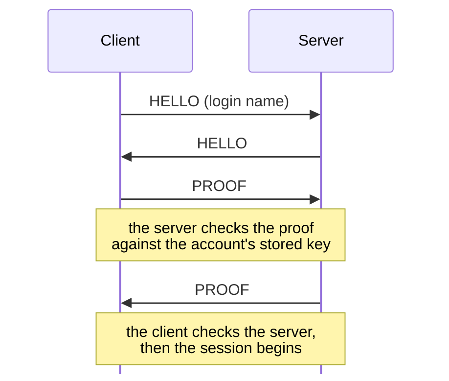
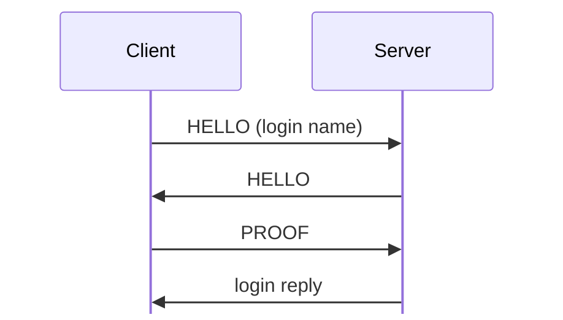

# Connection handshake and login

For hex and field notation, see [Conventions](README.md#conventions).

Each KDX TCP connection starts with a handshake of two messages from each side.
The handshake is also the login: the client proves that it knows the key derived
from the account's password, and the server proves that it knows the same key.
The password itself never goes over the wire.

The examples on this page come from `captures/first-connect.pcapng`, where Win32
Client 1.600 logs in as `admin` to Server 1.620. Frame 16 is the client's hello,
18 the server's hello, 20 the client's proof, and 21 the server's proof.
Addresses are virtual addresses in the Ghidra project for the Linux
`KDXServer.lexe` 1.620; see `re/README.md`.

## XOR layer

Each handshake message is a 4-byte key, then a body. The body is a whole number
of 32-bit words, and each word is XORed with a key stream: <!-- [S
`FUN_080872f4`, `FUN_0808751c`; O] -->

```
k = key
for each 32-bit word w in body:  k = (k << 1) + 0x4878 (mod 2^32);  w ^= k
```

The stream runs without a break over the hello header and its body. A hello's
key is random. A proof's key is its own first 4 bytes; see [PROOF](#proof).

## Sequence



The client and the server each send a hello, and then each sends a proof. The
server checks the client's proof against the key it stores for the account. The
client checks the server's proof, and then the session starts.

The server sends its hello only after it gets the client's hello. <!-- [O] -->
If the server must report an error before it has sent its hello, it sends the
hello first. <!-- [S] -->

## HELLO

The total length is `(name_len + pad_len + skipped_len + 0x27) & ~3`, and it
must be at most 0x800. <!-- [S `FUN_080876e8`] -->

Struct `Hello` (dynamic):

| Off | Size | Type | Field | Notes |
|---|---|---|---|---|
| 0x00 | 4 | u32 | `key` | not stored. The random XOR key, sent in the clear. |
| 0x04 | 4 | char[4] | `protocol` | not stored. `"%TXP"` (0x25545850). Any other value gives error 0x40071 at TRN line 941. <!-- [S; O] lab probe --> |
| 0x08 | 4 | char[4] | `sub_protocol` | `"%KDX"` (0x254b4458) between a client and a server. <!-- [S; O] --> A GConsole peer sends `"%HGC"` (0x25484743), which a client accepts with sub-version 0x40; see [gconsole.md](gconsole.md#handshake). <!-- [S `FUN_0804b824`; O] --> |
| 0x0c | 1 | u8 | `version` | `1`. 0 means that the peer is too old (0x40072), and more than 1 means that it is too new (0x40073). <!-- [S] --> |
| 0x0d | 1 | u8 | `sub_version` | Client 1.600 and Client 1.620 beta 5 send `0x10`, and Server 1.620 sends `0x20`. <!-- [O `captures/linux-first-connect.pcapng` frames 8, 10] --> Tracker 1.110 sends `0x30`, <!-- [S] --> and a GConsole peer sends `0x40`. <!-- [S; O] --> Server 1.620 and Tracker 1.110 accept only sub-protocol `%KDX` (else 0x40071) with sub-version exactly `0x10` (else 0x40072 below, 0x40073 above). <!-- [S server `0x080526e0`, tracker `FUN_0804bb4c`] version callback at +0x88 --> |
| 0x0e | 1 | u8 | `pad_len` | 0 as sent. <!-- [S; O] --> |
| 0x0f | 1 | u8 | `name_len` | 0 to 31. The receiver keeps at most 31 bytes. <!-- [S `FUN_08085a04`] --> |
| 0x10 | 4 | u8[4] | `ignored` | 0 as sent. <!-- [S `FUN_08085a04`; O] --> |
| 0x14 | 2 | u16 | `skipped_len` | 0 as sent. <!-- [S; O] --> |
| 0x16 | 2 | u16 | `challenge` | The offset of the 0x14 bytes in the receiver's challenge table that the receiver's proof must echo; see [Challenge tables](#challenge-tables). <!-- [S; O] --> |
| 0x18 | 12 | u8[12] | `nonce` | A value for each connection. It seems to come from the time, because the two sides' nonces share bytes. <!-- [O] --> If the peer echoes our own nonce, we have connected to ourselves, and we reject the connection with 0x40074. <!-- [S] --> |
| 0x24 | `pad_len` | u8[] | `pad` | not stored. Bytes that the receiver skips before the name. <!-- [S `FUN_08085a04`] --> |
|  | `skipped_len` | u8[] | `skipped` | not stored. More bytes that the receiver skips before the name. <!-- [S `FUN_08085a04`] --> |
|  | `name_len` | str | `name` | The login name from a client. Server 1.620 sends it empty. <!-- [O] --> See [Login names](#login-names). |
|  | pad4 | u8[] | `padding` |  |

The receiver adds `pad_len` and `skipped_len` and skips that many bytes, so the
wire does not show how the bytes split between `pad` and `skipped`. <!-- [S
`FUN_08085a04`] -->

The field names follow the server's error text. A wrong protocol or sub-protocol
gives 0x40071, "The network protocol is unknown". A version or sub-version out
of range gives 0x40072 or 0x40073, "The protocol version of the remote host is
too OLD" or "…more recent". <!-- [S `FUN_08066d04`] --> The sub-version also
tells the peer's role: 0x10 is a client, 0x20 a server, 0x30 a tracker, and 0x40
a GConsole peer.

## PROOF

Struct `Proof` (44 bytes):

| Off | Size | Type | Field | Notes |
|---|---|---|---|---|
| 0x00 | 20 | u8[20] | `auth` | The first 4 bytes are also the XOR key for the rest. |
| 0x14 | 20 | u8[20] | `response` | The 20 bytes of the challenge table at the offset that the **peer's** hello gives. |
| 0x28 | 1 | u8 | `status` | `0x10` OK, `2` unknown protocol or sub-protocol, `3` peer too old, `4` peer too new. <!-- [S] --> |
| 0x29 | 3 | u8[3] | `ignored` | 0 as sent. <!-- [S `FUN_08085a04`; O] --> |

Bytes 0x04 to 0x2b are XORed with the stream whose key is bytes 0 to 3.

If the status is not OK, `auth` is all zeros, except the key word, which is
`peer_nonce[4..8] XOR 0x201f7790`. <!-- [S `FUN_0808751c`] -->

This computation gives both proofs in the capture exactly: <!-- [O] -->

```
secret = account_key(password)                 # 32 bytes, below
n      = PEER's hello nonce                    # 12 bytes
input  = s[0:4] n[0:4] s[4:12] n[4:8] s[12:20] n[8:12] s[20:32]     # 44 bytes
d      = SHA-1(input)                          # 20 bytes
auth   = Twofish-256(key = secret).encrypt(d[0:16]) || d[16:20]
```

The receiver computes `auth` again with its own nonce and compares all 20 bytes.
Then it compares the 20 challenge bytes with its own table. <!-- [S
`FUN_08085a04`, `FUN_0808584c`] --> If either check fails, the error is 0x40070.

### account_key(password)

<!-- [S `FUN_080669cc`; O] -->

```
password empty: fixed bytes  da39a3ee caaebe6e 5e6b4b0d ba8e29ba 3255bfef 18a2b5c4 95601890 afd80709
otherwise:      d = SHA-1(password)
                d[0:20] || d[0:8] || BE32(fnv1(password, seed = 1))
fnv1(h, b) = (h * 0x01000193) ^ b   for each byte, starting at h = 1
```

The constant for an empty password is not what the formula gives for an empty
input. Words 0, 2, 4, 6, and 7 are the five words of SHA-1(""), and words 1, 3,
and 5 are other values. Use the bytes exactly as they are above. Both sides of a
guest login use them. <!-- [O `captures/kdx-news.pcapng`; O
`captures/linux-accounts-news.pcapng` frames 94 to 100] the kdx CLI on port
40434, and Client 1.620 beta 5 -->

The server stores this 32-byte key for each account, so `Accounts.dat` alone
does not give the password. <!-- [I] -->

## Connection types

The client's Connect dialog has a Type menu: <!-- [S `FUN_0804bac0`] -->

| Value | Type | Default port |
|---:|---|---:|
| 0 | Auto-Detect | none; needs a port |
| 1 | Server | 10700 |
| 2 | Client (DCC) | 10600, see [dcc.md](dcc.md) |
| 3 | Tracker | 10800, see [tracker.md](tracker.md) |
| 4 | GConsole | 10900, see [gconsole.md](gconsole.md) |

The peer's hello decides the type of connection: <!-- [S `FUN_0804b824`,
`FUN_0804b938`] -->

| Sub-protocol | Sub-version | Connection |
|---|---:|---|
| `%KDX` | 0x10 | Client (DCC) |
| `%KDX` | 0x20 | Server |
| `%KDX` | 0x30 | Tracker |
| `%HGC` (0x25484743) | 0x40 | GConsole |

## Login names

<!-- [S `FUN_0805270c`] -->

- An empty name: the server uses `guest`.
- `0x00` and then a 32-bit ID (name_len 5): the connection attaches to the
  session that has that ID. It uses that session's key, and must come from the
  same IP address. This opens a file transfer connection; see
  [transfers.md](transfers.md). <!-- [S `FUN_0805270c`; O] -->
- Any other name: an account login. The server checks the proof with the key
  that it stores for the account.

## Challenge tables

Each connection object holds a pointer to its table at +0xa4, and the table's
length, a u16, at +0xa0. <!-- [S client `FUN_080ea000`, server `FUN_0808529c`]
--> All code that uses the table reads these two fields, so all tables work the
same way in the client: <!-- [S] -->

- `FUN_080ec058` picks the challenge for our hello: a random offset, modulo `len
  - 0x13`.
- `FUN_080ec280` answers the peer's challenge with the 20 bytes at its offset,
  if the offset is at most `len - 0x14`.
- `FUN_080ea768` checks the peer's response against the 20 bytes at our own
  challenge.

Both rules come to `offset + 0x14 <= len`, where `len` is the length of the
table that the side holds at that time. On a GConsole connection, the client
changes its table between the two steps, as described below.

There are three tables:

| Table | Length | Used by |
|---|---:|---|
| [the KDX story](#the-kdx-story) | 1739 (0x6cb) | all connections that the client, server, and tracker make <!-- [S] --> |
| [the GConsole story](#the-gconsole-story) | 3193 (0xc79) | a client connection whose peer sends `%HGC` 0x40 <!-- [S `FUN_0804b824`; O] --> |
| `All your base are belong to us!` | 31 (0x1f) | a connection made with no table. No caller in the client or server does that. <!-- [S `FUN_0808529c`] --> |

Each connection starts with the KDX story, which goes to the
constructor. <!-- [S] client FUN_080ea08c, nine callers; server FUN_08085328,
one caller in FUN_08052ad0 --> After the peer's hello, the client changes to the
GConsole story. So the client picked the challenge that it sent from the KDX
story's length, but answers it from the GConsole story. All client, server, and
tracker builds hold the 31-byte default, but no caller in Client 1.620 beta 5 or
Server 1.620 gives a length of 0. <!-- [S] -->

### The KDX story

A blob of 1739 bytes, the same in all client, server, and tracker builds
(SHA-256 `4fca7636e77e85fdde95862a6be66e12e5e031ad61add65c5e975d3daff4b9e7`). It
is a copyright notice and short story of 1578 bytes ("Sale of the Cesspool"), a
NUL, and 160 bytes that look like PowerPC code. In the 1.620 Linux server, it is
at file offset `0x635a0`.

To extract it, find `This program including the following story`, take 1739
bytes from there, and check the SHA-256 above.

### The GConsole story

A blob of 3193 bytes, the same in the Linux, Windows, and Mac clients, and in no
server or tracker (SHA-256
`b43f22222971a57a0d8bdb3a5af2747c7ff511ea88f0ba8c24e38e9edc029c36`). It is a
copyright notice and a second short story ("Who Wants To Be A Maggot?"), with
`\n` line ends and a NUL at the end. In Client 1.620 beta 5 for Linux, it is at
file offset `0x1029e0`.

To extract it, find `The following story is Copyright 2004`, take 3193 bytes
from there, and check the SHA-256 above.

### Getting the stories

The KDX and GConsole stories are Haxial's copyrighted text, so **do not commit
them**. The Rust code works like the binaries: a `ChallengeTable` holds the
31-byte default, or a story in its place. Each story is a required input.
`kdx_client::table` gets it once and caches it in `~/.cache/kdx/table/`, named
for its sub-protocol without the `%` (`kdx.bin` and `hgc.bin`):

1. If there is a cached copy and its SHA-256 matches, use it.
2. If not, offer to fetch the story. Download the smallest known Haxial archive
   that holds it, and extract the story; `vendor/MANIFEST.md` gives the Wayback
   URLs. For the KDX story, that is `KDXTrackerServ1110-Win.zip` (248 KB). For
   the GConsole story, which only the clients hold, it is
   `KDXClient1600-Win.zip` (793 KB). Both are plain zip files, with no StuffIt.
3. If not, ask the user for a KDX file to extract it from (zip archives are
   opened), or for the story itself. All builds hold the KDX story, but only a
   client holds the GConsole story.

`kdx table fetch`, `import`, and `path` work with both stories.

## Error codes

<!-- [S `FUN_08066fd8`, `FUN_08066c14`] -->

The log shows an error as `ID <hi>/<lo> @ <module><line>`. `<hi>/<lo>` are the
two 16-bit halves of the code. The module tag is three ASCII bytes passed as an
integer: `0x54524e` is `TRN`, the transport module. So `ID 4/113 @ TRN941` is
code 0x40071 at TRN line 941 (unknown protocol).

[Error codes](messages/status.md#error-codes) has the full table. The handshake
gives these codes:

| Code | Meaning (from log strings and call sites) |
|---|---|
| 0x40070 | authentication failed (bad proof or challenge) |
| 0x40071 | unknown protocol (protocol or sub-protocol mismatch) |
| 0x40072 | the peer's protocol version is too old |
| 0x40073 | the peer's protocol version is too new |
| 0x40074 | invalid protocol data. The handshake gives it when the peer echoes our nonce (a connection to ourselves). |
| 0x40075 | protocol limit exceeded. The handshake gives it for a hello of more than 0x800 bytes. |

## Version 0.9x

The 2001 Mac builds and NetFone 1.400 use an older handshake, with no XOR layer,
no Twofish, and no challenge table. A 0.9x peer cannot talk to a 1.x peer. These
builds are PowerPC PEF files from `KDX0915.sit.bin` to `KDX0921.sit.bin`,
`KDXTrackerServ0900.sit.bin`, `KDXTrackerServ0902.sit.bin`, and
`NetFone1400-Mac.sit`; see `vendor/MANIFEST.md`. Addresses are in the Ghidra
projects `KDXServer0921-Mac`, `KDXClient0921-Mac`, and `KDXTrackerServ0902-Mac`,
made as `re/README.md` describes.

### Sub-protocols

| Sub-protocol | Sub-version | Used by |
|---|---:|---|
| `%KDX` | 1 | Client and Server 0.915 to 0.921 <!-- [S server `FUN_10005b40`, client `FUN_10000a50`] --> |
| `%KDt` | 1 | Tracker 0.900 and 0.902, and Client 0.920 and 0.921 when they browse a tracker <!-- [S tracker `0x1000154c`, client `FUN_1001b410`] --> |
| `%NFO` | 1 | NetFone 1.400, probably. The tag and the argument 1 have the same call shape as in the KDX programs. <!-- [I] read from the raw code, because Ghidra 12.1.4's PEF loader fails on NetFone's relocations --> |

A peer must send the same sub-protocol and exactly the same sub-version. If not,
the error is 0x40071, or 0x40072 or 0x40073. <!-- [S `FUN_100350b0`] --> Clients
0.915 to 0.919 hold `%KDX` but not `%KDt`. <!-- [S] -->

### Sequence



The client sends its hello first. The server answers after it checks the
client's hello. <!-- [S `FUN_10035480`] --> When the client has the server's
hello, it sends its proof, and the server replies with one byte.

### HELLO

<!-- [S server `FUN_10034fc0`, `FUN_100350b0`, client `FUN_10057db0`,
`FUN_10057ea0`] -->

The hello is sent in the clear. The total length is `skipped_len + name_len +
0x63`, and it must be at most 0x800 (else 0x40075).

Struct `Hello09x` (dynamic):

| Off | Size | Type | Field | Notes |
|---|---|---|---|---|
| 0x00 | 4 | char[4] | `protocol` | `"%TXP"`, else 0x40071 |
| 0x04 | 4 | char[4] | `sub_protocol` | See [Sub-protocols](#sub-protocols). |
| 0x08 | 1 | u8 | `version` | `1`. Other values give 0x40072 or 0x40073. |
| 0x09 | 1 | u8 | `sub_version` | `1` |
| 0x0a | 1 | u8 | `second_version` | `1`. Other values give 0x40072 or 0x40073. |
| 0x0b | 1 | u8 | `name_len` | The receiver keeps at most 31 bytes. <!-- [S `FUN_10035300`] --> |
| 0x0c | 4 | u8[4] | `ignored` | 0 as sent |
| 0x10 | 2 | u16 | `skipped_len` | 0 as sent |
| 0x12 | 2 | u16 | `string_len` | `0x43`, else 0x40074 |
| 0x14 | 12 | u8[12] | `nonce` |  |
| 0x20 | `skipped_len` | u8[] | `skipped` | Bytes that the receiver skips before the string. |
|  | `string_len` | str | `string` | `(c)2001 KDX.  All rights reserved.\r\rAll your base are belong to us!` |
|  | `name_len` | str | `name` | The login name. |

Each field is 4 bytes before its place in 1.x, where 1.x has the XOR key. The
byte at 0x0e in 1.x is the second version here, and the 1.x challenge at 0x16 is
the string length here.

The receiver compares the peer's 0x43 bytes with its own, and gives 0x40074 if
they are different. <!-- [S `FUN_10035300`, `FUN_100351d0`] --> The 0.9x
programs hold neither story. <!-- [S] --> Client 0.921, Server 0.921, Tracker
0.902, and NetFone 1.400 each load the string through their hello's TOC
slot. <!-- [S] --> The 31-byte line that 1.x uses as its default table is the
end of this string.

### PROOF

<!-- [S server `FUN_100351d0`, `FUN_10035480`, `FUN_100353a0`] -->

The client sends a proof of 20 bytes:

Struct `Proof09x` (20 bytes):

| Off | Size | Type | Field | Notes |
|---|---|---|---|---|
| 0x00 | 20 | u8[20] | `proof` | SHA-1 of the key, then the receiver's nonce. |

The key is the account's 32-byte key, which the server gets from its login
callback. The server answers with one byte:

Struct `ProofReply09x` (1 bytes):

| Off | Size | Type | Field | Notes |
|---|---|---|---|---|
| 0x00 | 1 | u8 | `status` | `0x10` OK, `1` failed |

If the client gets any reply other than 0x10, it gives 0x40070. Then both sides
give the key to `FUN_1000c1f0`, <!-- [S] --> which is probably a cipher's key
schedule. <!-- [I] -->

Only Server 0.921's proof code has been read. The client and tracker have the
same hello code, <!-- [S] --> so they probably have the same proof too. <!-- [I]
--> Nobody knows yet if the 32-byte key is the same as the `account_key` of 1.x.
