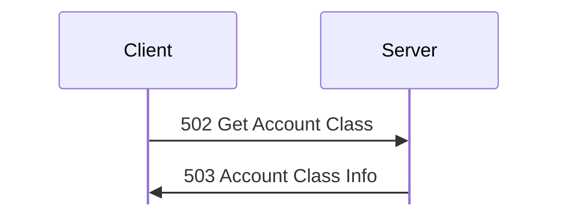
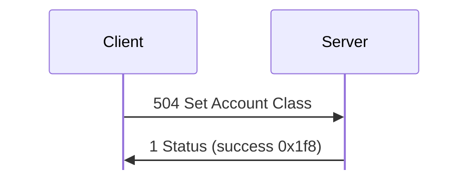
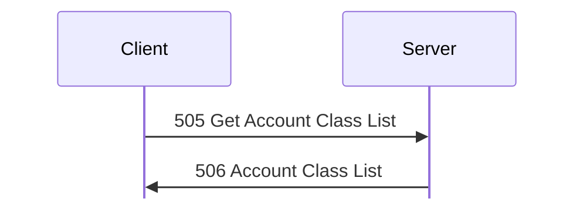
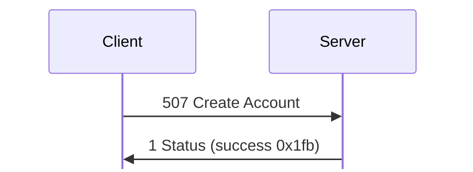
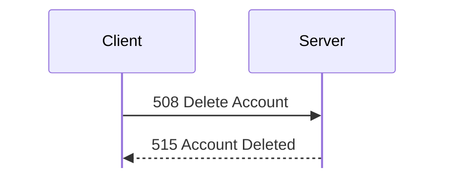
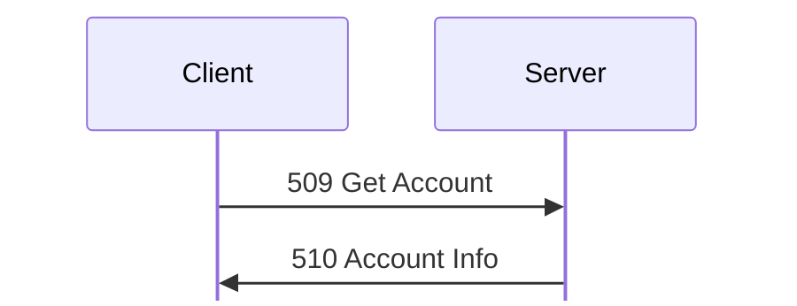
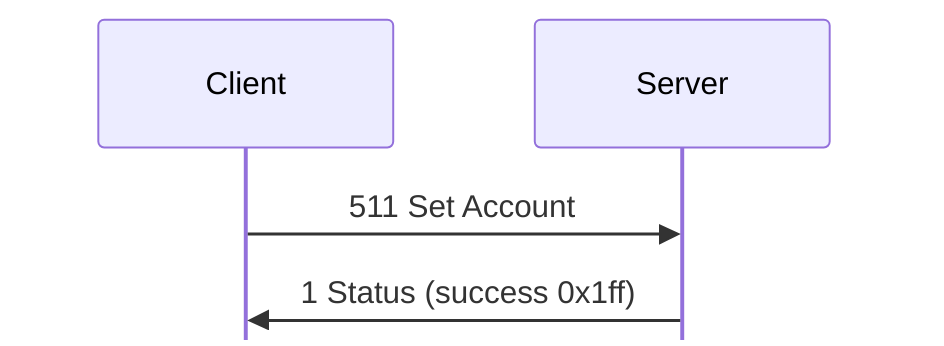
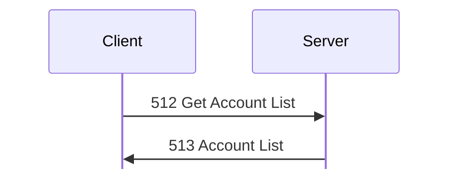
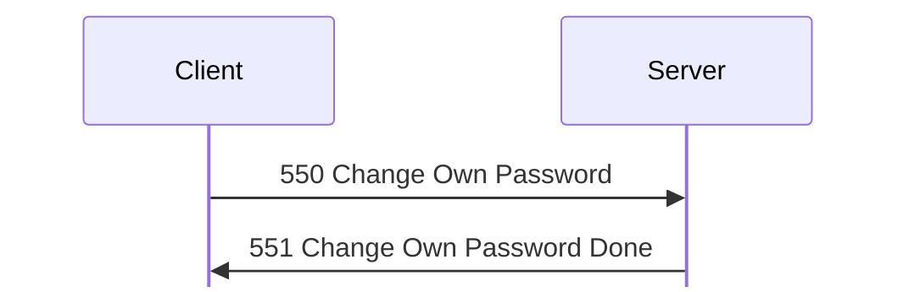

# Account messages

Tags, hex, and field notation: see [Conventions](../README.md#conventions).

Message types 502 to 551: accounts, user classes, privileges, and passwords.

## 502 Get Account Class
Initiator: Client. Privilege: View Accounts (50). **[S `FUN_080552b8`; O]**

A class is read with [502 Get Account Class](#m502), and the server replies with
[503 Account Class Info](#m503):

Struct `AccountClassIndex` (1 bytes):

| Off | Size | Type | Field | Notes |
|---|---|---|---|---|
| 0x00 | 1 | u8 | class_index |  |

## 503 Account Class Info
Initiator: Server. Reply to [502 Get Account Class](#m502).

The stored class record, padded to 4:

Struct `AccountClassInfo` (dynamic):

| Off | Size | Type | Field | Notes |
|---|---|---|---|---|
| 0x00 | 16 | u8[16] | privileges | 11 bytes used |
| 0x10 | 8 | u64 | time |  |
| 0x18 | 13 | u8[13] | ignored_18 |  |
| 0x25 | 1 | u8 | flood_protection | commands per 2 minutes; 0x50 (Relaxed) for Administrator, 0x28 (Strict) for Guest; see Flood ban **[S]**; 0x3c (Average) for User, which [504 Set Account Class](#m504) sets to 0x14 (Very Strict) in `linux-accounts-folder-access` frame 43 **[O]** |
| 0x26 | 2 | u8[2] | ignored_26 | stored as given **[S]** |
| 0x28 | 8 | u8[8] | ignored_28 |  |
| 0x30 | 1 | u8 | class_index | 0, 2 |
| 0x31 | 3 | u8[3] | ignored_31 | byte 0 is 0xff for Administrator, 0 for Guest; probably the colour **[I]** |
| 0x34 | 1 | u8 | name_len |  |
| 0x35 | 1 | u8 | second_string_len |  |
| 0x36 | 1 | u8 | editor_login_len |  |
| 0x37 | 1 | u8 | ignored_37 |  |
| 0x38 | name_len | str | name |  |
|  | second_string_len | str | second_string | **[S]** |
|  | editor_login_len | str | editor_login | set by the server on 504 **[S]** |
|  | pad4 | u8[] | padding |  |

The padding after the name is uninitialised (`@`, `.` in the lab) **[O]**;
`kdx-proto` keeps it on a round trip.

## 504 Set Account Class
Initiator: Client. Privilege: Modify Accounts (52). **[S `FUN_080553c8`; O]**

The server answers [504 Set Account Class](#m504) with 1 Status:

The request is a [503 Account Class Info](#m503) record (at least 0x38 bytes)
with the class index at 0x30.

Struct `SetAccountClass` (dynamic):

| Off | Size | Type | Field | Notes |
|---|---|---|---|---|
| 0x00 |  | AccountClassInfo | class |  |

Client 1.620 for Linux sends it unpadded, with the
time 0 and the second string and editor login empty (69 bytes for Administrator,
`captures/linux-catalog-volumes.pcapng` frames 40 and 59; 61 bytes for Guest,
`captures/linux-accounts-news.pcapng` frames 20 and 30). The server filters the
name (`FUN_08081ffc`), writes the requester's login as the editor, sets the time
at 0x10, and saves the class. Privileges the requester lacks can't be granted
(`FUN_080551b0`; failure [1 Status](status.md#m1) 0x640005). Success is 1 Status
0x1f8 (frames 43 and 62); the history record 0x1f8 carries the old class name.
Logged-in users of that class get the new privileges at once (`FUN_08054900`).

## 505 Get Account Class List
Initiator: Client. Any one of View Folder Access (27), Create/Modify Chats
(37), View Accounts (50), or Create/Modify Newsgroups (73), since every
class-list editor uses it **[I]**. **[S `FUN_0805572c`; O]**

The class list is one request and one reply:

No payload.

Client 1.620 for Linux and `kdx-client` send an empty request.

## 506 Account Class List
Initiator: Server. Reply to [505 Get Account Class List](#m505).

A u32 count (12 classes in the lab), then one record per class, padded to 4 with
zeros. A record is the [503 Account Class Info](#m503) record without the 8
bytes at 0x28 (port 50770 in the probe) **[O `captures/probe.pcapng`]**:

Struct `AccountClassList` (dynamic):

| Off | Size | Type | Field | Notes |
|---|---|---|---|---|
| 0x00 | 4 | u32 | classes_count |  |
| 0x04 | classes_count | AccountClassListEntry[] | classes |  |

Struct `AccountClassListEntry` (dynamic):

| Off | Size | Type | Field | Notes |
|---|---|---|---|---|
| 0x00 | 16 | u8[16] | privileges | 11 bytes used (see Access Privileges) |
| 0x10 | 8 | u64 | time |  |
| 0x18 | 13 | u8[13] | ignored_18 | 0 as sent. |
| 0x25 | 1 | u8 | flood_protection | 0 in this list **[S]** |
| 0x26 | 2 | u8[2] | ignored_26 | 0 as sent. |
| 0x28 | 1 | u8 | class_index | 0 to 11, in list order |
| 0x29 | 3 | u8[3] | ignored_29 | `ff 00 00` for Administrator, `00 00 ff` for User, else 0 |
| 0x2c | 1 | u8 | name_len |  |
| 0x2d | 1 | u8 | second_string_len |  |
| 0x2e | 1 | u8 | editor_login_len |  |
| 0x2f | 1 | u8 | ignored_2f |  |
| 0x30 | name_len | str | name |  |
|  | second_string_len | str | second_string |  |
|  | editor_login_len | str | editor_login |  |
|  | pad4 | u8[] | padding |  |

**[O]** privilege bytes:

- Admin: `28 31 e8 5b f4 d0 3c 0d c3 e0 80`
- User: `28 30 00 03 f0 c0 04 08 03 20`
- Guest: `28 30 00 03 80 00 00 08 02`

## 507 Create Account
Initiator: Client. Privilege: Create Accounts (51). **[S `FUN_08055928`; O]**

On success [507 Create Account](#m507) gets 1 Status:

The request is an account record:

Struct `Account` (dynamic):

| Off | Size | Type | Field | Notes |
|---|---|---|---|---|
| 0x00 | 16 | u8[16] | privileges | values of the bits set in the mask; `80 00 00 00 00 00 02 00…` for admin, 0 for new accounts **[S `FUN_080551b0`]** |
| 0x10 | 16 | u8[16] | privilege_mask | bits the account sets itself; the rest come from its class **[S `FUN_080551b0`]** |
| 0x20 | 32 | u8[32] | key | see below |
| 0x40 | 8 | u64 | created | set by the server |
| 0x48 | 8 | u64 | modified | set by the server |
| 0x50 | 8 | u64 | last_login | 0 if never |
| 0x58 | 30 | u8[30] | ignored_58 | 0 as sent. |
| 0x76 | 1 | u8 | class_index | must name an existing class, else 0x10002 |
| 0x77 | 3 | u8[3] | ignored_77 | stored as given |
| 0x7a | 1 | u8 | login_len |  |
| 0x7b | 1 | u8 | name_len |  |
| 0x7c | 1 | u8 | third_len |  |
| 0x7d | 1 | u8 | editor_len |  |
| 0x7e | 2 | u8[2] | ignored_7e |  |
| 0x80 | login_len | str | login |  |
|  | name_len | str | name | the server filters the name (`FUN_08081ffc`) |
|  | third_len | str | third | stored as given; 0 in the lab |
|  | editor_len | str | editor | see below |
|  | pad4 | u8[] | padding |  |

[507 Create Account](#m507), [510 Account Info](#m510), and
[511 Set Account](#m511) share this layout **[S `FUN_08055928`,
`FUN_08055ff4`; O]**.

The key field:

- 507 Create Account: the new account's key (see
  [handshake.md](../handshake.md)). The CLI sends the empty password's key for
  an account with no password.
- 511 Set Account: the new key. All zero keeps the current key.
- 510 Account Info: byte 0 is 1 if the account has a password, i.e. its key
  is not the empty password's key (`FUN_08066a90`), and 0 otherwise. The
  rest is zero (frames 253 and 590).

The editor field:

- In a request it is ignored by 507, and in 511 it names the account to
  change.
- The server stores the requester's login there. 510 shows `admin` for the
  accounts admin created (frame 253). The setup-created `admin` account shows
  an empty editor.

Struct `CreateAccount` (dynamic):

| Off | Size | Type | Field | Notes |
|---|---|---|---|---|
| 0x00 |  | Account | account |  |

The server sets the times and the editor, then
replies with [1 Status](status.md#m1) success 0x1fb (frame 235). Errors:

- 0x1000d if the login exists (frame 289);
- 0x10002 for an invalid login (`FUN_08057f88`) or class;
- 0x640005 when the account would hold a privilege the requester lacks
  (`FUN_080551b0`, below).

The privilege check (`FUN_080551b0`) **[S]**: the account's effective
privileges are its class's bits, with the bits in the mask taken from the
record instead. Bits 3 and 36 are ignored, and so is bit 23 if the requester
has bit 24. The request fails if any remaining bit is one the requester lacks.
A requester with bit 0 passes.

## 508 Delete Account
Initiator: Client. Privilege: Modify Accounts (52). **[S `FUN_08055d50`; O]**

There is no reply to [508 Delete Account](#m508), only 515 Account Deleted to
the requester:

The request is the login, with no length byte:

Struct `AccountLogin` (dynamic):

| Off | Size | Type | Field | Notes |
|---|---|---|---|---|
| 0x00 | rest | str | login | no length byte |

On success the server sends
[515 Account Deleted](#m515) to the requester. It sends no reply (frames
607-610).

Errors:

- 0x1000c for an unknown login (frame 630);
- 0x10014 without the privilege (frame 391);
- 0x10014 if the target has privilege 0 set in both its mask and its
  values;
- 0x10014 if the target has Protected Account (54) set in both and the
  requester lacks privilege 0.

## 509 Get Account
Initiator: Client. Privilege: View Accounts (50). **[S `FUN_08055e98`; O]**

[509 Get Account](#m509) gets [510 Account Info](#m510):

The request is the account's login, with no length byte (`AccountLogin`, as in
[508 Delete Account](#m508) and [515 Account Deleted](#m515)):

Struct `GetAccount` (dynamic):

| Off | Size | Type | Field | Notes |
|---|---|---|---|---|
| 0x00 |  | AccountLogin | login |  |

An unknown login
gets [1 Status](status.md#m1) 0x1000c (`captures/kdx-accounts.pcapng` frame
554).

## 510 Account Info
Initiator: Server. Reply to [509 Get Account](#m509).

The stored account record, with the key replaced by a flag. Its padding is
uninitialised (frame 590) **[O]**; `kdx-proto` keeps it on a round trip. The
`Account` record is defined in [507 Create Account](#m507), with the key and
editor fields.

Struct `AccountInfo` (dynamic):

| Off | Size | Type | Field | Notes |
|---|---|---|---|---|
| 0x00 |  | Account | account | `account key` byte 0 is the has-password flag |

## 511 Set Account
Initiator: Client. Privilege: Modify Accounts (52). **[S `FUN_08055ff4`; O]**

On success [511 Set Account](#m511) gets 1 Status:

The request is an account record whose editor field holds the current login:

Struct `SetAccount` (dynamic):

| Off | Size | Type | Field | Notes |
|---|---|---|---|---|
| 0x00 |  | Account | account | `editor` holds the current login |

If
the login field differs, the server renames the account, failing with 0x1000d if
the new login exists. It keeps the creation and last-login times, sets the
modified time, and replies with [1 Status](status.md#m1) success 0x1ff (frames
412-413). Users logged in to the account are updated in place with the new login
and privileges.

Errors:

- 0x1000c for an unknown account;
- 0x10014 if the account has Protected Account (54) set in both the mask
  and the values and the requester lacks privilege 0;
- the same checks as [507 Create Account](#m507) otherwise.

## 512 Get Account List
Initiator: Client. Privilege: View Accounts (50). **[S `FUN_080566bc`; O]**

The account list is one request and one reply:

No payload.

Client 1.620 for Linux and `kdx-client` send an empty request.

## 513 Account List
Initiator: Server. Reply to [512 Get Account List](#m512).

A u32 count, then one entry per account, each padded to 4:

Struct `AccountList` (dynamic):

| Off | Size | Type | Field | Notes |
|---|---|---|---|---|
| 0x00 | 4 | u32 | accounts_count |  |
| 0x04 | accounts_count | AccountListEntry[] | accounts |  |

Struct `AccountListEntry` (dynamic):

| Off | Size | Type | Field | Notes |
|---|---|---|---|---|
| 0x00 | 8 | u64 | created |  |
| 0x08 | 8 | u64 | last_login | 0 if never |
| 0x10 | 11 | u8[11] | ignored_10 |  |
| 0x1b | 1 | u8 | ignored_1b | 1 for admin, 0 for guest |
| 0x1c | 4 | u8[4] | ignored_1c |  |
| 0x20 | 1 | u8 | class_index | 0 for admin, 2 for guest |
| 0x21 | 1 | u8 | ignored_21 | 0xff for admin; matches [503 Account Class Info](#m503) offset 0x31 |
| 0x22 | 2 | u8[2] | ignored_22 |  |
| 0x24 | 1 | u8 | login_len |  |
| 0x25 | 1 | u8 | name_len |  |
| 0x26 | 2 | u8[2] | ignored_26 |  |
| 0x28 | login_len | str | login |  |
|  | name_len | str | name |  |
|  | pad4 | u8[] | padding |  |

## 514 Account Changed
Initiator: Server. Server 1.620 never sends it and Client 1.620 beta 5
doesn't handle it **[S]**.

The payload is unknown, because no capture holds one.

Struct `AccountChanged` (dynamic):

| Off | Size | Type | Field | Notes |
|---|---|---|---|---|
| 0x00 | rest | u8[] | ignored |  |

## 515 Account Deleted
Initiator: Server. Sent on a successful [508 Delete Account](#m508).

The payload is the deleted login:

Struct `AccountDeleted` (dynamic):

| Off | Size | Type | Field | Notes |
|---|---|---|---|---|
| 0x00 |  | AccountLogin | login |  |

The server sends it to the requester as a
notification (its own txid, reply bit clear) (frames 607-610).

## 550 Change Own Password
Initiator: Client. Privilege: Change Own Password (53). **[S `FUN_08056a04`;
O]**

A password change is one request and one reply:

The request is the 32-byte key of the new password, not the password
(`kdx_proto::msg::admin::ChangeOwnPassword`):

Struct `ChangeOwnPassword` (32 bytes):

| Off | Size | Type | Field | Notes |
|---|---|---|---|---|
| 0x00 | 32 | u8[32] | account_key | the key of the new password |

The server stores it as the account's key and replies with
[551 Change Own Password Done](#m551). The old password stops working at once.

## 551 Change Own Password Done
Initiator: Server. Reply to [550 Change Own Password](#m550).

No payload.

The reply is empty (frames 323-324).
