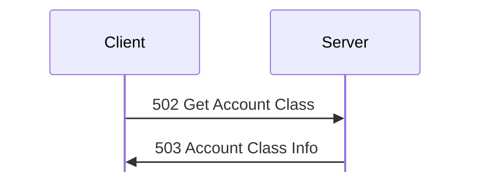
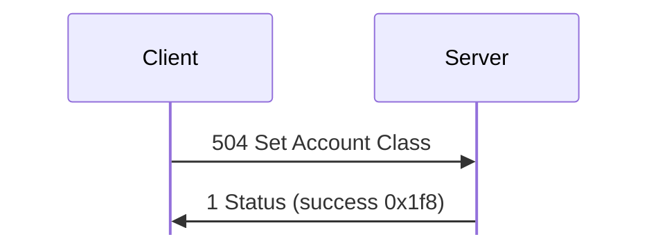
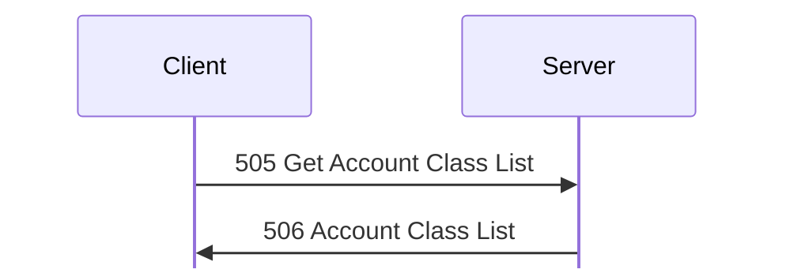
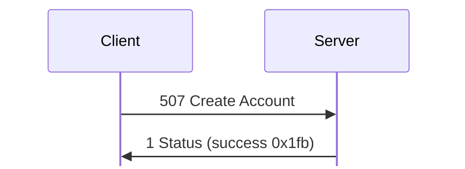
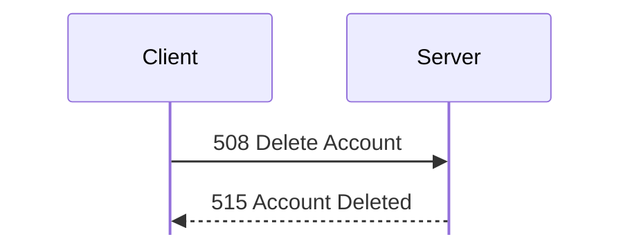
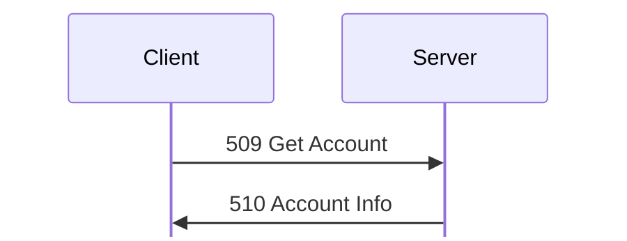
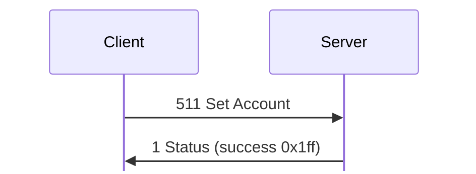
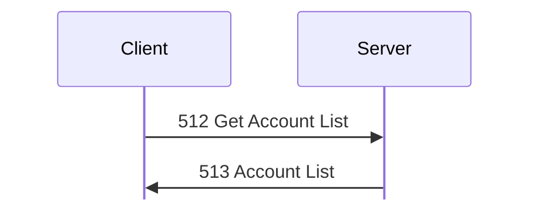
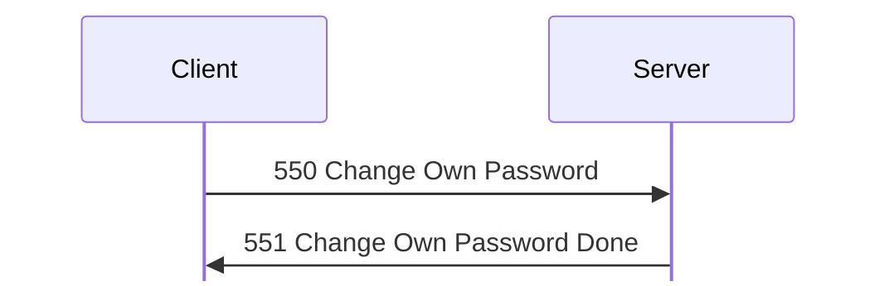

# Account messages

For hex and field notation, see [Conventions](../README.md#conventions).

Message types 502 to 551 manage accounts, user classes, privileges, and
passwords.

## 502 Get Account Class
Initiator: Client. Privilege: View Accounts (50). <!-- [S `FUN_080552b8`; O] -->

The client reads a class with 502 Get Account Class, and the server replies with
[503 Account Class Info](#m503):

Struct `AccountClassIndex` (1 bytes):

| Off | Size | Type | Field | Notes |
|---|---|---|---|---|
| 0x00 | 1 | `u8` | `class_index` |  |

## 503 Account Class Info
Initiator: Server. Reply to [502 Get Account Class](#m502).

The payload is the stored class record, padded to a multiple of 4:

Struct `AccountClassInfo` (dynamic):

| Off | Size | Type | Field | Notes |
|---|---|---|---|---|
| 0x00 | 16 | [`Privileges`](../privileges.md#sPrivileges) | `privileges` | See [privileges.md](../privileges.md). |
| 0x10 | 8 | `u64` | `time` |  |
| 0x18 | 13 | `u8[13]` | `ignored_18` | 0 as sent. 504 does not store them. <!-- [S `FUN_080553c8`] --> |
| 0x25 | 1 | `u8` | `flood_protection` | Commands per 2 minutes: 0x50 (Relaxed) for Administrator, and 0x28 (Strict) for Guest; see [Flood ban](../sequences.md#flood-ban). <!-- [S] --> 0x3c (Average) for User, which [504 Set Account Class](#m504) sets to 0x14 (Very Strict) in `linux-accounts-folder-access` frame 43. <!-- [O] --> |
| 0x26 | 2 | `u16` | `speed_limit` | Download speed limit in KiB per second for each download, unless the user has Ignore Speed Limits (26). 0 means no limit for the class. <!-- [S `FUN_08054900`, `FUN_08052440`] --> |
| 0x28 | 8 | `u8[8]` | `ignored_28` | 0 as sent. 504 does not store them. <!-- [S `FUN_080553c8`] --> |
| 0x30 | 1 | `u8` | `class_index` | 0, 2 |
| 0x31 | 3 | [`Color`](../encodings.md#sColor) | `color` | The [color](../encodings.md#colors) of the class's users, unless an account has Color Overrides Class (3). <!-- [S `FUN_08054900`] --> `ff 00 00` for Administrator, and 0 for Guest. <!-- [O] --> |
| 0x34 | 1 | `u8` | `name_len` |  |
| 0x35 | 1 | `u8` | `second_string_len` |  |
| 0x36 | 1 | `u8` | `editor_login_len` |  |
| 0x37 | 1 | `u8` | `ignored_37` |  |
| 0x38 | `name_len` | `str` | `name` |  |
|  | `second_string_len` | `str` | `second_string` | <!-- [S] --> |
|  | `editor_login_len` | `str` | `editor_login` | The server sets it on 504. <!-- [S] --> |
|  | pad4 | `u8[]` | `padding` |  |

The padding after the name is uninitialized memory, such as `@` and `.` in the
lab. <!-- [O] --> `kdx-proto` keeps it on a round trip.

## 504 Set Account Class
Initiator: Client. Privilege: Modify Accounts (52). <!-- [S `FUN_080553c8`; O] -->

The server answers with 1 Status:

The request is a [503 Account Class Info](#m503) record of at least 0x38 bytes,
with the class index at 0x30.

Struct `SetAccountClass` (dynamic):

| Off | Size | Type | Field | Notes |
|---|---|---|---|---|
| 0x00 |  | [`AccountClassInfo`](#sAccountClassInfo) | `class` |  |

Client 1.620 for Linux sends it with no padding, with the time 0, and with the
second string and the editor login empty. It is 69 bytes for Administrator
(`captures/linux-catalog-volumes.pcapng` frames 40 and 59), and 61 bytes for
Guest (`captures/linux-accounts-news.pcapng` frames 20 and 30).

The server filters the name (`FUN_08081ffc`), writes the requester's login as
the editor, sets the time at 0x10, and saves the class. A requester cannot give
privileges that it does not have itself (`FUN_080551b0`). If it tries, the reply
is [1 Status](status.md#m1) 0x640005. If it succeeds, the reply is 1 Status
0x1f8 (frames 43 and 62), and the history record 0x1f8 holds the old class name.
Users of that class who are logged in get the new privileges at once
(`FUN_08054900`).

## 505 Get Account Class List
Initiator: Client. Privilege: View Folder Access (27), Create/Modify Chats
(37), View Accounts (50), or Create/Modify Newsgroups (73). Any one of them is
probably enough, because all class list editors use this message. <!-- [S
`FUN_0805572c`; I; O] -->

The class list is one request and one reply:

No payload.

Client 1.620 for Linux and `kdx-client` send an empty request.

## 506 Account Class List
Initiator: Server. Reply to [505 Get Account Class List](#m505).

The payload is a u32 count (12 classes in the lab), then one record for each
class, padded to a multiple of 4 with zeros. A record is the [503 Account Class
Info](#m503) record without the 8 bytes at 0x28, the second string, and the
editor login. <!-- [O `captures/probe.pcapng`] port 50770; [S `FUN_0805572c`]
-->

Struct `AccountClassList` (dynamic):

| Off | Size | Type | Field | Notes |
|---|---|---|---|---|
| 0x00 | 4 | `u32` | `classes_count` |  |
| 0x04 | `classes_count` | [`AccountClassListEntry`](#sAccountClassListEntry)`[]` | `classes` |  |

Struct `AccountClassListEntry` (dynamic):

| Off | Size | Type | Field | Notes |
|---|---|---|---|---|
| 0x00 | 16 | [`Privileges`](../privileges.md#sPrivileges) | `privileges` |  |
| 0x10 | 8 | `u64` | `time` |  |
| 0x18 | 13 | `u8[13]` | `ignored_18` | 0 as sent. |
| 0x25 | 1 | `u8` | `flood_protection` | 0 in this list. <!-- [S] --> |
| 0x26 | 2 | `u16` | `speed_limit` | 0 in this list. <!-- [S] --> |
| 0x28 | 1 | `u8` | `class_index` | 0 to 11, in list order. |
| 0x29 | 3 | [`Color`](../encodings.md#sColor) | `color` | `ff 00 00` for Administrator, `00 00 ff` for User, and 0 for the others. |
| 0x2c | 1 | `u8` | `name_len` |  |
| 0x2d | 2 | `u8[2]` | `ignored_2d` | 0 as sent. The server sends no second string or editor login. <!-- [S] --> |
| 0x2f | 1 | `u8` | `ignored_2f` | 0 as sent. <!-- [S] --> |
| 0x30 | `name_len` | `str` | `name` |  |
|  | pad4 | `u8[]` | `padding` |  |

These are the privilege bytes in the lab: <!-- [O] -->

- Admin: `28 31 e8 5b f4 d0 3c 0d c3 e0 80`
- User: `28 30 00 03 f0 c0 04 08 03 20`
- Guest: `28 30 00 03 80 00 00 08 02`

## 507 Create Account
Initiator: Client. Privilege: Create Accounts (51). <!-- [S `FUN_08055928`; O] -->

If it succeeds, the reply is 1 Status:

The request is an account record. 507 Create Account, [510 Account Info](#m510),
and [511 Set Account](#m511) use the same layout. <!-- [S `FUN_08055928`,
`FUN_08055ff4`; O] -->

Struct `Account` (dynamic):

| Off | Size | Type | Field | Notes |
|---|---|---|---|---|
| 0x00 | 16 | [`Privileges`](../privileges.md#sPrivileges) | `privileges` | The values of the bits set in the mask. `80 00 00 00 00 00 02 00…` for admin, and 0 for new accounts. <!-- [S `FUN_080551b0`] --> |
| 0x10 | 16 | [`Privileges`](../privileges.md#sPrivileges) | `privilege_mask` | The bits that the account sets itself. The other bits come from its class. <!-- [S `FUN_080551b0`] --> |
| 0x20 | 32 | `u8[32]` | `key` | See below. |
| 0x40 | 8 | `u64` | `created` | The server sets it. |
| 0x48 | 8 | `u64` | `modified` | The server sets it. |
| 0x50 | 8 | `u64` | `last_login` | 0 if never. |
| 0x58 | 30 | `u8[30]` | `ignored_58` | 0 as sent. |
| 0x76 | 1 | `u8` | `class_index` | Must be a class that exists, or the server gives 0x10002. |
| 0x77 | 3 | [`Color`](../encodings.md#sColor) | `color` | Used instead of the class's color if the account has Color Overrides Class (3). <!-- [S `FUN_08054900`] --> |
| 0x7a | 1 | `u8` | `login_len` |  |
| 0x7b | 1 | `u8` | `name_len` |  |
| 0x7c | 1 | `u8` | `third_len` |  |
| 0x7d | 1 | `u8` | `editor_len` |  |
| 0x7e | 2 | `u8[2]` | `ignored_7e` |  |
| 0x80 | `login_len` | `str` | `login` |  |
|  | `name_len` | `str` | `name` | The server filters the name (`FUN_08081ffc`). |
|  | `third_len` | `str` | `third` | Stored as given. 0 in the lab. |
|  | `editor_len` | `str` | `editor` | See below. |
|  | pad4 | `u8[]` | `padding` |  |

The key field holds:

- In 507 Create Account, the new account's key; see
  [handshake.md](../handshake.md). For an account with no password, the CLI
  sends the key of the empty password.
- In 511 Set Account, the new key. A key of all zeros keeps the current key.
- In 510 Account Info, a flag in byte 0: 1 if the account has a password, which
  means that its key is not the key of the empty password (`FUN_08066a90`), and
  0 if not. The other bytes are zero (frames 253 and 590).

The editor field holds:

- In a request, nothing for 507, which ignores it. In 511, the account to
  change.
- In the stored record, the requester's login. 510 shows `admin` for the
  accounts that admin made (frame 253). The `admin` account that setup made has
  an empty editor.

Struct `CreateAccount` (dynamic):

| Off | Size | Type | Field | Notes |
|---|---|---|---|---|
| 0x00 |  | [`Account`](#sAccount) | `account` |  |

The server sets the times and the editor, and replies with [1
Status](status.md#m1) success 0x1fb (frame 235). These are the errors:

- 0x1000d if the login already exists (frame 289).
- 0x10002 for an invalid login (`FUN_08057f88`) or class.
- 0x640005 if the account would get a privilege that the requester does not have
  (`FUN_080551b0`, below).

This is the privilege check of `FUN_080551b0`: <!-- [S] --> the account's
effective privileges are the bits of its class, except that the bits in the mask
come from the record. Bits 3 and 36 are ignored, and so is bit 23 if the
requester has bit 24. The request fails if the requester does not have one of
the other bits. A requester with bit 0 always passes.

## 508 Delete Account
Initiator: Client. Privilege: Modify Accounts (52). <!-- [S `FUN_08055d50`; O] -->

There is no reply, only 515 Account Deleted to the requester:

The request is the login, with no length byte:

Struct `AccountLogin` (dynamic):

| Off | Size | Type | Field | Notes |
|---|---|---|---|---|
| 0x00 | rest | `str` | `login` | No length byte. |

If it succeeds, the server sends [515 Account Deleted](#m515) to the requester,
and no reply (frames 607 to 610).

These are the errors:

- 0x1000c for an unknown login (frame 630).
- 0x10014 without the privilege (frame 391).
- 0x10014 if the target has privilege 0 set in both its mask and its values.
- 0x10014 if the target has Protected Account (54) set in both, and the
  requester does not have privilege 0.

## 509 Get Account
Initiator: Client. Privilege: View Accounts (50). <!-- [S `FUN_08055e98`; O] -->

The reply is [510 Account Info](#m510):

The request is the account's login, with no length byte. This is the
`AccountLogin` of [508 Delete Account](#m508) and [515 Account Deleted](#m515):

Struct `GetAccount` (dynamic):

| Off | Size | Type | Field | Notes |
|---|---|---|---|---|
| 0x00 |  | [`AccountLogin`](#sAccountLogin) | `login` |  |

An unknown login gets [1 Status](status.md#m1) 0x1000c. <!-- [O
`captures/kdx-accounts.pcapng` frame 554] -->

## 510 Account Info
Initiator: Server. Reply to [509 Get Account](#m509).

The payload is the stored account record, with a flag in place of the key. [507
Create Account](#m507) defines the `Account` record, with its key and editor
fields. The padding is uninitialized memory (frame 590). <!-- [O] -->
`kdx-proto` keeps it on a round trip.

Struct `AccountInfo` (dynamic):

| Off | Size | Type | Field | Notes |
|---|---|---|---|---|
| 0x00 |  | [`Account`](#sAccount) | `account` | Byte 0 of `key` is the has-password flag. |

## 511 Set Account
Initiator: Client. Privilege: Modify Accounts (52). <!-- [S `FUN_08055ff4`; O] -->

If it succeeds, the reply is 1 Status:

The request is an account record whose editor field holds the current login:

Struct `SetAccount` (dynamic):

| Off | Size | Type | Field | Notes |
|---|---|---|---|---|
| 0x00 |  | [`Account`](#sAccount) | `account` | `editor` holds the current login. |

If the login field is different, the server renames the account. If the new
login already exists, it fails with 0x1000d. The server keeps the creation and
last-login times, sets the modified time, and replies with [1
Status](status.md#m1) success 0x1ff (frames 412 and 413). Users who are logged
in to the account get the new login and privileges at once.

These are the errors:

- 0x1000c for an unknown account.
- 0x10014 if the account has Protected Account (54) set in both the mask and the
  values, and the requester does not have privilege 0.
- Otherwise, the same checks as [507 Create Account](#m507).

## 512 Get Account List
Initiator: Client. Privilege: View Accounts (50). <!-- [S `FUN_080566bc`; O] -->

The account list is one request and one reply:

No payload.

Client 1.620 for Linux and `kdx-client` send an empty request.

## 513 Account List
Initiator: Server. Reply to [512 Get Account List](#m512).

The payload is a u32 count, then one entry for each account, each padded to a
multiple of 4:

Struct `AccountList` (dynamic):

| Off | Size | Type | Field | Notes |
|---|---|---|---|---|
| 0x00 | 4 | `u32` | `accounts_count` |  |
| 0x04 | `accounts_count` | [`AccountListEntry`](#sAccountListEntry)`[]` | `accounts` |  |

Struct `AccountListEntry` (dynamic):

| Off | Size | Type | Field | Notes |
|---|---|---|---|---|
| 0x00 | 8 | `u64` | `created` |  |
| 0x08 | 8 | `u64` | `last_login` | 0 if never. |
| 0x10 | 11 | `u8[11]` | `ignored_10` |  |
| 0x1b | 1 | `u8` | `ignored_1b` | 1 for admin, and 0 for guest. |
| 0x1c | 4 | `u8[4]` | `ignored_1c` |  |
| 0x20 | 1 | `u8` | `class_index` | 0 for admin, and 2 for guest. |
| 0x21 | 1 | `u8` | `ignored_21` | 0xff for admin. The same as offset 0x31 of [503 Account Class Info](#m503). |
| 0x22 | 2 | `u8[2]` | `ignored_22` |  |
| 0x24 | 1 | `u8` | `login_len` |  |
| 0x25 | 1 | `u8` | `name_len` |  |
| 0x26 | 2 | `u8[2]` | `ignored_26` |  |
| 0x28 | `login_len` | `str` | `login` |  |
|  | `name_len` | `str` | `name` |  |
|  | pad4 | `u8[]` | `padding` |  |

## 514 Account Changed
Initiator: Server. Server 1.620 never sends it, and Client 1.620 beta 5 does
not handle it. <!-- [S] -->

The payload is unknown, because no capture holds one.

Struct `AccountChanged` (dynamic):

| Off | Size | Type | Field | Notes |
|---|---|---|---|---|
| 0x00 | rest | `u8[]` | `ignored` |  |

## 515 Account Deleted
Initiator: Server. It follows a successful [508 Delete Account](#m508).

The payload is the deleted login:

Struct `AccountDeleted` (dynamic):

| Off | Size | Type | Field | Notes |
|---|---|---|---|---|
| 0x00 |  | [`AccountLogin`](#sAccountLogin) | `login` |  |

The server sends it to the requester as a notification, with its own txid and
the reply bit clear (frames 607 to 610).

## 550 Change Own Password
Initiator: Client. Privilege: Change Own Password (53). <!-- [S `FUN_08056a04`; O] -->

A password change is one request and one reply:

The request is the 32-byte key of the new password, not the password itself
(`kdx_proto::msg::admin::ChangeOwnPassword`):

Struct `ChangeOwnPassword` (32 bytes):

| Off | Size | Type | Field | Notes |
|---|---|---|---|---|
| 0x00 | 32 | `u8[32]` | `account_key` | The key of the new password. |

The server stores it as the account's key, and replies with [551 Change Own
Password Done](#m551). The old password stops working at once.

## 551 Change Own Password Done
Initiator: Server. Reply to [550 Change Own Password](#m550).

No payload.

The reply is empty (frames 323 and 324).
