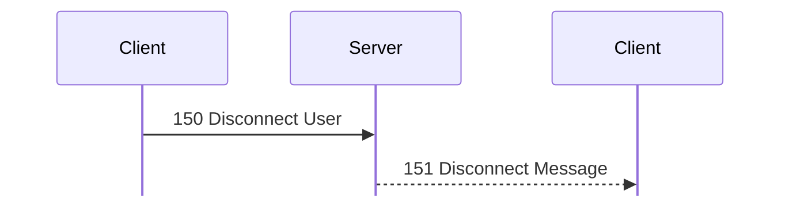
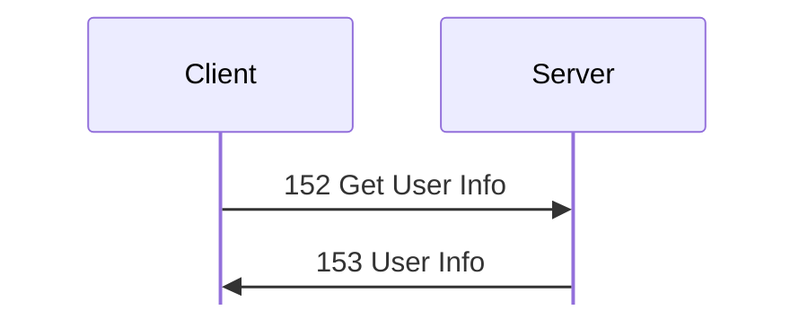
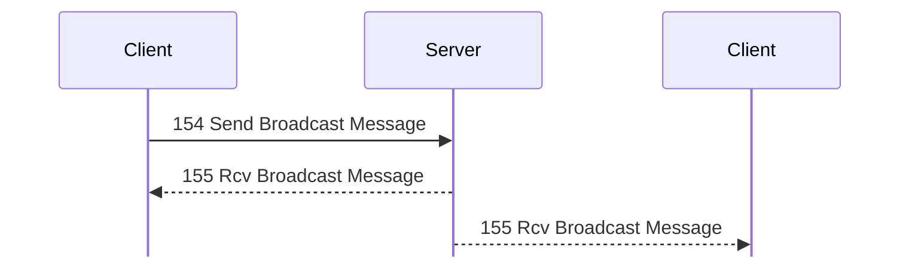
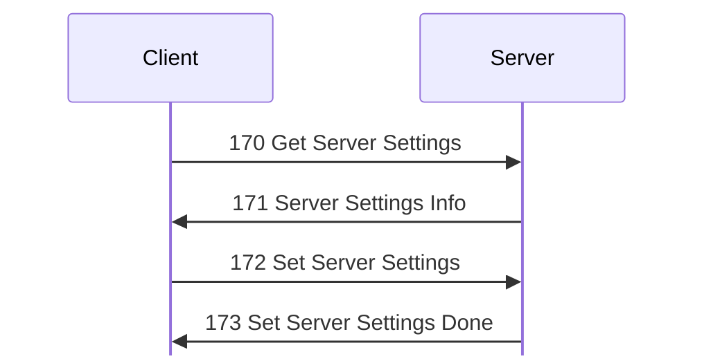
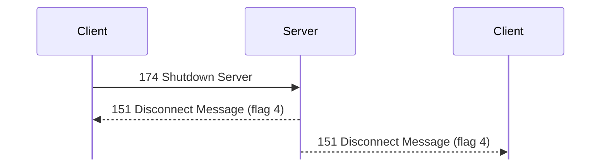
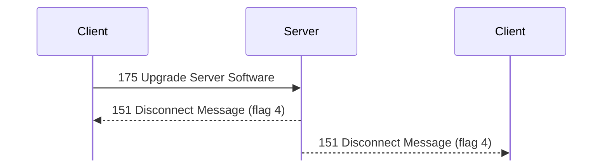
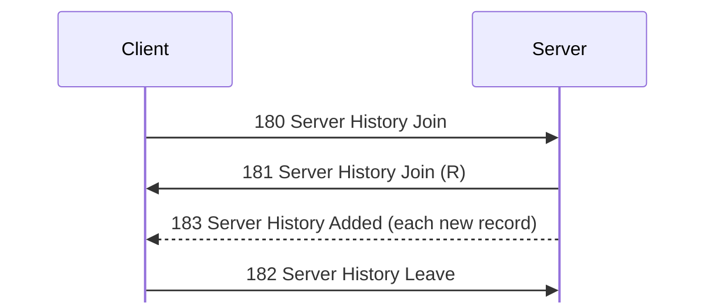

# Administration messages

For hex and field notation, see [Conventions](../README.md#conventions).

Message types 150 to 183 cover disconnects, user information, broadcasts, server
settings, shutdown, upgrades, and the server history. Types 184 to 191 are the
kinds of history record.

## 150 Disconnect User
Initiator: Client. Privilege: Disconnect Users (41), and Ban Users (43) to ban.
<!-- [S `FUN_0804c42c`; O `captures/linux-chat-admin.pcapng` frames 159, 161]
-->

The server tells the target:

Struct `DisconnectUser` (dynamic):

| Off | Size | Type | Field | Notes |
|---|---|---|---|---|
| 0x00 | 4 | `u32` | `user_id` | The user to disconnect. |
| 0x04 | 4 | `u8[4]` | `ignored_04` |  |
| 0x08 | 4 | `u32` | `ban_seconds` | At most 0x80000. 0 means no ban. |
| 0x0c | 5 | `u8[5]` | `ignored_0c` |  |
| 0x11 | 1 | `u8` | `options` | Bit 0: disconnect without a notice. |
| 0x12 | 2 | `u8[2]` | `ignored_12` |  |
| 0x14 | 1 | `u8` | `message_len` |  |
| 0x15 | 3 | `u8[3]` | `ignored_15` |  |
| 0x18 | `message_len` | `str` | `message` |  |

The server refuses a target that has Cannot Be Disconnected, unless the server's
address check passes. The target receives [151 Disconnect Message](#m151).

In `captures/linux-chat-admin.pcapng`, the GUI (user 2) disconnected itself with
the message `test` and no ban. The 150 Disconnect User at frame 159 is 28
bytes. <!-- [O] --> `kdx_proto::msg::admin::DisconnectUser` re-encodes it byte
for byte.

## 151 Disconnect Message
Initiator: Server.

The server sends this to the target of [150 Disconnect User](#m150), and
broadcasts it for [174 Shutdown Server](#m174) and [175 Upgrade Server
Software](#m175):

Struct `DisconnectMessage` (dynamic):

| Off | Size | Type | Field | Notes |
|---|---|---|---|---|
| 0x00 | 4 | `u32` | `user_id` |  |
| 0x04 | 8 | `u8[8]` | `ignored` | 0 as sent. |
| 0x0c | 2 | `u16` | `flags` | 2: banned. 4: the server is shutting down or upgrading. |
| 0x0e | 2 | `u16` | `value_0e` | Unknown. 0 in the lab. |
| 0x10 | 2 | `u16` | `value_10` | Unknown. 0 in the lab. |
| 0x12 | 1 | `u8` | `message_len` |  |
| 0x13 | 1 | `u8` | `name_len` |  |
| 0x14 | `message_len` | `str` | `message` |  |
|  | `name_len` | `str` | `name` |  |

In the same capture, the 151 Disconnect Message at frame 161 has user ID 2,
flags 0, and the name `kdx-lab-linux`. <!-- [O] --> The sender was also the
target, so the capture does not show which of them 0x00 names.
`kdx_proto::msg::admin::DisconnectMessage` re-encodes it byte for byte.

## 152 Get User Info
Initiator: Client. Privilege: Get User Info (40). <!-- [S `FUN_0804c8a8`; O] -->

The reply is [153 User Info](#m153):

Struct `GetUserInfo` (4 bytes):

| Off | Size | Type | Field | Notes |
|---|---|---|---|---|
| 0x00 | 4 | `u32` | `user_id` |  |

If the user does not exist, the server replies with [1 Status](status.md#m1)
0x1000c. <!-- [O] --> `kdx_proto::msg::user_info::GetUserInfo` encodes the
request.

## 153 User Info
Initiator: Server. <!-- [S `FUN_0804c8a8`; O] -->

This is the reply to [152 Get User Info](#m152), padded to a multiple of 4. It
is 120 bytes when the prober asks about itself.

Struct `UserInfo` (dynamic):

| Off | Size | Type | Field | Notes |
|---|---|---|---|---|
| 0x00 | 4 | `u32` | `user_id` |  |
| 0x04 | 4 | `u8[4]` | `ignored_04` |  |
| 0x08 | 8 | `u64` | `login_time` |  |
| 0x10 | 8 | `u64` | `time_10` | Meaning unknown. |
| 0x18 | 8 | `u64` | `time_18` | Meaning unknown. |
| 0x20 | 27 | `u8[27]` | `ignored_20` |  |
| 0x3b | 1 | `u8` | `address_len` |  |
| 0x3c | 1 | `u8` | `ignored_3c` |  |
| 0x3d | 1 | `u8` | `nick_len` |  |
| 0x3e | 1 | `u8` | `ignored_3e` |  |
| 0x3f | 1 | `u8` | `name_3f_len` |  |
| 0x40 | 1 | `u8` | `login_len` |  |
| 0x41 | 1 | `u8` | `name_41_len` |  |
| 0x42 | 2 | `u8[2]` | `ignored_42` |  |
| 0x44 | `address_len` | `str` | `address` |  |
|  | `nick_len` | `str` | `nick` |  |
|  | `name_3f_len` | `str` | `name_3f` | `Administrator`. Probably the class or the account name. <!-- [I] --> |
|  | `login_len` | `str` | `login` |  |
|  | `name_41_len` | `str` | `name_41` | `Administrator`. Probably the class or the account name. <!-- [I] --> |
|  | pad4 | `u8[]` | `padding` | Uninitialized. |

## 154 Send Broadcast Message
Initiator: Client. Privilege: Broadcast (33). <!-- [S `FUN_0804d1a8`; O `captures/linux-chat-admin.pcapng` frames 129, 130, 132] -->

Everyone receives the broadcast, the sender too:

Struct `SendBroadcast` (dynamic):

| Off | Size | Type | Field | Notes |
|---|---|---|---|---|
| 0x00 | 2 | `u16` | `value_0` | Unknown. 0 in the lab. |
| 0x02 | 2 | `u16` | `value_2` | Copied to 0x0e of [155 Rcv Broadcast Message](#m155). |
| 0x04 | rest | `str` | `text` | At most 0x800 bytes. |

Everyone receives [155 Rcv Broadcast Message](#m155). The GUI (user 2) sent `00
00 00 00` and `test broadcast` (frame 129). <!-- [O] -->
`kdx_proto::msg::admin::SendBroadcast` re-encodes it.

## 155 Rcv Broadcast Message
Initiator: Server.

The server sends this to everyone for a [154 Send Broadcast Message](#m154):

Struct `RcvBroadcast` (dynamic):

| Off | Size | Type | Field | Notes |
|---|---|---|---|---|
| 0x00 | 4 | `u32` | `user_id` | 0 for the server's own notices. |
| 0x04 | 10 | `u8[10]` | `ignored` | 0 as sent. |
| 0x0e | 2 | `u16` | `value_0e` | Copied from 0x02 of the request. |
| 0x10 | rest | `str` | `text` |  |

For the 154 at frame 129, the peer (frame 130) and the sender (frame 132) both
got user ID 2, 12 zero bytes, and the text. <!-- [O] -->
`kdx_proto::msg::admin::RcvBroadcast` re-encodes them.

## 170 Get Server Settings
Initiator: Client. Privilege: Modify Server Settings (61).
<!-- [S `FUN_0805f598`; O `captures/linux-server-settings.pcapng`] -->

No payload.

The reply is [171 Server Settings Info](#m171).

## 171 Server Settings Info
Initiator: Server. It is 216 or 764 bytes in the captures. <!-- [S `FUN_0805f598`; O] -->

This is the reply to [170 Get Server Settings](#m170). It holds the server's
settings file, which starts with the protocol `%KDX`, the sub-protocol `SSTG`,
and a version. A table of section offsets follows, and then the sections. The
server compares the protocol and the sub-protocol as two separate words. <!-- [S
`FUN_08060268`] -->

This is the layout in `captures/linux-server-settings.pcapng` frames 36, 40, 56,
221, and 225: <!-- [O] -->

Struct `ServerSettings` (dynamic):

| Off | Size | Type | Field | Notes |
|---|---|---|---|---|
| 0x00 | 4 | `char[4]` | `protocol` | not stored. `"%KDX"` (0x254b4458). <!-- [S `FUN_08060268`] --> |
| 0x04 | 4 | `char[4]` | `sub_protocol` | not stored. `"SSTG"` (0x53535447). <!-- [S `FUN_08060268`] --> |
| 0x08 | 2 | `u16` | `version` | 1 |
| 0x0a | 2 | `u8[2]` | `ignored` |  |
| 0x0c | 88 | [`ServerSettingsSection`](#sServerSettingsSection)`[11]` | `sections` | Probably 11 entries. <!-- [I] --> |
| 0x64 | 12 | `u8[12]` | `value_64` | `01 01 01 01 00 01 00 02 00 00 00 00` in a 171. In a 172, 0x6b is 0, and so is 0x69 if the icon is absent. |
| 0x70 | rest | `u8[]` | `body` | The sections, at the offsets in the table. Entry 0 is a `ServerSettingsMain`. |

Struct `ServerSettingsSection` (8 bytes):

| Off | Size | Type | Field | Notes |
|---|---|---|---|---|
| 0x00 | 4 | `u32` | `offset` | From the start of the blob. |
| 0x04 | 4 | `u32` | `length` | 0 for an empty or absent section. |

The main section is entry 0. It starts at 0x70 and is 0x68 bytes in the
captures. Its offsets below are from its own start; add 0x70 to get the offset
in the blob:

Struct `ServerSettingsMain` (dynamic):

| Off | Size | Type | Field | Notes |
|---|---|---|---|---|
| 0x00 | 35 | `u8[35]` | `ignored_00` |  |
| 0x23 | 1 | `u8` | `flags` | Bit 1: the greeting is on. 0x93 in the blob. |
| 0x24 | 20 | `u8[20]` | `ignored_24` |  |
| 0x38 | 4 | `u32` | `total_outgoing_speed_limit` | Bytes per second. 0x5000, or 0 when off. 0xa8 in the blob. |
| 0x3c | 22 | `u8[22]` | `ignored_3c` |  |
| 0x52 | 1 | `u8` | `ignored_52` | 0x0a, the length of both names in the captures. Probably the name's length. <!-- [I] --> 0xc2 in the blob. |
| 0x53 | 9 | `u8[9]` | `ignored_53` |  |
| 0x5c | rest | `str` | `server_name` | NUL-terminated, at the end of the main section. 0xcc in the blob. |

These are the section table entries in the captures, as offset and
length: <!-- [O] -->

- Entry 0 (at 0x0c) is the main section: 0x70, 0x68.
- Entry 3 (at 0x24) is the greeting section: 0xd8, 0x17. The length is 0 when no
  greeting is set.
- Entry 5 (at 0x34) is the icon section: 0xf0, 0x20c. It is 0xd8, 0 when no icon
  is set, and 0xf0, 0 in a [172 Set Server Settings](#m172) without the icon.
- Entry 7 (at 0x44) has the offset of the blob's end and length 0 in a [171
  Server Settings Info](#m171). It is 0, 0 in a 172.

Entries 1 and 2 are 0xd8, 0, and entries 4, 6, and 8 to 10 are all zero in every
capture. Each section starts on a multiple of 4. The greeting section has the
layout of [107 Server Greeting](session.md#m107), and the icon section holds the
bytes of [106 Server Icon](session.md#m106). A 172 can give the icon section
length 0, and the server then keeps its icon: frames 56 and 225 sent no icon,
and the 171 at frame 221 still holds it.

`kdx_proto::msg::server_info::ServerSettings` decodes the table, reads the named
fields from the main section, and keeps the other bytes as sent. It re-encodes
all six blobs of `captures/linux-server-settings.pcapng`, and the 171 at frame
116 of `captures/probe.pcapng`, byte for byte.

## 172 Set Server Settings
Initiator: Client. <!-- [S `FUN_0805f638`] -->

The client reads the settings, then writes them back:

Struct `SetServerSettings` (dynamic):

| Off | Size | Type | Field | Notes |
|---|---|---|---|---|
| 0x00 |  | [`ServerSettings`](#sServerSettings) | `settings` | The blob of [171 Server Settings Info](#m171). |

The client sends back a blob in the same layout as [171 Server Settings
Info](#m171), and the server replies with [173 Set Server Settings
Done](#m173). <!-- [O] -->

## 173 Set Server Settings Done
Initiator: Server. Reply to [172 Set Server Settings](#m172). <!-- [O] -->

No payload.

The reply is empty. <!-- [O `captures/linux-server-settings.pcapng` frames 41,
57] -->

## 174 Shutdown Server
Initiator: Client. Privilege: Shutdown Server (64). <!-- [S `FUN_08061598`] -->

The server tells the users before it exits:

Struct `ShutdownServer` (dynamic):

| Off | Size | Type | Field | Notes |
|---|---|---|---|---|
| 0x00 | 1 | `u8` | `ignored_00` | 0 as sent. |
| 0x01 | 1 | `u8` | `mode` | The low 3 bits must not all be 0, or the reply is 0x10002. |
| 0x02 | 2 | `u8[2]` | `ignored_02` | 0 as sent. |
| 0x04 | rest | `str` | `message` | No length byte. At most 0xff bytes. |

The server broadcasts [151 Disconnect Message](#m151) with flag 4, writes
history record 0xae, and exits after 5000 ms (`FUN_0806155c`). Mode 1 only exits
the program. <!-- [O `captures/linux-shutdown.pcapng` frames 47, 48] --> Before
it exits, mode bit 2 runs `/sbin/shutdown -h now`, and bit 1 runs
`/sbin/shutdown -r now` (`FUN_080916e4`). <!-- [S] -->
`kdx_proto::msg::admin::ShutdownServer` re-encodes frame 47.

## 175 Upgrade Server Software
Initiator: Client. Privileges: Shutdown Server (64) and Launch Programs
(82). <!-- [S `FUN_0806172c`] -->

The server tells the users before it restarts:

No payload.

The handler reads no body. <!-- [S] --> The dialog's Restart KDX option does not
reach the server: the body is empty whether it is ticked or not. <!-- [O
`captures/linux-shutdown.pcapng` frame 19; O `captures/linux-upgrade.pcapng`
frame 19] -->

If `KDXServer.lexe` is not in the server's folder, the reply is [1
Status](status.md#m1) 0x1000c. The server then opens `KDXServer.lexe` in the
folder that it finds for `Bases` (`FUN_08092db8`), and `KDXUpgradeHelper.lexe`.
A missing file gets 0x30067. <!-- [S] --> If the new program is not in `Bases`,
the first open fails its `stat` with 0x30067, module 0x46, line 0x198. <!-- [O
`captures/linux-shutdown.pcapng` frame 20] -->

If it succeeds, there is no 1 Status. The server broadcasts [151 Disconnect
Message](#m151) with flag 4 and "Upgrading server software, be back in 5
seconds!". <!-- [O `captures/linux-upgrade.pcapng` frame 20] --> It starts the
helper, writes history record 0xaf, and exits after 0xd48 ms with mode 1 of [174
Shutdown Server](#m174). <!-- [S] --> The helper moves `Bases/KDXServer.lexe`
over the server's program and starts it, whatever its version. In the lab, 175
Upgrade Server Software downgraded Server 1.620 to 1.600. The server was back
about 5 s after the 151, and the next login's [105 Server Info](session.md#m105)
reports version 1600. <!-- [O `captures/linux-upgrade.pcapng` frame 37] -->

## 180 Server History Join
Initiator: Client. Privilege: View Server History (63). <!-- [S `FUN_08062674`, `FUN_080627f8`, `FUN_08061d80`] -->

A client joins the history, gets new records, and leaves:

No payload.

The request is empty. <!-- [O `captures/linux-server-settings.pcapng` frames 32,
88; O `captures/linux-chat-admin.pcapng` frame 134] -->

The reply is [181 Server History Join (R)](#m181). While the client is joined,
it receives [183 Server History Added](#m183) for each new record. A record's
kind is one of 184 to 191 (Login, Disconnected, Abort File Download, and so on),
or the type of the logged request, such as [400 Get File List](files.md#m400)
for a file list that failed.

This is a record. The 183s in frames 38 to 228 use the same layout. <!-- [O
`captures/linux-server-settings.pcapng` frames 33, 89; O
`captures/linux-chat-admin.pcapng` frame 135] -->

Struct `HistoryRecord` (dynamic):

| Off | Size | Type | Field | Notes |
|---|---|---|---|---|
| 0x00 | 8 | `u64` | `time` | Milliseconds. |
| 0x08 | 4 | `u32` | `kind` | 0xbe ([190 Server Started](#m190)) comes first in each join reply. |
| 0x0c | 4 | `u32` | `user_id` | 0 for Server Started. |
| 0x10 | 50 | `u8[50]` | `ignored_10` | 0 in every capture. |
| 0x42 | 2 | `u16` | `path_len` |  |
| 0x44 | 2 | `u8[2]` | `ignored_44` | 0 in every capture. |
| 0x46 | 1 | `u8` | `address_len` |  |
| 0x47 | 1 | `u8` | `nick_len` |  |
| 0x48 | 1 | `u8` | `login_len` |  |
| 0x49 | 1 | `u8` | `detail_len` |  |
| 0x4a | 2 | `u8[2]` | `ignored_4a` | 0 in every capture. |
| 0x4c | `address_len` | `str` | `address` |  |
|  | `nick_len` | `str` | `nick` | The nick before the event. |
|  | `login_len` | `str` | `login` |  |
|  | `detail_len` | `str` | `detail` | The new nick for [100 Set Identity](session.md#m100) (frame 197), or the chat name for [202 Join Chat](chat.md#m202) (frame 208). |
|  | `path_len` | [`FilePath`](../encodings.md#sFilePath) | `path` |  |
|  | pad4 | `u8[]` | `padding` |  |

The path is a [FilePath](../encodings.md#file-paths), as in the file messages.
It is `speed.bin` for [412 Download File](files.md#m412) and [188 Finished File
Download](#m188) (frames 108 and 190). Saving the settings logs [170 Get Server
Settings](#m170) and [172 Set Server Settings](#m172) (frames 38 and 43).
`kdx_proto::msg::admin::HistoryList` (181) and `HistoryRecord` (183) re-encode
every payload byte for byte, with the unnamed bytes and the padding.

## 181 Server History Join (R)
Initiator: Server.

This is the reply to [180 Server History Join](#m180). It holds the buffered
records, each padded to a multiple of 4.

Struct `HistoryList` (dynamic):

| Off | Size | Type | Field | Notes |
|---|---|---|---|---|
| 0x00 | 4 | `u32` | `ignored` | 0 as sent. |
| 0x04 | 4 | `u32` | `records_count` |  |
| 0x08 | `records_count` | [`HistoryRecord`](#sHistoryRecord)`[]` | `records` | Each is padded to a multiple of 4. |

## 182 Server History Leave
Initiator: Client. Privilege: View Server History (63). <!-- [S `FUN_080627f8`] -->

No payload.

The request is empty. <!-- [O `captures/linux-chat-admin.pcapng` frame 137] -->
The client leaves the history that it joined with [180 Server History
Join](#m180).

## 183 Server History Added
Initiator: Server. <!-- [S `FUN_08061d80`] -->

While a client is joined with [180 Server History Join](#m180), the server sends
this for each new record. The payload is one record, padded to a multiple of 4.

Struct `HistoryAdded` (dynamic):

| Off | Size | Type | Field | Notes |
|---|---|---|---|---|
| 0x00 |  | [`HistoryRecord`](#sHistoryRecord) | `record` |  |

## 184 to 191 History record kinds
Initiator: Server. <!-- [S] -->

These are kinds of history record in [181 Server History Join (R)](#m181) and
[183 Server History Added](#m183): [184 Login](#m184), [185
Disconnected](#m185), [186 Abort File Download](#m186), [187 Abort File
Upload](#m187), [188 Finished File Download](#m188), [189 Finished File
Upload](#m189), [190 Server Started](#m190), and [191 Login Failed](#m191). The
record layout is under [180 Server History Join](#m180).
