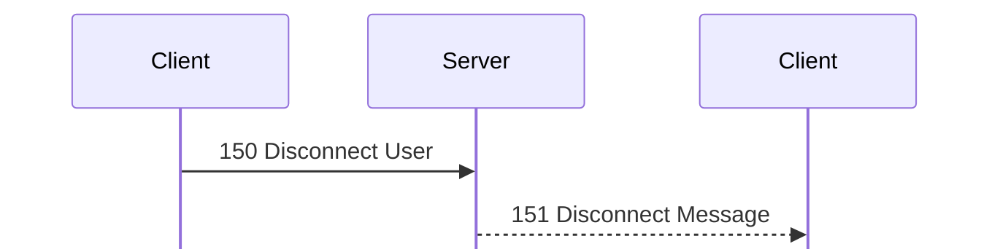
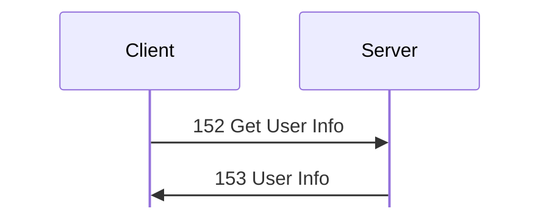
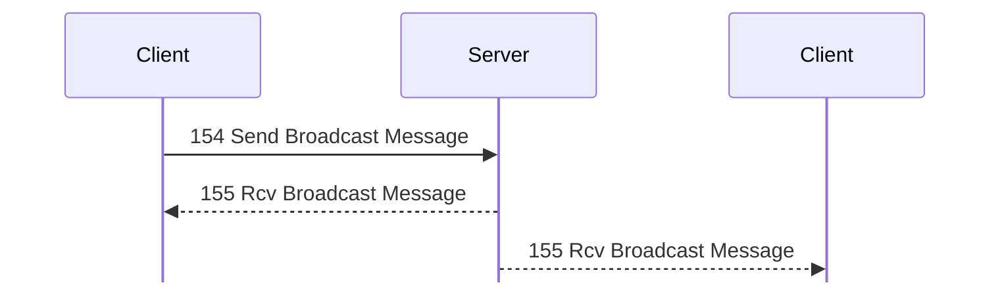
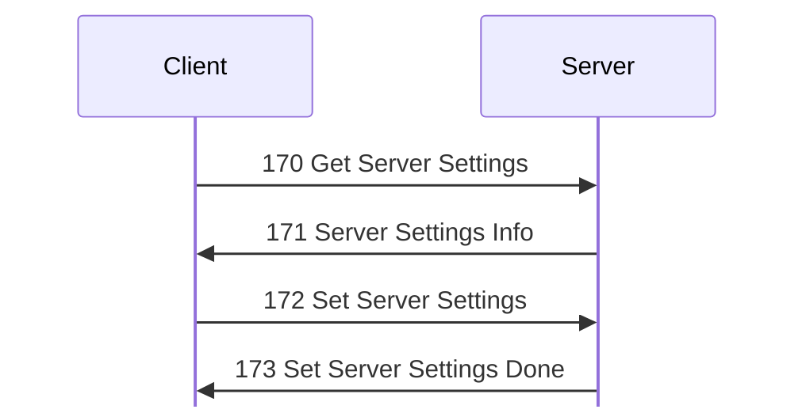
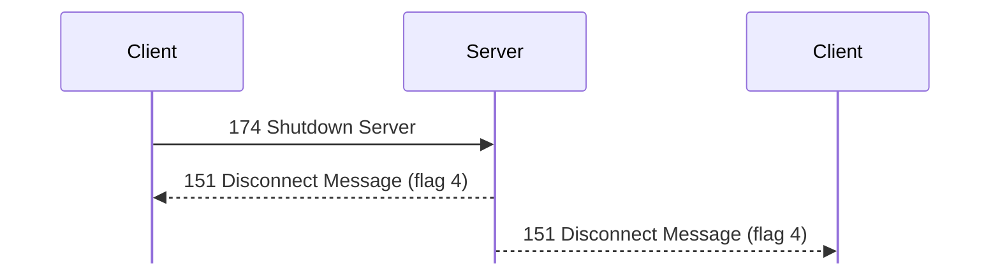
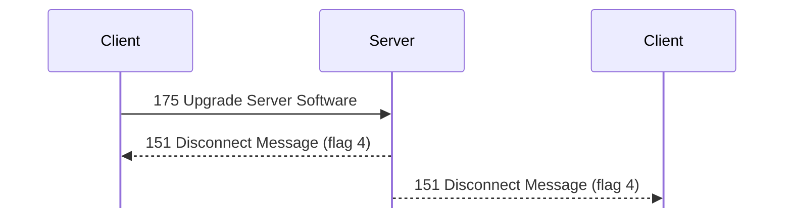
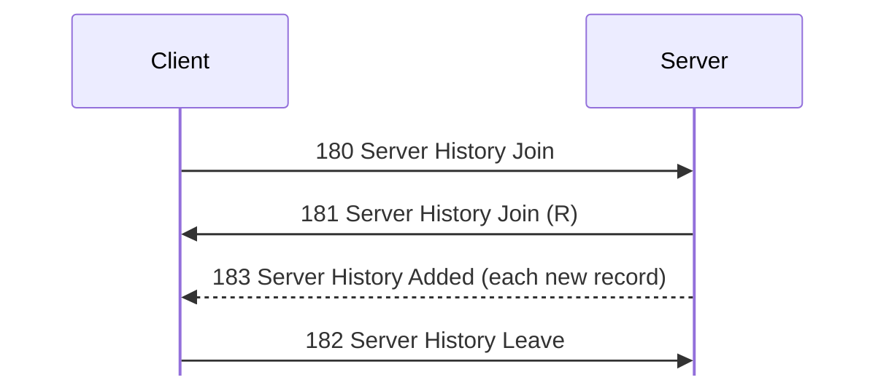

# Administration messages

Tags, hex, and field notation: see [Conventions](../README.md#conventions).

Message types 150 to 183: disconnects, user info, broadcasts, server settings,
shutdown, upgrades, and server history; and 184 to 191, the kinds of history
record.

## 150 Disconnect User
Initiator: Client. Privilege: Disconnect Users (41), and Ban Users (43) to ban.
<!-- [S `FUN_0804c42c`; O `captures/linux-chat-admin.pcapng` frames 159, 161] -->

The target is told:

Struct `DisconnectUser` (dynamic):

| Off | Size | Type | Field | Notes |
|---|---|---|---|---|
| 0x00 | 4 | u32 | user_id | the user to disconnect |
| 0x04 | 4 | u8[4] | ignored_04 |  |
| 0x08 | 4 | u32 | ban_seconds | ≤ 0x80000; 0 = no ban |
| 0x0c | 5 | u8[5] | ignored_0c |  |
| 0x11 | 1 | u8 | options | bit 0: disconnect without a notice |
| 0x12 | 2 | u8[2] | ignored_12 |  |
| 0x14 | 1 | u8 | message_len |  |
| 0x15 | 3 | u8[3] | ignored_15 |  |
| 0x18 | message_len | str | message |  |

A target with Cannot Be Disconnected is refused unless the server's address
check passes. The target receives [151 Disconnect Message](#m151).

In `captures/linux-chat-admin.pcapng` the GUI (user 2) disconnected itself
with the message `test` and no ban: the [150 Disconnect User](#m150) at frame
159 is 28 bytes. <!-- [O] --> `kdx_proto::msg::admin::DisconnectUser` re-encodes it
byte for byte.

## 151 Disconnect Message
Initiator: Server.

Sent to the target of [150 Disconnect User](#m150), and broadcast by
[174 Shutdown Server](#m174) and [175 Upgrade Server Software](#m175):

Struct `DisconnectMessage` (dynamic):

| Off | Size | Type | Field | Notes |
|---|---|---|---|---|
| 0x00 | 4 | u32 | user_id |  |
| 0x04 | 8 | u8[8] | ignored | 0 as sent. |
| 0x0c | 2 | u16 | flags | 2 = banned, 4 = server shutting down or upgrading |
| 0x0e | 2 | u16 | value_0e | unknown; 0 in the lab |
| 0x10 | 2 | u16 | value_10 | unknown; 0 in the lab |
| 0x12 | 1 | u8 | message_len |  |
| 0x13 | 1 | u8 | name_len |  |
| 0x14 | message_len | str | message |  |
|  | name_len | str | name |  |

In that capture the [151 Disconnect Message](#m151) at frame 161 has user ID 2,
flags 0, and the name `kdx-lab-linux`. <!-- [O] --> Since the sender was also the
target, the capture doesn't tell the two apart at 0x00.
`kdx_proto::msg::admin::DisconnectMessage` re-encodes it byte for byte.

## 152 Get User Info
Initiator: Client. Privilege: Get User Info (40). <!-- [S `FUN_0804c8a8`; O] -->

[152 Get User Info](#m152) gets [153 User Info](#m153):

Struct `GetUserInfo` (4 bytes):

| Off | Size | Type | Field | Notes |
|---|---|---|---|---|
| 0x00 | 4 | u32 | user_id |  |

If the user doesn't exist, the server replies with [1 Status](status.md#m1)
0x1000c. <!-- [O] --> `kdx_proto::msg::user_info::GetUserInfo` encodes the request.

## 153 User Info
Initiator: Server. <!-- [S `FUN_0804c8a8`; O] -->

Reply to [152 Get User Info](#m152) (120 bytes for the prober itself), padded
to 4:

Struct `UserInfo` (dynamic):

| Off | Size | Type | Field | Notes |
|---|---|---|---|---|
| 0x00 | 4 | u32 | user_id |  |
| 0x04 | 4 | u8[4] | ignored_04 |  |
| 0x08 | 8 | u64 | login_time |  |
| 0x10 | 8 | u64 | time_10 | meaning unknown |
| 0x18 | 8 | u64 | time_18 | meaning unknown |
| 0x20 | 27 | u8[27] | ignored_20 |  |
| 0x3b | 1 | u8 | address_len |  |
| 0x3c | 1 | u8 | ignored_3c |  |
| 0x3d | 1 | u8 | nick_len |  |
| 0x3e | 1 | u8 | ignored_3e |  |
| 0x3f | 1 | u8 | name_3f_len |  |
| 0x40 | 1 | u8 | login_len |  |
| 0x41 | 1 | u8 | name_41_len |  |
| 0x42 | 2 | u8[2] | ignored_42 |  |
| 0x44 | address_len | str | address |  |
|  | nick_len | str | nick |  |
|  | name_3f_len | str | name_3f | `Administrator`; the class or the account name <!-- [I] --> |
|  | login_len | str | login |  |
|  | name_41_len | str | name_41 | `Administrator`; the class or the account name <!-- [I] --> |
|  | pad4 | u8[] | padding | uninitialised padding to a multiple of 4 |

## 154 Send Broadcast Message
Initiator: Client. Privilege: Broadcast (33). <!-- [S `FUN_0804d1a8`; O `captures/linux-chat-admin.pcapng` frames 129, 130, 132] -->

Everyone receives the broadcast, the sender included:

Struct `SendBroadcast` (dynamic):

| Off | Size | Type | Field | Notes |
|---|---|---|---|---|
| 0x00 | 2 | u16 | value_0 | unknown; 0 in the lab |
| 0x02 | 2 | u16 | value_2 | copied through to 0x0e of [155 Rcv Broadcast Message](#m155) |
| 0x04 | rest | str | text | ≤ 0x800 |

Everyone receives [155 Rcv Broadcast Message](#m155). The GUI (user 2) sent
`00 00 00 00` and `test broadcast` (frame 129). <!-- [O] -->
`kdx_proto::msg::admin::SendBroadcast` re-encodes it.

## 155 Rcv Broadcast Message
Initiator: Server.

Sent to everyone for a [154 Send Broadcast Message](#m154):

Struct `RcvBroadcast` (dynamic):

| Off | Size | Type | Field | Notes |
|---|---|---|---|---|
| 0x00 | 4 | u32 | user_id | 0 for the server's own notices |
| 0x04 | 10 | u8[10] | ignored | 0 as sent. |
| 0x0e | 2 | u16 | value_0e | copied from 0x02 of the request |
| 0x10 | rest | str | text |  |

For the 154 at frame 129, both the peer (130) and the sender (132) got user
ID 2, 12 zero bytes, and the text. <!-- [O] --> `kdx_proto::msg::admin::RcvBroadcast`
re-encodes them.

## 170 Get Server Settings
Initiator: Client. Privilege: Modify Server Settings (61).
<!-- [S `FUN_0805f598`; O `captures/linux-server-settings.pcapng`] -->

No payload.

The reply is [171 Server Settings Info](#m171).

## 171 Server Settings Info
Initiator: Server. Observed sizes: 216 and 764 bytes. <!-- [S `FUN_0805f598`; O] -->

Reply to [170 Get Server Settings](#m170). The reply is the server's
settings file. It starts with the protocol `%KDX`, the sub-protocol `SSTG`, and a
version, followed by a table of section offsets and the sections. The server
compares the protocol and the sub-protocol as two separate words.
<!-- [S `FUN_08060268`] -->

What the captures show (`captures/linux-server-settings.pcapng` frames 36,
40, 56, 221, 225): <!-- [O] -->

Struct `ServerSettings` (dynamic):

| Off | Size | Type | Field | Notes |
|---|---|---|---|---|
| 0x00 | 4 | char[4] | protocol | not stored. `"%KDX"` (0x254b4458) <!-- [S `FUN_08060268`] --> |
| 0x04 | 4 | char[4] | sub_protocol | not stored. `"SSTG"` (0x53535447) <!-- [S `FUN_08060268`] --> |
| 0x08 | 2 | u16 | version | 1 |
| 0x0a | 2 | u8[2] | ignored |  |
| 0x0c | 88 | ServerSettingsSection[11] | sections | 11 entries <!-- [I] --> |
| 0x64 | 12 | u8[12] | value_64 | `01 01 01 01 00 01 00 02 00 00 00 00` in a 171; 0x6b is 0 in a 172, and 0x69 too in a 172 without the icon |
| 0x70 | rest | u8[] | body | the sections, at the offsets of the table; entry 0 is a `ServerSettingsMain` |

Struct `ServerSettingsSection` (8 bytes):

| Off | Size | Type | Field | Notes |
|---|---|---|---|---|
| 0x00 | 4 | u32 | offset | from the start of the blob |
| 0x04 | 4 | u32 | length | 0 for an empty or absent section |

The main section, entry 0, starts at 0x70 and is 0x68 bytes in the captures.
Its offsets below are from its own start; add 0x70 for the blob:

Struct `ServerSettingsMain` (dynamic):

| Off | Size | Type | Field | Notes |
|---|---|---|---|---|
| 0x00 | 35 | u8[35] | ignored_00 |  |
| 0x23 | 1 | u8 | flags | bit 1: greeting enabled (0x93 in the blob) |
| 0x24 | 20 | u8[20] | ignored_24 |  |
| 0x38 | 4 | u32 | total_outgoing_speed_limit | bytes per second; 0x5000, or 0 when off (0xa8 in the blob) |
| 0x3c | 22 | u8[22] | ignored_3c |  |
| 0x52 | 1 | u8 | ignored_52 | 0x0a, the length of both names seen <!-- [I] --> (0xc2 in the blob) |
| 0x53 | 9 | u8[9] | ignored_53 |  |
| 0x5c | rest | str | server_name | NUL-terminated, at the end of the main section (0xcc in the blob) |

What the section table holds in the captures: <!-- [O] -->

- Entry 0 (at 0x0c) is the main section: 0x70, 0x68.
- Entry 3 (at 0x24) is the greeting section: 0xd8, 0x17; length 0 when no
  greeting is set.
- Entry 5 (at 0x34) is the icon section: 0xf0, 0x20c; 0xd8, 0 when none is
  set; 0xf0, 0 in a [172 Set Server Settings](#m172) without it.
- Entry 7 (at 0x44) has the offset at the end of the blob and length 0 in a
  [171 Server Settings Info](#m171); 0, 0 in a 172.

Entries 1 and 2 are (0xd8, 0) and entries 4, 6, and 8 to 10 are all zero in
every capture. Each section starts on a multiple of 4. The greeting section has
the layout of [107 Server Greeting](session.md#m107), and the icon section holds
the bytes of [106 Server Icon](session.md#m106). A 172 may give the icon section
length 0, and the server keeps its icon: frames 56 and 225 sent none, and the
171 at frame 221 still holds it.

`kdx_proto::msg::server_info::ServerSettings` decodes the table and reads the
named fields from the main section, keeping the rest of the bytes as sent.
It re-encodes all six blobs of `captures/linux-server-settings.pcapng` and
the 171 at frame 116 of `captures/probe.pcapng` byte for byte.

## 172 Set Server Settings
Initiator: Client.
Handler:. <!-- [S `FUN_0805f638`] -->

The settings are read, then written back:

Struct `SetServerSettings` (dynamic):

| Off | Size | Type | Field | Notes |
|---|---|---|---|---|
| 0x00 |  | ServerSettings | settings | the blob of [171 Server Settings Info](#m171) |

[172 Set Server Settings](#m172) sends the same blob as
[171 Server Settings Info](#m171) back, and the server answers with
[173 Set Server Settings Done](#m173). <!-- [O] -->

## 173 Set Server Settings Done
Initiator: Server.

Reply to [172 Set Server Settings](#m172). <!-- [O] -->

No payload.

The reply is empty. <!-- [O `captures/linux-server-settings.pcapng` frames 41, 57] -->

## 174 Shutdown Server
Initiator: Client. Privilege: Shutdown Server (64). <!-- [S `FUN_08061598`] -->

Users are told before the server exits:

Struct `ShutdownServer` (dynamic):

| Off | Size | Type | Field | Notes |
|---|---|---|---|---|
| 0x00 | 1 | u8 | ignored_00 | 0 as sent. |
| 0x01 | 1 | u8 | mode | low 3 bits nonzero, else 0x10002 |
| 0x02 | 2 | u8[2] | ignored_02 | 0 as sent. |
| 0x04 | rest | str | message | the rest of the body, no length prefix; ≤ 0xff |

The server broadcasts [151 Disconnect Message](#m151) with flag 4, writes
history record 0xae, then exits after 5000 ms (`FUN_0806155c`). Mode 1 exits the
program only. <!-- [O `captures/linux-shutdown.pcapng` frames 47, 48] --> Before
exiting, mode bit 2 runs `/sbin/shutdown -h now` and bit 1
`/sbin/shutdown -r now` (`FUN_080916e4`). <!-- [S] -->
`kdx_proto::msg::admin::ShutdownServer` re-encodes frame 47.

## 175 Upgrade Server Software
Initiator: Client. Privileges: Shutdown Server (64) and Launch Programs
(82). <!-- [S `FUN_0806172c`] -->

Users are told before the server restarts:

No payload.

The request has no fields; the handler reads no body. <!-- [S] --> The dialog's
Restart KDX option doesn't reach the server: the body is empty with it unticked
and ticked. <!-- [O `captures/linux-shutdown.pcapng` frame 19; O `captures/linux-upgrade.pcapng` frame 19] -->

Without `KDXServer.lexe` in the server's folder the reply is
[1 Status](status.md#m1) 0x1000c. The server then opens `KDXServer.lexe` in the
folder it resolves for `Bases` (`FUN_08092db8`) and `KDXUpgradeHelper.lexe`; a
missing file gets 0x30067. <!-- [S] --> Without the new program in `Bases` the first
open fails its `stat`: 0x30067, module 0x46, line 0x198. <!-- [O `captures/linux-shutdown.pcapng` frame 20] -->

On success there is no 1 Status. The server broadcasts
[151 Disconnect Message](#m151) with flag 4 and "Upgrading server software, be
back in 5 seconds!", <!-- [O `captures/linux-upgrade.pcapng` frame 20] --> launches
the helper, writes history record 0xaf, and exits after 0xd48 ms with mode 1 of
[174 Shutdown Server](#m174). <!-- [S] --> The helper moves `Bases/KDXServer.lexe`
over the server's program and starts it, whatever its version. In the lab,
[175 Upgrade Server Software](#m175) downgraded Server 1.620 to 1.600, which was
back about 5 s after the 151; the next login's
[105 Server Info](session.md#m105) reports version 1600. <!-- [O `captures/linux-upgrade.pcapng` frame 37] -->

## 180 Server History Join
Initiator: Client. Privilege: View Server History (63). <!-- [S `FUN_08062674`, `FUN_080627f8`, `FUN_08061d80`] -->

A client joins the history, gets new records, and leaves:

No payload.

The request is empty. <!-- [O `captures/linux-server-settings.pcapng` frames 32, 88; O `captures/linux-chat-admin.pcapng` frame 134] -->

The reply is [181 Server History Join (R)](#m181). While joined, the client
receives [183 Server History Added](#m183) for each new record. A record's kind
is one of 184 to 191 (Login, Disconnected, Abort File Download, …), or the type
of the logged request (e.g. [400 Get File List](files.md#m400) for a failed file
list).

A record, which the 183s in frames 38 to 228 repeat: <!-- [O `captures/linux-server-settings.pcapng` frames 33, 89; O `captures/linux-chat-admin.pcapng` frame 135] -->

Struct `HistoryRecord` (dynamic):

| Off | Size | Type | Field | Notes |
|---|---|---|---|---|
| 0x00 | 8 | u64 | time | ms |
| 0x08 | 4 | u32 | kind | 0xbe ([190 Server Started](#m190)) first in each join reply |
| 0x0c | 4 | u32 | user_id | 0 for Server Started |
| 0x10 | 50 | u8[50] | ignored_10 | 0 in every capture |
| 0x42 | 2 | u16 | path_len |  |
| 0x44 | 2 | u8[2] | ignored_44 | 0 in every capture |
| 0x46 | 1 | u8 | address_len |  |
| 0x47 | 1 | u8 | nick_len |  |
| 0x48 | 1 | u8 | login_len |  |
| 0x49 | 1 | u8 | detail_len |  |
| 0x4a | 2 | u8[2] | ignored_4a | 0 in every capture |
| 0x4c | address_len | str | address |  |
|  | nick_len | str | nick | the nick before the event |
|  | login_len | str | login |  |
|  | detail_len | str | detail | the new nick for [100 Set Identity](session.md#m100) (frame 197), the chat name for [202 Join Chat](chat.md#m202) (frame 208) |
|  | path_len | FilePath | path |  |
|  | pad4 | u8[] | padding | padding to a multiple of 4 |

The path is a [FilePath](../encodings.md#file-paths), as in the file messages:
`speed.bin` for [412 Download File](files.md#m412) and [188 Finished File
Download](#m188) (frames 108, 190). Saving the settings logs [170 Get Server
Settings](#m170) and [172 Set Server Settings](#m172) (frames 38, 43).
`kdx_proto::msg::admin::HistoryList` (181) and `HistoryRecord` (183) re-encode
every payload byte for byte, the unnamed bytes and padding included.

## 181 Server History Join (R)
Initiator: Server.

Reply to [180 Server History Join](#m180): the buffered records, each padded
to 4.

Struct `HistoryList` (dynamic):

| Off | Size | Type | Field | Notes |
|---|---|---|---|---|
| 0x00 | 4 | u32 | ignored | 0 as sent. |
| 0x04 | 4 | u32 | records_count |  |
| 0x08 | records_count | HistoryRecord[] | records | each padded to 4 |

## 182 Server History Leave
Initiator: Client. Privilege: View Server History (63).
Handler:. <!-- [S `FUN_080627f8`] -->

No payload.

The request is empty. <!-- [O `captures/linux-chat-admin.pcapng` frame 137] -->

Leaves the history joined with [180 Server History Join](#m180).

## 183 Server History Added
Initiator: Server.
Handler:. <!-- [S `FUN_08061d80`] -->

Sent while joined with [180 Server History Join](#m180), for each new
record: one record padded to 4.

Struct `HistoryAdded` (dynamic):

| Off | Size | Type | Field | Notes |
|---|---|---|---|---|
| 0x00 |  | HistoryRecord | record |  |

## 184 to 191 History record kinds
Initiator: Server. <!-- [S] -->

The kind of a history record in [181 Server History Join (R)](#m181) and
[183 Server History Added](#m183): [184 Login](#m184),
[185 Disconnected](#m185), [186 Abort File Download](#m186),
[187 Abort File Upload](#m187), [188 Finished File Download](#m188),
[189 Finished File Upload](#m189), [190 Server Started](#m190), and
[191 Login Failed](#m191). The record layout is under
[180 Server History Join](#m180).
