# Chat messages

Tags, hex, and field notation: see [Conventions](../README.md#conventions).

Message types 200 to 223: public and private chat rooms, invitations, and
voice flags. Private messages are on [their own page](private-messages.md).

## 200 Create Private Chat
Initiator: Client. Privilege: Create Private Chat (34). **[S `FUN_08058420`; O
`captures/linux-chat-admin.pcapng` frames 84 to 85]**

A new private chat is one request and one reply:

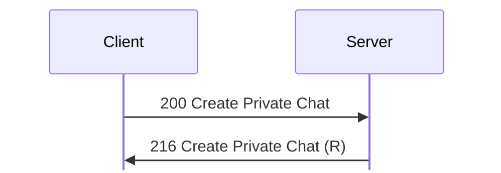

No payload.

A user can have at most 10 private chats. The server
answers with [216 Create Private Chat (R)](#m216).

## 201 Delete Chat
Initiator: Client. Privilege: Create/Modify Chats (37). **[S `FUN_08059774`;
O]**

Every member gets 221 Chat Deleted before the requester gets 1 Status:

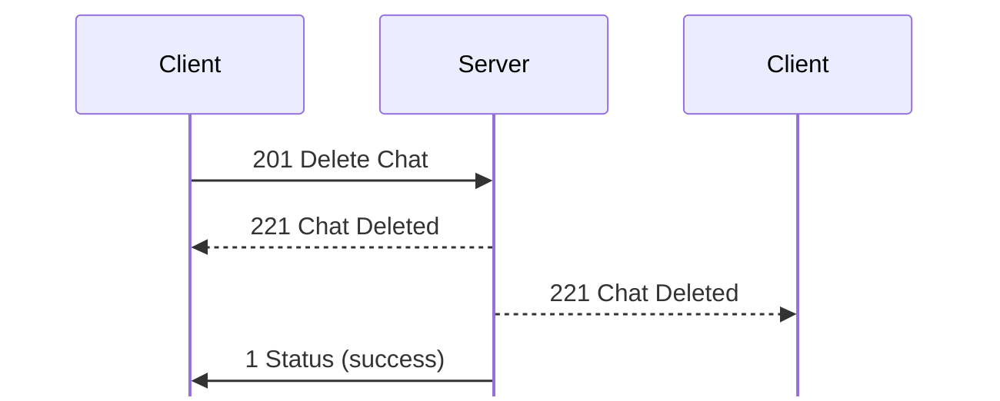

Struct `ChatId` (4 bytes):

| Off | Size | Type | Field | Notes |
|---|---|---|---|---|
| 0x00 | 4 | u32 | chat_id |  |

Every member, the requester included, receives
[221 Chat Deleted](#m221) before the requester's [1 Status](status.md#m1)
success. Users outside the chat receive nothing.

**[O]** `captures/linux-chat-rooms.pcapng`: deleting `lab-chat` (0xe8df4d29)
with two members sent 221 to both (frames 125, 127), then Status at 129.
Deleting the empty `lab-room` sent no 221 to a user in Public Chat (frames
77-83). The client deleted a chat whose window was open without sending
[204 Leave Chat](#m204) first (frame 122). `ChatId` in `kdx_proto::msg::chat`
re-encodes [201 Delete Chat](#m201) (frames 77, 122) byte for byte (test
`linux_chat_rooms`).

## 202 Join Chat
Initiator: Client. Privilege: Join Chat (30) and the chat's join classes.
**[S `FUN_08058710`; O]**

Joining a chat, with the other members told:

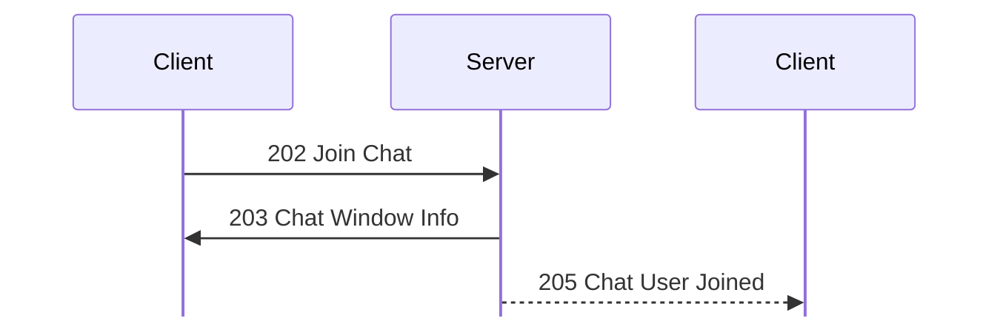

Struct `JoinChat` (8 bytes):

| Off | Size | Type | Field | Notes |
|---|---|---|---|---|
| 0x00 | 4 | u32 | chat_id |  |
| 0x04 | 4 | u32 | key | needed for private chats |

The server answers with [203 Chat Window Info](#m203), and the other members
receive [205 Chat User Joined](#m205).

## 203 Chat Window Info
Initiator: Server. Reply to [202 Join Chat](#m202).

Reply (51 bytes in the lab). The five strings follow the member IDs in this
order: name, topic, topic setter, IRC server, IRC channel. The length fields
before them are in a different order: IRC server, IRC channel, name, topic,
topic setter **[S server `FUN_08058710`, client `FUN_08082b90`]**. In every
capture the IRC lengths are 0 and the byte at 0x20 is the name's length, so no
capture shows the order of the strings **[O]**.

Struct `ChatWindowInfo` (dynamic):

| Off | Size | Type | Field | Notes |
|---|---|---|---|---|
| 0x00 | 8 | u64 | time |  |
| 0x08 | 4 | u32 | chat_id |  |
| 0x0c | 4 | u32 | key |  |
| 0x10 | 4 | u8[4] | ignored_10 |  |
| 0x14 | 2 | u16 | flags | bit 0 private, bit 1 voice |
| 0x16 | 2 | u16 | members_count |  |
| 0x18 | 6 | u8[6] | ignored_18 |  |
| 0x1e | 1 | u8 | irc_server_len |  |
| 0x1f | 1 | u8 | irc_channel_len |  |
| 0x20 | 1 | u8 | name_len |  |
| 0x21 | 1 | u8 | topic_len |  |
| 0x22 | 1 | u8 | topic_setter_len |  |
| 0x23 | 1 | u8 | ignored_23 |  |
| 0x24 | members_count | u32[] | members |  |
|  | name_len | str | name | **[O]** |
|  | topic_len | str | topic |  |
|  | topic_setter_len | str | topic_setter | the nick that set the topic |
|  | irc_server_len | str | irc_server |  |
|  | irc_channel_len | str | irc_channel |  |

In frame 68 of `captures/probe.pcapng` only the name (`Public Chat`) is
set; the payload is not padded.

**[O]** `captures/linux-chat-rooms.pcapng`: flags is 2 for a voice chat (frames
70, 115) and 0 for Public Chat (frame 176). The time is set for Public Chat and
0 for chats made with [217 Create Chat](#m217).

## 204 Leave Chat
Initiator: Client. **[S `FUN_08058c0c`; O `captures/linux-chat-rooms.pcapng`
frame 75; O `captures/kdx-cli.pcapng` frames 423 to 424]**

Leaving a chat tells the other members:

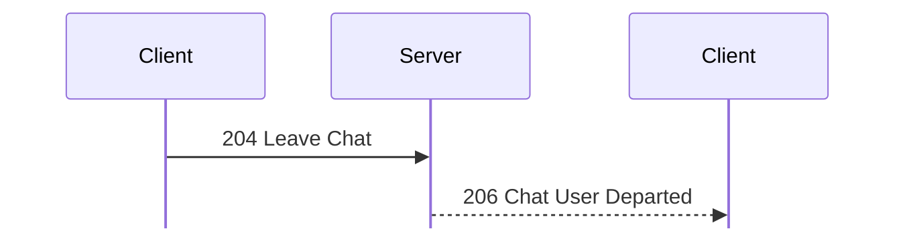

Struct `LeaveChat` (4 bytes):

| Off | Size | Type | Field | Notes |
|---|---|---|---|---|
| 0x00 | 4 | ChatId | chat |  |

The other members receive [206 Chat User Departed](#m206). A private chat that
becomes empty is deleted. `ChatId` in `kdx_proto::msg::chat` re-encodes
[204 Leave Chat](#m204) byte for byte (tests `linux_chat_rooms`, `kdx_cli`).

## 205 Chat User Joined
Initiator: Server. Sent to the other members after
[202 Join Chat](#m202).

Struct `ChatUserChange` (12 bytes):

| Off | Size | Type | Field | Notes |
|---|---|---|---|---|
| 0x00 | 4 | u32 | chat_id |  |
| 0x04 | 4 | u32 | user_id | the user who joined or left |
| 0x08 | 1 | u8 | ignored_08 | 0 in 205, 1 in [206](#m206) |
| 0x09 | 3 | u8[3] | ignored_09 |  |

In 205 the last four bytes are 0 (`captures/kdx-cli.pcapng`
frame 417; `captures/linux-chat-rooms.pcapng` frames 117, 177;
`captures/linux-chat-admin.pcapng` frame 68) **[O]**.
`kdx_proto::msg::chat::ChatUserChange` re-encodes it byte for byte.

## 206 Chat User Departed
Initiator: Server. Sent to the other members after
[204 Leave Chat](#m204).

Struct `ChatUserDeparted` (12 bytes):

| Off | Size | Type | Field | Notes |
|---|---|---|---|---|
| 0x00 | 12 | ChatUserChange | change | the byte at 0x08 is 1, then 3 zero bytes |

The payload is {u32 chat ID, u32 user ID, u8 1, 3 zero bytes}
(`captures/kdx-cli.pcapng` frame 424) **[O]**. The meaning of the 1 is
unknown; [205 Chat User Joined](#m205) has 0 there. `ChatUserChange` in
`kdx_proto::msg::chat` re-encodes [206 Chat User Departed](#m206) byte for byte
(tests `linux_chat_rooms`, `kdx_cli`).

## 207 Send Chat Text
Initiator: Client. Privilege: Send Chat (31) and the chat's send classes.
**[S `FUN_08058d74`; O]**

The server forwards the text to every member, the sender included:

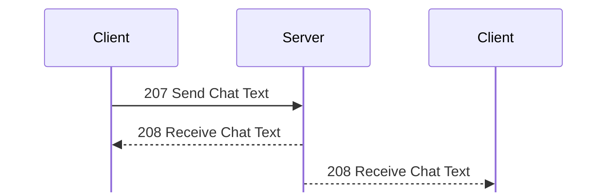

Struct `ChatText` (dynamic):

| Off | Size | Type | Field | Notes |
|---|---|---|---|---|
| 0x00 | 4 | u32 | chat_id |  |
| 0x04 | 4 | u32 | user_id | the server fills in the sender |
| 0x08 | 4 | u8[4] | ignored |  |
| 0x0c | rest | str | text | at most 0x1000 bytes |

The server forwards it as [208 Receive Chat Text](#m208).

## 208 Receive Chat Text
Initiator: Server. Forwarded from [207 Send Chat Text](#m207).

The server forwards the same layout as 207 to every member, the sender
included.

Struct `ReceiveChatText` (dynamic):

| Off | Size | Type | Field | Notes |
|---|---|---|---|---|
| 0x00 |  | ChatText | text | `user ID` is the sender's |

## 209 Set Chat Topic
Initiator: Client. Privilege: Set Chat Topic (35) and the chat's topic
classes. **[S `FUN_08058eac`; O]**

Members receive the new topic:

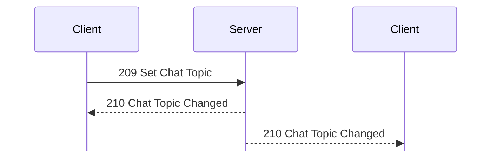

Struct `SetChatTopic` (dynamic):

| Off | Size | Type | Field | Notes |
|---|---|---|---|---|
| 0x00 | 4 | u32 | chat_id |  |
| 0x04 | 6 | u8[6] | ignored_04 | 0 from the client |
| 0x0a | 1 | u8 | topic_len |  |
| 0x0b | 1 | u8 | ignored_0b | 0 from the client |
| 0x0c | topic_len | str | topic |  |
|  | rest | u8[] | rest | ignored by the server; empty from the client |

**[O]**: a probe that put `Hello` at 0x10 with length 5 got the topic
`00 00 00 00 48`, so the server reads from 0x0c (`captures/probe.pcapng`
frames 73-74).

Members receive [210 Chat Topic Changed](#m210).

## 210 Chat Topic Changed
Initiator: Server. Sent to members after [209 Set Chat Topic](#m209).

Struct `ChatTopicChanged` (dynamic):

| Off | Size | Type | Field | Notes |
|---|---|---|---|---|
| 0x00 | 8 | u64 | time |  |
| 0x08 | 4 | u32 | chat_id |  |
| 0x0c | 4 | u32 | user_id |  |
| 0x10 | 8 | u8[8] | ignored_10 | 0 as sent. |
| 0x18 | 1 | u8 | topic_len |  |
| 0x19 | 1 | u8 | nick_len |  |
| 0x1a | 2 | u8[2] | ignored_1a | 0 as sent. |
| 0x1c | topic_len | str | topic |  |
|  | nick_len | str | nick |  |

## 211 Chat Invite
Initiator: Client. **[S `FUN_080591ac`; O `captures/linux-chat-admin.pcapng`
frames 87 to 88, 118 to 120]**

Each invitee receives an invitation:

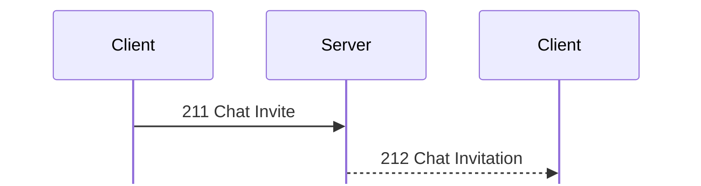

Struct `ChatInvite` (dynamic):

| Off | Size | Type | Field | Notes |
|---|---|---|---|---|
| 0x00 | 4 | u32 | chat_id |  |
| 0x04 | 4 | u8[4] | ignored_04 |  |
| 0x08 | 2 | u16 | user_ids_count |  |
| 0x0a | 5 | u8[5] | ignored_0a |  |
| 0x0f | 1 | u8 | message_len |  |
| 0x10 | user_ids_count | u32[] | user_ids | Length at most 20 |
|  | message_len | str | message |  |

Each invitee receives [212 Chat Invitation](#m212).

**[O]**: the client invited user 1 to `Private 1` (frame 87, 20 bytes), then
users 1 and 4 (frame 118, 24 bytes), with no message. User 4 had left, so
only user 1 got a 212 each time (frames 88 and 120). `ChatInvite` in
`kdx_proto::msg::chat` re-encodes it byte for byte (test
`linux_chat_admin`).

## 212 Chat Invitation
Initiator: Server. Sent to each invitee of [211 Chat Invite](#m211).

Not padded **[O]**:

Struct `ChatInvitation` (dynamic):

| Off | Size | Type | Field | Notes |
|---|---|---|---|---|
| 0x00 | 4 | u32 | chat_id |  |
| 0x04 | 4 | u32 | key | for [202 Join Chat](#m202) |
| 0x08 | 4 | u32 | user_id |  |
| 0x0c | 4 | u32 | ignored_0c | 1 at 88, 2 at 120 |
| 0x10 | 2 | u16 | ignored_10 | 1 |
| 0x12 | 6 | u8[6] | ignored_12 |  |
| 0x18 | 1 | u8 | message_len |  |
| 0x19 | 1 | u8 | name_len |  |
| 0x1a | 2 | u8[2] | ignored_1a |  |
| 0x1c | message_len | str | message | **[I]** probably **[I]**; 0 |
|  | name_len | str | name |  |

**[O]**: frames 88 and 120 are 37 bytes each. The u32 at 0x0c may be the
request's invitee count or a running count **[I]**. The u16 at 0x10 is 1
although [216 Create Private Chat (R)](#m216) gave the chat flags 0.
`ChatInvitation` in `kdx_proto::msg::chat` re-encodes it byte for byte (test
`linux_chat_admin`).

## 213 Must Join Chat
Initiator: Server. **[S `FUN_0804b114`; O]**

After login the server asks for the join, and the client joins chat 1:

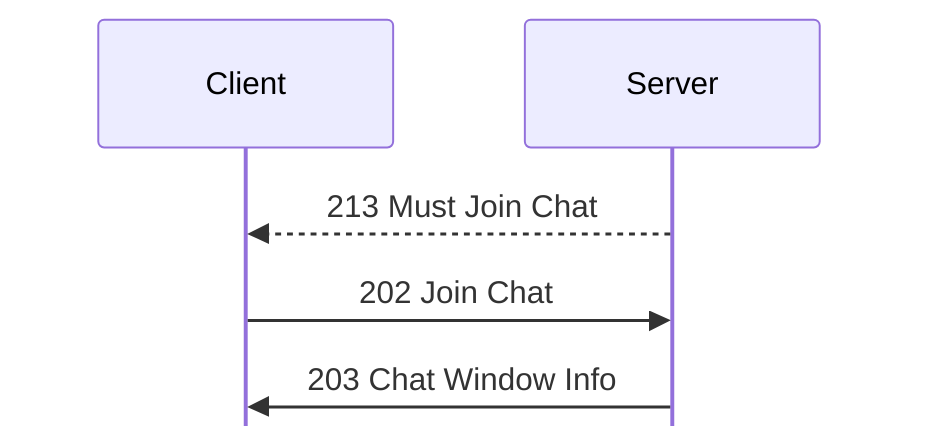

No payload.

The payload is empty **[O `captures/linux-chat-rooms.pcapng` frame 167]**. Sent
after login when the account has Join Chat (30) and Join Chat On Connect (36).
It names no chat. The client always joins chat 1, Public Chat: its [213 Must
Join Chat](#m213) handler ignores the payload and calls the join helper with
chat ID 1 and key 0, which opens the chat window and sends [202 Join
Chat](#m202) {1, 0}, in Client 1.620 beta 5 **[S `FUN_08084020`,
`FUN_08080734`]**. If the window for chat 1 is already open, the helper only
brings it to the front and sends nothing.

**[O]** `captures/linux-chat-rooms.pcapng`: with bit 36 set in the Administrator
class ([504 Set Account Class](accounts.md#m504) at frame 145), 213 arrived
after [106 Server Icon](session.md#m106) (frame 167), and the client sent 202
for chat 1 (frame 175).

## 214 Get Chat List
Initiator: Client. **[S `FUN_080594dc`; O]**

The chat list is one request and one reply:

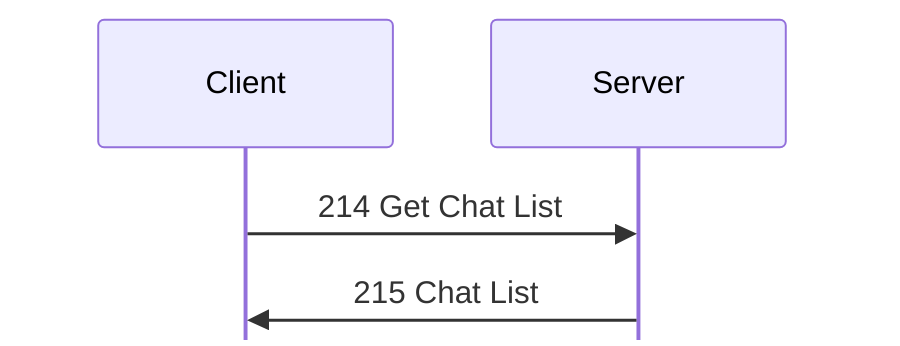

No payload.

The server answers with [215 Chat List](#m215).

## 215 Chat List
Initiator: Server. Reply to [214 Get Chat List](#m214).

A u32 count, then one entry per chat, each padded to 4:

Struct `ChatList` (dynamic):

| Off | Size | Type | Field | Notes |
|---|---|---|---|---|
| 0x00 | 4 | u32 | chats_count |  |
| 0x04 | chats_count | ChatListEntry[] | chats |  |

Struct `ChatListEntry` (dynamic):

| Off | Size | Type | Field | Notes |
|---|---|---|---|---|
| 0x00 | 4 | u32 | chat_id |  |
| 0x04 | 4 | u32 | key |  |
| 0x08 | 6 | u8[6] | ignored |  |
| 0x0e | 2 | u16 | flags | bit 1 voice |
| 0x10 | 2 | u16 | member_count |  |
| 0x12 | 1 | u8 | name_len |  |
| 0x13 | 1 | u8 | description_len |  |
| 0x14 | name_len | str | name |  |
|  | description_len | str | description |  |
|  | pad4 | u8[] | padding |  |

**[O]**: Public Chat (1), Voice Chat (2, flags 2), Admin Lounge (3). Chats made
with [217 Create Chat](#m217) follow, with a random chat ID (0xc217598c and
0xe8df4d29 in `captures/linux-chat-rooms.pcapng` frames 47, 90).

## 216 Create Private Chat (R)
Initiator: Server. Reply to [200 Create Private Chat](#m200).

The reply has the [203 Chat Window Info](#m203) layout, with the creator as the
only member **[O]**. The flags are 0 at frame 85, and the name is e.g.
`Private 1`.

Struct `CreatePrivateChatReply` (dynamic):

| Off | Size | Type | Field | Notes |
|---|---|---|---|---|
| 0x00 |  | ChatWindowInfo | info | one member, the creator |

**[O]**: the 49-byte reply at 85 holds time 0, chat ID 0xb06d05e6, key
0x4ca93520, 1 member, user 2, and `Private 1`. The u32 at 0x24 is the member
list of 203, not a separate creator field.
`kdx_proto::msg::chat::ChatWindowInfo` re-encodes it byte for byte (test
`linux_chat_admin`).

## 217 Create Chat
Initiator: Client. Privilege: Create/Modify Chats (37) for
[217 Create Chat](#m217) and [220 Set Chat](#m220). **[S; O
`captures/linux-chat-rooms.pcapng` frames 42 to 62, 85, 136 to 137]** Handler:
**[S `FUN_08059944`]**.

Creating, reading, and changing a chat record:

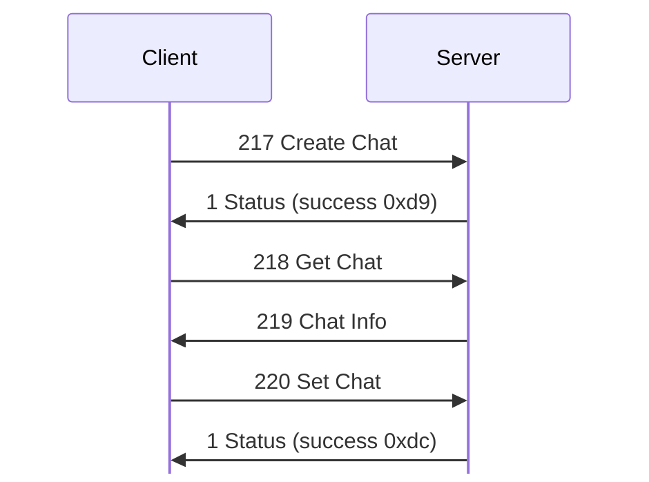

217 Create Chat and 220 Set Chat carry a chat record.
[218 Get Chat](#m218) is a u32 chat ID, and [219 Chat Info](#m219) is a chat
record. 220 Set Chat refuses private chats. 217 and 220 get
[1 Status](status.md#m1) success.

The chat record, not padded, is `ChatRecord` in
[encodings.md](../encodings.md#chat-record).

Struct `CreateChat` (dynamic):

| Off | Size | Type | Field | Notes |
|---|---|---|---|---|
| 0x00 |  | ChatRecord | chat | `chat ID` is 0 |

**[O]** `captures/linux-chat-rooms.pcapng`: 217 for `lab-room` / `lab` (frame
42), 219 and 220 for `lab edited` (frames 50, 52), 220 with Voice Chat ticked
(flags 2, frame 62), and 219 for Public Chat (frame 137). The three class masks
are `ff ff ff ff` for Public Chat and `80 00 00 00` for a chat whose Access was
left at the default. Their bits are probably account classes, MSB first
(Administrator is class 0), for join, send, and topic **[I]**. The client sends
[505 Get Account Class List](accounts.md#m505) before it opens the new-chat
window (frame 39). 217 gets 1 Status success 0xd9 and 220 gets 0xdc (frames 45,
55). `ChatRecord` and `ChatId` in `kdx_proto::msg::chat` re-encode 217 to 220
byte for byte (test `linux_chat_rooms`).

## 218 Get Chat
Initiator: Client. **[S; O]**
Handler: **[S `FUN_08059be8`]**.

Struct `GetChat` (4 bytes):

| Off | Size | Type | Field | Notes |
|---|---|---|---|---|
| 0x00 | 4 | ChatId | chat |  |

See [217 Create Chat](#m217) for the shared facts.
[218 Get Chat](#m218) is the chat ID alone (frames 49, 59, 136). The server
answers with [219 Chat Info](#m219).

## 219 Chat Info
Initiator: Server. Reply to [218 Get Chat](#m218).

A chat record, as described under [217 Create Chat](#m217).

Struct `ChatInfo` (dynamic):

| Off | Size | Type | Field | Notes |
|---|---|---|---|---|
| 0x00 |  | ChatRecord | chat |  |

## 220 Set Chat
Initiator: Client. Privilege: Create/Modify Chats (37).
Handler: **[S `FUN_08059e24`]**.

Carries a chat record and refuses private chats; see
[217 Create Chat](#m217) for the record, captures and Status code.

Struct `SetChat` (dynamic):

| Off | Size | Type | Field | Notes |
|---|---|---|---|---|
| 0x00 |  | ChatRecord | chat |  |

## 221 Chat Deleted
Initiator: Server. Sent to every member after [201 Delete Chat](#m201).

Struct `ChatDeleted` (8 bytes):

| Off | Size | Type | Field | Notes |
|---|---|---|---|---|
| 0x00 | 4 | u32 | chat_id |  |
| 0x04 | 4 | u32 | user_id | the requester |

**[O]** `captures/linux-chat-rooms.pcapng`: deleting `lab-chat` (0xe8df4d29)
sent `e8 df 4d 29 00 00 00 02` to both members (frames 125, 127).
`ChatDeleted` in `kdx_proto::msg::chat` re-encodes [221 Chat Deleted](#m221)
(frames 125, 127) byte for byte (test `linux_chat_rooms`).

## 222 Get Chat DCC Addresses
Initiator: Client. **[S `FUN_0805a110`; O]**

A voice chat member asks where the others listen:

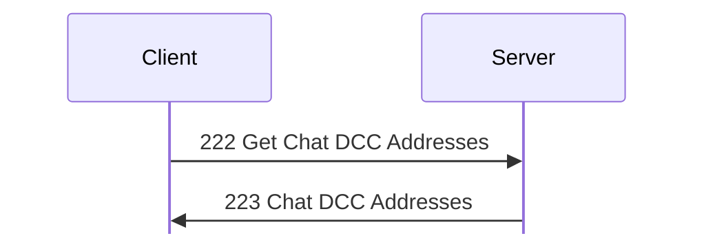

Struct `GetChatDccAddresses` (4 bytes):

| Off | Size | Type | Field | Notes |
|---|---|---|---|---|
| 0x00 | 4 | ChatId | chat |  |

The chat must have the voice flag (bit 1) and the
sender must be a member; otherwise [1 Status](status.md#m1) 0x10014. An unknown
chat gets 0x1000c **[S]**. The server answers with
[223 Chat DCC Addresses](#m223).

The client then opens a TCP connection to each address for voice; see
[dcc.md](../dcc.md).

**[O]** `captures/linux-chat-rooms.pcapng`: the client sends
[222 Get Chat DCC Addresses](#m222) right after joining a voice chat. `ChatId`
re-encodes 222 byte for byte (tests `linux_chat_rooms`,
`linux_dcc_voice_failed`).

## 223 Chat DCC Addresses
Initiator: Server. Reply to [222 Get Chat DCC Addresses](#m222).

The reply has one entry for each other member whose user record has a
nonzero DCC port (0x0a), each padded to 4 **[S]**:

Struct `ChatDccAddresses` (dynamic):

| Off | Size | Type | Field | Notes |
|---|---|---|---|---|
| 0x00 | rest | DccAddress[] | addresses |  |

Struct `DccAddress` (dynamic):

| Off | Size | Type | Field | Notes |
|---|---|---|---|---|
| 0x00 | 4 | u32 | user_id |  |
| 0x04 | 10 | u8[10] | ignored_04 | 0 as sent. |
| 0x0e | 1 | u8 | address_len |  |
| 0x0f | 1 | u8 | ignored_0f | 0 as sent. |
| 0x10 | address_len | str | address | `ip:port`: the member's address and DCC port |
|  | pad4 | u8[] | padding |  |

**[O]** `captures/linux-chat-rooms.pcapng`: the reply was empty (len 0) when
the client was alone (frames 72-73) and when a `kdx` CLI peer was also a
member (frames 119-120). The CLI sends DCC port 0, so the server leaves it
out **[S]**.

**[O]** `captures/linux-dcc-voice-failed.pcapng`: one entry, user 1 with length
0xf and `127.0.0.1:10600`, padded with 0x22 rather than 0 (frames 109 and 155).
The padding byte is probably uninitialised **[I]**; `DccAddress::padding` keeps
it. `DccAddress` re-encodes [223 Chat DCC Addresses](#m223) byte for byte (tests
`linux_chat_rooms`, `linux_dcc_voice_failed`).
