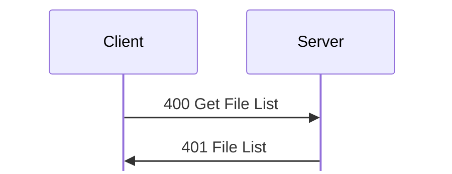
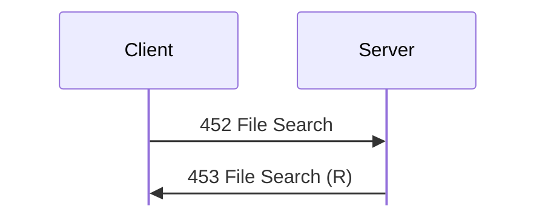

# File messages

For hex and field notation, see [Conventions](../README.md#conventions).

Message types 400 to 453 cover listings, folders, deletion, file information,
downloads and uploads, launching, the trash, volumes, the catalog, and search.

File requests address items with a file path. Each user is confined to a base
folder.

## File path requests

A *name list* below has the same layout as a file path: a u16 count, then, for
each name, a u16 0, a u8 length, and the name. When a request holds paths back
to back, each one carries its own length, and the root is written as a count of
0 (`00 00`), not left empty (`captures/linux-files.pcapng` frames 206 and
241). <!-- [O] --> `kdx_proto::msg::FilePath::decode_delimited` reads such a
path. Each request also passes the folder access check (`FUN_08057e5c`) with an
access kind. If the check fails, the reply is [1 Status](status.md#m1) 0x10014.
`kdx_proto::msg::file` re-encodes each request below byte for byte (test
`linux_files`).

## 400 to 409: Listings, folders and deletion

### 400 Get File List
Initiator: Client. <!-- [S `FUN_0804d938`; O] -->

A folder listing is one request and one reply:

Struct `GetFileList` (dynamic):

| Off | Size | Type | Field | Notes |
|---|---|---|---|---|
| 0x00 |  | [`FilePath`](../encodings.md#sFilePath) | `path` | Empty for the root. |

The server replies with [401 File List](#m401).

If the folder access check (`FUN_08057e5c`) fails, or the server cannot read the
folder, the server also replies with an empty 401 File List. It then writes a
history record of kind 400 Get File List.

### 401 File List
Initiator: Server. Reply to [400 Get File List](#m400).

A folder with no entries gets an empty reply. Otherwise, the reply is a u32
count, then one entry for each item, each padded to a multiple of 4:

Struct `FileList` (dynamic):

| Off | Size | Type | Field | Notes |
|---|---|---|---|---|
| 0x00 | 4 | `u32` | `entries_count` |  |
| 0x04 | `entries_count` | [`FileListEntry`](#sFileListEntry)`[]` | `entries` |  |

Struct `FileListEntry` (dynamic):

| Off | Size | Type | Field | Notes |
|---|---|---|---|---|
| 0x00 | 8 | `u64` | `size` | 0x1000 for folders. |
| 0x08 | 8 | `u64` | `created` | Time. |
| 0x10 | 8 | `u64` | `modified` | Time. |
| 0x18 | 8 | `u8[8]` | `ignored_18` |  |
| 0x20 | 4 | `u32` | `attributes` | 1 for a file, and 0x01000002 for a folder. <!-- [O] --> The server clears bit 24 and tests 0x42. <!-- [S] --> |
| 0x24 | 10 | `u8[10]` | `ignored_24` |  |
| 0x2e | 2 | `u16` | `ignored_2e` | 0xffff for folders, and 0 for a file. |
| 0x30 | 2 | `u16` | `access_item` | The icon of the folder access entry: 0x2c for Dropbox, and 0x2b for Uploads. 0 for a file. See [1100 Create Folder Access](folder-access.md#m1100). <!-- [S] --> |
| 0x32 | 2 | `u8[2]` | `ignored_32` |  |
| 0x34 | 1 | `u8` | `ignored_34` | 4 for `Admin Dropbox [DB]`, 5 for `Uploads [UL]`, and 0 for a file. |
| 0x35 | 1 | `u8` | `name_len` |  |
| 0x36 | 1 | `u8` | `kind_len` |  |
| 0x37 | 1 | `u8` | `ignored_37` |  |
| 0x38 | `name_len` | `str` | `name` |  |
|  | `kind_len` | `str` | `kind` | Empty for folders. `exttype/bin` for a `.bin` file, as in [413 Download File (R)](#m413). |
|  | pad4 | `u8[]` | `padding` | Uninitialized. <!-- [O] --> |

In `captures/kdx-cli.pcapng`, a 600000-byte `cli-big.bin` is listed with size
0x927c0 and kind `exttype/bin`. <!-- [O] -->
`kdx_proto::msg::file::FileListEntry` decodes both kinds of entry.

### 402 Create Folder
Initiator: Client. Privilege: Upload (11). <!-- [S `FUN_0804e0f8`; O `captures/linux-files.pcapng` frames 26 to 29] -->

Struct `CreateFolder` (dynamic):

| Off | Size | Type | Field | Notes |
|---|---|---|---|---|
| 0x00 | 19 | `u8[19]` | `ignored` | 0 as sent. |
| 0x13 | 1 | `u8` | `access_len` |  |
| 0x14 | 2 | `u16` | `path_len` |  |
| 0x16 | 1 | `u8` | `name_len` |  |
| 0x17 | 1 | `u8` | `owner_len` |  |
| 0x18 | `name_len` | `str` | `name` | If empty, the last name in the path is the new folder. |
|  | `access_len` | `str` | `access` | The tag, such as `DB`. Needs Modify Folder Access (28). |
|  | `owner_len` | `str` | `owner` |  |
|  | `path_len` | [`FilePath`](../encodings.md#sFilePath) | `path` | The parent folder. |

The strings come in the order name, access, owner, but the access length comes
first. <!-- [S `FUN_0804e0f8`] -->

With a tag, the folder is named `name [tag]`, or `name [tag,owner]` with an
owner login. A name that ends in a reserved suffix, such as `lnk`, gets 0x30076.
If it succeeds, the reply is [1 Status](status.md#m1) 0x192 (frame 29). The
client's New Folder dialog has Name, a Folder Access menu, and Owner Login.
Frame 26 is 51 bytes: the name `lab-folder` and the path `Uploads [UL]`, with no
tag, no owner, and no padding (`CreateFolder`). <!-- [O] -->

### 403 Create Alias
Initiator: Client. Privilege: Create Aliases (15). <!-- [S `FUN_0804e4ec`; O `captures/linux-files.pcapng` frames 95 to 98] -->

The request is the destination folder path, the source folder path, then a name
list of items in the source folder. Frame 95 holds `Uploads [UL]`, `Uploads
[UL]`, and `upload2.txt`. If it succeeds, the reply is [1 Status](status.md#m1)
0x193 (frame 98). It has the layout of [407 Move File/Folder](#m407).

Struct `MoveItems` (dynamic):

| Off | Size | Type | Field | Notes |
|---|---|---|---|---|
| 0x00 |  | [`DelimitedFilePath`](../encodings.md#sDelimitedFilePath) | `destination` | The folder that the items, or their aliases, go to. |
|  |  | [`DelimitedFilePath`](../encodings.md#sDelimitedFilePath) | `source` | The folder that holds the items. |
|  |  | [`DelimitedFilePath`](../encodings.md#sDelimitedFilePath) | `names` | The items' names, as a name list. An empty list is `00 00`. |

### Unhandled requests

Server 1.620 has no handler for [404 Delete File/Folder](#m404), [406 Rename
File/Folder](#m406), or [408 Copy File/Folder](#m408). [405 Move To
Trash](#m405), [407 Move File/Folder](#m407), and [411 Set File/Folder
Info](#m411) do the same jobs. <!-- [S `FUN_0804fdac`] -->

### 404 Delete File/Folder
Initiator: Client. Unhandled; see [Unhandled requests](#unhandled-requests).

Struct `DeleteFileFolder` (dynamic):

| Off | Size | Type | Field | Notes |
|---|---|---|---|---|
| 0x00 | rest | `u8[]` | `ignored` | Unknown, because the server has no handler. <!-- [S] --> |

### 405 Move To Trash
Initiator: Client. Privilege: Delete (18). <!-- [S `FUN_0804e980`; O `captures/linux-files.pcapng` frames 241 to 244] -->

The request is a folder path, then a name list. Frame 241 holds the root, then
`lab-folder`. Each item gets a history record. If it succeeds, the reply is [1
Status](status.md#m1) 0x195 (frame 244).

Struct `MoveToTrash` (dynamic):

| Off | Size | Type | Field | Notes |
|---|---|---|---|---|
| 0x00 |  | [`DelimitedFilePath`](../encodings.md#sDelimitedFilePath) | `folder` | The folder that holds the items. |
|  |  | [`DelimitedFilePath`](../encodings.md#sDelimitedFilePath) | `names` | The items' names, as a name list. An empty list is `00 00`. |

### 406 Rename File/Folder
Initiator: Client. Unhandled; see [Unhandled requests](#unhandled-requests).

Struct `RenameFileFolder` (dynamic):

| Off | Size | Type | Field | Notes |
|---|---|---|---|---|
| 0x00 | rest | `u8[]` | `ignored` | Unknown, because the server has no handler. <!-- [S] --> |

### 407 Move File/Folder
Initiator: Client. Privilege: Move (16). <!-- [S `FUN_0804ebd8`; O `captures/linux-files.pcapng` frames 76, 80, 127, 131, 206, 210] -->

The request is the destination folder path, the source folder path, then a name
list. Frame 76 moves `upload.txt` from `Uploads [UL]/lab-folder` to `Uploads
[UL]`. Frame 127 moves `upload2.txt` back into `lab-folder`, and frame 206 moves
`lab-folder` to the root. If it succeeds, the reply is [1 Status](status.md#m1)
0x197 (frames 80, 131, and 210).

Struct `MoveFileFolder` (dynamic):

| Off | Size | Type | Field | Notes |
|---|---|---|---|---|
| 0x00 |  | [`MoveItems`](#sMoveItems) | `items` | See [403 Create Alias](#m403). |

### 408 Copy File/Folder
Initiator: Client. Unhandled; see [Unhandled requests](#unhandled-requests).

Struct `CopyFileFolder` (dynamic):

| Off | Size | Type | Field | Notes |
|---|---|---|---|---|
| 0x00 | rest | `u8[]` | `ignored` | Unknown, because the server has no handler. <!-- [S] --> |

### 409 Get File/Folder Info
Initiator: Client. <!-- [S `FUN_0804ef00`; O] -->

Struct `GetFileFolderInfo` (dynamic):

| Off | Size | Type | Field | Notes |
|---|---|---|---|---|
| 0x00 |  | [`FilePath`](../encodings.md#sFilePath) | `path` |  |

The server replies with [410 File/Folder Info](#m410). If the path is a single
name that is a volume, and the user can see all volumes, it replies with [422
Volume Info](#m422) instead.

## 410 to 419: File info, downloads and uploads

### 410 File/Folder Info
Initiator: Server. Reply to [409 Get File/Folder Info](#m409).

The reply is 82 bytes for `Uploads [UL]`:

Struct `FileInfo` (dynamic):

| Off | Size | Type | Field | Notes |
|---|---|---|---|---|
| 0x00 | 4 | `u32` | `ignored_00` | 0x39 |
| 0x04 | 4 | `u32` | `ignored_04` | 0xbf |
| 0x08 | 8 | `u64` | `size` |  |
| 0x10 | 8 | `u64` | `created` |  |
| 0x18 | 8 | `u64` | `modified` |  |
| 0x20 | 8 | `u8[8]` | `ignored_20` |  |
| 0x28 | 4 | `u32` | `ignored_28` | 2 (frame 138 of `captures/probe.pcapng`). |
| 0x2c | 17 | `u8[17]` | `ignored_2c` |  |
| 0x3d | 1 | `u8` | `name_len` |  |
| 0x3e | 1 | `u8` | `kind_len` |  |
| 0x3f | 1 | `u8` | `ignored_3f` |  |
| 0x40 | `name_len` | `str` | `name` |  |
|  | `kind_len` | `str` | `kind` | `folder` |
|  | rest | `u8[]` | `rest` | Any bytes after the kind. None in the capture. |

### 411 Set File/Folder Info
Initiator: Client. <!-- [S `FUN_0804f684`; O `captures/linux-files.pcapng` frame 89] -->

Struct `SetFileInfo` (dynamic):

| Off | Size | Type | Field | Notes |
|---|---|---|---|---|
| 0x00 | 40 | `u8[40]` | `ignored_00` | 0 as sent. |
| 0x28 | 4 | `u32` | `flags` | Bit 0 renames, and needs Rename (17). Bits 0x86 set attributes, and need Set File/Folder Attributes (20). |
| 0x2c | 2 | `u8[2]` | `ignored_2c` | 0 as sent. |
| 0x2e | 2 | `u16` | `path_len` |  |
| 0x30 | 1 | `u8` | `ignored_30` | 0 as sent. |
| 0x31 | 1 | `u8` | `name_len` |  |
| 0x32 | 2 | `u8[2]` | `ignored_32` | Other lengths. 0 from the client. |
| 0x34 | `path_len` | [`FilePath`](../encodings.md#sFilePath) | `path` | Frame 89 renames `Uploads [UL]/upload.txt` to `upload2.txt`. |
|  | `name_len` | `str` | `name` |  |

Without Modify Folder Access (28), a new name must keep the folder's ` [tag]`
suffix. There is no reply, whether it succeeds or not: frame 89 gets no Status
for its txid. Frame 89 is 93 bytes, with no padding. <!-- [O] -->

Downloads and uploads use their own connection; see
[transfers.md](../transfers.md).

### 412 Download File
Initiator: Client, on a transfer connection. Privilege: Download (10). <!-- [S
`FUN_08050984`, `FUN_080512b4`; O] --> Part of the [download
sequence](../transfers.md#download).

Struct `DownloadFile` (dynamic):

| Off | Size | Type | Field | Notes |
|---|---|---|---|---|
| 0x00 | 8 | `u64` | `data_offset` | Where to resume. |
| 0x08 | 8 | `u64` | `rsrc_offset` |  |
| 0x10 | 7 | `u8[7]` | `ignored` |  |
| 0x17 | 1 | `u8` | `options` | Bit 0: plain (unencrypted) transfer. |
| 0x18 |  | [`FilePath`](../encodings.md#sFilePath) | `path` |  |

The payload must be at least 0x1a bytes. The server rounds each offset down to a
multiple of 0x1000. An offset at or past the end still gets its [414 Download
File (D)](#m414), with length 0. An offset of 5000 resumed at 4096, and the
65904 bytes that came back match the full download from 0x1000. An offset of
70000 on the 70000-byte file got an empty 414 (`captures/probe.pcapng` frames
271 to 281, 383 to 389, and 348 to 351; test `downloads`). <!-- [O] -->

Offsets and sizes are 64-bit everywhere. The server rounds the offset down
within its 64-bit value, seeks to it with `lseek64`, and sends the remaining
length as a 48-bit header length. <!-- [S `FUN_08050984`, `FUN_080945e0`] -->
Server 1.600 for Windows seeks with the high half too. <!-- [S `FUN_0042c600`]
--> So the data should start exactly at the rounded offset past 4 GiB as well.
But once, a download from `kdx.erb.pw` with an offset above 4 GiB began 0xF000
bytes past the rounded offset. It was not captured. <!-- [O] --> That server's
build is unknown, and the cause is open. A client should take the start as the
data fork size minus the 414 length, not as the rounded offset. <!-- [I] -->

The server refuses a file over 0x40000 bytes with code 0x640003 while the same
user already has a download running, unless the user has privilege bit 25. That
bit is probably Allow Simultaneous Downloads. <!-- [I] -->

The server replies with [413 Download File (R)](#m413). Then it streams:

1. [414 Download File (D)](#m414) with the request's txid and the reply bit set.
   The length is the number of data fork bytes that remain. The data follows.
2. **414 Download File (D)** with the server's own txid and the reply bit clear.
   The length is the number of resource fork bytes that remain (0 here). The
   data follows.

At the end, the server writes a [188 Finished File
Download](administration.md#m188) history record.

### 413 Download File (R)
Initiator: Server. Reply to [412 Download File](#m412). Part of the [download
sequence](../transfers.md#download).

Struct `FileStrings` (dynamic):

| Off | Size | Type | Field | Notes |
|---|---|---|---|---|
| 0x00 | 1 | `u8` | `name_len` |  |
| 0x01 | 1 | `u8` | `second_len` |  |
| 0x02 | 1 | `u8` | `third_len` |  |
| 0x03 | 1 | `u8` | `fourth_len` | At most 0x41. |
| 0x04 | `name_len` | `str` | `name` | `probe-dl.bin`. <!-- [O] --> |
|  | `second_len` | `str` | `second` | `exttype/bin`. <!-- [O] --> Probably a type that the server makes from the file extension, because Linux files have no type code. <!-- [I] --> |
|  | `third_len` | `str` | `third` | Empty. <!-- [O] --> |
|  | `fourth_len` | `str` | `fourth` | Empty. <!-- [O] --> |

The reply is 99 bytes for a plain Linux file:

Struct `DownloadInfo` (dynamic):

| Off | Size | Type | Field | Notes |
|---|---|---|---|---|
| 0x00 | 8 | `u64` | `data_size` | 0x11170 = 70000 |
| 0x08 | 8 | `u64` | `rsrc_size` |  |
| 0x10 | 8 | `u8[8]` | `ignored_10` | 0 as sent. |
| 0x18 | 8 | `u64` | `created` |  |
| 0x20 | 8 | `u64` | `modified` |  |
| 0x28 | 8 | `u8[8]` | `ignored_28` | 0 |
| 0x30 | 4 | `u32` | `ignored_30` | 1 |
| 0x34 | 20 | `u8[20]` | `ignored_34` | 0 as sent. |
| 0x48 |  | [`FileStrings`](#sFileStrings) | `strings` | The name and its three strings. |

### 414 Download File (D)
Initiator: Server. The data for [412 Download File](#m412), sent after [413
Download File (R)](#m413), once for each fork. Part of the [download
sequence](../transfers.md#download).

Struct `FileData` (dynamic):

| Off | Size | Type | Field | Notes |
|---|---|---|---|---|
| 0x00 | rest | `u8[]` | `data` | The bytes of one fork, with no framing. |

One 414 Download File (D) header covers the whole fork, even past the limits on
normal payloads. A 600000-byte file came as a single 414 of length 600000, byte
for byte, and a resume from 300000 came as one 414 of 300992 bytes from 299008
(`captures/kdx-cli.pcapng` frames 133 and 190). <!-- [O] -->
`kdx_proto::msg::file::FileData` holds the payload of 414 and [417 Upload File
(D)](#m417) unchanged. The server reads data in chunks that start at 0x10000 and
grow to 0x80000. With a speed limit, the chunks are multiples of 0x1000.

### 415 Upload File
Initiator: Client, on a transfer connection. Privilege: Upload (11). <!-- [S
`FUN_08051750`, `FUN_08051dec`; O] --> Part of the [upload
sequence](../transfers.md#upload).

Struct `UploadFile` (dynamic):

| Off | Size | Type | Field | Notes |
|---|---|---|---|---|
| 0x00 | 8 | `u64` | `data_size` |  |
| 0x08 | 8 | `u64` | `rsrc_size` |  |
| 0x10 | 7 | `u8[7]` | `ignored_10` |  |
| 0x17 | 1 | `u8` | `options` | Bit 0: plain (unencrypted) transfer. |
| 0x18 | 24 | `u8[24]` | `ignored_18` | Probably times, as at the same offsets of [413](#m413). <!-- [I] --> |
| 0x30 | 22 | `u8[22]` | `ignored_30` |  |
| 0x46 | 2 | `u16` | `folder_len` |  |
| 0x48 |  | [`FileStrings`](#sFileStrings) | `strings` | The name must not be empty. |
|  | `folder_len` | [`FilePath`](../encodings.md#sFilePath) | `folder` | The destination folder. |
|  | rest | `u8[]` | `rest` | Any bytes after the folder path. |

The server writes to a temporary name until the upload is complete. If the name
already exists, the upload fails with 0x30073. The server resumes an earlier
partial upload of the same name. At the end, it applies the second to fourth
strings to the file. They probably hold type and comment information. <!-- [I]
-->

The server replies with [416 Upload File (R)](#m416). The client then sends:

1. A [417 Upload File (D)](#m417) header. Its length must equal the number of
   data fork bytes that remain, or the server fails with 0x40074. The data
   follows.
2. A **417 Upload File (D)** header for the resource fork, then its data. This
   build expects length 0 here. <!-- [S] -->

When both forks are complete, the server renames the file into place, writes a
[189 Finished File Upload](administration.md#m189) history record, and sends
[418 Upload File (C)](#m418).

### 416 Upload File (R)
Initiator: Server. Reply to [415 Upload File](#m415). Part of the [upload
sequence](../transfers.md#upload).

The reply is 24 bytes:

Struct `UploadReply` (24 bytes):

| Off | Size | Type | Field | Notes |
|---|---|---|---|---|
| 0x00 | 8 | `u64` | `data_offset` | From a partial upload. The server resumes at this value, rounded down to a multiple of 0x1000. |
| 0x08 | 8 | `u64` | `rsrc_offset` | Always all ones. Resource forks do not resume. |
| 0x10 | 8 | `u8[8]` | `ignored` | 0 as sent. |

### 417 Upload File (D)
Initiator: Client. The data for [415 Upload File](#m415), sent after [416 Upload
File (R)](#m416), once for each fork. Part of the [upload
sequence](../transfers.md#upload).

Struct `UploadFileData` (dynamic):

| Off | Size | Type | Field | Notes |
|---|---|---|---|---|
| 0x00 |  | [`FileData`](#sFileData) | `data` | See [414 Download File (D)](#m414). |

300000 bytes sent under one 417 Upload File (D) header arrived byte for byte
(`captures/kdx-cli.pcapng` frame 244). <!-- [O] -->
`kdx_proto::msg::file::FileData` holds the payload unchanged, as for [414
Download File (D)](#m414).

### 418 Upload File (C)
Initiator: Server. It completes [415 Upload File](#m415). Part of the [upload
sequence](../transfers.md#upload).

No payload.

The server sends this empty message with its own txid when both forks are
complete. <!-- [O `captures/linux-files.pcapng` frame 51] --> In that capture,
100 bytes uploaded to `Uploads [UL]` arrived byte for byte. <!-- [O] -->

### 419 Notify Speed Limit
Initiator: Server. <!-- [O] -->

Struct `NotifySpeedLimit` (4 bytes):

| Off | Size | Type | Field | Notes |
|---|---|---|---|---|
| 0x00 | 4 | `u32` | `bytes_per_second` |  |

It came on the session, not on the transfer connection, when a download started
under the total outgoing speed limit. It held `00 00 50 00`, the 20480 bytes per
second set in the server settings, and came right after the [413 Download File
(R)](#m413) (`captures/linux-server-settings.pcapng` frames 106 and
110). <!-- [O] --> `kdx_proto::msg::transfer::NotifySpeedLimit` re-encodes it.

## 420 to 429: Launch, trash and volumes

### 420 Launch File
Initiator: Client. Privilege: Launch Programs (82). <!-- [S `FUN_0804fa90`, client `FUN_0807455c`; O `captures/linux-catalog-volumes.pcapng` frames 31 to 32] -->

Struct `LaunchFile` (dynamic):

| Off | Size | Type | Field | Notes |
|---|---|---|---|---|
| 0x00 | 8 | `u8[8]` | `ignored` | 0 as sent. |
| 0x08 |  | [`FilePath`](../encodings.md#sFilePath) | `path` | The payload is at least 9 bytes. |

If it succeeds, the reply is [1 Status](status.md#m1) 0x1a4, and the server runs
the file. Frames 31 and 32 of `captures/linux-catalog-volumes.pcapng` launch
`lab-files/hello.sh` this way. <!-- [O] -->

### 421 Empty Trash
Initiator: Client. Privilege: Empty Trash (13). The dispatcher handles it
itself. If it succeeds, the reply is [1 Status](status.md#m1) 0x1a5. <!-- [S]
-->

No payload.

The request is empty. <!-- [O `captures/linux-files.pcapng` frame 260] -->

### 422 Volume Info
Initiator: Server. Reply to [409 Get File/Folder Info](#m409) when the path is
a single name that is a volume, and the user can see all volumes. <!-- [S
`FUN_0804ef00`, client `FUN_080758dc`; O `captures/linux-catalog-volumes.pcapng`
frames 50 to 51] -->

The reply is not padded. It is 93 bytes at frame 51:

Struct `VolumeInfo` (dynamic):

| Off | Size | Type | Field | Notes |
|---|---|---|---|---|
| 0x00 | 8 | `u64` | `total` | All ones if unknown. |
| 0x08 | 8 | `u64` | `free` | The client shows the used size as total minus free. |
| 0x10 | 8 | `u64` | `modified` | Time. |
| 0x18 | 8 | `u64` | `created` | Time. |
| 0x20 | 4 | `u32` | `item_count` | 0xffffffff if unknown. |
| 0x24 | 2 | `u8[2]` | `ignored_24` |  |
| 0x26 | 1 | `u8` | `disk_type` | 1 RAM, 2 Network, 3 Cartridge, 4 Hard Disk, 5 CD, 6 DVD, 7 Floppy. 0 on Linux. <!-- [O] --> |
| 0x27 | 5 | `u8[5]` | `ignored_27` |  |
| 0x2c | 4 | `u32` | `ignored_2c` | 0x88 <!-- [O] --> |
| 0x30 | 4 | `u32` | `icon` | 0x3d <!-- [O] --> |
| 0x34 | 16 | `u8[16]` | `ignored_34` |  |
| 0x44 | 4 | `u32` | `flags` | Bit 0: the name can be edited. Bit 1: the comments can be edited. |
| 0x48 | 4 | `u32` | `flags_mask` | The client ANDs it with 0x44. |
| 0x4c | 2 | `u8[2]` | `ignored_4c` |  |
| 0x4e | 1 | `u8` | `name_len` |  |
| 0x4f | 1 | `u8` | `ignored_4f` | The new name's length in [423](#m423). |
| 0x50 | 1 | `u8` | `format_len` |  |
| 0x51 | 1 | `u8` | `comments_len` |  |
| 0x52 | 2 | `u8[2]` | `ignored_52` |  |
| 0x54 | `name_len` | `str` | `name` | `/tmp` at frame 51. <!-- [O] --> |
|  | `format_len` | `str` | `format` | The file system name, such as `tmpfs` at frame 51. <!-- [O] --> |
|  | `comments_len` | `str` | `comments` |  |

On Linux, the sizes and the item count are all ones, and the times are
0. <!-- [O] --> `kdx_proto::msg::file::VolumeInfo` re-encodes the reply byte for
byte. The client's labels are Free Size, Used Size, Total Size, Item Count, Disk
Type, Format, Created, Modified, and Comments. The client makes the name or
comments field read-only when its bit is clear (`FUN_080a0410`).

Server 1.620 for Linux writes `caps & 2 | 1` to both 0x44 and 0x48, where `caps`
is the constant 0x39 from `FUN_08096780`. So the name can always be edited, and
the comments never can. <!-- [S `FUN_0804ef00`] --> Both words are `00000001` in
frame 51 of `captures/linux-catalog-volumes.pcapng`, which also ends with the
format, `tmpfs`. <!-- [O] -->

### 423 Set Volume Info
Initiator: Client. Privilege: See All Volumes (22). <!-- [S `FUN_0804f8d0`, client `FUN_08074420`; O `captures/linux-catalog-volumes.pcapng` frames 53 to 54] -->

The request has the layout of [422 Volume Info](#m422), but different strings.
At 0x54 come the volume's current name, the new name, the format (ignored), and
the comments. In the flags at 0x44, bit 0 renames the volume, and bit 1 sets the
comments. The client sets a bit only for a field that the user edited, and sends
nothing if the user edited neither. <!-- [S client `FUN_08074420`] -->

Struct `SetVolumeInfo` (dynamic):

| Off | Size | Type | Field | Notes |
|---|---|---|---|---|
| 0x00 | 68 | `u8[68]` | `ignored_00` | The server ignores it. |
| 0x44 | 4 | `u32` | `flags` | Bit 0 renames the volume. Bit 1 sets the comments. |
| 0x48 | 6 | `u8[6]` | `ignored_48` | The server ignores it. |
| 0x4e | 1 | `u8` | `name_len` |  |
| 0x4f | 1 | `u8` | `new_name_len` |  |
| 0x50 | 1 | `u8` | `format_len` |  |
| 0x51 | 1 | `u8` | `comments_len` |  |
| 0x52 | 2 | `u8[2]` | `ignored_52` | The server ignores it. |
| 0x54 | `name_len` | `str` | `name` | The volume's current name. |
|  | `new_name_len` | `str` | `new_name` |  |
|  | `format_len` | `str` | `format` | Ignored. |
|  | `comments_len` | `str` | `comments` |  |

If it succeeds, there is no reply, and the server writes history record
0x1a7. <!-- [S] -->

In Server 1.620 for Linux, both setters are stubs. <!-- [S] --> Renaming
(`FUN_08096530`) throws 0x10005 (module 0x46, line 0x87f) before the server
writes the history record, and the client gets a [1 Status](status.md#m1) error
with it. In frame 53 of `captures/linux-catalog-volumes.pcapng`, 423 Set Volume
Info has flags `00000001`, the name `/tmp`, and the new name `/tmp-renamed`.
Frame 54 is the error, at module 0x46, line 2175. <!-- [O] --> Setting the
comments (`FUN_08094e6c`) does nothing. Frame 53 is 100 bytes, with no padding,
and every field except the flags and the string lengths is 0. <!-- [O] -->
`kdx_proto::msg::file::SetVolumeInfo` re-encodes it byte for byte (test
`linux_catalog_volumes`).

## 450 to 459: Catalog and search

### 450 Generate Catalog
Initiator: Client. Privilege: Modify Server Settings (61). <!-- [S `FUN_0805a728`, `FUN_0805a878`; O `captures/linux-catalog-volumes.pcapng` frames 23 to 26] -->

The request is empty, or a u32 of flags. Bit 0 cancels a running catalog, and
only the user who started it can cancel it.

Struct `GenerateCatalog` (4 bytes):

| Off | Size | Type | Field | Notes |
|---|---|---|---|---|
| 0x00 | 4 | `u32` | `flags` | Bit 0 cancels. The client can leave out the whole payload for 0. |

A second start while a catalog is running gets [1 Status](status.md#m1) 0x30075.
The server writes history record 0x1c2 and builds an index of all files. 450
Generate Catalog itself gets no reply. The server sends progress in [451
Generate Catalog (S)](#m451) to the user who started it.

### 451 Generate Catalog (S)
Initiator: Server. Progress for [450 Generate Catalog](#m450).

The server sends this to the user who started the catalog, at most every 2000
ms, and a final one when it is done:

Struct `CatalogStatus` (8 bytes):

| Off | Size | Type | Field | Notes |
|---|---|---|---|---|
| 0x00 | 4 | `u32` | `flags` | 0x00000001: done. |
| 0x04 | 4 | `u32` | `items` | The number of items indexed so far. |

In `captures/linux-catalog-volumes.pcapng`, the empty 450 at frame 23 gets
`00000000 00000002` (frame 24), then `00000001 0000000b` (frame 26). <!-- [O]
-->

### 452 File Search
Initiator: Client. <!-- [S `FUN_0805abc0`; O `captures/linux-catalog-volumes.pcapng` frames 28 to 29] -->

A search is one request and one reply:

The request is at least 0x58 bytes. Byte 0x54 is the query length, which must be
at least 3; the client checks this too. The query starts at 0x58.

Struct `FileSearch` (dynamic):

| Off | Size | Type | Field | Notes |
|---|---|---|---|---|
| 0x00 | 84 | `u8[84]` | `ignored_00` | The client sends zeros, and the server ignores it. |
| 0x54 | 1 | `u8` | `query_len` |  |
| 0x55 | 3 | `u8[3]` | `ignored_55` | The client sends zeros, and the server ignores it. |
| 0x58 | `query_len` | `str` | `query` | At least 3 bytes. |

If there is no catalog, the reply is [1 Status](status.md#m1) 0x640001, as in
`captures/linux-files.pcapng`. <!-- [O] --> If there is, the server writes
history record 0x1c4 and replies with [453 File Search (R)](#m453).

### 453 File Search (R)
Initiator: Server. Reply to [452 File Search](#m452).

The reply is a u32 count and at most 100 entries, each padded to a multiple of
4:

Struct `FileSearchReply` (dynamic):

| Off | Size | Type | Field | Notes |
|---|---|---|---|---|
| 0x00 | 4 | `u32` | `entries_count` |  |
| 0x04 | `entries_count` | [`FileSearchEntry`](#sFileSearchEntry)`[]` | `entries` |  |

Struct `FileSearchEntry` (dynamic):

| Off | Size | Type | Field | Notes |
|---|---|---|---|---|
| 0x00 | 8 | `u64` | `size` |  |
| 0x08 | 8 | `u64` | `created` | Time. Probably the creation time. <!-- [I] --> |
| 0x10 | 8 | `u64` | `modified` | Time. Probably the modification time. <!-- [I] --> |
| 0x18 | 4 | `u32` | `path_len` |  |
| 0x1c | 4 | `u8[4]` | `ignored_1c` |  |
| 0x20 | 4 | `u32` | `attributes` | As in [401 File List](#m401). |
| 0x24 | 10 | `u8[10]` | `ignored_24` |  |
| 0x2e | 2 | `u16` | `ignored_2e` | As in 401. |
| 0x30 | 4 | `u8[4]` | `ignored_30` |  |
| 0x34 | 1 | `u8` | `ignored_34` | 0x10 for a file. <!-- [O] --> |
| 0x35 | 1 | `u8` | `ignored_35` |  |
| 0x36 | 1 | `u8` | `name_len` |  |
| 0x37 | 1 | `u8` | `ignored_37` |  |
| 0x38 | `name_len` | `str` | `name` |  |
|  | `path_len` | [`FilePath`](../encodings.md#sFilePath) | `path` | The item's full file path, root first. |
|  | pad4 | `u8[]` | `padding` |  |

The server leaves out the items that the user cannot see through folder access.
If nothing matches, the reply is an empty 453 File Search (R).

Frame 29 of `captures/linux-catalog-volumes.pcapng` has one match for `a.txt`:
size 6, attributes 1, name length 0, and a path length of 0x16 for the path
`lab-files`, `a.txt`. <!-- [O] --> So the name can be empty, with the item's
name only in its path. `kdx_proto::msg::file` re-encodes [420 Launch
File](#m420) and 450 Generate Catalog to 453 byte for byte (test
`linux_catalog_volumes`).
