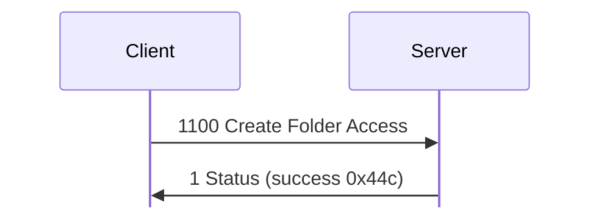
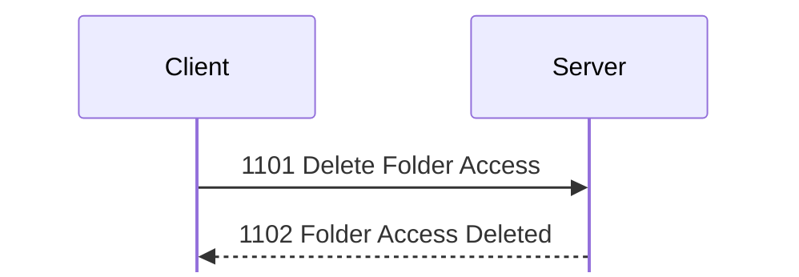
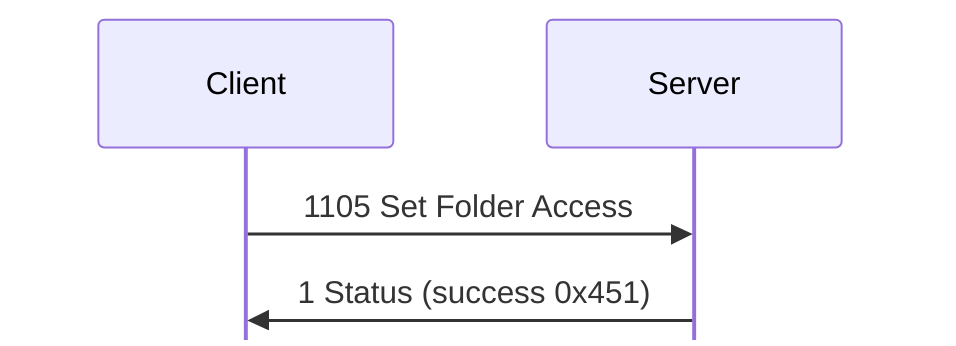
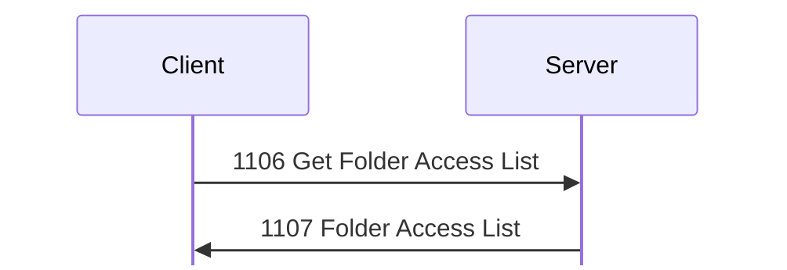

# Folder access messages

For hex and field notation, see [Conventions](../README.md#conventions).

Message types 1100 to 1107 manage the access rules of folders.

A folder access item is a named set of rules. A folder names its item with a `
[tag]` suffix, such as `Uploads [UL]`. The item `[Default]` applies when neither
a folder nor its parents name an item. The u16 at offset 0x30 of a [401 File
List](files.md#m401) entry is the item's icon, not an ID. <!-- [S] -->

## 1100 Create Folder Access
Initiator: Client. Privilege: Modify Folder Access (28). <!-- [S `FUN_080572f0`; O `captures/linux-files.pcapng` frames 231 to 234] -->

If it succeeds, the reply is 1 Status:

The request is a folder access record, which the client's folder access editor
also reads. 1100 Create Folder Access, [1104 Folder Access Info](#m1104), and
[1105 Set Folder Access](#m1105) use it. <!-- [S `FUN_080572f0`, `FUN_08057634`;
O `captures/linux-files.pcapng` frames 226, 229, 231; O
`captures/linux-accounts-folder-access.pcapng`; O
`captures/linux-folder-access-guest.pcapng`] --> The last two captures show the
record in 1105 Set Folder Access. Its total length, padded to a multiple of 4,
must equal the payload length. `kdx_proto::msg::admin::FolderAccess` encodes the
three captured records again byte for byte, with their padding (test
`linux_files`).

Struct `FolderAccess` (dynamic):

| Off | Size | Type | Field | Notes |
|---|---|---|---|---|
| 0x00 | 4 | u8[4] | ignored_00 | 0 in the lab. |
| 0x04 | 4 | u32 | flags | In byte 7, bit 0 is built-in, and bit 1 is Owner Login In Folder Name. |
| 0x08 | 4 | u32 | icon | 0x28 Normal, 0x2b Uploads, 0x2c Dropbox, 0x34 Pictures, 0x35 Audio |
| 0x0c | 128 | FolderAccessRule[32] | class_rules | One rule for each class, at 0x0c + 4 × class index. User (class 1) is at 0x10, and Guest (class 2) at 0x14. <!-- [O] --> The first rule is 0xfffe0000 (all permissions) in both lab items, so it is probably Administrator's. <!-- [I] --> |
| 0x8c | 4 | FolderAccessRule | rule | 0xfffe0000 in `DB`, and 0 in `[Default]`. Probably the owner's rule. <!-- [I] --> |
| 0x90 | 29 | u8[29] | ignored_90 | 0 as sent. |
| 0xad | 1 | u8 | name_len |  |
| 0xae | 1 | u8 | owner_len |  |
| 0xaf | 1 | u8 | description_len |  |
| 0xb0 | 1 | u8 | ignored_b0 |  |
| 0xb1 | 1 | u8 | current_name_len |  |
| 0xb2 | 6 | u8[6] | ignored_b2 |  |
| 0xb8 | name_len | str | name | The tag, such as `DB`. |
|  | owner_len | str | owner |  |
|  | description_len | str | description |  |
|  | current_name_len | str | current_name | Only in 1105: the item to change. |
|  | pad4 | u8[] | padding |  |

Struct `FolderAccessRule` (4 bytes):

| Off | Size | Type | Field | Notes |
|---|---|---|---|---|
| 0x00 | 2 | u16 | permission_bits | The MSB is bit 0. |
| 0x02 | 2 | u16 | ignored | 0 as sent. |

The permission bits come from the client's menu at file offset 0xf6448:

| Bit | Permission |
|---:|---|
| 0 | Can See Folder |
| 1 | See Folder Content |
| 2 | Read/Download Files |
| 3 | Create/Upload Files |
| 4 | Create/Upload Folders |
| 5 | Move In |
| 6 | Move Out |
| 7 | Alias In |
| 8 | Alias Out |
| 9 | Duplicate In |
| 10 | Duplicate Out |
| 11 | Delete Items |
| 12 | Rename |
| 13 | Set Item Attributes |
| 14 | Modify File Contents |

In the lab, `DB` gives 0x9d40 (bits 0, 3, 4, 5, 7, and 9: a drop box), and
`[Default]` gives 0xe0a0 (bits 0, 1, 2, 8, and 10), for classes 1 to 31. <!-- [O
frames 226, 229] --> The client's editor shows Name, Description, Owner Login,
Owner Login In Folder Name, the Access Privileges table, and Icon.

Struct `CreateFolderAccess` (dynamic):

| Off | Size | Type | Field | Notes |
|---|---|---|---|---|
| 0x00 |  | FolderAccess | item |  |

An invalid name gets 0x1001e, and a name that already exists gets 0x1000d. If it
succeeds, the reply is [1 Status](status.md#m1) 0x44c. Frame 231 makes `test`
with all other fields 0, and frame 234 is the success.

## 1101 Delete Folder Access
Initiator: Client. Privilege: Modify Folder Access (28). <!-- [S `FUN_08057460`; O `captures/linux-accounts-folder-access.pcapng` frames 70 to 71] -->

A delete gets no Status reply:

The request is the item name, with no length byte:

Struct `FolderAccessName` (dynamic):

| Off | Size | Type | Field | Notes |
|---|---|---|---|---|
| 0x00 | rest | str | name | No length byte. |

An unknown name gets 0x1000c. If the delete succeeds, there is no Status reply.
Instead, the server sends [1102 Folder Access Deleted](#m1102) to the requester,
and writes history record 0x44d. `kdx_proto::msg::admin::FolderAccessName`
encodes frames 70 and 71 (`lab-item`, 8 bytes, with no padding) again. <!-- [O]
-->

## 1102 Folder Access Deleted
Initiator: Server. It follows a successful
[1101 Delete Folder Access](#m1101).

The payload is the name:

Struct `FolderAccessDeleted` (dynamic):

| Off | Size | Type | Field | Notes |
|---|---|---|---|---|
| 0x00 |  | FolderAccessName | name |  |

1102 Folder Access Deleted has the server's own next txid, not the request's:
`f2cfecc3` in frame 71. <!-- [O] -->

## 1103 Get Folder Access
Initiator: Client. Privilege: View Folder Access (27). <!-- [S `FUN_08057534`; O `captures/linux-files.pcapng` frames 225 to 229] -->

The reply is [1104 Folder Access Info](#m1104):

The request is the item name, with no length byte, such as `DB` in frame 225 and
`[Default]` in frame 228:

Struct `GetFolderAccess` (dynamic):

| Off | Size | Type | Field | Notes |
|---|---|---|---|---|
| 0x00 |  | FolderAccessName | name |  |

The request has no padding: 2 bytes and 9 bytes in `captures/linux-files.pcapng`
frames 225 and 228. <!-- [O] --> `kdx_proto::msg::admin::FolderAccessName`
encodes it again, and also `captures/linux-accounts-folder-access.pcapng` frame
60. <!-- [O] -->

## 1104 Folder Access Info
Initiator: Server. Reply to [1103 Get Folder Access](#m1103).

The payload is the stored folder access record:

Struct `FolderAccessInfo` (dynamic):

| Off | Size | Type | Field | Notes |
|---|---|---|---|---|
| 0x00 |  | FolderAccess | item |  |

After a [1105 Set Folder Access](#m1105), this is the record from 1105 as sent,
with its current name. <!-- [O `captures/linux-folder-access-guest.pcapng`
frames 30, 38] -->

## 1105 Set Folder Access
Initiator: Client. Privilege: Modify Folder Access (28). <!-- [S `FUN_08057634`; O `captures/linux-accounts-folder-access.pcapng` frames 63, 66] -->

If it succeeds, the reply is 1 Status:

The request is a folder access record:

Struct `SetFolderAccess` (dynamic):

| Off | Size | Type | Field | Notes |
|---|---|---|---|---|
| 0x00 |  | FolderAccess | item | `current_name` selects the item. |

The current name (0xb1) selects the item. If the name is different, the server
renames the item. If it succeeds, the reply is [1 Status](status.md#m1) 0x451.
The client sends the name and the current name even when they are the same:
frame 63 is 200 bytes, with `lab-item` twice, and length 8 at 0xad and 0xb1. It
sets byte 0x14 to 0x80, which is bit 0 (Can See Folder) of the Guest
rule. <!-- [O] --> When the user ticks Can See Folder for Guest only, and then
for User only, the client sets 0x14 and then 0x10. <!-- [O
`captures/linux-folder-access-guest.pcapng` frames 30, 40] -->

## 1106 Get Folder Access List
Initiator: Client. Privilege: View Folder Access (27). <!-- [S `FUN_080578d8`; O] -->

The folder access list is one request and one reply:

The request is empty, or a u32 of flags:

Struct `GetFolderAccessList` (dynamic):

| Off | Size | Type | Field | Notes |
|---|---|---|---|---|
| 0x00 | rest | u8[] | rest | Empty, or a u32 of flags and then any bytes. Rust `flags` is the first 4 bytes, if present. <!-- [S] --> |

If bit 0 of the top byte of the u32 is set, a user without the privilege gets no
reply, not [1 Status](status.md#m1) 0x10014. Client 1.620 for Linux sends
`00000001` when it opens the file window, and an empty request after [1100
Create Folder Access](#m1100). <!-- [O `captures/linux-files.pcapng` frames 23,
232] --> `kdx_proto::msg::admin::GetFolderAccessList` keeps the u32 and any
bytes after it, or all of a payload of less than 4 bytes. It encodes again
frames 23 and 232, and the three empty requests of
`captures/linux-accounts-folder-access.pcapng` (frames 50, 54, and 64). <!-- [O]
-->

## 1107 Folder Access List
Initiator: Server. Reply to [1106 Get Folder Access List](#m1106).

The payload is a u32 count, then one entry for each item, each padded to a
multiple of 4:

Struct `FolderAccessList` (dynamic):

| Off | Size | Type | Field | Notes |
|---|---|---|---|---|
| 0x00 | 4 | u32 | items_count |  |
| 0x04 | items_count | FolderAccessItem[] | items |  |

Struct `FolderAccessItem` (dynamic):

| Off | Size | Type | Field | Notes |
|---|---|---|---|---|
| 0x00 | 4 | u32 | flags | 1 is built-in (`[Default]`), and 2 is Owner Login In Folder Name. 1, 2, and 0 in the lab. <!-- [S] --> |
| 0x04 | 4 | u32 | icon | 0 for `[Default]`, 0x2c Dropbox (`DB`), 0x2b Uploads (`UL`). <!-- [S] --> |
| 0x08 | 8 | u8[8] | ignored_08 | The server does not write these bytes. |
| 0x10 | 1 | u8 | ignored_10 |  |
| 0x11 | 1 | u8 | name_len |  |
| 0x12 | 1 | u8 | second_len |  |
| 0x13 | 1 | u8 | description_len |  |
| 0x14 | name_len | str | name | `[Default]` in the lab. |
|  | second_len | str | second | Empty in the lab. |
|  | description_len | str | description | `If a folder and its parents…` |
|  | pad4 | u8[] | padding |  |
