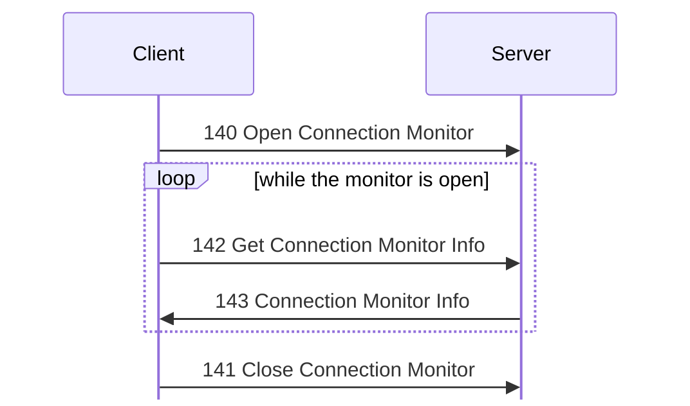

# Connection monitor messages

For hex and field notation, see [Conventions](../README.md#conventions).

Message types 140 to 143 watch the list of connections to the server.

## 140 Open Connection Monitor
Initiator: Client. <!-- [S] -->
The dispatcher handles it itself. <!-- [S] -->

The client opens the monitor, polls it any number of times, and closes it:

No payload.

140 Open Connection Monitor and [141 Close Connection Monitor](#m141) need Get
User Info (bit 40). They set or clear a flag on the user. There is no reply.

## 141 Close Connection Monitor
Initiator: Client. <!-- [S] -->
The dispatcher handles it itself. <!-- [S] -->

No payload.

This clears the flag that [140 Open Connection Monitor](#m140) set. There is no
reply.

## 142 Get Connection Monitor Info
Initiator: Client. <!-- [S `FUN_0804b9b0`; O] -->

No payload.

The request needs Get User Info (bit 40). If the client did not send [140 Open
Connection Monitor](#m140) first, the server replies with [1
Status](status.md#m1) 0x10003 (protocol breach). <!-- [O] -->

## 143 Connection Monitor Info
Initiator: Server. <!-- [S `FUN_0804b9b0`; O] -->

This is the reply to [142 Get Connection Monitor Info](#m142). It has one record
for each connection, and after each, one record for each file transfer of that
user. There is no count, and each record is padded to a multiple of 4: <!-- [S
`FUN_0804b9b0`] -->

Struct `ConnectionMonitorInfo` (dynamic):

| Off | Size | Type | Field | Notes |
|---|---|---|---|---|
| 0x00 | rest | [`MonitoredConnection`](#sMonitoredConnection)`[]` | `records` |  |

Struct `MonitoredConnection` (dynamic):

| Off | Size | Type | Field | Notes |
|---|---|---|---|---|
| 0x00 | 4 | `u32` | `user_id` |  |
| 0x04 | 4 | `u32` | `transfer_id` | 0 in a connection record. The transfer's ID in a transfer record. <!-- [S] --> |
| 0x08 | 8 | `u64` | `login_time` | The transfer's start time in a transfer record. <!-- [S] --> |
| 0x10 | 8 | `u64` | `time_10` | 0 in a transfer record. <!-- [S] --> |
| 0x18 | 8 | `u64` | `time_18` | <!-- [S] --> |
| 0x20 | 8 | `u64` | `bytes_done` | Transfer record only: the bytes moved, less the bytes still in the send queue. <!-- [S] --> |
| 0x28 | 8 | `u64` | `bytes_total` | Transfer record only. <!-- [S] --> |
| 0x30 | 4 | `u32` | `rate` | Transfer record only: bytes per second since the start, not counting a resumed offset. <!-- [S] --> 0x51a1 with a limit of 0x5000. <!-- [O] --> |
| 0x34 | 4 | `u32` | `seconds_left` | Transfer record only: (total − done) / rate. <!-- [S] --> |
| 0x38 | 4 | `u32` | `value_38` | Transfer record only: a value for each transfer. <!-- [S] --> 0x5000, the server's speed limit, in all records. <!-- [O] --> |
| 0x3c | 4 | `u32` | `state` | Transfer record only: 0x90 while data is in the queue and the state is 0. <!-- [S] --> 0x19c ([412 Download File](files.md#m412)) for a download. <!-- [O] --> |
| 0x40 | 2 | `u8[2]` | `ignored_40` | 0 as sent. |
| 0x42 | 1 | `u8` | `class_index` | <!-- [S] --> |
| 0x43 | 29 | `u8[29]` | `ignored_43` |  |
| 0x60 | 1 | `u8` | `nick_len` |  |
| 0x61 | 1 | `u8` | `login_len` |  |
| 0x62 | 1 | `u8` | `account_len` |  |
| 0x63 | 1 | `u8` | `address_len` |  |
| 0x64 | 2 | `u8[2]` | `ignored_64` |  |
| 0x66 | 2 | `u16` | `path_len` |  |
| 0x68 | `nick_len` | `str` | `nick` | `probe` <!-- [O] --> |
|  | `login_len` | `str` | `login` | `admin` <!-- [O] --> |
|  | `account_len` | `str` | `account` | `Administrator`. <!-- [O] --> `?` if the class no longer exists. <!-- [S] --> |
|  | `address_len` | `str` | `address` | `127.0.0.1:50984`. <!-- [O] --> The peer address of the connection, or of the transfer connection in a transfer record. <!-- [S] --> |
|  | `path_len` | [`FilePath`](../encodings.md#sFilePath) | `path` | Transfer record only. In a connection record, it is the root, as in the file messages. <!-- [S; O] --> |
|  | pad4 | `u8[]` | `padding` | Padding to a multiple of 4. |

The padding after the strings is uninitialized memory. <!-- [O] --> `kdx-proto`
keeps it on a round trip. The fields for transfer records only are 0 in a
connection record.

In `captures/linux-catalog-volumes.pcapng`, the replies in frames 104 to 161
hold three records: the operator's connection, the `kdx-get` connection (user
2), and its download of `speed.bin` (transfer 3). <!-- [O] --> In frame 104, the
transfer has done 0x14000 of 0x200000 bytes, at 0x6aaa bytes per second, with
0x49 seconds left. In frame 161, it has done 0x1f4000 at 0x51a1, with 2 seconds
left.
