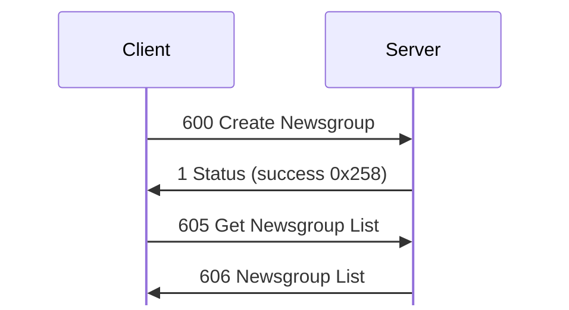
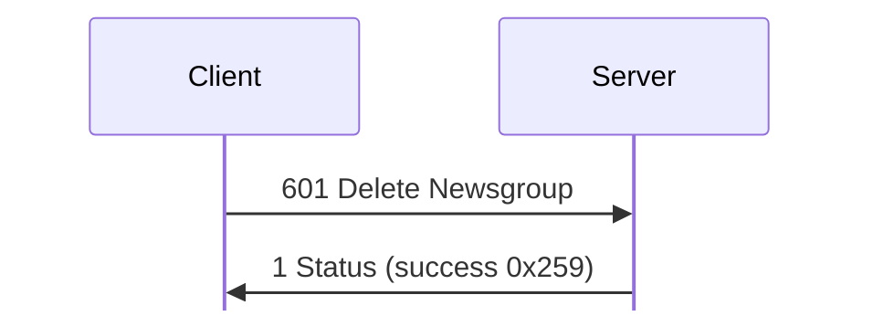
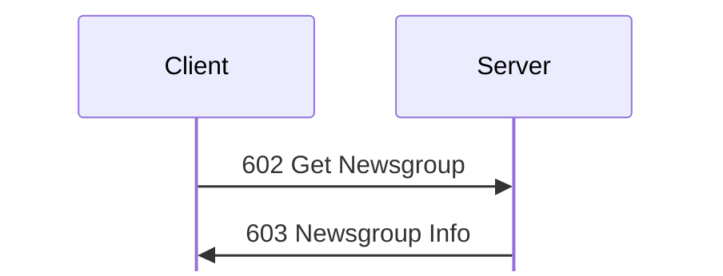
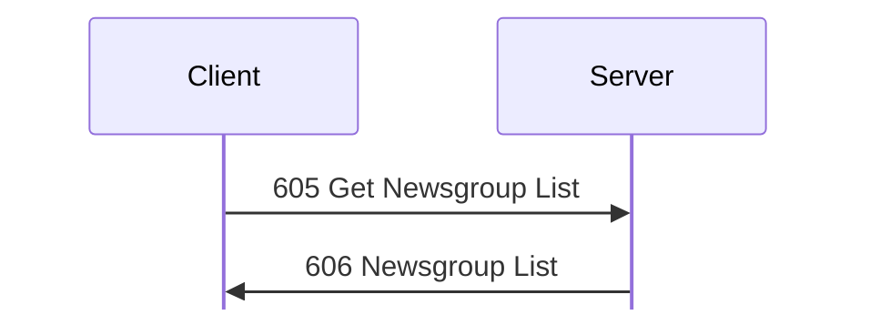
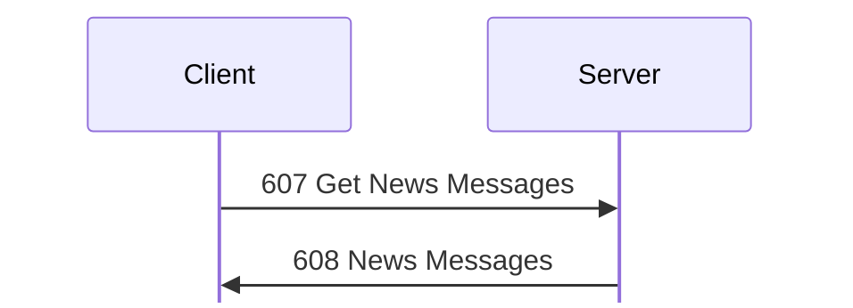
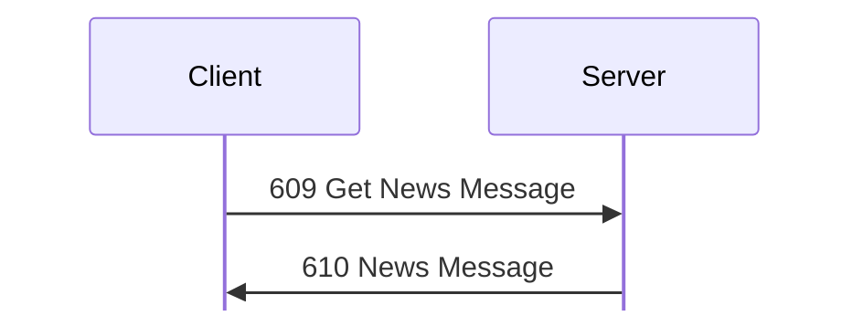
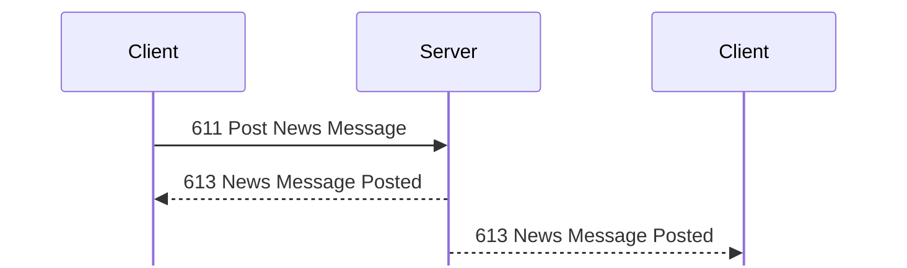
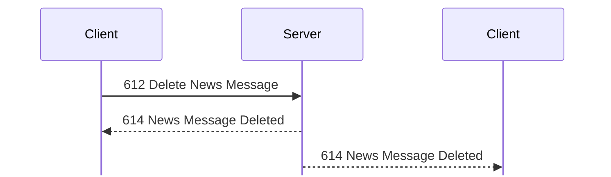

# News messages

For hex and field notation, see [Conventions](../README.md#conventions).

Message types 600 to 614: newsgroups and their messages.

## 600 Create Newsgroup
Initiator: Client. Privilege: Create/Modify Newsgroups (73). <!-- [S `FUN_0805c8f8`, client `FUN_08089034`; O `captures/linux-accounts-news.pcapng` frames 58 to 63] -->

A group is created or changed, and the client then reloads the list:

Struct `CreateNewsgroup` (dynamic):

| Off | Size | Type | Field | Notes |
|---|---|---|---|---|
| 0x00 |  | NewsgroupInfo | group |  |

Struct `NewsgroupInfo` (dynamic):

| Off | Size | Type | Field | Notes |
|---|---|---|---|---|
| 0x00 | 4 | u32 | group_id |  |
| 0x04 | 12 | u8[12] | ignored_04 | 0 as sent. |
| 0x10 | 8 | u64 | time | [611 Post News Message](#m611) sets it |
| 0x18 | 4 | u32 | read_classes | a class bitmap, class 0 in the top bit; `ffffffff` |
| 0x1c | 4 | u32 | post_classes | the same; `ffffffff` |
| 0x20 | 4 | u8[4] | ignored_20 | a third class bitmap; `01 00 00 00`; the client sends 0 <!-- [S] --> |
| 0x24 | 12 | u8[12] | ignored_24 | 0 as sent. |
| 0x30 | 2 | u16 | message_count | 1 |
| 0x32 | 2 | u16 | size_limit_kib | KiB, clamped to 4..1024; 0x32 (50 KiB) by default <!-- [S `FUN_0805c8f8`] --> |
| 0x34 | 8 | u8[8] | ignored_34 | 0 as sent. |
| 0x3c | 1 | u8 | name_len |  |
| 0x3d | 1 | u8 | description_len |  |
| 0x3e | 2 | u8[2] | ignored_3e | 0 as sent. |
| 0x40 | name_len | str | name | `General News` Length at most 0x3f |
|  | description_len | str | description | Length at most 0x7f; 0 in the lab |

The request is a [603 Newsgroup Info](#m603) record, which this section defines
as `NewsgroupInfo`. The server ignores the ID at 0x00 and picks one. The name
must be 1..0x3f bytes and the description at most 0x7f. Success is [1
Status](status.md#m1) 0x258, and a history record. The client's editor has Name,
Description, Archive Size, and the class access list; it sends [600 Create
Newsgroup](#m600) or [604 Set Newsgroup](#m604), then [605 Get Newsgroup
List](#m605).

Frame 58 creates `test newsgroup` (description `desc`, archive size 0x1a4,
read and post classes `80000000`, so Administrator only). It is 82 bytes,
unpadded, with the ID, time, message count, and the bitmap at 0x20 all 0.
The server gives it ID 2 (frame 63). <!-- [O] --> `NewsgroupInfo` re-encodes 600,
603, and 604 byte for byte (test `linux_accounts_news`).

When a group's stored messages reach 1.5 times the archive size, the server
moves the oldest ones into a file under `News Archives` named after the
group. <!-- [S `FUN_0805ed88`] -->

## 601 Delete Newsgroup
Initiator: Client. Privilege: Create/Modify Newsgroups (73). <!-- [S `FUN_0805caf4`; O `captures/linux-accounts-news.pcapng` frames 81 to 84] -->

On success [601 Delete Newsgroup](#m601) gets 1 Status:

Struct `DeleteNewsgroup` (4 bytes):

| Off | Size | Type | Field | Notes |
|---|---|---|---|---|
| 0x00 | 4 | u32 | group_id | as `NewsgroupId` encodes it (frame 81) <!-- [O] --> |

 An unknown group gets 0x1000c. Success is [1 Status](status.md#m1)
0x259 (frame 84). [602 Get Newsgroup](#m602) also writes history record 0x25a.

## 602 Get Newsgroup
Initiator: Client. Privilege: Create/Modify Newsgroups (73). Observed size: 76
bytes. <!-- [S `FUN_0805cc24`; O `captures/linux-accounts-news.pcapng` frames 68 to 69] -->

[602 Get Newsgroup](#m602) gets [603 Newsgroup Info](#m603):

Struct `GetNewsgroup` (4 bytes):

| Off | Size | Type | Field | Notes |
|---|---|---|---|---|
| 0x00 | 4 | u32 | group_id | unpadded; `NewsgroupId` encodes it (`captures/linux-accounts-news.pcapng` frame 68, `captures/linux-first-connect.pcapng` frame 130) <!-- [O] --> |

An unknown group gets
[1 Status](status.md#m1) 0x1000c.

## 603 Newsgroup Info
Initiator: Server. Reply to [602 Get Newsgroup](#m602).

The reply is not padded: frame 69 of `captures/linux-accounts-news.pcapng` is
82 bytes, for the 14-byte name `test newsgroup` and the description `desc`.
<!-- [O] --> The record is the `NewsgroupInfo` of
[600 Create Newsgroup](#m600):

Struct `NewsgroupInfoReply` (dynamic):

| Off | Size | Type | Field | Notes |
|---|---|---|---|---|
| 0x00 |  | NewsgroupInfo | group |  |

The read and post class bitmaps are the ones [607 Get News Messages](#m607) and
611 Post News Message check. <!-- [S] -->

## 604 Set Newsgroup
Initiator: Client. Privilege: Create/Modify Newsgroups (73). <!-- [S `FUN_0805ce60`; O `captures/linux-accounts-news.pcapng` frames 71 to 74] -->

The request is a [603 Newsgroup Info](#m603) record with the group ID at 0x00.

Struct `SetNewsgroup` (dynamic):

| Off | Size | Type | Field | Notes |
|---|---|---|---|---|
| 0x00 |  | NewsgroupInfo | group |  |

Success is [1 Status](status.md#m1) 0x25c (frame 74). Frame 71 renames group 2
to `Lab Group`, with the description `edited description` and archive size 0x32.
It is 91 bytes, unpadded. <!-- [O] -->

## 605 Get Newsgroup List
Initiator: Client. Privilege: View News (70). <!-- [S `FUN_0805d038`; O] -->

The newsgroup list is one request and one reply:

No payload.

The request is empty. <!-- [O `captures/linux-accounts-news.pcapng` frame 55] -->

## 606 Newsgroup List
Initiator: Server. Reply to [605 Get Newsgroup List](#m605).

A u32 count, then one entry per group, each padded to 4:

Struct `NewsgroupList` (dynamic):

| Off | Size | Type | Field | Notes |
|---|---|---|---|---|
| 0x00 | 4 | u32 | groups_count |  |
| 0x04 | groups_count | NewsgroupEntry[] | groups |  |

Struct `NewsgroupEntry` (dynamic):

| Off | Size | Type | Field | Notes |
|---|---|---|---|---|
| 0x00 | 8 | u64 | time |  |
| 0x08 | 4 | u32 | group_id |  |
| 0x0c | 4 | u8[4] | ignored_0c |  |
| 0x10 | 2 | u16 | message_count | 1 <!-- [I] --> |
| 0x12 | 4 | u8[4] | ignored_12 |  |
| 0x16 | 1 | u8 | name_len |  |
| 0x17 | 1 | u8 | description_len |  |
| 0x18 | name_len | str | name | `General News` |
|  | description_len | str | description | 0 in the lab, so probably the description length <!-- [I] --> |
|  | pad4 | u8[] | padding | padding to a multiple of 4 |

## 607 Get News Messages
Initiator: Client. <!-- [S `FUN_0805d2e8`; O] -->

A group's messages are one request and one reply:

Struct `GetNewsMessages` (4 bytes):

| Off | Size | Type | Field | Notes |
|---|---|---|---|---|
| 0x00 | 4 | u32 | group_id | `NewsgroupId` encodes it (`captures/kdx-news.pcapng` frame 76, `captures/linux-accounts-news.pcapng` frames 65, 78, and 107) <!-- [O] --> |

## 608 News Messages
Initiator: Server. Reply to [607 Get News Messages](#m607).

Struct `NewsMessages` (dynamic):

| Off | Size | Type | Field | Notes |
|---|---|---|---|---|
| 0x00 | 4 | u32 | group_id |  |
| 0x04 | 4 | u32 | permissions | 1 post, 2 delete any message, 4 read; 7 for admin, 4 for guest |
| 0x08 | 4 | u8[4] | ignored |  |
| 0x0c | 4 | u32 | messages_count |  |
| 0x10 | messages_count | NewsMessage[] | messages | each as in [610 News Message](#m610) |

Struct `NewsMessage` (dynamic):

| Off | Size | Type | Field | Notes |
|---|---|---|---|---|
| 0x00 | 8 | u64 | time |  |
| 0x08 | 4 | u32 | group_id |  |
| 0x0c | 4 | u32 | message_id |  |
| 0x10 | 8 | u8[8] | ignored_10 | 0 as sent. |
| 0x18 | 2 | u16 | body_len |  |
| 0x1a | 2 | u8[2] | ignored_1a | 0 as sent. |
| 0x1c | 1 | u8 | poster_len |  |
| 0x1d | 1 | u8 | login_len |  |
| 0x1e | 1 | u8 | subject_len |  |
| 0x1f | 1 | u8 | ignored_1f | 0 as sent. |
| 0x20 | poster_len | str | poster | the poster's nick; `KDX` |
|  | login_len | str | login | `KDX`; `admin` in `captures/kdx-news.pcapng` frame 138 <!-- [S `FUN_0805d758`; O] --> |
|  | subject_len | str | subject | `Welcome` |
|  | body_len | str | body | 0x82c |
|  | pad4 | u8[] | padding | padding to a multiple of 4 |

The strings come in the order poster, login, subject, body, though the body
length comes before the other three. <!-- [O `captures/kdx-news.pcapng` frame 138] -->

The server computes the permissions from the user's privileges and the group's
class bitmaps. <!-- [S `FUN_0805d2e8`; O `captures/kdx-news.pcapng` frames 77, 204] --> Without read access but with post access, the reply is just the 16-byte
header with permissions 1 and count 0. <!-- [S] -->

## 609 Get News Message
Initiator: Client. <!-- [S `FUN_0805d54c`; O] -->

One message is read with 609 Get News Message and [610 News Message](#m610):

`NewsMessageId` encodes the request (`captures/kdx-news.pcapng` frame 137,
`captures/linux-first-connect.pcapng` frames 99 and 112): <!-- [O] -->

Struct `GetNewsMessage` (8 bytes):

| Off | Size | Type | Field | Notes |
|---|---|---|---|---|
| 0x00 | 4 | u32 | group_id |  |
| 0x04 | 4 | u32 | message_id |  |

[609 Get News Message](#m609) does not reset the
idle timer.

## 610 News Message
Initiator: Server. Reply to [609 Get News Message](#m609).

One news message record, the `NewsMessage` of
[608 News Messages](#m608), padded to 4:

Struct `NewsMessageReply` (dynamic):

| Off | Size | Type | Field | Notes |
|---|---|---|---|---|
| 0x00 |  | NewsMessage | message |  |

## 611 Post News Message
Initiator: Client. Privilege: Post News (71), and the user's class must be in
the group's post classes unless the user has privilege 0. <!-- [S `FUN_0805d758`; O `captures/kdx-news.pcapng`] -->

A post has no reply. Every user whose class may read the group, the poster
included, gets 613 News Message Posted:

Struct `PostNewsMessage` (dynamic):

| Off | Size | Type | Field | Notes |
|---|---|---|---|---|
| 0x00 | 4 | u32 | group_id |  |
| 0x04 | 8 | u8[8] | ignored_04 | ignored by the server <!-- [S] --> |
| 0x0c | 2 | u16 | body_len |  |
| 0x0e | 1 | u8 | subject_len |  |
| 0x0f | 1 | u8 | ignored_0f | ignored by the server <!-- [S] --> |
| 0x10 | subject_len | str | subject | the server keeps at most 0x80 bytes |
|  | body_len | str | body | lines end in CR the server keeps at most 0x4000 bytes |
|  | rest | u8[] | rest | any bytes after the body |

The subject comes before the body, though the body length comes first. <!-- [S `FUN_0805d758`] -->

Client 1.620 beta 5 for Linux sends the request unpadded: 39, 18 and 23
bytes in `captures/linux-first-connect.pcapng` frames 94, 107 and 115, and
66 bytes in `captures/linux-text-encoding.pcapng` frame 319. <!-- [O] -->
`kdx-proto` encodes it the same way. The `kdx` CLI's earlier posts in
`captures/kdx-news.pcapng` frames 32 and 112 were padded to 4 with zeros, and
the server accepted them with [613 News Message Posted](#m613) at frames 35 and
115. <!-- [O] -->

There is no reply on success (frames 356-361). The server stores a
[610 News Message](#m610) record, with the user's nick and login, under the
group's next message ID, then sends 613 News Message Posted to every
user whose class may read the group, the poster included. Errors: <!-- [O] -->
0x1000c for an unknown group (frame 160) and 0x10014 for a guest (frame 182).

## 612 Delete News Message
Initiator: Client. <!-- [S `FUN_0805db44`; O] -->

A delete has no reply. Every user gets 614 News Message Deleted:

`NewsMessageId` encodes the request (`captures/linux-first-connect.pcapng`
frame 102, `captures/kdx-news.pcapng` frames 225 and 406): <!-- [O] -->

Struct `DeleteNewsMessage` (8 bytes):

| Off | Size | Type | Field | Notes |
|---|---|---|---|---|
| 0x00 | 4 | u32 | group_id |  |
| 0x04 | 4 | u32 | message_id |  |

The user's class must be in the group's read
classes unless the user has privilege 0. Without Delete News Messages (72), the
user may delete only the group's last message, and only if they posted it (the
login at 0x1d matches); otherwise [1 Status](status.md#m1) 0x10014 (`kdx-news`
frame 226, a guest).

There is no reply on success. The server broadcasts
[614 News Message Deleted](#m614) to every user (frames 409-411). An unknown
group or message gets no reply and no 614 (frame 435).

## 613 News Message Posted
Initiator: Server. <!-- [S; O] --> Sent after a successful
[611 Post News Message](#m611).

Struct `NewsMessageChange` (12 bytes):

| Off | Size | Type | Field | Notes |
|---|---|---|---|---|
| 0x00 | 4 | u32 | group_id |  |
| 0x04 | 4 | u32 | message_id | the message posted or deleted |
| 0x08 | 4 | u32 | message_count | messages in the group afterwards |

## 614 News Message Deleted
Initiator: Server. <!-- [S; O] --> Broadcast to every user after a
[612 Delete News Message](#m612). Same layout as
[613 News Message Posted](#m613):

Struct `NewsMessageDeleted` (12 bytes):

| Off | Size | Type | Field | Notes |
|---|---|---|---|---|
| 0x00 | 12 | NewsMessageChange | change | the message ID is the deleted message |
