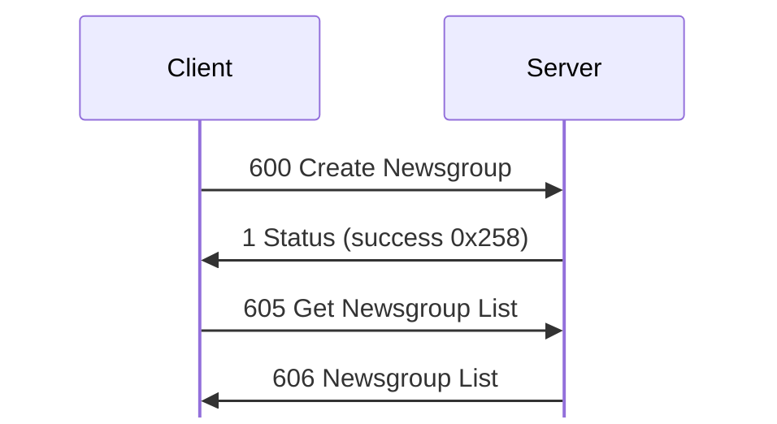
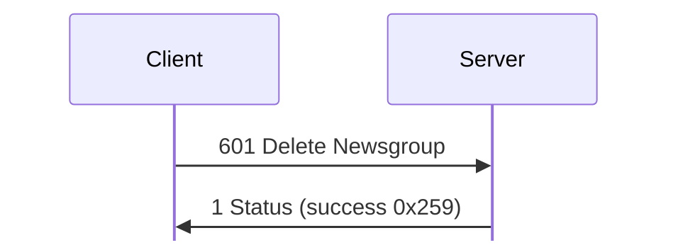
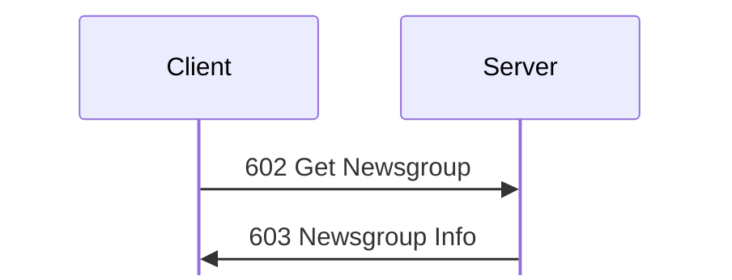
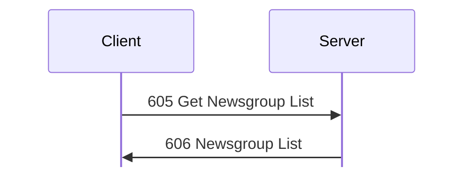
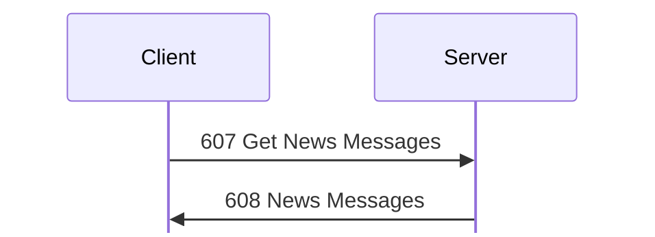
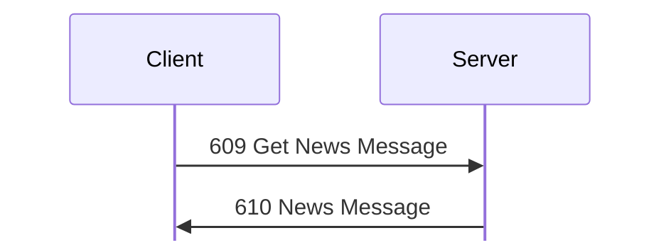
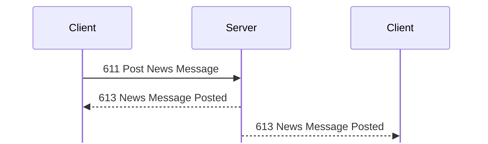
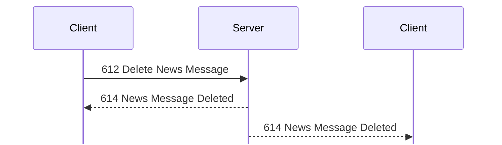

# News messages

For hex and field notation, see [Conventions](../README.md#conventions).

Message types 600 to 614 manage newsgroups and their messages.

## 600 Create Newsgroup
Initiator: Client. Privilege: Create/Modify Newsgroups (73). <!-- [S `FUN_0805c8f8`, client `FUN_08089034`; O `captures/linux-accounts-news.pcapng` frames 58 to 63] -->

The client makes or changes a group, and then loads the list again:

Struct `CreateNewsgroup` (dynamic):

| Off | Size | Type | Field | Notes |
|---|---|---|---|---|
| 0x00 |  | [`NewsgroupInfo`](#sNewsgroupInfo) | `group` |  |

Struct `NewsgroupInfo` (dynamic):

| Off | Size | Type | Field | Notes |
|---|---|---|---|---|
| 0x00 | 4 | `u32` | `group_id` |  |
| 0x04 | 12 | `u8[12]` | `ignored_04` | 0 as sent. |
| 0x10 | 8 | `u64` | `time` | [611 Post News Message](#m611) sets it. |
| 0x18 | 4 | `u32` | `read_classes` | A class bitmap, with class 0 in the top bit. `ffffffff`. |
| 0x1c | 4 | `u32` | `post_classes` | The same. `ffffffff`. |
| 0x20 | 4 | `u8[4]` | `ignored_20` | A third class bitmap. `01 00 00 00`. The client sends 0. <!-- [S] --> |
| 0x24 | 12 | `u8[12]` | `ignored_24` | 0 as sent. |
| 0x30 | 2 | `u16` | `message_count` | 1 |
| 0x32 | 2 | `u16` | `size_limit_kib` | In KiB, clamped to 4 to 1024. 0x32 (50 KiB) by default. <!-- [S `FUN_0805c8f8`] --> |
| 0x34 | 8 | `u8[8]` | `ignored_34` | 0 as sent. |
| 0x3c | 1 | `u8` | `name_len` |  |
| 0x3d | 1 | `u8` | `description_len` |  |
| 0x3e | 2 | `u8[2]` | `ignored_3e` | 0 as sent. |
| 0x40 | `name_len` | `str` | `name` | `General News`. At most 0x3f bytes. |
|  | `description_len` | `str` | `description` | At most 0x7f bytes. 0 in the lab. |

The request is a [603 Newsgroup Info](#m603) record, which this section defines
as `NewsgroupInfo`. The server ignores the ID at 0x00, and picks one. The name
must be 1 to 0x3f bytes, and the description at most 0x7f. If it succeeds, the
reply is [1 Status](status.md#m1) 0x258, and the server writes a history record.
The client's editor has Name, Description, Archive Size, and the class access
list. It sends 600 Create Newsgroup or [604 Set Newsgroup](#m604), and then [605
Get Newsgroup List](#m605).

Frame 58 makes `test newsgroup`, with the description `desc`, archive size
0x1a4, and read and post classes `80000000`, so Administrator only. It is 82
bytes with no padding, and the ID, time, message count, and the bitmap at 0x20
are all 0. The server gives it ID 2 (frame 63). <!-- [O] --> `NewsgroupInfo`
encodes 600, 603, and 604 again byte for byte (test `linux_accounts_news`).

When the stored messages of a group reach 1.5 times the archive size, the server
moves the oldest ones into a file under `News Archives`, named for the
group. <!-- [S `FUN_0805ed88`] -->

## 601 Delete Newsgroup
Initiator: Client. Privilege: Create/Modify Newsgroups (73). <!-- [S `FUN_0805caf4`; O `captures/linux-accounts-news.pcapng` frames 81 to 84] -->

If it succeeds, the reply is 1 Status:

Struct `DeleteNewsgroup` (4 bytes):

| Off | Size | Type | Field | Notes |
|---|---|---|---|---|
| 0x00 | 4 | `u32` | `group_id` | As `NewsgroupId` encodes it. <!-- [O frame 81] --> |

An unknown group gets 0x1000c. If it succeeds, the reply is [1
Status](status.md#m1) 0x259 (frame 84), and the server writes history record
0x25a.

## 602 Get Newsgroup
Initiator: Client. Privilege: Create/Modify Newsgroups (73). 76 bytes as
seen. <!-- [S `FUN_0805cc24`; O `captures/linux-accounts-news.pcapng` frames 68
to 69] -->

The reply is [603 Newsgroup Info](#m603):

Struct `GetNewsgroup` (4 bytes):

| Off | Size | Type | Field | Notes |
|---|---|---|---|---|
| 0x00 | 4 | `u32` | `group_id` | No padding. `NewsgroupId` encodes it. <!-- [O `captures/linux-accounts-news.pcapng` frame 68; O `captures/linux-first-connect.pcapng` frame 130] --> |

An unknown group gets [1 Status](status.md#m1) 0x1000c.

## 603 Newsgroup Info
Initiator: Server. Reply to [602 Get Newsgroup](#m602).

The reply is the `NewsgroupInfo` record of [600 Create Newsgroup](#m600), with
no padding. Frame 69 of `captures/linux-accounts-news.pcapng` is 82 bytes, for
the 14-byte name `test newsgroup` and the description `desc`. <!-- [O] -->

Struct `NewsgroupInfoReply` (dynamic):

| Off | Size | Type | Field | Notes |
|---|---|---|---|---|
| 0x00 |  | [`NewsgroupInfo`](#sNewsgroupInfo) | `group` |  |

[607 Get News Messages](#m607) and 611 Post News Message check the read and post
class bitmaps. <!-- [S] -->

## 604 Set Newsgroup
Initiator: Client. Privilege: Create/Modify Newsgroups (73). <!-- [S `FUN_0805ce60`; O `captures/linux-accounts-news.pcapng` frames 71 to 74] -->

The request is a [603 Newsgroup Info](#m603) record, with the group ID at 0x00.

Struct `SetNewsgroup` (dynamic):

| Off | Size | Type | Field | Notes |
|---|---|---|---|---|
| 0x00 |  | [`NewsgroupInfo`](#sNewsgroupInfo) | `group` |  |

If it succeeds, the reply is [1 Status](status.md#m1) 0x25c (frame 74). Frame 71
renames group 2 to `Lab Group`, with the description `edited description` and
archive size 0x32. It is 91 bytes, with no padding. <!-- [O] -->

## 605 Get Newsgroup List
Initiator: Client. Privilege: View News (70). <!-- [S `FUN_0805d038`; O `captures/linux-accounts-news.pcapng` frame 55] -->

The newsgroup list is one request and one reply:

No payload.

## 606 Newsgroup List
Initiator: Server. Reply to [605 Get Newsgroup List](#m605).

The payload is a u32 count, then one entry for each group, each padded to a
multiple of 4:

Struct `NewsgroupList` (dynamic):

| Off | Size | Type | Field | Notes |
|---|---|---|---|---|
| 0x00 | 4 | `u32` | `groups_count` |  |
| 0x04 | `groups_count` | [`NewsgroupEntry`](#sNewsgroupEntry)`[]` | `groups` |  |

Struct `NewsgroupEntry` (dynamic):

| Off | Size | Type | Field | Notes |
|---|---|---|---|---|
| 0x00 | 8 | `u64` | `time` |  |
| 0x08 | 4 | `u32` | `group_id` |  |
| 0x0c | 4 | `u8[4]` | `ignored_0c` |  |
| 0x10 | 2 | `u16` | `message_count` | 1, probably. <!-- [I] --> |
| 0x12 | 4 | `u8[4]` | `ignored_12` |  |
| 0x16 | 1 | `u8` | `name_len` |  |
| 0x17 | 1 | `u8` | `description_len` |  |
| 0x18 | `name_len` | `str` | `name` | `General News` |
|  | `description_len` | `str` | `description` | 0 bytes in the lab, so `description_len` is probably the description's length. <!-- [I] --> |
|  | pad4 | `u8[]` | `padding` | Padding to a multiple of 4. |

## 607 Get News Messages
Initiator: Client. <!-- [S `FUN_0805d2e8`; O] -->

A group's messages are one request and one reply:

Struct `GetNewsMessages` (4 bytes):

| Off | Size | Type | Field | Notes |
|---|---|---|---|---|
| 0x00 | 4 | `u32` | `group_id` | `NewsgroupId` encodes it. <!-- [O `captures/kdx-news.pcapng` frame 76; O `captures/linux-accounts-news.pcapng` frames 65, 78, 107] --> |

## 608 News Messages
Initiator: Server. Reply to [607 Get News Messages](#m607).

Struct `NewsMessages` (dynamic):

| Off | Size | Type | Field | Notes |
|---|---|---|---|---|
| 0x00 | 4 | `u32` | `group_id` |  |
| 0x04 | 4 | `u32` | `permissions` | 1 post, 2 delete any message, 4 read. 7 for admin, and 4 for guest. |
| 0x08 | 4 | `u8[4]` | `ignored` |  |
| 0x0c | 4 | `u32` | `messages_count` |  |
| 0x10 | `messages_count` | [`NewsMessage`](#sNewsMessage)`[]` | `messages` | Each as in [610 News Message](#m610). |

Struct `NewsMessage` (dynamic):

| Off | Size | Type | Field | Notes |
|---|---|---|---|---|
| 0x00 | 8 | `u64` | `time` |  |
| 0x08 | 4 | `u32` | `group_id` |  |
| 0x0c | 4 | `u32` | `message_id` |  |
| 0x10 | 8 | `u8[8]` | `ignored_10` | 0 as sent. |
| 0x18 | 2 | `u16` | `body_len` |  |
| 0x1a | 2 | `u8[2]` | `ignored_1a` | 0 as sent. |
| 0x1c | 1 | `u8` | `poster_len` |  |
| 0x1d | 1 | `u8` | `login_len` |  |
| 0x1e | 1 | `u8` | `subject_len` |  |
| 0x1f | 1 | `u8` | `ignored_1f` | 0 as sent. |
| 0x20 | `poster_len` | `str` | `poster` | The poster's nick. `KDX`. |
|  | `login_len` | `str` | `login` | `KDX`, and `admin` in `captures/kdx-news.pcapng` frame 138. <!-- [S `FUN_0805d758`; O] --> |
|  | `subject_len` | `str` | `subject` | `Welcome` |
|  | `body_len` | `str` | `body` | 0x82c |
|  | pad4 | `u8[]` | `padding` | Padding to a multiple of 4. |

The strings come in the order poster, login, subject, body, but the body length
comes before the other three. <!-- [O `captures/kdx-news.pcapng` frame 138] -->

The server computes the permissions from the user's privileges and the group's
class bitmaps. <!-- [S `FUN_0805d2e8`; O `captures/kdx-news.pcapng` frames 77,
204] --> If the user can post but not read, the reply is only the 16-byte
header, with permissions 1 and count 0. <!-- [S] -->

## 609 Get News Message
Initiator: Client. <!-- [S `FUN_0805d54c`; O] -->

The client reads one message with 609 Get News Message, and the reply is [610
News Message](#m610):

`NewsMessageId` encodes the request: <!-- [O `captures/kdx-news.pcapng` frame
137; O `captures/linux-first-connect.pcapng` frames 99, 112] -->

Struct `GetNewsMessage` (8 bytes):

| Off | Size | Type | Field | Notes |
|---|---|---|---|---|
| 0x00 | 4 | `u32` | `group_id` |  |
| 0x04 | 4 | `u32` | `message_id` |  |

609 Get News Message does not reset the idle timer.

## 610 News Message
Initiator: Server. Reply to [609 Get News Message](#m609).

The payload is one news message record, the `NewsMessage` of [608 News
Messages](#m608), padded to a multiple of 4:

Struct `NewsMessageReply` (dynamic):

| Off | Size | Type | Field | Notes |
|---|---|---|---|---|
| 0x00 |  | [`NewsMessage`](#sNewsMessage) | `message` |  |

## 611 Post News Message
Initiator: Client. Privilege: Post News (71). Unless the user has privilege
0, the user's class must also be in the group's post classes. <!-- [S
`FUN_0805d758`; O `captures/kdx-news.pcapng`] -->

A post gets no reply. Each user whose class can read the group, the poster too,
gets 613 News Message Posted:

Struct `PostNewsMessage` (dynamic):

| Off | Size | Type | Field | Notes |
|---|---|---|---|---|
| 0x00 | 4 | `u32` | `group_id` |  |
| 0x04 | 8 | `u8[8]` | `ignored_04` | The server ignores these bytes. <!-- [S] --> |
| 0x0c | 2 | `u16` | `body_len` |  |
| 0x0e | 1 | `u8` | `subject_len` |  |
| 0x0f | 1 | `u8` | `ignored_0f` | The server ignores this byte. <!-- [S] --> |
| 0x10 | `subject_len` | `str` | `subject` | The server keeps at most 0x80 bytes. |
|  | `body_len` | `str` | `body` | Lines end in CR. The server keeps at most 0x4000 bytes. |
|  | rest | `u8[]` | `rest` | Any bytes after the body. |

The subject comes before the body, but the body length comes first. <!-- [S
`FUN_0805d758`] -->

Client 1.620 beta 5 for Linux sends the request with no padding: 39, 18, and 23
bytes in `captures/linux-first-connect.pcapng` frames 94, 107, and 115, and 66
bytes in `captures/linux-text-encoding.pcapng` frame 319. <!-- [O] -->
`kdx-proto` encodes it in the same way. Earlier posts from the `kdx` CLI, in
`captures/kdx-news.pcapng` frames 32 and 112, were padded to a multiple of 4
with zeros. The server accepted them with [613 News Message Posted](#m613) in
frames 35 and 115. <!-- [O] -->

If the post succeeds, there is no reply (frames 356 to 361). The server stores a
[610 News Message](#m610) record, with the user's nick and login, under the
group's next message ID. Then it sends 613 News Message Posted to each user
whose class can read the group, the poster too. An unknown group gets 0x1000c
(frame 160), and a guest gets 0x10014 (frame 182). <!-- [O] -->

## 612 Delete News Message
Initiator: Client. <!-- [S `FUN_0805db44`; O] -->

A delete gets no reply. All users get 614 News Message Deleted:

`NewsMessageId` encodes the request: <!-- [O
`captures/linux-first-connect.pcapng` frame 102; O `captures/kdx-news.pcapng`
frames 225, 406] -->

Struct `DeleteNewsMessage` (8 bytes):

| Off | Size | Type | Field | Notes |
|---|---|---|---|---|
| 0x00 | 4 | `u32` | `group_id` |  |
| 0x04 | 4 | `u32` | `message_id` |  |

Unless the user has privilege 0, the user's class must be in the group's read
classes. Without Delete News Messages (72), a user can delete only the group's
last message, and only if they posted it: the login at 0x1d must match. If not,
the reply is [1 Status](status.md#m1) 0x10014. <!-- [O
`captures/kdx-news.pcapng` frame 226] a guest -->

If the delete succeeds, there is no reply. The server sends [614 News Message
Deleted](#m614) to all users (frames 409 to 411). An unknown group or message
gets no reply, and no 614 (frame 435).

## 613 News Message Posted
Initiator: Server. It follows a successful
[611 Post News Message](#m611). <!-- [S; O] -->

Struct `NewsMessageChange` (12 bytes):

| Off | Size | Type | Field | Notes |
|---|---|---|---|---|
| 0x00 | 4 | `u32` | `group_id` |  |
| 0x04 | 4 | `u32` | `message_id` | The message that was posted or deleted. |
| 0x08 | 4 | `u32` | `message_count` | The number of messages in the group after the change. |

## 614 News Message Deleted
Initiator: Server. It goes to all users after a
[612 Delete News Message](#m612). <!-- [S; O] -->

The layout is the same as [613 News Message Posted](#m613):

Struct `NewsMessageDeleted` (12 bytes):

| Off | Size | Type | Field | Notes |
|---|---|---|---|---|
| 0x00 | 12 | [`NewsMessageChange`](#sNewsMessageChange) | `change` | The message ID is that of the deleted message. |
