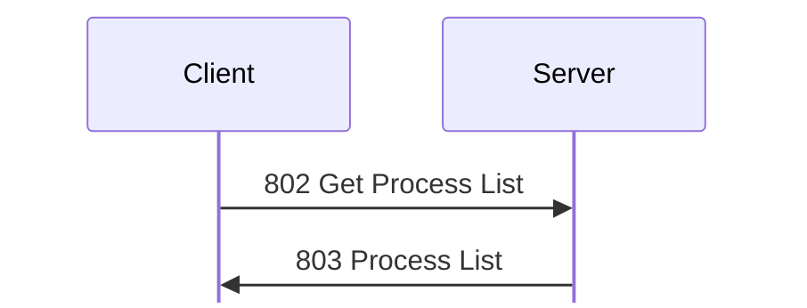

# Process messages

Tags, hex, and field notation: see [Conventions](../README.md#conventions).

Message types 800 to 804: listing and ending the processes of the server host.

## 800 Open Process Monitor
Initiator: Client. Privilege: View Processes (80). <!-- [S `FUN_0805b394`] -->

Struct `OpenProcessMonitor` (dynamic):

| Off | Size | Type | Field | Notes |
|---|---|---|---|---|
| 0x00 | rest | u8[] | ignored | payload unknown; not checked against the handler <!-- [I] --> |

## 801 Close Process Monitor
Initiator: Client. Privilege: View Processes (80). <!-- [S `FUN_0805b418`] -->

Struct `CloseProcessMonitor` (dynamic):

| Off | Size | Type | Field | Notes |
|---|---|---|---|---|
| 0x00 | rest | u8[] | ignored | payload unknown; not checked against the handler <!-- [I] --> |

## 802 Get Process List
Initiator: Client. Privilege: View Processes (80). <!-- [S `FUN_0805b454`; O] -->

The process list is one request and one reply:

No payload.

The server runs `/bin/ps auxwww` (its own child shows
up in the list) and replies with [803 Process List](#m803).

## 803 Process List
Initiator: Server. Reply to [802 Get Process List](#m802).

Struct `ProcessList` (dynamic):

| Off | Size | Type | Field | Notes |
|---|---|---|---|---|
| 0x00 | 8 | u64 | memory_00 | about 33 GB; host memory <!-- [I] --> |
| 0x08 | 8 | u64 | memory_08 | about 33 GB <!-- [I] --> |
| 0x10 | 12 | u8[12] | ignored |  |
| 0x1c | 4 | u32 | processes_count |  |
| 0x20 | processes_count | Process[] | processes |  |

Each process entry is padded to 4:

Struct `Process` (dynamic):

| Off | Size | Type | Field | Notes |
|---|---|---|---|---|
| 0x00 | 4 | u32 | pid |  |
| 0x04 | 4 | u8[4] | ignored_04 |  |
| 0x08 | 8 | u64 | start_time |  |
| 0x10 | 41 | u8[41] | ignored_10 |  |
| 0x39 | 1 | u8 | user_len |  |
| 0x3a | 1 | u8 | command_len |  |
| 0x3b | 1 | u8 | string_3b_len |  |
| 0x3c | command_len | str | command | Length at most 0xff; longer commands are cut |
|  | string_3b_len | str | string_3b | written between the command and the user name; <!-- [S `FUN_0805b454`] --> empty in `captures/probe.pcapng` frame 208 <!-- [O] --> |
|  | user_len | str | user |  |
|  | pad4 | u8[] | padding |  |

The strings come in the order command, `string_3b`, user, though the length of
the user is first. <!-- [S `FUN_0805b454`] -->

## 804 Exit/Terminate Process
Initiator: Client. Privilege: Terminate Processes (81). <!-- [S `FUN_0805b8f4`, `FUN_08090c6c`] -->

Struct `ExitTerminateProcess` (12 bytes):

| Off | Size | Type | Field | Notes |
|---|---|---|---|---|
| 0x00 | 4 | u32 | flags | bit 0 kill, bit 1 exit, bit 2 extra flag; one of bits 0 and 1 is required, else 0x10002 |
| 0x04 | 4 | u32 | pid |  |
| 0x08 | 4 | u32 | value_08 | must be 0, or nothing happens |

On Linux, kill sends SIGKILL and exit sends SIGTERM to the PID. Bit 2 gets
0x10005 (unsupported) on Linux. A failed `kill()` returns the OS error.
There is no reply on success; the server logs `Terminate Process` and
writes history record 0x324. <!-- [S] --> The client's Exit Process sends flags
2 (exit). <!-- [O `captures/linux-shutdown.pcapng` frame 25] -->
`kdx_proto::msg::admin::ExitTerminateProcess` re-encodes it.
