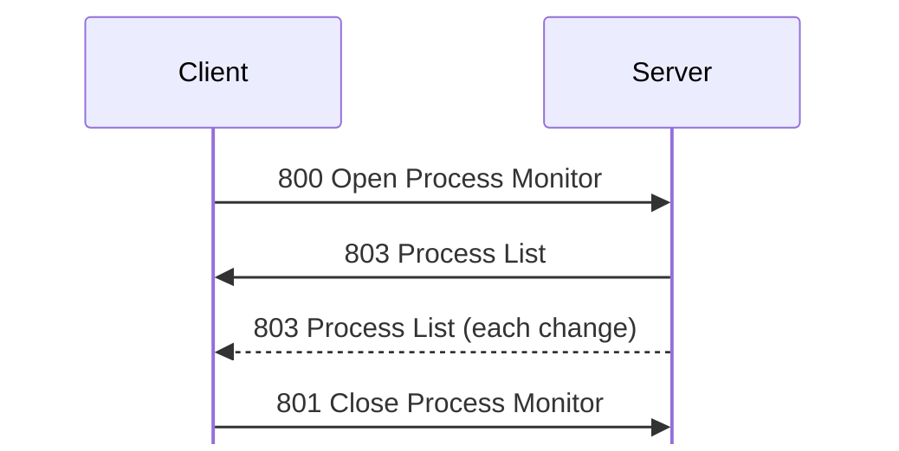
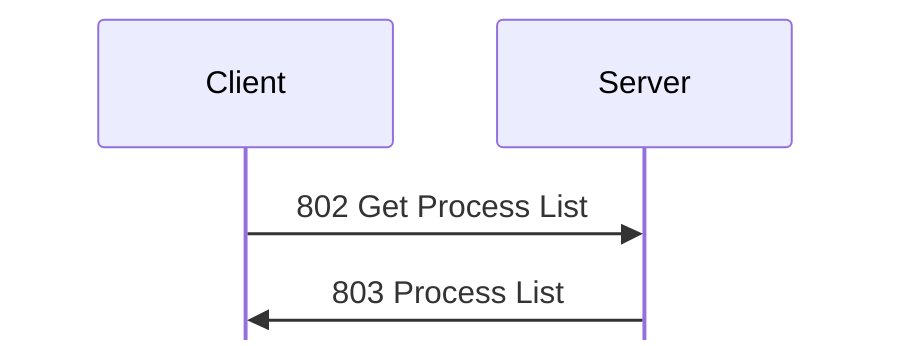

# Process messages

For hex and field notation, see [Conventions](../README.md#conventions).

Message types 800 to 804 list and stop the processes on the server's host.
They grew out of RemoteAdminTool's types 100 to 104; see [rat.md](../rat.md).
<!-- [S] -->

## 800 Open Process Monitor
Initiator: Client. Privilege: View Processes (80). <!-- [S `FUN_0805b394`] -->

The server sends the list at once, and then each time it changes, until the
client closes the monitor:

No payload.

If the user already has the monitor open, the reply is 0x10003. If not, the
reply is a [803 Process List](#m803), as for [802 Get Process List](#m802), and
the server sets a flag on the user. While any user has the flag, the server
watches for processes that start and quit. On each change, it sends a new [803
Process List](#m803) to each user with the flag, as a notification. <!-- [S
`FUN_0805b344`] -->

Server 1.000 for Mac watches with a Carbon event handler. <!-- [S server
`FUN_10010bf0`, server `FUN_100541b0`] Server 1.000 --> On Linux, the function
that starts the watch is empty, so Server 1.620 sends only the first list. <!--
[S `FUN_08090c2c`] -->

## 801 Close Process Monitor
Initiator: Client. <!-- [S `FUN_0805b418`, server `FUN_10010cb0`] -->

No payload.

This clears the flag of [800 Open Process Monitor](#m800). When no user has the
flag, the server stops the watch. It checks no privilege, and there is no reply.

## 802 Get Process List
Initiator: Client. Privilege: View Processes (80). <!-- [S `FUN_0805b454`; O] -->

The process list is one request and one reply:

No payload.

The server runs `/bin/ps auxwww`, and replies with [803 Process List](#m803).
The `ps` process itself is in the list.

## 803 Process List
Initiator: Server. Reply to [800 Open Process Monitor](#m800) or [802 Get
Process List](#m802), or a notification to an open monitor.

Struct `ProcessList` (dynamic):

| Off | Size | Type | Field | Notes |
|---|---|---|---|---|
| 0x00 | 8 | `u64` | `memory_00` | About 33 GB, probably the host's memory. <!-- [I] --> |
| 0x08 | 8 | `u64` | `memory_08` | About 33 GB. <!-- [I] --> |
| 0x10 | 12 | `u8[12]` | `ignored` |  |
| 0x1c | 4 | `u32` | `processes_count` |  |
| 0x20 | `processes_count` | [`Process`](#sProcess)`[]` | `processes` |  |

Each process entry is padded to a multiple of 4:

Struct `Process` (dynamic):

| Off | Size | Type | Field | Notes |
|---|---|---|---|---|
| 0x00 | 4 | `u32` | `pid` |  |
| 0x04 | 4 | `u8[4]` | `ignored_04` |  |
| 0x08 | 8 | `u64` | `start_time` |  |
| 0x10 | 41 | `u8[41]` | `ignored_10` |  |
| 0x39 | 1 | `u8` | `user_len` |  |
| 0x3a | 1 | `u8` | `command_len` |  |
| 0x3b | 1 | `u8` | `string_3b_len` |  |
| 0x3c | `command_len` | `str` | `command` | At most 0xff bytes. The server cuts longer commands. |
|  | `string_3b_len` | `str` | `string_3b` | Written between the command and the user name. <!-- [S `FUN_0805b454`] --> Empty in `captures/probe.pcapng` frame 208. <!-- [O] --> |
|  | `user_len` | `str` | `user` |  |
|  | pad4 | `u8[]` | `padding` |  |

The strings come in the order command, `string_3b`, user, but the user's length
comes first. <!-- [S `FUN_0805b454`] -->

## 804 Exit/Terminate Process
Initiator: Client. Privilege: Terminate Processes (81). <!-- [S `FUN_0805b8f4`, `FUN_08090c6c`] -->

Struct `ExitTerminateProcess` (12 bytes):

| Off | Size | Type | Field | Notes |
|---|---|---|---|---|
| 0x00 | 4 | `u32` | `flags` | Bit 0 is kill, bit 1 exit, and bit 2 restart. Bit 0 or bit 1 must be set, or the server gives 0x10002. |
| 0x04 | 4 | `u32` | `pid` |  |
| 0x08 | 4 | `u32` | `value_08` | Must be 0 on Linux, or nothing happens. On a Mac, `pid` and this field are the 8-byte process serial number. <!-- [S server `FUN_10010fe0`] Server 1.000 --> |

On Linux, kill sends SIGKILL to the PID, and exit sends SIGTERM. On Linux, bit 2
gets 0x10005 (unsupported). If `kill()` fails, the reply is the OS error. If it
succeeds, there is no reply, and the server logs `Terminate Process` and writes
history record 0x324. <!-- [S] --> The client's Exit Process sends flags 2
(exit). <!-- [O `captures/linux-shutdown.pcapng` frame 25] -->
`kdx_proto::msg::admin::ExitTerminateProcess` encodes it again byte for byte.

Server 1.000 for Mac shows what bit 2 does. <!-- [S server `FUN_10010fe0`,
server `FUN_10054270`, server `FUN_10030450`] Server 1.000 --> Kill and exit
both send the process a Quit Apple Event. With bit 2, the server first saves the
process's file, waits 900 ms for the process to quit, and then asks the Finder
to open the file again. So bit 2 restarts the process, as RAT's 104
Restart Process did. If no Finder runs, the error is -600.
