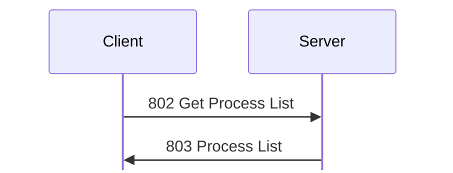

# Process messages

For hex and field notation, see [Conventions](../README.md#conventions).

Message types 800 to 804 list and stop the processes on the server's host.

## 800 Open Process Monitor
Initiator: Client. Privilege: View Processes (80). <!-- [S `FUN_0805b394`] -->

Struct `OpenProcessMonitor` (dynamic):

| Off | Size | Type | Field | Notes |
|---|---|---|---|---|
| 0x00 | rest | `u8[]` | `ignored` | The payload is unknown. Nobody has read the handler for it yet. <!-- [I] --> |

## 801 Close Process Monitor
Initiator: Client. Privilege: View Processes (80). <!-- [S `FUN_0805b418`] -->

Struct `CloseProcessMonitor` (dynamic):

| Off | Size | Type | Field | Notes |
|---|---|---|---|---|
| 0x00 | rest | `u8[]` | `ignored` | The payload is unknown. Nobody has read the handler for it yet. <!-- [I] --> |

## 802 Get Process List
Initiator: Client. Privilege: View Processes (80). <!-- [S `FUN_0805b454`; O] -->

The process list is one request and one reply:

No payload.

The server runs `/bin/ps auxwww`, and replies with [803 Process List](#m803).
The `ps` process itself is in the list.

## 803 Process List
Initiator: Server. Reply to [802 Get Process List](#m802).

Struct `ProcessList` (dynamic):

| Off | Size | Type | Field | Notes |
|---|---|---|---|---|
| 0x00 | 8 | `u64` | `memory_00` | About 33 GB, probably the host's memory. <!-- [I] --> |
| 0x08 | 8 | `u64` | `memory_08` | About 33 GB. <!-- [I] --> |
| 0x10 | 12 | `u8[12]` | `ignored` |  |
| 0x1c | 4 | `u32` | `processes_count` |  |
| 0x20 | `processes_count` | [`Process`](#sProcess)`[]` | `processes` |  |

Each process entry is padded to a multiple of 4:

Struct `Process` (dynamic):

| Off | Size | Type | Field | Notes |
|---|---|---|---|---|
| 0x00 | 4 | `u32` | `pid` |  |
| 0x04 | 4 | `u8[4]` | `ignored_04` |  |
| 0x08 | 8 | `u64` | `start_time` |  |
| 0x10 | 41 | `u8[41]` | `ignored_10` |  |
| 0x39 | 1 | `u8` | `user_len` |  |
| 0x3a | 1 | `u8` | `command_len` |  |
| 0x3b | 1 | `u8` | `string_3b_len` |  |
| 0x3c | `command_len` | `str` | `command` | At most 0xff bytes. The server cuts longer commands. |
|  | `string_3b_len` | `str` | `string_3b` | Written between the command and the user name. <!-- [S `FUN_0805b454`] --> Empty in `captures/probe.pcapng` frame 208. <!-- [O] --> |
|  | `user_len` | `str` | `user` |  |
|  | pad4 | `u8[]` | `padding` |  |

The strings come in the order command, `string_3b`, user, but the user's length
comes first. <!-- [S `FUN_0805b454`] -->

## 804 Exit/Terminate Process
Initiator: Client. Privilege: Terminate Processes (81). <!-- [S `FUN_0805b8f4`, `FUN_08090c6c`] -->

Struct `ExitTerminateProcess` (12 bytes):

| Off | Size | Type | Field | Notes |
|---|---|---|---|---|
| 0x00 | 4 | `u32` | `flags` | Bit 0 is kill, bit 1 exit, and bit 2 an extra flag. Bit 0 or bit 1 must be set, or the server gives 0x10002. |
| 0x04 | 4 | `u32` | `pid` |  |
| 0x08 | 4 | `u32` | `value_08` | Must be 0, or nothing happens. |

On Linux, kill sends SIGKILL to the PID, and exit sends SIGTERM. On Linux, bit 2
gets 0x10005 (unsupported). If `kill()` fails, the reply is the OS error. If it
succeeds, there is no reply, and the server logs `Terminate Process` and writes
history record 0x324. <!-- [S] --> The client's Exit Process sends flags 2
(exit). <!-- [O `captures/linux-shutdown.pcapng` frame 25] -->
`kdx_proto::msg::admin::ExitTerminateProcess` encodes it again byte for byte.
