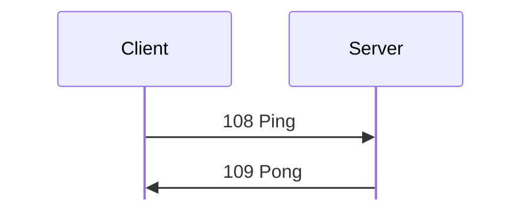
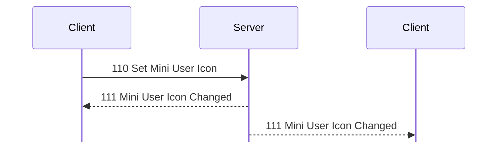
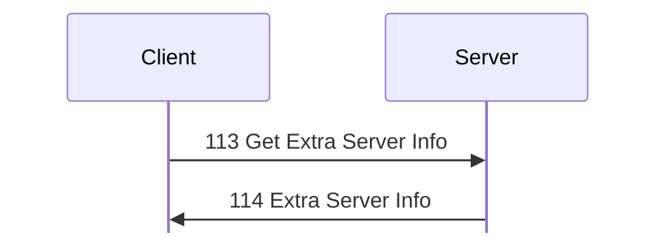
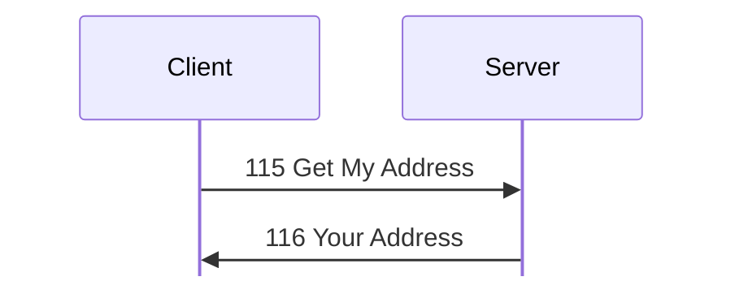

# Session messages

For hex and field notation, see [Conventions](../README.md#conventions).

Message types 100 to 118 cover setup, identity, the user list, server
information, the greeting, ping, and the key exchange between clients.

## 100 Set Identity
Initiator: Client. <!-- [S `FUN_0804b304`; O] -->

This is the client's first message after the handshake. The client sends it
again each time the user changes nick, icon, or info. The payload is a user
record with user ID 0.

Struct `SetIdentity` (dynamic):

| Off | Size | Type | Field | Notes |
|---|---|---|---|---|
| 0x00 |  | [`UserRecord`](../encodings.md#sUserRecord) | `user` | `user_id` is 0. |

- The nick takes effect only with the Use Any Name privilege. Without it, the
  server uses the account name. The server logs changes as `Set Name: <…> (…)`.
- There is no direct reply. After the first 100 Set Identity, the server sends
  these messages, in this order:
  1. [101 User List](#m101)
  2. [105 Server Info](#m105)
  3. [107 Server Greeting](#m107), unless the account has Don't Show Greeting
  4. [106 Server Icon](#m106), if the server has one
  5. [213 Must Join Chat](chat.md#m213), if both Join Chat On Connect and Join
     Chat are set

  It also sends [103 User Joined](#m103) to all other users, and writes a [184
  Login](administration.md#m184) history record. <!-- [O
  `captures/linux-server-settings.pcapng` frames 80, 82, 83; O
  `captures/linux-chat-rooms.pcapng` frame 167] -->
- After a later 100 Set Identity, the server sends [102 User Changed](#m102) to
  all users, the sender too. <!-- [O `captures/linux-server-settings.pcapng`
  frames 196, 199, 201] -->

## 101 User List
Initiator: Server. <!-- [S `FUN_0804af04`; O] -->

The payload is a series of user records, one for each user who is logged in.
After a login, it holds all of them.

Struct `UserList` (dynamic):

| Off | Size | Type | Field | Notes |
|---|---|---|---|---|
| 0x00 | rest | [`UserRecord`](../encodings.md#sUserRecord)`[]` | `users` | Each is padded to a multiple of 4. |

## 102 User Changed
Initiator: Server. <!-- [S; O] -->

The server sends this to all users when a user sends a later [100 Set
Identity](#m100). The payload is one user record.

Struct `UserChanged` (dynamic):

| Off | Size | Type | Field | Notes |
|---|---|---|---|---|
| 0x00 |  | [`UserRecord`](../encodings.md#sUserRecord) | `user` |  |

## 103 User Joined
Initiator: Server. <!-- [S; O] -->

The server sends this to all other users after a user's first [100 Set
Identity](#m100). The payload is one user record.

Struct `UserJoined` (dynamic):

| Off | Size | Type | Field | Notes |
|---|---|---|---|---|
| 0x00 |  | [`UserRecord`](../encodings.md#sUserRecord) | `user` |  |

## 104 User Departed
Initiator: Server. <!-- [O `captures/kdx-cli.pcapng` frames 398, 429; O `captures/linux-chat-admin.pcapng` frames 59, 116] -->

Struct `UserDeparted` (8 bytes):

| Off | Size | Type | Field | Notes |
|---|---|---|---|---|
| 0x00 | 4 | `u32` | `user_id` |  |
| 0x04 | 1 | `u8` | `value_4` | 7 in all captures. |
| 0x05 | 3 | `u8[3]` | `ignored` | 0 as sent. |

`kdx_proto::msg::user::UserDeparted` encodes it again byte for byte (test
`linux_chat_admin`).

## 105 Server Info
Initiator: Server. 86 bytes as seen. <!-- [S `FUN_0804b304`; O] -->

Struct `ServerInfo` (dynamic):

| Off | Size | Type | Field | Notes |
|---|---|---|---|---|
| 0x00 | 32 | `u8[32]` | `session_key` | From the user object (+0x74). Probably a session ID for transfer connections. <!-- [I] --> |
| 0x20 | 4 | `u32` | `file_transfer_port` | The server's optional File Transfer port (settings +0x260), or 0 if it has none. If it is not 0, the client opens transfer connections to it. <!-- [S client `FUN_08052cc0`] --> |
| 0x24 | 4 | `u32` | `user_id` | 7 and 8 in two probes, one after the other. <!-- [O] --> |
| 0x28 | 2 | `u16` | `version` | 0x0654 = 1620 |
| 0x2a | 2 | `u16` | `can_modify_settings` | 1 with Modify Server Settings. |
| 0x2c | 26 | `u8[26]` | `ignored_2c` |  |
| 0x46 | 2 | `u16` | `value_46` | 2. If it is not 2, the client compares the version, and warns about an older or newer server. <!-- [S] --> Server 1.620 always sends 2, so the warning never shows. |
| 0x48 | 1 | `u8` | `name_len` |  |
| 0x49 | 1 | `u8` | `description_len` |  |
| 0x4a | 1 | `u8` | `third_len` |  |
| 0x4b | 1 | `u8` | `ignored_4b` |  |
| 0x4c | `name_len` | `str` | `name` | "New Server". <!-- [O] --> At most 0x3f bytes. |
|  | `description_len` | `str` | `description` | At most 0xff bytes. |
|  | `third_len` | `str` | `third` | At most 0x7f bytes. |

The whole message is at most 0x400 bytes.

## 106 Server Icon
Initiator: Server. <!-- [O] -->

The payload is the server's icon bitmap, the same bytes as the icon section of
the settings blob; see [171 Server Settings Info](administration.md#m171). For a
32×32 icon pasted from the user icon, it is 524 bytes that start `01 20 20 04 00
01 00 00 00 ff cc 00`, the same as the icon section of the 171 in frame
221. <!-- [O `captures/linux-server-settings.pcapng` frames 83, 221] -->
`kdx_proto::msg::server_info::ServerIcon` holds the bytes.

Struct `ServerIcon` (dynamic):

| Off | Size | Type | Field | Notes |
|---|---|---|---|---|
| 0x00 | rest | `u8[]` | `icon` | The bitmap. |

## 107 Server Greeting
Initiator: Server. <!-- [S `FUN_0804b738`; O] -->

Struct `ServerGreeting` (dynamic):

| Off | Size | Type | Field | Notes |
|---|---|---|---|---|
| 0x00 | 4 | `u8[4]` | `ignored` | 0 as sent. |
| 0x04 | rest | `str` | `text` | To the end of the payload. |

If the server has no greeting, it sends `(No greeting.)`. <!-- [O
`captures/probe.pcapng` frame 163] --> If it has a greeting that is not enabled,
it sends `(Greeting disabled.)`. <!-- [O `captures/linux-server-settings.pcapng`
frame 46] --> The enable option is bit 1 of byte 0x93 of the settings blob.
`kdx_proto::msg::server_info::ServerGreeting` encodes frames 46, 62, and 82
again byte for byte (test `linux_server_settings`).

## 108 Ping
Initiator: Client. The dispatcher handles it itself. <!-- [S] -->

The reply is [109 Pong](#m109):

No payload.

Ping does not reset the idle timer.

## 109 Pong
Initiator: Server. Reply to [108 Ping](#m108). <!-- [S] -->

No payload.

## 110 Set Mini User Icon
Initiator: Client. <!-- [S `FUN_0804b6d4`; O] -->

The change goes to all users, the sender too:

Struct `MiniUserIcon` (4 bytes):

| Off | Size | Type | Field | Notes |
|---|---|---|---|---|
| 0x00 | 1 | `u8` | `status` | 1 after `/away`, and 0 after `/back`. <!-- [O] --> |
| 0x01 | 3 | `u8[3]` | `ignored` | 0 as sent. The payload must be at least 4 bytes. |

There is no reply.

## 111 Mini User Icon Changed
Initiator: Server.

When a [110 Set Mini User Icon](#m110) changes the value, the server sends this
to all users, the sender too:

Struct `MiniUserIconChanged` (8 bytes):

| Off | Size | Type | Field | Notes |
|---|---|---|---|---|
| 0x00 | 4 | `u32` | `user_id` |  |
| 0x04 | 4 | [`MiniUserIcon`](#sMiniUserIcon) | `icon` | The payload of 110. |

For user 3, `/away` sent `01 00 00 00`, and the peer got `00 00 00 03 01 00 00
00`. <!-- [O `captures/linux-server-settings.pcapng` frames 210, 211, 213] -->
`kdx_proto::msg::user::MiniUserIcon` and `MiniUserIconChanged` encode frames 210
to 218 again byte for byte.

## 112 (unnamed)
Initiator: Client. <!-- [S `FUN_0804b738`; O] -->

No payload.

The server answers with [107 Server Greeting](#m107) as a new message, with its
own txid, not as a reply. The client uses this to get the greeting again.

## 113 Get Extra Server Info
Initiator: Client. <!-- [S `FUN_080619d8`; O] -->

The reply is [114 Extra Server Info](#m114):

No payload.

## 114 Extra Server Info
Initiator: Server. Reply to [113 Get Extra Server Info](#m113). <!-- [S `FUN_080619d8`; O] -->

Struct `ExtraServerInfo` (dynamic):

| Off | Size | Type | Field | Notes |
|---|---|---|---|---|
| 0x00 | 16 | `u8[16]` | `ignored_00` |  |
| 0x10 | 8 | `u64` | `start_time` | In ms. |
| 0x18 | 8 | `u64` | `now` | In ms. |
| 0x20 | 4 | `u32` | `uptime` | In seconds. |
| 0x24 | 4 | `u32` | `os_value_24` | 0x1000 in the lab. |
| 0x28 | 4 | `u32` | `os_value_28` | 1000 in the lab. |
| 0x2c | 1 | `u8` | `os_len` |  |
| 0x2d | 3 | `u8[3]` | `ignored_2d` |  |
| 0x30 | `os_len` | `str` | `os` | As `uname` gives it. |

## 115 Get My Address
Initiator: Client. The dispatcher handles it itself. <!-- [S; O] -->

The reply is [116 Your Address](#m116):

No payload.

## 116 Your Address
Initiator: Server. Reply to [115 Get My Address](#m115). <!-- [S; O] -->

The payload is the client's address as the server sees it, as a u8 length and
then `"a.b.c.d:port"`.

Struct `YourAddress` (dynamic):

| Off | Size | Type | Field | Notes |
|---|---|---|---|---|
| 0x00 | 1 | `u8` | `address_len` |  |
| 0x01 | `address_len` | `str` | `address` | `a.b.c.d:port` |

## 117 SKPK
Initiator: Client, to a client. <!-- [S `FUN_0808eefc`, `FUN_0808ff64`] -->

Struct `Skpk` (48 bytes):

| Off | Size | Type | Field | Notes |
|---|---|---|---|---|
| 0x00 | 32 | `u8[32]` | `key` | The sender's key for secondary connections to it. |
| 0x20 | 4 | `u32` | `dcc_port` | The sender's listener. |
| 0x24 | 4 | `u32` | `connection_id` | The sender's ID for this primary connection. Each client numbers its own connections. |
| 0x28 | 2 | `u16` | `client_version` | 0x0654 (1620). The receiver warns if it is older or newer. |
| 0x2a | 6 | `u8[6]` | `ignored` | 0 as sent. |

Frames 22, 25, 119, and 122 match this layout, with ports 0x2968 and 0x2969, and
connection IDs 2 and 4. <!-- [O `captures/linux-dcc-voice-failed.pcapng`] -->
`kdx_proto::msg::dcc::Skpk` encodes frames 22 and 25 again byte for byte.

## 118 (unnamed)
Initiator: Client. The dispatcher handles it itself. <!-- [S `FUN_0804fdac`; O `captures/probe.pcapng` frame 165] -->

Struct `RegistrationNotice` (4 bytes):

| Off | Size | Type | Field | Notes |
|---|---|---|---|---|
| 0x00 | 4 | `u32` | `value` |  |

There is no reply. The server stores 1 at user +0x3b if the value is not 0, and
2 if it is 0. The probe sent `00 00 00 01` and got no reply. <!-- [O] -->
`kdx_proto::msg::user::RegistrationNotice` encodes it again.

The client sends it on a timer, 9000000 ms after login, plus a random 0 to
0x4fffff ms. <!-- [S client `FUN_0804c01c`] --> The value is the length of the
client's stored purchase certificate, or 0 if it has none. <!-- [S client
`FUN_08107e04`] --> So it probably tells the server if the client is
registered. <!-- [I] -->

The server acts on it. <!-- [S `FUN_0804b7c8`] --> Every 900000 ms, plus a
random 0 to 0x8ffff ms, it sends [155 Rcv Broadcast
Message](administration.md#m155) "Please help fund the further development of
KDX by purchasing a license." to each user whose stored value is 2, and who has
been connected for less than 2 hours (7200000 ms). The first round runs
217500000 ms (about 60 hours) after the server starts, <!-- [S `FUN_080531f0`]
--> so a short lab run never shows it. The text is obfuscated in the binary at
0x080adc00: each byte is ~b + 0xbe. The payload of the 155 is 16 zero bytes, and
then the text.
