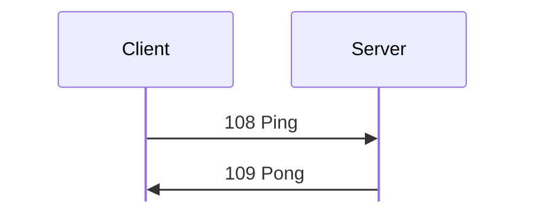
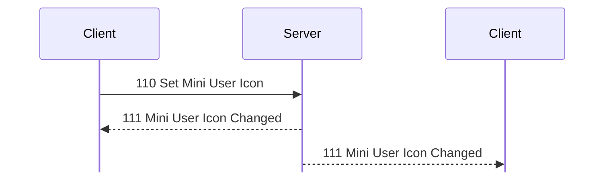
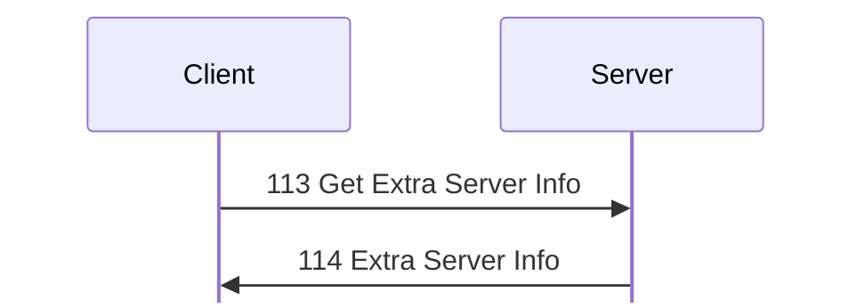
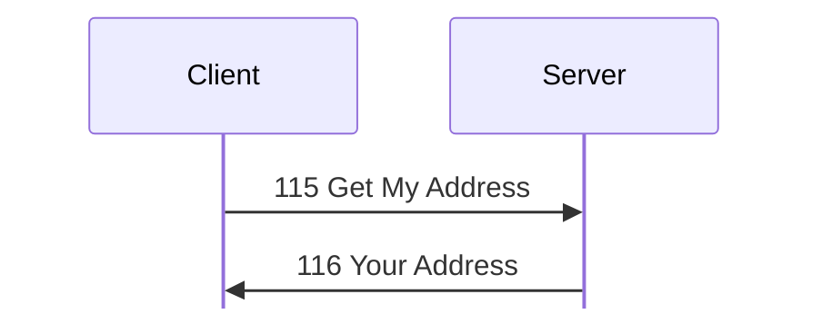

# Session messages

Tags, hex, and field notation: see [Conventions](../README.md#conventions).

Message types 100 to 118: setup, identity, user list, server information,
greeting, ping, and the key exchange between clients.

## 100 Set Identity
Initiator: Client. **[S `FUN_0804b304`; O]**

The client's first message after the handshake. It is also sent again
whenever the user changes nick, icon, or info. The payload is a user record
with user ID 0.

Struct `SetIdentity` (dynamic):

| Off | Size | Type | Field | Notes |
|---|---|---|---|---|
| 0x00 |  | UserRecord | user | `user ID` is 0 |

- The nick takes effect only with the Use Any Name privilege; otherwise the
  account name is used. Changes are logged as `Set Name: <…> (…)`.
- No direct reply. On the first [100 Set Identity](#m100), the server sends, in
  order:
  - [101 User List](#m101);
  - [105 Server Info](#m105);
  - [107 Server Greeting](#m107), unless the account has Don't Show Greeting;
  - [106 Server Icon](#m106), if one is set;
  - [213 Must Join Chat](chat.md#m213), when Join Chat On Connect and Join Chat
    are both set.

  It also sends [103 User Joined](#m103) to everyone else and writes a
  [184 Login](administration.md#m184) history record. **[O]**: 105, 107, 106 in
  that order (`captures/linux-server-settings.pcapng` frames 80, 82, 83), and
  213 after 106 (`captures/linux-chat-rooms.pcapng` frame 167).
- A later 100 Set Identity broadcasts [102 User Changed](#m102) to everyone, the
  sender included (`captures/linux-server-settings.pcapng` frames 196, 199, 201)
  **[O]**.

## 101 User List
Initiator: Server. **[S `FUN_0804af04`; O]**

A sequence of user records, one per user who is logged in (all of them on
login).

Struct `UserList` (dynamic):

| Off | Size | Type | Field | Notes |
|---|---|---|---|---|
| 0x00 | rest | UserRecord[] | users | each padded to 4 |

## 102 User Changed
Initiator: Server. **[S; O]**

Sent to everyone when a user sends a later
[100 Set Identity](#m100). One user record.

Struct `UserChanged` (dynamic):

| Off | Size | Type | Field | Notes |
|---|---|---|---|---|
| 0x00 |  | UserRecord | user |  |

## 103 User Joined
Initiator: Server. **[S; O]**

Sent to everyone else after a user's first
[100 Set Identity](#m100). One user record.

Struct `UserJoined` (dynamic):

| Off | Size | Type | Field | Notes |
|---|---|---|---|---|
| 0x00 |  | UserRecord | user |  |

## 104 User Departed
Initiator: Server. **[O `captures/kdx-cli.pcapng` frames 398, 429; O
`captures/linux-chat-admin.pcapng` frames 59, 116]**

Struct `UserDeparted` (8 bytes):

| Off | Size | Type | Field | Notes |
|---|---|---|---|---|
| 0x00 | 4 | u32 | user_id |  |
| 0x04 | 1 | u8 | value_4 | 7 in every capture |
| 0x05 | 3 | u8[3] | ignored | 0 as sent. |

`kdx_proto::msg::user::UserDeparted` re-encodes it byte for byte (test
`linux_chat_admin`).

## 105 Server Info
Initiator: Server. Observed size: 86 bytes. **[S `FUN_0804b304`; O]**

Struct `ServerInfo` (dynamic):

| Off | Size | Type | Field | Notes |
|---|---|---|---|---|
| 0x00 | 32 | u8[32] | session_key | from the user object (+0x74), probably a session ID for transfer connections **[I]** |
| 0x20 | 4 | u32 | file_transfer_port | the server's optional File Transfer port (settings +0x260); 0 if none. The client opens transfer connections there when it is nonzero **[S client `FUN_08052cc0`]** |
| 0x24 | 4 | u32 | user_id | **[O]** 7 and 8 in successive probes |
| 0x28 | 2 | u16 | version | 0x0654 = 1620 |
| 0x2a | 2 | u16 | can_modify_settings | 1 with Modify Server Settings |
| 0x2c | 26 | u8[26] | ignored_2c |  |
| 0x46 | 2 | u16 | value_46 | 2. Unless it is 2, the client compares the version and warns about an older or newer server **[S]**; Server 1.620 always sends 2, so the warning never shows |
| 0x48 | 1 | u8 | name_len |  |
| 0x49 | 1 | u8 | description_len |  |
| 0x4a | 1 | u8 | third_len |  |
| 0x4b | 1 | u8 | ignored_4b |  |
| 0x4c | name_len | str | name | "New Server" **[O]** Length ≤ 0x3f |
|  | description_len | str | description | Length ≤ 0xff |
|  | third_len | str | third | Length ≤ 0x7f |

The whole message is at most 0x400 bytes.

## 106 Server Icon
Initiator: Server. **[O]**

The server's icon bitmap, the same bytes as the icon section of the settings
blob (see [171 Server Settings Info](administration.md#m171)). **[O]**: 524
bytes for a 32×32 icon pasted from the user icon, starting
`01 20 20 04 00 01 00 00 00 ff cc 00` (`captures/linux-server-settings.pcapng`
frame 83), equal to the icon section of the 171 at frame 221.
`kdx_proto::msg::server_info::ServerIcon` holds the bytes.

Struct `ServerIcon` (dynamic):

| Off | Size | Type | Field | Notes |
|---|---|---|---|---|
| 0x00 | rest | u8[] | icon | the bitmap |

## 107 Server Greeting
Initiator: Server. **[S `FUN_0804b738`; O]**

Struct `ServerGreeting` (dynamic):

| Off | Size | Type | Field | Notes |
|---|---|---|---|---|
| 0x00 | 4 | u8[4] | ignored | 0 as sent. |
| 0x04 | rest | str | text | to the end of the payload |

When no greeting is set, the server sends `(No greeting.)`
(`captures/probe.pcapng` frame 163) **[O]**. When a greeting is set but not
enabled, it sends `(Greeting disabled.)`
(`captures/linux-server-settings.pcapng` frame 46) **[O]**. The enable
option is bit 1 of byte 0x93 of the settings blob.
`kdx_proto::msg::server_info::ServerGreeting` re-encodes frames 46, 62, and
82 byte for byte (test `linux_server_settings`).

## 108 Ping
Initiator: Client. **[S]**
Handled inline in the dispatcher **[S]**.

[108 Ping](#m108) gets [109 Pong](#m109):

No payload.

Ping does not reset the idle timer.

## 109 Pong
Initiator: Server. **[S]**

Reply to [108 Ping](#m108).

No payload.

## 110 Set Mini User Icon
Initiator: Client. **[S `FUN_0804b6d4`; O]**

The change reaches everyone, the sender included:

Struct `MiniUserIcon` (4 bytes):

| Off | Size | Type | Field | Notes |
|---|---|---|---|---|
| 0x00 | 1 | u8 | status | 1 after `/away`, 0 after `/back` **[O]** |
| 0x01 | 3 | u8[3] | ignored | 0 as sent. the payload must be at least 4 bytes |

There is no reply.

## 111 Mini User Icon Changed
Initiator: Server.

Sent when a [110 Set Mini User Icon](#m110) changed the value: the server
broadcasts it to everyone, the sender included:

Struct `MiniUserIconChanged` (8 bytes):

| Off | Size | Type | Field | Notes |
|---|---|---|---|---|
| 0x00 | 4 | u32 | user_id |  |
| 0x04 | 4 | MiniUserIcon | icon | the 110 payload |

**[O]**: `/away` sent `01 00 00 00`, and the peer received `00 00 00 03 01 00 00
00` for user 3 (`captures/linux-server-settings.pcapng` frames 210, 211,
213). `kdx_proto::msg::user::MiniUserIcon` and `MiniUserIconChanged`
re-encode frames 210 to 218 byte for byte.

## 112 (unnamed)
Initiator: Client. **[S `FUN_0804b738`; O]**

No payload.

The server answers with [107 Server Greeting](#m107) as a
new message (its own txid), not as a reply. The client uses this to re-read the
greeting.

## 113 Get Extra Server Info
Initiator: Client. **[S `FUN_080619d8`; O]**

[113 Get Extra Server Info](#m113) gets [114 Extra Server Info](#m114):

No payload.

## 114 Extra Server Info
Initiator: Server. **[S `FUN_080619d8`; O]**

Reply to [113 Get Extra Server Info](#m113):

Struct `ExtraServerInfo` (dynamic):

| Off | Size | Type | Field | Notes |
|---|---|---|---|---|
| 0x00 | 16 | u8[16] | ignored_00 |  |
| 0x10 | 8 | u64 | start_time | ms |
| 0x18 | 8 | u64 | now | ms |
| 0x20 | 4 | u32 | uptime | in seconds |
| 0x24 | 4 | u32 | os_value_24 | 0x1000 in the lab |
| 0x28 | 4 | u32 | os_value_28 | 1000 in the lab |
| 0x2c | 1 | u8 | os_len |  |
| 0x2d | 3 | u8[3] | ignored_2d |  |
| 0x30 | os_len | str | os | as from `uname` |

## 115 Get My Address
Initiator: Client. **[S; O]**
Handled inline in the dispatcher **[S]**.

[115 Get My Address](#m115) gets [116 Your Address](#m116):

No payload.

## 116 Your Address
Initiator: Server. **[S; O]**

Reply to [115 Get My Address](#m115). The reply is a u8 length followed by
`"a.b.c.d:port"`: the client's address as the server sees it.

Struct `YourAddress` (dynamic):

| Off | Size | Type | Field | Notes |
|---|---|---|---|---|
| 0x00 | 1 | u8 | address_len |  |
| 0x01 | address_len | str | address | `a.b.c.d:port` |

## 117 SKPK

Initiator: Client (to client). **[S `FUN_0808eefc`, `FUN_0808ff64`]**

Struct `Skpk` (48 bytes):

| Off | Size | Type | Field | Notes |
|---|---|---|---|---|
| 0x00 | 32 | u8[32] | key | the sender's key for secondary connections to it |
| 0x20 | 4 | u32 | dcc_port | the sender's listener |
| 0x24 | 4 | u32 | connection_id | the sender's ID for this primary connection; each client numbers its own |
| 0x28 | 2 | u16 | client_version | 0x0654 (1620); the receiver warns if it is older or newer |
| 0x2a | 6 | u8[6] | ignored | 0 as sent. |

Frames 22, 25, 119, and 122 match this layout, with ports 0x2968 and 0x2969 and
connection IDs 2 and 4 **[O]**. `kdx_proto::msg::dcc::Skpk` re-encodes frames
22 and 25 byte for byte.

## 118 (unnamed)
Initiator: Client. **[S `FUN_0804fdac`; O `captures/probe.pcapng` frame 165]**
Handled inline in the dispatcher **[S]**.

Struct `RegistrationNotice` (4 bytes):

| Off | Size | Type | Field | Notes |
|---|---|---|---|---|
| 0x00 | 4 | u32 | value |  |

No reply. The server stores 1 if the value is nonzero and 2 if it is zero
(user +0x3b). The probe sent `00 00 00 01` and got no reply **[O]**.
`kdx_proto::msg::user::RegistrationNotice` re-encodes it.

The client sends it on a timer, 9000000 ms plus a random 0..0x4fffff ms after
login **[S client `FUN_0804c01c`]**. The value comes from the client's stored
purchase certificate (its length; 0 without one) **[S client `FUN_08107e04`]**.
So it reports whether the client is registered **[I]**.

The server acts on it **[S `FUN_0804b7c8`]**: every 900000 ms plus a random
0..0x8ffff ms, it sends [155 Rcv Broadcast Message](administration.md#m155)
"Please help fund the further development of KDX by purchasing a license." to
each user whose stored value is 2 and who has been connected less than 2 hours
(7200000 ms). The first round runs 217500000 ms (about 60 hours) after the
server starts **[S `FUN_080531f0`]**, so a short lab run never shows it. The
text is obfuscated in the binary at 0x080adc00 (each byte is ~b + 0xbe). The 155
payload is 16 zero bytes then the text.
