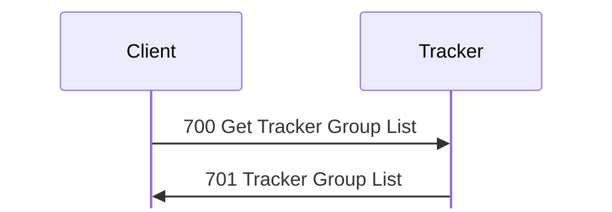
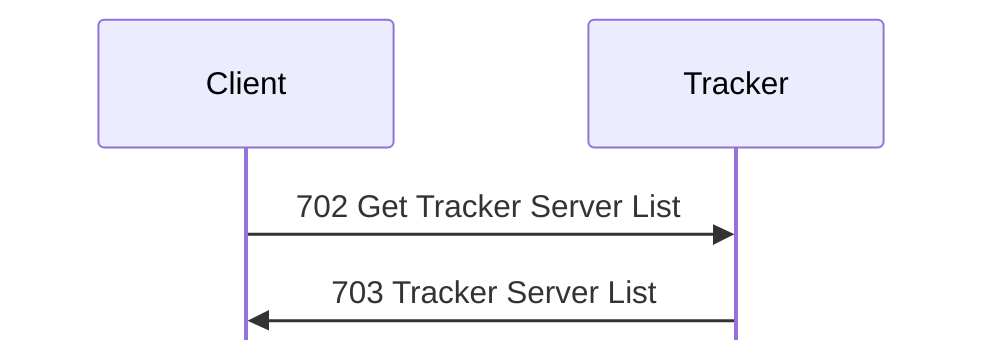
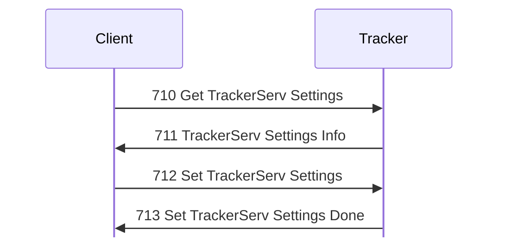
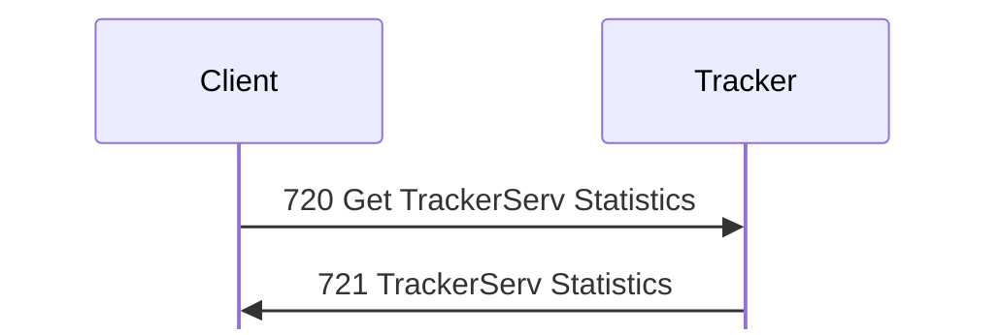

# Tracker messages

Tags, hex, and field notation: see [Conventions](../README.md#conventions).

Message types 700 to 721: what a client and a tracker exchange over TCP after
the login described in [tracker.md](../tracker.md#browsing-tcp). The tracker
also sends [1 Status](status.md#tracker-form) in its short form, and answers
[115 Get My Address](session.md#m115) as a server does: the reply
[116 Your Address](session.md#m116) holds the peer's address as a Pascal string
**[S `FUN_0804b378`]**.

**[O]** tags that give only a frame number cite
`captures/linux-tracker.pcapng`.

## 700 Get Tracker Group List

Initiator: Client. **[S `FUN_0804abf4`; O frame 34]**

No payload.

The reply is [701 Tracker Group List](#m701).

The group list is one request and one reply:

## 701 Tracker Group List

Initiator: Tracker. **[S `FUN_0804abf4`; O frame 34]**

Reply to [700 Get Tracker Group List](#m700). A fresh Tracker 1.110 has
eight groups: Business, Chat, Education, Games, General, Macintosh,
Trackers, and Windows, none with a description **[O]**.

Struct `TrackerGroupList` (dynamic):

| Off | Size | Type | Field | Notes |
|---|---|---|---|---|
| 0x00 | 4 | u32 | groups_count |  |
| 0x04 | groups_count | GroupListEntry[] | groups |  |

Struct `GroupListEntry` (dynamic):

| Off | Size | Type | Field | Notes |
|---|---|---|---|---|
| 0x00 | 2 | u16 | servers | number of servers in the group |
| 0x02 | 4 | u8[4] | value_02 | not set by the tracker; the client ignores it **[S client `FUN_08068bcc`]** |
| 0x06 | 1 | u8 | name_len |  |
| 0x07 | 1 | u8 | description_len |  |
| 0x08 | name_len | str | name |  |
|  | description_len | str | description |  |
|  | pad4 | u8[] | padding |  |

## 702 Get Tracker Server List

Initiator: Client, where the sender is client `FUN_08069ac4` and the handler
is `FUN_0804adcc`. **[S `FUN_0804adcc`, client `FUN_08069ac4`; O frames 36,
37]**

Struct `GetServerList` (dynamic):

| Off | Size | Type | Field | Notes |
|---|---|---|---|---|
| 0x00 | 2 | u8[2] | ignored_00 | 0 as sent. |
| 0x02 | 1 | u8 | group_len |  |
| 0x03 | 1 | u8 | ignored_03 | 0 as sent. |
| 0x04 | group_len | str | group |  |

A payload shorter than 4 bytes plus the name gives 0x10002, and an unknown group
0x1000c **[O `captures/kdx-cli-tracker.pcapng` frame 39]**; group names match
byte for byte **[S]**. The reply is [703 Tracker Server List](#m703).

A group's server list is one request and one reply:

## 703 Tracker Server List

Initiator: Tracker.

Reply to [702 Get Tracker Server List](#m702), with an empty payload for an
empty group:

Struct `TrackerServerList` (dynamic):

| Off | Size | Type | Field | Notes |
|---|---|---|---|---|
| 0x00 | 4 | u32 | servers_count |  |
| 0x04 | servers_count | ServerListEntry[] | servers | the client rejects more than 0xffff |

Each server record is padded to a multiple of 4 **[S tracker `FUN_0804adcc`,
client `FUN_08068da0`]**:

Struct `ServerListEntry` (dynamic):

| Off | Size | Type | Field | Notes |
|---|---|---|---|---|
| 0x00 | 8 | u64 | first_seen | milliseconds since 1900, as in [encodings.md](../encodings.md#times); frame 37 holds the arrival time of registration 23 **[O]** |
| 0x08 | 6 | u8[6] | ignored_08 | 0 as sent. |
| 0x0e | 2 | u16 | flags | from the registration |
| 0x10 | 2 | u16 | users |  |
| 0x12 | 6 | u8[6] | ignored_12 | 0 as sent. |
| 0x18 | 1 | u8 | address_len | 6: the address and port |
| 0x19 | 1 | u8 | name_len |  |
| 0x1a | 1 | u8 | description_len |  |
| 0x1b | 1 | u8 | extra_len |  |
| 0x1c | 4 | u8[4] | address | IPv4 address |
| 0x20 | 2 | u16 | port | TCP port |
| 0x22 | name_len | str | name |  |
|  | description_len | str | description |  |
|  | extra_len | u8[] | extra | Length 0 |
|  | pad4 | u8[] | padding |  |

Verified: `kdx-proto` re-encodes [701 Tracker Group List](#m701), 702, and
[703 Tracker Server List](#m703) from frames 34, 36, 37, 57, 58, 247, and 257
byte for byte **[O]**.

## 710 Get TrackerServ Settings

Initiator: Client. **[S `FUN_0804cb90`, `FUN_0804cd88`; O frame 80]**

No payload.

The reply, [711 TrackerServ Settings Info](#m711), is the tracker's settings in
its file format without the secrets. That format, which
[712 Set TrackerServ Settings](#m712) also uses, is a header and then up to
twelve sections. Entry n of `sections` and byte n of `present` describe
section n.

Struct `TrackerSettings` (dynamic):

| Off | Size | Type | Field | Notes |
|---|---|---|---|---|
| 0x00 | 8 | char[8] | magic | not stored. `"%KDXTSTG"` |
| 0x08 | 2 | u16 | format | must be 1 **[S `FUN_0804d63c`]** |
| 0x0a | 2 | u8[2] | ignored | the parser never reads them **[S `FUN_0804d63c`]** |
| 0x0c | 96 | TrackerSettingsSection[12] | sections | where each section is. Rust `sections` holds the bytes each entry points at |
| 0x6c | 12 | u8[12] | present | the parser reads a section only when its byte is exactly 1 **[S `FUN_0804d63c`]** |
| 0x78 | rest | u8[] | section_data | Rust `sections`. the sections the entries point to, back to back, in the order below |

Struct `TrackerSettingsSection` (8 bytes):

| Off | Size | Type | Field | Notes |
|---|---|---|---|---|
| 0x00 | 4 | u32 | offset | from the start of the settings; 0 for an absent section |
| 0x04 | 4 | u32 | size | 0 for an absent section |

An absent section has offset and size 0. A present but empty section has size 0
and the offset where it would start **[O frames 80, 82, 237, 240]**.

### Sections

Sections 0 to 2, 4 and 5 are in use. Sections 3 and 6 to 11 have offset 0, size
0 and a present byte of 0 **[O frames 80, 82, 237, 240]**, and the parser reads
neither their table entries nor their present bytes **[S `FUN_0804d63c`]**.
The parser rejects a blob shorter than 0x78 bytes or without the magic and
format 1 **[S `FUN_0804d63c`]**. The client builds the sections in the order
general, upstream trackers, groups, admin, then greeting, so admin (5) comes
before greeting (4) in the file **[S `FUN_0806b68c`; O frames 80, 82, 237,
240]**. Verified: `kdx-proto` re-encodes the blobs of those frames byte for
byte, and each general, groups, and admin section from its fields **[O]**.

| Index | Section | Layout | What the tracker does with it |
|---|---|---|---|
| 0 | general | [GeneralSettings](#general-settings) | the size must be at least 0x4c and hold the strings |
| 1 | upstream trackers | [UpstreamTracker](#upstream-trackers) | replaces the whole list, even when empty |
| 2 | groups | [SettingsGroup](#groups) | the size must not be 0; replaces the whole list and drops every registration (`FUN_0804ab2c`) |
| 3 | unused | | |
| 4 | greeting | [ServerGreeting](session.md#m107) | a section that isn't present, or is shorter than 5 bytes, clears the greeting; a longer one is kept up to 0xffff bytes |
| 5 | admin | [AdminSettings](#admin) | the size must be at least 0x94 and hold the login; an empty login keeps the old one |
| 6 to 11 | unused | | |

Offsets in the layouts below are from the start of the section.

### General settings

Struct `GeneralSettings` (dynamic):

| Off | Size | Type | Field | Notes |
|---|---|---|---|---|
| 0x00 | 8 | u16[4] | limits | four limits, from the file only; 0 in 711 |
| 0x08 | 24 | u8[24] | ignored_08 |  |
| 0x20 | 4 | u32 | flags | bit 0 Register with Trackers, bit 1 Enable Greeting |
| 0x24 | 4 | u32 | tracker_port | 0 or above 0xfffe means 10800 |
| 0x28 | 4 | u8[4] | ignored_28 |  |
| 0x2c | 12 | u8[12] | server_id | from the file only |
| 0x38 | 14 | u8[14] | ignored_38 |  |
| 0x46 | 1 | u8 | name_len |  |
| 0x47 | 1 | u8 | description_len |  |
| 0x48 | 4 | u8[4] | ignored_48 | `kdx-proto` does not keep these bytes |
| 0x4c | name_len | str | name |  |
|  | description_len | str | description |  |
|  | pad4 | u8[] | padding |  |

Flags bit 0 is Register with Trackers (tracker +0x1a4) and bit 1 Enable
Greeting (tracker +0x22c) **[S `FUN_0804d63c`]**. The flags are a u32: Enable
Greeting alone is `00 00 00 02` **[O frame 82]**. The tracker clears bit 0 when
the name is empty, or no upstream tracker has an address, which includes an
upstream section that isn't present. It keeps 63 bytes of the name and 255 of
the description. A port of 0 or above 0xfffe means 10800. The limits and the
server ID are read from the file only.

### Upstream trackers

The section is a run of entries. Whether each is padded to 4 is not verified
**[I]**. The strings are as in the server's tracker entry.

Struct `UpstreamTracker` (dynamic):

| Off | Size | Type | Field | Notes |
|---|---|---|---|---|
| 0x00 | 8 | u8[8] | ignored_00 |  |
| 0x08 | 12 | u8[12] | ignored_08 | raw bytes |
| 0x14 | 1 | u8 | name_len |  |
| 0x15 | 1 | u8 | comments_len |  |
| 0x16 | 1 | u8 | address_len |  |
| 0x17 | 1 | u8 | login_len |  |
| 0x18 | 1 | u8 | key_len |  |
| 0x19 | 1 | u8 | unused_len |  |
| 0x1a | 1 | u8 | group_0_len |  |
| 0x1b | 1 | u8 | group_1_len |  |
| 0x1c | 1 | u8 | group_2_len |  |
| 0x1d | 1 | u8 | group_3_len |  |
| 0x1e | 1 | u8 | group_4_len |  |
| 0x1f | 1 | u8 | group_5_len |  |
| 0x20 | name_len | str | name |  |
|  | comments_len | str | comments |  |
|  | address_len | str | address |  |
|  | login_len | str | login |  |
|  | key_len | u8[] | key |  |
|  | unused_len | str | unused |  |
|  | group_0_len | str | group_0 |  |
|  | group_1_len | str | group_1 |  |
|  | group_2_len | str | group_2 |  |
|  | group_3_len | str | group_3 |  |
|  | group_4_len | str | group_4 |  |
|  | group_5_len | str | group_5 |  |

### Groups

The section is a run of group records. A record is 0x1c bytes and the strings,
padded to a multiple of 4 **[O frame 80]**; the parser steps over records by
the four lengths at 0x18 to 0x1b **[S]**.

Struct `SettingsGroup` (dynamic):

| Off | Size | Type | Field | Notes |
|---|---|---|---|---|
| 0x00 | 12 | u8[12] | ignored_00 |  |
| 0x0c | 4 | u32 | flags | set when the name contains `tracker`; 0 in 711 |
| 0x10 | 2 | u16 | value_10 | nothing sets it |
| 0x12 | 2 | u16 | value_12 | nothing sets it |
| 0x14 | 4 | u8[4] | ignored_14 |  |
| 0x18 | 1 | u8 | name_len |  |
| 0x19 | 1 | u8 | description_len |  |
| 0x1a | 2 | u8[2] | ignored_1a | the parser counts these as two more lengths **[S]** |
| 0x1c | name_len | str | name |  |
|  | description_len | str | description |  |
|  | pad4 | u8[] | padding |  |

A group's flag (0x0c in memory) is set when its name contains `tracker` in any
case (`FUN_0804aa30` calls the substring search `FUN_0808274c` with its case
flag set) **[S]**, so `Trackers` takes only trackers. The tracker keeps its
groups sorted by name, byte for byte, so a new group `Lab` lands between
General and Macintosh (frame 247) **[S; O]**. After parsing, the tracker adds
the groups `General` and `Trackers` back if they are missing.

### Admin

Struct `AdminSettings` (dynamic):

| Off | Size | Type | Field | Notes |
|---|---|---|---|---|
| 0x00 | 7 | u8[7] | ignored_00 |  |
| 0x07 | 1 | u8 | flags_07 | bit 0: a key follows |
| 0x08 | 32 | u8[32] | key | the `AccountKey` of the password; 711 leaves it out |
| 0x28 | 104 | u8[104] | ignored_28 |  |
| 0x90 | 1 | u8 | login_len |  |
| 0x91 | 3 | u8[3] | ignored_91 |  |
| 0x94 | login_len | str | login |  |
|  | pad4 | u8[] | padding |  |

The key is the `AccountKey` of the password, as for a server account: frame 82
carries the key of `lab-tracker-pw!2`, verified **[O]**.

### Greeting

The section is a [107 Server Greeting](session.md#m107) payload: a u32 0 and
then the text. The tracker sends it as 107 after login when Enable Greeting is
on and the section is longer than 4 bytes **[S `FUN_0804bbf8`]**.

The client's settings window shows Tracker Name, Description, Port Number,
Admin Login, Change Admin Password (Password, Confirm), a Groups panel
(Group Name, Description), a Trackers panel with Register with Trackers,
and a Greeting panel with Enable Greeting **[S client `FUN_0806b1b0`]**.

[710 Get TrackerServ Settings](#m710) gets 711 TrackerServ Settings Info, and
712 Set TrackerServ Settings gets [713 Set TrackerServ Settings Done](#m713):

## 711 TrackerServ Settings Info

Initiator: Tracker. **[S `FUN_0804cb90`, `FUN_0804cd88`; O frame 80]**

Struct `TrackerSettingsInfo` (dynamic):

| Off | Size | Type | Field | Notes |
|---|---|---|---|---|
| 0x00 |  | TrackerSettings | settings | defined in [710 Get TrackerServ Settings](#m710) |

Reply to [710 Get TrackerServ Settings](#m710), in the format described
there. [711 TrackerServ Settings Info](#m711) sets every present byte **[O frame
80]**. It sends the limits and server ID as 0 **[O frame 80]**. A fresh tracker
is named `New TrackerServ` **[O frame 80]**. 711 doesn't send a group's flag:
the `Trackers` group has 0 there **[O frame 80]**. It leaves the admin key out.

The client reads it in `FUN_0806b1b0` with the same checks as the tracker's
parser: a blob under 0x78 bytes, or without the magic and format 1, is an error,
and a section is read only when its present byte is 1 and it fits. From the
general section it takes the two flag bits, the name, the description, and the
port, and from admin only the login. It ignores the limits and the server ID
**[S `FUN_0806b1b0`]**.

## 712 Set TrackerServ Settings

Initiator: Client.

Struct `SetTrackerSettings` (dynamic):

| Off | Size | Type | Field | Notes |
|---|---|---|---|---|
| 0x00 |  | TrackerSettings | settings | defined in [710 Get TrackerServ Settings](#m710) |

The payload is the [711 TrackerServ Settings Info](#m711) format (see
[710 Get TrackerServ Settings](#m710)), parsed by `FUN_0804d63c` **[S]**. The
limits and server ID are taken from the file only. A port of 0 or above 0xfffe
means 10800; a new port is applied at once (`FUN_0804ca60`).

Client 1.620 beta 5 builds [712 Set TrackerServ Settings](#m712) in
`FUN_0806b68c`. It sets the present bytes for general, trackers, groups, and
greeting, but not admin (0x71) **[S `FUN_0806b68c`]**. It lays the sections out
as general, trackers, groups, admin, greeting, and takes the general flags from
the Register with Trackers and Enable Greeting checkboxes **[S
`FUN_0806b68c`]**. It writes the groups section only when the group list has
been edited (bit 12 at list +0x24); otherwise the section has offset and size
0, and the tracker keeps its groups **[S `FUN_0806b68c`; O frames 82, 240]**. It
always writes the greeting section, as a u32 0 and the text, so an empty
greeting is 4 bytes and the tracker clears its greeting **[S `FUN_0806b68c`,
`FUN_0804d63c`]**.

It also writes the admin section: 0x94 zero bytes and then the login, which
the client allows up to 0xff bytes and the tracker keeps up to 0x3f, with flags
bit 0 and the new key when the password field is filled. The tracker ignores
that section, because the present byte is 0, so the admin login and password
can't be changed remotely with this client, and the new password is then
refused (frame 104) **[S `FUN_0806b68c`, `FUN_0804d63c`; O frames 82, 104]**.

The tracker saves `KDXTrackerServ.stg`, replies
[713 Set TrackerServ Settings Done](#m713), restarts its upstream registration,
and logs `TrackerServ settings changed remotely` (also in the tracker log)
**[S `FUN_0804cc10`; O frame 83]**. The file is XOR'd with a second LCG (seed
0xacb8fa74, multiplier 0x41a609fd, increment 0x1379); that is storage, not
protocol.

## 713 Set TrackerServ Settings Done

Initiator: Tracker. **[S `FUN_0804cc10`; O frame 83]**

No payload.

Reply to [712 Set TrackerServ Settings](#m712), even to a blob the tracker
can't read.

## 720 Get TrackerServ Statistics

Initiator: Client. **[S `FUN_0804b180`]**

No payload.

The reply is [721 TrackerServ Statistics](#m721).

[720 Get TrackerServ Statistics](#m720) gets 721 TrackerServ Statistics:

## 721 TrackerServ Statistics

Initiator: Tracker. It matches the client's Tracker Stats window.
**[S `FUN_0804b180`; O frame 86]**

Reply to [720 Get TrackerServ Statistics](#m720), 0x38 bytes:

Struct `TrackerStats` (56 bytes):

| Off | Size | Type | Field | Notes |
|---|---|---|---|---|
| 0x00 | 8 | u64 | start_time | milliseconds since 1900 |
| 0x08 | 8 | u64 | connections_accepted | TCP connections accepted (`DAT_08104b00`) |
| 0x10 | 8 | u64 | datagrams_received | UDP datagrams received (`DAT_08104b04`) |
| 0x18 | 8 | u8[8] | ignored_18 | 0 as sent. |
| 0x20 | 4 | u32 | hours |  |
| 0x24 | 4 | u32 | connections | TCP connections open now (tracker +0x1c) |
| 0x28 | 4 | u32 | servers | records listed |
| 0x2c | 12 | u8[12] | ignored_2c | 0 as sent. |

Verified: `kdx-proto` re-encodes frame 86 byte for byte **[O]**.
