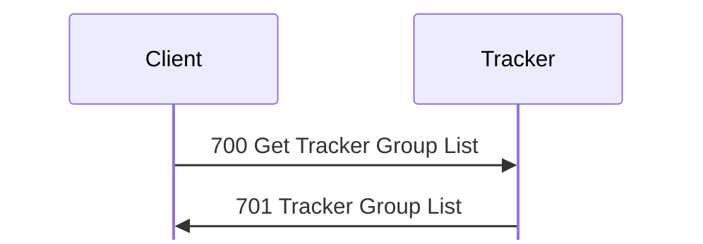
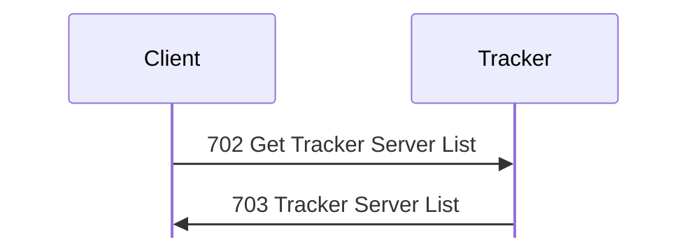
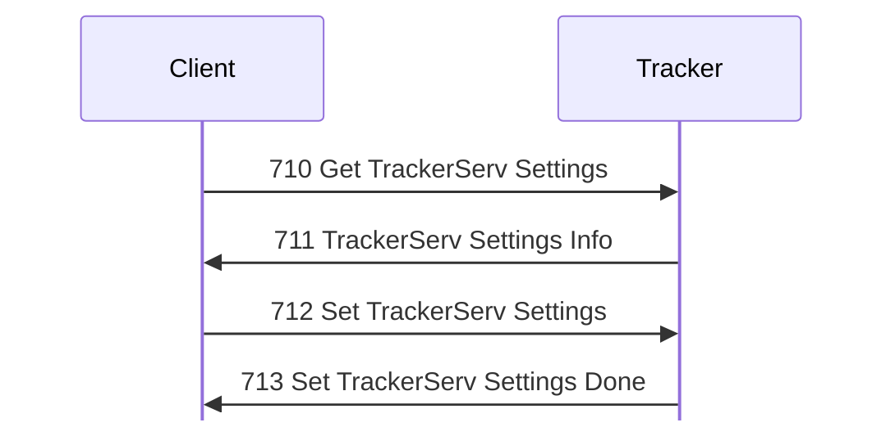
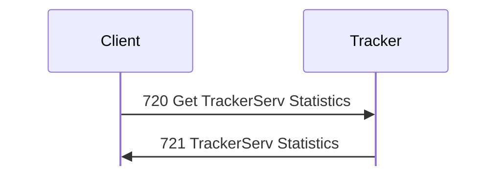

# Tracker messages

For hex and field notation, see [Conventions](../README.md#conventions).

Message types 700 to 721 are what a client and a tracker exchange over TCP,
after the login that [tracker.md](../tracker.md#browsing-tcp) describes. The
tracker also sends [1 Status](status.md#tracker-form) in its short form. It
answers [115 Get My Address](session.md#m115) as a server does: the reply, [116
Your Address](session.md#m116), holds the peer's address as a Pascal
string. <!-- [S `FUN_0804b378`] -->

<!-- An [O] tag that gives only a frame number cites captures/linux-tracker.pcapng. -->

## 700 Get Tracker Group List

Initiator: Client. <!-- [S `FUN_0804abf4`; O frame 34] --> Part of the [tracker
browsing sequence](../tracker.md#connection).

The group list is one request and one reply:

No payload.

The reply is [701 Tracker Group List](#m701).

## 701 Tracker Group List

Initiator: Tracker. <!-- [S `FUN_0804abf4`; O frame 34] --> Part of the [tracker
browsing sequence](../tracker.md#connection).

This is the reply to [700 Get Tracker Group List](#m700). A new Tracker 1.110
has eight groups, all with no description: Business, Chat, Education, Games,
General, Macintosh, Trackers, and Windows. <!-- [O] -->

Struct `TrackerGroupList` (dynamic):

| Off | Size | Type | Field | Notes |
|---|---|---|---|---|
| 0x00 | 4 | `u32` | `groups_count` |  |
| 0x04 | `groups_count` | [`GroupListEntry`](#sGroupListEntry)`[]` | `groups` |  |

Struct `GroupListEntry` (dynamic):

| Off | Size | Type | Field | Notes |
|---|---|---|---|---|
| 0x00 | 2 | `u16` | `servers` | The number of servers in the group. |
| 0x02 | 4 | `u8[4]` | `value_02` | The tracker does not set it, and the client ignores it. <!-- [S client `FUN_08068bcc`] --> |
| 0x06 | 1 | `u8` | `name_len` |  |
| 0x07 | 1 | `u8` | `description_len` |  |
| 0x08 | `name_len` | `str` | `name` |  |
|  | `description_len` | `str` | `description` |  |
|  | pad4 | `u8[]` | `padding` |  |

## 702 Get Tracker Server List

Initiator: Client. <!-- [S `FUN_0804adcc`, client `FUN_08069ac4`; O frames 36,
37] --> Part of the [tracker browsing sequence](../tracker.md#connection).

A group's server list is one request and one reply:

Struct `GetServerList` (dynamic):

| Off | Size | Type | Field | Notes |
|---|---|---|---|---|
| 0x00 | 2 | `u8[2]` | `ignored_00` | 0 as sent. |
| 0x02 | 1 | `u8` | `group_len` |  |
| 0x03 | 1 | `u8` | `ignored_03` | 0 as sent. |
| 0x04 | `group_len` | `str` | `group` |  |

A payload shorter than 4 bytes plus the name gets 0x10002, and an unknown group
gets 0x1000c. <!-- [O `captures/kdx-cli-tracker.pcapng` frame 39] --> Group
names must match byte for byte. <!-- [S] --> The reply is [703 Tracker Server
List](#m703).

## 703 Tracker Server List

Initiator: Tracker. Part of the [tracker browsing
sequence](../tracker.md#connection).

This is the reply to [702 Get Tracker Server List](#m702). The payload is empty
for an empty group.

Struct `TrackerServerList` (dynamic):

| Off | Size | Type | Field | Notes |
|---|---|---|---|---|
| 0x00 | 4 | `u32` | `servers_count` |  |
| 0x04 | `servers_count` | [`ServerListEntry`](#sServerListEntry)`[]` | `servers` | The client rejects more than 0xffff. |

Each server record is padded to a multiple of 4: <!-- [S tracker `FUN_0804adcc`,
client `FUN_08068da0`] -->

Struct `ServerListEntry` (dynamic):

| Off | Size | Type | Field | Notes |
|---|---|---|---|---|
| 0x00 | 8 | `u64` | `first_seen` | Milliseconds since 1900; see [encodings.md](../encodings.md#times). Frame 37 holds the time that registration 23 arrived. <!-- [O] --> |
| 0x08 | 6 | `u8[6]` | `ignored_08` | 0 as sent. |
| 0x0e | 2 | `u16` | `flags` | From the registration. |
| 0x10 | 2 | `u16` | `users` |  |
| 0x12 | 6 | `u8[6]` | `ignored_12` | 0 as sent. |
| 0x18 | 1 | `u8` | `address_len` | 6: the address and the port. |
| 0x19 | 1 | `u8` | `name_len` |  |
| 0x1a | 1 | `u8` | `description_len` |  |
| 0x1b | 1 | `u8` | `extra_len` |  |
| 0x1c | 4 | `u32` | `address` | IPv4 address, such as 0x7f000001 for 127.0.0.1. |
| 0x20 | 2 | `u16` | `port` | TCP port. |
| 0x22 | `name_len` | `str` | `name` |  |
|  | `description_len` | `str` | `description` |  |
|  | `extra_len` | `u8[]` | `extra` | Length 0. |
|  | pad4 | `u8[]` | `padding` |  |

`kdx-proto` re-encodes [701 Tracker Group List](#m701), [702 Get Tracker Server
List](#m702), and [703 Tracker Server List](#m703) from frames 34, 36, 37, 57,
58, 247, and 257 byte for byte. <!-- [O] -->

## 710 Get TrackerServ Settings

Initiator: Client. <!-- [S `FUN_0804cb90`, `FUN_0804cd88`; O frame 80] -->

No payload.

The reply, [711 TrackerServ Settings Info](#m711), holds the tracker's settings
in its file format, without the secrets. [712 Set TrackerServ Settings](#m712)
uses the same format: a header, then up to twelve sections. Entry n of
`sections` and byte n of `present` describe section n.

Struct `TrackerSettings` (dynamic):

| Off | Size | Type | Field | Notes |
|---|---|---|---|---|
| 0x00 | 4 | `char[4]` | `protocol` | not stored. `"%KDX"` (0x254b4458). <!-- [S `FUN_0804d63c`] --> |
| 0x04 | 4 | `char[4]` | `sub_protocol` | not stored. `"TSTG"` (0x54535447). <!-- [S `FUN_0804d63c`] --> |
| 0x08 | 2 | `u16` | `version` | Must be 1. <!-- [S `FUN_0804d63c`] --> |
| 0x0a | 2 | `u8[2]` | `ignored` | The parser never reads them. <!-- [S `FUN_0804d63c`] --> |
| 0x0c | 96 | [`TrackerSettingsSection`](#sTrackerSettingsSection)`[12]` | `sections` | Where each section is. Rust `sections` holds the bytes that each entry points to. |
| 0x6c | 12 | `u8[12]` | `present` | The parser reads a section only when its byte is exactly 1. <!-- [S `FUN_0804d63c`] --> |
| 0x78 | rest | `u8[]` | `section_data` | Rust `sections`. The sections that the entries point to, back to back, in the order below. |

Struct `TrackerSettingsSection` (8 bytes):

| Off | Size | Type | Field | Notes |
|---|---|---|---|---|
| 0x00 | 4 | `u32` | `offset` | From the start of the settings. 0 for an absent section. |
| 0x04 | 4 | `u32` | `size` | 0 for an absent section. |

An absent section has offset 0 and size 0. A section that is present but empty
has size 0 and the offset where it would start. <!-- [O frames 80, 82, 237, 240]
-->

### Sections

Sections 0, 1, 2, 4, and 5 are in use. Sections 3 and 6 to 11 have offset 0,
size 0, and a present byte of 0, <!-- [O frames 80, 82, 237, 240] --> and the
parser reads neither their table entries nor their present bytes. <!-- [S
`FUN_0804d63c`] --> The parser rejects a blob that is shorter than 0x78 bytes,
or that does not have the protocol, the sub-protocol, and version 1. <!-- [S
`FUN_0804d63c`] --> The client builds the sections in the order general,
upstream trackers, groups, admin, greeting. So admin (5) comes before greeting
(4) in the file. <!-- [S `FUN_0806b68c`; O frames 80, 82, 237, 240] -->
`kdx-proto` re-encodes the blobs of those frames byte for byte, and each
general, groups, and admin section from its fields. <!-- [O] -->

| Index | Section | Layout | What the tracker does with it |
|---|---|---|---|
| 0 | general | [GeneralSettings](#general-settings) | The size must be at least 0x4c and hold the strings. |
| 1 | upstream trackers | [UpstreamTracker](#upstream-trackers) | Replaces the whole list, even when empty. |
| 2 | groups | [SettingsGroup](#groups) | The size must not be 0. Replaces the whole list and drops every registration. <!-- [S `FUN_0804ab2c`] --> |
| 3 | unused | | |
| 4 | greeting | [ServerGreeting](session.md#m107) | A section that is absent, or shorter than 5 bytes, clears the greeting. The tracker keeps up to 0xffff bytes of a longer one. |
| 5 | admin | [AdminSettings](#admin) | The size must be at least 0x94 and hold the login. An empty login keeps the old one. |
| 6 to 11 | unused | | |

The offsets in the layouts below are from the start of the section.

### General settings

Struct `GeneralSettings` (dynamic):

| Off | Size | Type | Field | Notes |
|---|---|---|---|---|
| 0x00 | 8 | `u16[4]` | `limits` | Four limits, from the file only. 0 in 711. |
| 0x08 | 24 | `u8[24]` | `ignored_08` |  |
| 0x20 | 4 | `u32` | `flags` | Bit 0: Register with Trackers. Bit 1: Enable Greeting. |
| 0x24 | 4 | `u32` | `tracker_port` | 0, or a value above 0xfffe, means 10800. |
| 0x28 | 4 | `u8[4]` | `ignored_28` |  |
| 0x2c | 12 | `u96` | `server_id` | From the file only. |
| 0x38 | 14 | `u8[14]` | `ignored_38` |  |
| 0x46 | 1 | `u8` | `name_len` |  |
| 0x47 | 1 | `u8` | `description_len` |  |
| 0x48 | 4 | `u8[4]` | `ignored_48` | `kdx-proto` does not keep these bytes. |
| 0x4c | `name_len` | `str` | `name` |  |
|  | `description_len` | `str` | `description` |  |
|  | pad4 | `u8[]` | `padding` |  |

Flags bit 0 is Register with Trackers (tracker +0x1a4), and bit 1 is Enable
Greeting (tracker +0x22c). <!-- [S `FUN_0804d63c`] --> The flags are a u32:
Enable Greeting alone is `00 00 00 02`. <!-- [O frame 82] --> The tracker clears
bit 0 when the name is empty, or when no upstream tracker has an address. That
includes an absent upstream section. The tracker keeps 63 bytes of the name and
255 of the description. A port of 0, or above 0xfffe, means
10800. The tracker reads the limits and the server ID from the file only.

### Upstream trackers

The section is a run of entries. It is not verified whether each one is padded
to a multiple of 4. <!-- [I] --> The strings are the same as in the server's
tracker entry.

Struct `UpstreamTracker` (dynamic):

| Off | Size | Type | Field | Notes |
|---|---|---|---|---|
| 0x00 | 8 | `u8[8]` | `ignored_00` |  |
| 0x08 | 12 | `u8[12]` | `ignored_08` | Raw bytes. |
| 0x14 | 1 | `u8` | `name_len` |  |
| 0x15 | 1 | `u8` | `comments_len` |  |
| 0x16 | 1 | `u8` | `address_len` |  |
| 0x17 | 1 | `u8` | `login_len` |  |
| 0x18 | 1 | `u8` | `key_len` |  |
| 0x19 | 1 | `u8` | `unused_len` |  |
| 0x1a | 1 | `u8` | `group_0_len` |  |
| 0x1b | 1 | `u8` | `group_1_len` |  |
| 0x1c | 1 | `u8` | `group_2_len` |  |
| 0x1d | 1 | `u8` | `group_3_len` |  |
| 0x1e | 1 | `u8` | `group_4_len` |  |
| 0x1f | 1 | `u8` | `group_5_len` |  |
| 0x20 | `name_len` | `str` | `name` |  |
|  | `comments_len` | `str` | `comments` |  |
|  | `address_len` | `str` | `address` |  |
|  | `login_len` | `str` | `login` |  |
|  | `key_len` | `u8[]` | `key` |  |
|  | `unused_len` | `str` | `unused` |  |
|  | `group_0_len` | `str` | `group_0` |  |
|  | `group_1_len` | `str` | `group_1` |  |
|  | `group_2_len` | `str` | `group_2` |  |
|  | `group_3_len` | `str` | `group_3` |  |
|  | `group_4_len` | `str` | `group_4` |  |
|  | `group_5_len` | `str` | `group_5` |  |

### Groups

The section is a run of group records. A record is 0x1c bytes plus the strings,
padded to a multiple of 4. <!-- [O frame 80] --> The parser steps over the
records by the four lengths at 0x18 to 0x1b. <!-- [S] -->

Struct `SettingsGroup` (dynamic):

| Off | Size | Type | Field | Notes |
|---|---|---|---|---|
| 0x00 | 12 | `u8[12]` | `ignored_00` |  |
| 0x0c | 4 | `u32` | `flags` | Set when the name contains `tracker`. 0 in 711. |
| 0x10 | 2 | `u16` | `value_10` | Nothing sets it. |
| 0x12 | 2 | `u16` | `value_12` | Nothing sets it. |
| 0x14 | 4 | `u8[4]` | `ignored_14` |  |
| 0x18 | 1 | `u8` | `name_len` |  |
| 0x19 | 1 | `u8` | `description_len` |  |
| 0x1a | 2 | `u8[2]` | `ignored_1a` | The parser counts these as two more lengths. <!-- [S] --> |
| 0x1c | `name_len` | `str` | `name` |  |
|  | `description_len` | `str` | `description` |  |
|  | pad4 | `u8[]` | `padding` |  |

The tracker sets a group's flag (0x0c in memory) when its name contains
`tracker` in any case. <!-- [S `FUN_0804aa30`, `FUN_0808274c`] --> So `Trackers`
takes only trackers. The tracker keeps its groups sorted by name, byte for byte,
so a new group `Lab` goes between General and Macintosh (frame 247). <!-- [S; O]
--> After it parses the section, the tracker adds the groups `General` and
`Trackers` back if they are missing.

### Admin

Struct `AdminSettings` (dynamic):

| Off | Size | Type | Field | Notes |
|---|---|---|---|---|
| 0x00 | 7 | `u8[7]` | `ignored_00` |  |
| 0x07 | 1 | `u8` | `flags_07` | Bit 0: a key follows. |
| 0x08 | 32 | `u8[32]` | `key` | The `AccountKey` of the password. [711 TrackerServ Settings Info](#m711) leaves it out. |
| 0x28 | 104 | `u8[104]` | `ignored_28` |  |
| 0x90 | 1 | `u8` | `login_len` |  |
| 0x91 | 3 | `u8[3]` | `ignored_91` |  |
| 0x94 | `login_len` | `str` | `login` |  |
|  | pad4 | `u8[]` | `padding` |  |

The key is the `AccountKey` of the password, as for a server account. Frame 82
holds the key of `lab-tracker-pw!2`. <!-- [O] -->

### Greeting

The section is a [107 Server Greeting](session.md#m107) payload: a u32 0, then
the text. The tracker sends it as [107 Server Greeting](session.md#m107) after
login when Enable Greeting is on and the section is longer than 4 bytes. <!-- [S
`FUN_0804bbf8`] -->

The client's settings window shows Tracker Name, Description, Port Number, Admin
Login, and Change Admin Password (Password, Confirm). It has a Groups panel
(Group Name, Description), a Trackers panel with Register with Trackers, and a
Greeting panel with Enable Greeting. <!-- [S client `FUN_0806b1b0`] -->

[710 Get TrackerServ Settings](#m710) gets [711 TrackerServ Settings
Info](#m711), and [712 Set TrackerServ Settings](#m712) gets [713 Set
TrackerServ Settings Done](#m713):

## 711 TrackerServ Settings Info

Initiator: Tracker. <!-- [S `FUN_0804cb90`, `FUN_0804cd88`; O frame 80] -->

Struct `TrackerSettingsInfo` (dynamic):

| Off | Size | Type | Field | Notes |
|---|---|---|---|---|
| 0x00 |  | [`TrackerSettings`](#sTrackerSettings) | `settings` | See [710 Get TrackerServ Settings](#m710). |

This is the reply to [710 Get TrackerServ Settings](#m710), in the format that
[710 Get TrackerServ Settings](#m710) describes. The tracker sets every present
byte, and sends the limits and the server ID as 0. A new tracker is named `New
TrackerServ`. [711 TrackerServ Settings Info](#m711) does not send a group's
flag: the `Trackers` group has 0 there. <!-- [O frame 80] --> It leaves out the
admin key.

The client reads it with the same checks as the tracker's parser. A blob under
0x78 bytes, or without the protocol, the sub-protocol, and version 1, is an
error. The client reads a section only when its present byte is 1 and it fits.
From the general section, it takes the two flag bits, the name, the description,
and the port. From admin, it takes only the login. It ignores the limits and the
server ID. <!-- [S `FUN_0806b1b0`] -->

## 712 Set TrackerServ Settings

Initiator: Client.

Struct `SetTrackerSettings` (dynamic):

| Off | Size | Type | Field | Notes |
|---|---|---|---|---|
| 0x00 |  | [`TrackerSettings`](#sTrackerSettings) | `settings` | See [710 Get TrackerServ Settings](#m710). |

The payload has the format of [711 TrackerServ Settings Info](#m711), which [710
Get TrackerServ Settings](#m710) describes. <!-- [S `FUN_0804d63c`] --> The
tracker reads the limits and the server ID from the file only. A port of 0, or
above 0xfffe, means 10800. A new port takes effect at once. <!-- [S
`FUN_0804ca60`] -->

When Client 1.620 beta 5 builds [712 Set TrackerServ Settings](#m712), it sets
the present bytes for general, trackers, groups, and greeting, but not for admin
(0x71). It puts the sections in the order general, trackers, groups, admin,
greeting, and takes the general flags from the Register with Trackers and Enable
Greeting checkboxes. <!-- [S `FUN_0806b68c`] --> It writes the groups section
only when the user has edited the group list (bit 12 at list +0x24). If not, the
section has offset 0 and size 0, and the tracker keeps its groups. <!-- [S
`FUN_0806b68c`; O frames 82, 240] --> It always writes the greeting section, as
a u32 0 and the text. So an empty greeting is 4 bytes, and the tracker clears
its greeting. <!-- [S `FUN_0806b68c`, `FUN_0804d63c`] -->

It also writes the admin section: 0x94 zero bytes, then the login. The client
allows a login of up to 0xff bytes, and the tracker keeps up to 0x3f. When the
password field is filled, the section also has flags bit 0 and the new key. The
tracker ignores the section, because its present byte is 0. So this client
cannot change the admin login and password remotely, and the tracker then
refuses the new password (frame 104). <!-- [S `FUN_0806b68c`, `FUN_0804d63c`; O
frames 82, 104] -->

The tracker saves `KDXTrackerServ.stg`, replies with [713 Set TrackerServ
Settings Done](#m713), restarts its upstream registration, and logs `TrackerServ
settings changed remotely`, in the tracker log too. <!-- [S `FUN_0804cc10`; O
frame 83] --> The file is XORed with a second LCG (seed 0xacb8fa74, multiplier
0x41a609fd, increment 0x1379). That is storage, not protocol.

## 713 Set TrackerServ Settings Done

Initiator: Tracker. <!-- [S `FUN_0804cc10`; O frame 83] -->

No payload.

This is the reply to [712 Set TrackerServ Settings](#m712), even to a blob that
the tracker cannot read.

## 720 Get TrackerServ Statistics

Initiator: Client. <!-- [S `FUN_0804b180`] -->

The statistics are one request and one reply:

No payload.

The reply is [721 TrackerServ Statistics](#m721).

## 721 TrackerServ Statistics

Initiator: Tracker. It matches the client's Tracker Stats window.
<!-- [S `FUN_0804b180`; O frame 86] -->

This is the reply to [720 Get TrackerServ Statistics](#m720). It is 0x38 bytes:

Struct `TrackerStats` (56 bytes):

| Off | Size | Type | Field | Notes |
|---|---|---|---|---|
| 0x00 | 8 | `u64` | `start_time` | Milliseconds since 1900. |
| 0x08 | 8 | `u64` | `connections_accepted` | TCP connections accepted (`DAT_08104b00`). |
| 0x10 | 8 | `u64` | `datagrams_received` | UDP datagrams received (`DAT_08104b04`). |
| 0x18 | 8 | `u8[8]` | `ignored_18` | 0 as sent. |
| 0x20 | 4 | `u32` | `hours` |  |
| 0x24 | 4 | `u32` | `connections` | TCP connections open now (tracker +0x1c). |
| 0x28 | 4 | `u32` | `servers` | The number of records listed. |
| 0x2c | 12 | `u8[12]` | `ignored_2c` | 0 as sent. |

`kdx-proto` re-encodes frame 86 byte for byte. <!-- [O] -->
