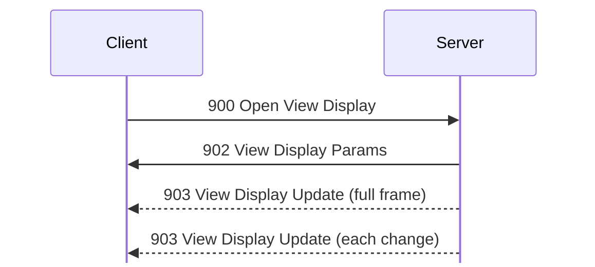
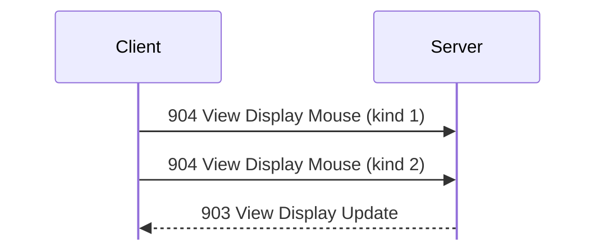

# View display messages

For hex and field notation, see [Conventions](../README.md#conventions).

Message types 900 to 905: remote viewing of the server host screen.

View display shares the server's screen. It runs on a transfer connection (see
[transfers.md](../transfers.md)), not on the session. <!-- [S `FUN_08052194`] -->
Server 1.620 for Linux can't capture its screen (`FUN_080996d8` raises 0x10004),
so [900 Open View Display](#m900) there only gets an error, and its input
injectors are empty. The layouts below are read from the server's code and the
client's decoder. <!-- [S] --> Server 1.600 for Windows has the same code at other
addresses (`FUN_00418dc0` for 900, `FUN_00418850` for the grab) and grabs the
primary screen with `BitBlt` from the desktop window into a 24-bit DIB. <!-- [S `FUN_0041ffd0`] --> It serves Client 1.620 beta 5 under Wine in
`captures/win-view-display.pcapng`. <!-- [O] -->

## 900 Open View Display
Initiator: Client, on a transfer connection. Privilege: View Display (66).
<!-- [S `FUN_0805c0f0`, client `FUN_0806f9d8`] -->

The viewer opens the display and then receives screen updates:

No payload.

A connection already busy gets 0x10003. The reply is
[902 View Display Params](#m902), then a full [903 View Display Update](#m903)
frame. After that the server sends a 903 to every viewer every 1500 ms when the
screen has changed.

A viewer whose send queue passes 0x800000 bytes is dropped with 0x40076.

## 901 Close View Display
Initiator: Client. It has no handler: the client closes the connection, and
sends no [901 Close View Display](#m901) (frame 420). <!-- [O] -->

Struct `CloseViewDisplay` (dynamic):

| Off | Size | Type | Field | Notes |
|---|---|---|---|---|
| 0x00 | rest | u8[] | ignored | unknown: nothing sends or handles it |

## 902 View Display Params
Initiator: Server. Reply to [900 Open View Display](#m900).

Struct `ViewDisplayParams` (16 bytes):

| Off | Size | Type | Field | Notes |
|---|---|---|---|---|
| 0x00 | 4 | u32 | flags | bit 0 = the viewer may control the display (Control Display, 67); admin gets 1 (frame 107) <!-- [O] --> |
| 0x04 | 12 | u8[12] | ignored | 0 as sent. |

## 903 View Display Update
Initiator: Server. Sent after [902 View Display Params](#m902) in reply to
[900 Open View Display](#m900), then whenever the screen changes.

Struct `ViewDisplayUpdate` (dynamic):

| Off | Size | Type | Field | Notes |
|---|---|---|---|---|
| 0x00 | 2 | u16 | screen_width |  |
| 0x02 | 2 | u16 | screen_height |  |
| 0x04 | 2 | u16 | left | of the changed rectangle |
| 0x06 | 2 | u16 | top |  |
| 0x08 | 2 | u16 | right | exclusive |
| 0x0a | 2 | u16 | bottom | exclusive |
| 0x0c | rest | u8[] | pixels | the stream for the whole screen, row by row, in u16 words |

A pixel is a u16 RGB555 (0RRRRRGGGGGBBBBB), the top 5 bits of each
channel. <!-- [S `FUN_0805bb54`] --> The value 0x6c59 means unchanged; a real
0x6c59 is sent as 0x6c5a. A frame after the first marks every unchanged
pixel this way, but still covers the whole screen; the rectangle is the
bounding box of the changed pixels, and the client only uses it to redraw.
<!-- [S client `FUN_0806f864`] --> No change sends no
[903 View Display Update](#m903). A new screen size starts a fresh full frame,
and its bottom is 0xffff rather than the height. <!-- [S `FUN_0805bb54`, `FUN_00418850`] --> The client reallocates its frame buffer when the size
changes.

The stream is a sequence of codes, read as u16 words: <!-- [S server `FUN_0805ba44`, `FUN_0805c5bc`, client `FUN_0806f36c`] -->

- A word with bit 15 clear is one pixel.
- A word with bit 15 set gives colour A = word & 0x7fff, and the next word
  C decides the rest:
  - C bit 15 clear: a run of C pixels of A.
  - C bit 15 set: a third word D gives colour B = D & 0x7fff, and
    n = ((C >> 12) & 7) | ((D >> 15) << 3).
    - n > 0: n pixels (4..12) from the mask C & 0xfff, highest used bit
      first; 1 = B, 0 = A.
    - n = 0: count = C & 0xfff, then a bitmap of ((count + 15) / 16) × 2
      bytes, MSB first; 1 = B, 0 = A.

The server first takes runs of 10 or more equal pixels, up to 0x7fff
each. <!-- [S `FUN_0805ba44`] --> It splits the pixels between runs into spans
of up to 0xfff pixels with at most two colours, where A is the span's
first pixel and B the first other colour. <!-- [S `FUN_0805c5bc`] --> A span of
4 to 9 pixels of one colour is a run; 4 to 12 pixels of two colours use
the mask; 13 or more use the bitmap; shorter spans are single pixels. The
first pixel's bit is always 0. The client also skips A or B when it is
0x6c59, so a span can mix changed and unchanged pixels.

Wine's black 3840×2160 screen comes as one full 903 (frame 108): width
0x0f00, height 0x0870, the rectangle 0, 0, 0x0f00, 0x0870, then 253 runs
`8000 7fff` and one `8000 10fd`, 3840 × 2160 pixels in all. The screen
never changed, so no later 903 came. <!-- [O] -->

## 904 View Display Mouse
Initiator: Client, on the view display connection. Privilege: Control
Display (67). <!-- [S `FUN_0805c344`, client `FUN_0806fc68`] -->

After a click the server sends the next update within 100 ms:

Struct `ViewDisplayMouse` (12 bytes):

| Off | Size | Type | Field | Notes |
|---|---|---|---|---|
| 0x00 | 4 | u32 | modifiers | as in [905 View Display Keyboard](#m905); Client 1.620 beta 5's bits are unknown <!-- [I] --> |
| 0x04 | 2 | u16 | x | in screen pixels |
| 0x06 | 2 | u16 | y |  |
| 0x08 | 2 | u16 | wheel | the event field [4201 Mouse](gconsole.md#m4201) sends as its wheel; 0 for clicks and moves <!-- [O] --> |
| 0x0a | 1 | u8 | button | 1 left, 2 right, 3 middle <!-- [S `FUN_00420270`] --> |
| 0x0b | 1 | u8 | kind | 1 down, 2 up, 3 move, 4 wheel <!-- [S `FUN_0805c344`] --> |

A click is kind 1, then kind 2, both with button 1; moves have button 0
(frames 307-310). <!-- [O] --> Other kinds are ignored. After kind 2, the server
sends the next [903 View Display Update](#m903) within 100 ms. The client sends
nothing when [902 View Display Params](#m902) denied control, and shows "You do
not have access to control" on a click.

The server turns the message back into the client's input event (kinds 1-4
become events 9, 10, 13, 14). <!-- [S `FUN_0805c344`, `FUN_00418fc0`] --> Server
1.600 for Windows plays it with `mouse_event`, scaling x and y to the
absolute range 0-0xffff by its screen size. <!-- [S `FUN_00420270`] --> Modifier
bit 0x10 turns any button into the right one. It ignores kind 4, the
wheel. The Linux server ignores all of it.

## 905 View Display Keyboard
Initiator: Client, on the view display connection. Privilege: Control
Display (67). <!-- [S `FUN_0805c498`, client `FUN_0806f1f4`] -->

Struct `ViewDisplayKeyboard` (12 bytes):

| Off | Size | Type | Field | Notes |
|---|---|---|---|---|
| 0x00 | 4 | u32 | modifiers | from Client 1.600 (`FUN_00463870`): Ctrl 0x21, Alt 2, Shift 8, Caps Lock 4, Windows 0x30; <!-- [S client `FUN_00463870`] --> Client 1.620 beta 5's bits are unknown <!-- [I] --> |
| 0x04 | 2 | u16 | character | <!-- [O] --> |
| 0x06 | 2 | u16 | key_code |; <!-- [O] --> `a` = 4, `b` = 5, `c` = 6 from Client 1.620 |
| 0x08 | 3 | u8[3] | ignored | 0 as sent. |
| 0x0b | 1 | u8 | kind | 1 key down, 2 key up, 3 key repeat <!-- [S `FUN_0805c498`] --> |

Typing `abc` sends `0061 0004`, `0062 0005`, `0063 0006` with kind 1, each
followed by a kind 2 that is zero apart from the kind (frames 312-322).
<!-- [O] --> After kind 1, the server sends the next
[903 View Display Update](#m903) within 100 ms.

The server turns kinds 1-3 back into events 5, 6, 7. <!-- [S `FUN_0805c498`, `FUN_00419110`] --> Server 1.600 for Windows ignores the character and the
modifiers. It looks the key code's low byte up in a 256-entry table of virtual
keys and calls `keybd_event`, with key up for kind 2 and key down otherwise
(`FUN_00420380`, with the table at 0x0047fe98). <!-- [S `FUN_00420380`] -->

The two clients send different key codes: <!-- [S] -->

- Client 1.600 for Windows uses the codes that table expects (table
  `0x004ff1e8`): `A` to `Z` 0x41-0x5a, `0` to `9` 0x30-0x39, keypad 0-9
  0x10-0x19, Tab 0x70, Return 0x71, Space 0x72, Home 0x80, Escape 0x90,
  BackSpace 0x91, Left Shift 0xa1, F1-F24 0xb0-0xc7.
- Client 1.620 beta 5 sends USB HID usages, mapped from X keysyms
  (`FUN_0811667c`, tables `0x081681e0` and `0x081680e0`).

So Server 1.600 for Windows maps Client 1.620's `a` (4) to virtual key 0,
and nothing typed in the capture reached its screen. <!-- [I] -->
