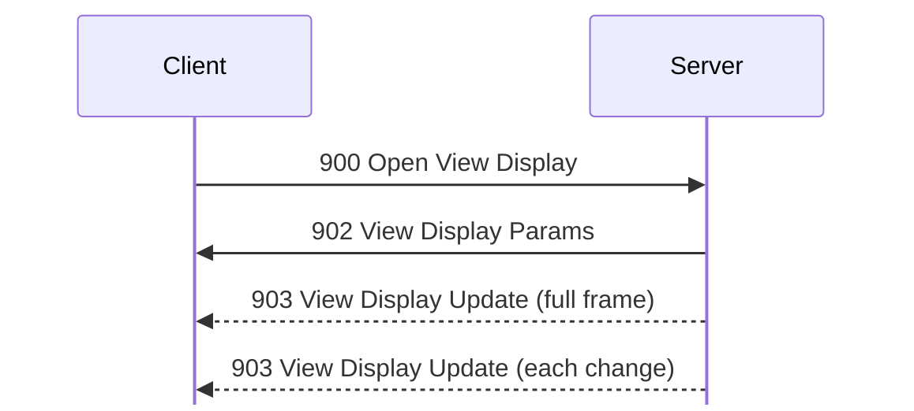
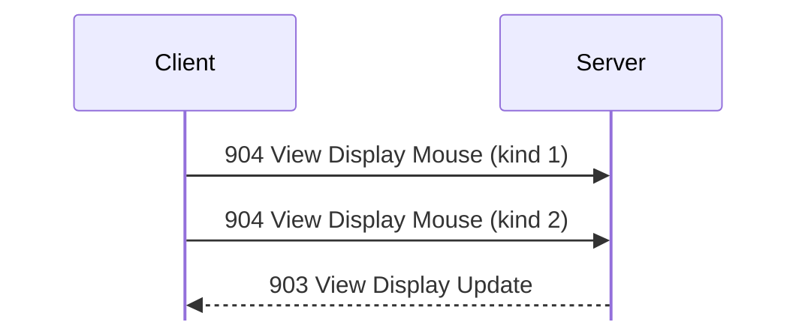

# View display messages

For hex and field notation, see [Conventions](../README.md#conventions).

Message types 900 to 905 show the screen of the server's host to a remote
viewer.

View display runs on a transfer connection, not on the session; see
[transfers.md](../transfers.md). <!-- [S `FUN_08052194`] --> Server 1.620 for
Linux cannot capture its screen (`FUN_080996d8` gives 0x10004). So on that
server, [900 Open View Display](#m900) only gets an error, and the input
functions do nothing. The layouts below come from the server's code and the
client's decoder. <!-- [S] --> Server 1.600 for Windows has the same code at
other addresses (`FUN_00418dc0` for 900, `FUN_00418850` for the grab). It grabs
the primary screen with `BitBlt` from the desktop window into a 24-bit
DIB. <!-- [S `FUN_0041ffd0`] --> In `captures/win-view-display.pcapng`, it
serves Client 1.620 beta 5 under Wine. <!-- [O] --> Frame numbers on this page
are from that capture.

## 900 Open View Display
Initiator: Client, on a transfer connection. Privilege: View Display (66).
<!-- [S `FUN_0805c0f0`, client `FUN_0806f9d8`] -->

The viewer opens the display, and then gets screen updates:

No payload.

If the connection is already busy, the reply is 0x10003. If not, the reply is
[902 View Display Params](#m902), then a full frame in [903 View Display
Update](#m903). After that, every 1500 ms, the server sends a 903 to each viewer
if the screen has changed.

If a viewer's send queue grows past 0x800000 bytes, the server drops the viewer
with 0x40076.

## 901 Close View Display
Initiator: Client. It has no handler. To close the display, the client closes the connection, and sends no 901 Close View Display. <!-- [O frame 420] -->

Struct `CloseViewDisplay` (dynamic):

| Off | Size | Type | Field | Notes |
|---|---|---|---|---|
| 0x00 | rest | u8[] | `ignored` | Unknown, because nothing sends or handles it. |

## 902 View Display Params
Initiator: Server. Reply to [900 Open View Display](#m900).

Struct `ViewDisplayParams` (16 bytes):

| Off | Size | Type | Field | Notes |
|---|---|---|---|---|
| 0x00 | 4 | u32 | `flags` | Bit 0 is set if the viewer can control the display (Control Display, 67). Admin gets 1. <!-- [O frame 107] --> |
| 0x04 | 12 | u8[12] | `ignored` | 0 as sent. |

## 903 View Display Update
Initiator: Server. It comes after [902 View Display Params](#m902) in reply to [900 Open View Display](#m900), and then each time the screen changes.

Struct `ViewDisplayUpdate` (dynamic):

| Off | Size | Type | Field | Notes |
|---|---|---|---|---|
| 0x00 | 2 | u16 | `screen_width` |  |
| 0x02 | 2 | u16 | `screen_height` |  |
| 0x04 | 2 | u16 | `left` | The changed rectangle. |
| 0x06 | 2 | u16 | `top` |  |
| 0x08 | 2 | u16 | `right` | Not included. |
| 0x0a | 2 | u16 | `bottom` | Not included. |
| 0x0c | rest | u8[] | `pixels` | The stream for the whole screen, row by row, in u16 words. |

A pixel is a u16 in RGB555 (0RRRRRGGGGGBBBBB), with the top 5 bits of each
channel. <!-- [S `FUN_0805bb54`] --> The value 0x6c59 means that the pixel has
not changed, so a real 0x6c59 is sent as 0x6c5a. Each frame after the first
marks all unchanged pixels in this way, but still covers the whole screen. The
rectangle is the bounding box of the changed pixels, and the client uses it only
to redraw. <!-- [S client `FUN_0806f864`] --> If nothing changes, the server
sends no 903. A new screen size starts a new full frame, whose bottom is 0xffff,
not the height. <!-- [S `FUN_0805bb54`, `FUN_00418850`] --> When the size
changes, the client allocates a new frame buffer.

The stream is a series of codes, read as u16 words: <!-- [S server
`FUN_0805ba44`, `FUN_0805c5bc`, client `FUN_0806f36c`] -->

- A word with bit 15 clear is one pixel.
- A word with bit 15 set gives color A = word & 0x7fff. The next word, C,
  decides the rest:
  - C bit 15 clear: a run of C pixels of A.
    - C bit 15 set: a third word, D, gives color B = D & 0x7fff, and n = ((C >>
      12) & 7) | ((D >> 15) << 3).
        - n > 0: n pixels (4 to 12) from the mask C & 0xfff, highest used bit
          first. 1 is B, and 0 is A.
        - n = 0: count = C & 0xfff, then a bitmap of ((count + 15) / 16) × 2
          bytes, MSB first. 1 is B, and 0 is A.

First, the server takes runs of 10 or more equal pixels, up to 0x7fff
each. <!-- [S `FUN_0805ba44`] --> It divides the pixels between runs into spans
of up to 0xfff pixels, with at most two colors. A is the span's first pixel, and
B the first other color. <!-- [S `FUN_0805c5bc`] --> Then:

- A span of 4 to 9 pixels of one color is a run.
- A span of 4 to 12 pixels of two colors uses the mask.
- A span of 13 or more pixels uses the bitmap.
- A shorter span is single pixels.

The bit of the first pixel is always 0. The client also skips A or B if it is
0x6c59, so a span can mix changed and unchanged pixels.

Wine's black 3840×2160 screen comes as one full 903 (frame 108): width 0x0f00,
height 0x0870, the rectangle 0, 0, 0x0f00, 0x0870, then 253 runs of `8000 7fff`
and one `8000 10fd`, 3840 × 2160 pixels in all. The screen never changed, so no
more 903s came. <!-- [O] -->

## 904 View Display Mouse
Initiator: Client, on the view display connection. Privilege: Control
Display (67). <!-- [S `FUN_0805c344`, client `FUN_0806fc68`] -->

After a click, the server sends the next update in less than 100 ms:

Struct `ViewDisplayMouse` (12 bytes):

| Off | Size | Type | Field | Notes |
|---|---|---|---|---|
| 0x00 | 4 | u32 | `modifiers` | As in [905 View Display Keyboard](#m905). The bits of Client 1.620 beta 5 are unknown. <!-- [I] --> |
| 0x04 | 2 | u16 | `x` | In screen pixels. |
| 0x06 | 2 | u16 | `y` |  |
| 0x08 | 2 | u16 | `wheel` | The event field that [4201 Mouse](gconsole.md#m4201) sends as its wheel. 0 for clicks and moves. <!-- [O] --> |
| 0x0a | 1 | u8 | `button` | 1 left, 2 right, 3 middle <!-- [S `FUN_00420270`] --> |
| 0x0b | 1 | u8 | `kind` | 1 down, 2 up, 3 move, 4 wheel <!-- [S `FUN_0805c344`] --> |

A click is kind 1, then kind 2, both with button 1. Moves have button 0. <!-- [O
frames 307 to 310] --> The server ignores other kinds. After kind 2, it sends
the next [903 View Display Update](#m903) in less than 100 ms. If [902 View
Display Params](#m902) did not allow control, the client sends nothing, and
shows "You do not have access to control" on a click.

The server changes the message back into the client's input event: kinds 1 to 4
become events 9, 10, 13, and 14. <!-- [S `FUN_0805c344`, `FUN_00418fc0`] -->
Server 1.600 for Windows plays the event with `mouse_event`, with x and y scaled
by its screen size to the absolute range 0 to 0xffff. <!-- [S `FUN_00420270`]
--> Modifier bit 0x10 makes any button the right button. The Windows server
ignores kind 4, the wheel, and the Linux server ignores all of the message.

## 905 View Display Keyboard
Initiator: Client, on the view display connection. Privilege: Control
Display (67). <!-- [S `FUN_0805c498`, client `FUN_0806f1f4`] -->

Struct `ViewDisplayKeyboard` (12 bytes):

| Off | Size | Type | Field | Notes |
|---|---|---|---|---|
| 0x00 | 4 | u32 | `modifiers` | From Client 1.600: Ctrl 0x21, Alt 2, Shift 8, Caps Lock 4, Windows 0x30. <!-- [S client `FUN_00463870`] --> The bits of Client 1.620 beta 5 are unknown. <!-- [I] --> |
| 0x04 | 2 | u16 | `character` | <!-- [O] --> |
| 0x06 | 2 | u16 | `key_code` | From Client 1.620, `a` is 4, `b` 5, and `c` 6. <!-- [O] --> |
| 0x08 | 3 | u8[3] | `ignored` | 0 as sent. |
| 0x0b | 1 | u8 | `kind` | 1 key down, 2 key up, 3 key repeat. <!-- [S `FUN_0805c498`] --> |

When the user types `abc`, the client sends `0061 0004`, `0062 0005`, and `0063
0006` with kind 1. After each one comes a kind 2 that is zero except for the
kind. <!-- [O frames 312 to 322] --> After kind 1, the server sends the next
[903 View Display Update](#m903) in less than 100 ms.

The server changes kinds 1 to 3 back into events 5, 6, and 7. <!-- [S
`FUN_0805c498`, `FUN_00419110`] --> Server 1.600 for Windows ignores the
character and the modifiers. It finds the low byte of the key code in a table of
256 virtual keys at 0x0047fe98, and calls `keybd_event`: key up for kind 2, and
key down for the others. <!-- [S `FUN_00420380`] -->

The two clients send different key codes: <!-- [S] -->

- Client 1.600 for Windows uses the codes that the server's table expects (its
  table is at `0x004ff1e8`): `A` to `Z` 0x41 to 0x5a, `0` to `9` 0x30 to 0x39,
  keypad 0 to 9 0x10 to 0x19, Tab 0x70, Return 0x71, Space 0x72, Home 0x80,
  Escape 0x90, BackSpace 0x91, Left Shift 0xa1, F1 to F24 0xb0 to 0xc7.
- Client 1.620 beta 5 sends USB HID usages, mapped from X keysyms
  (`FUN_0811667c`, tables `0x081681e0` and `0x081680e0`).

So Server 1.600 for Windows probably maps the `a` (4) of Client 1.620 to virtual
key 0. Nothing typed in the capture reached its screen. <!-- [I] -->
