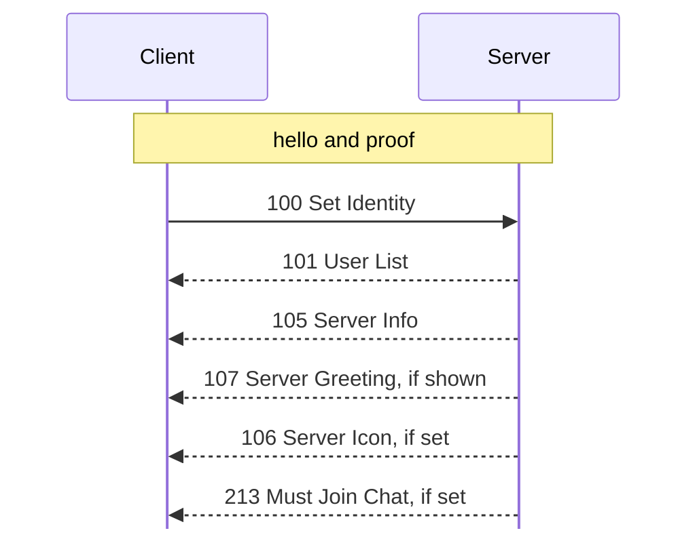
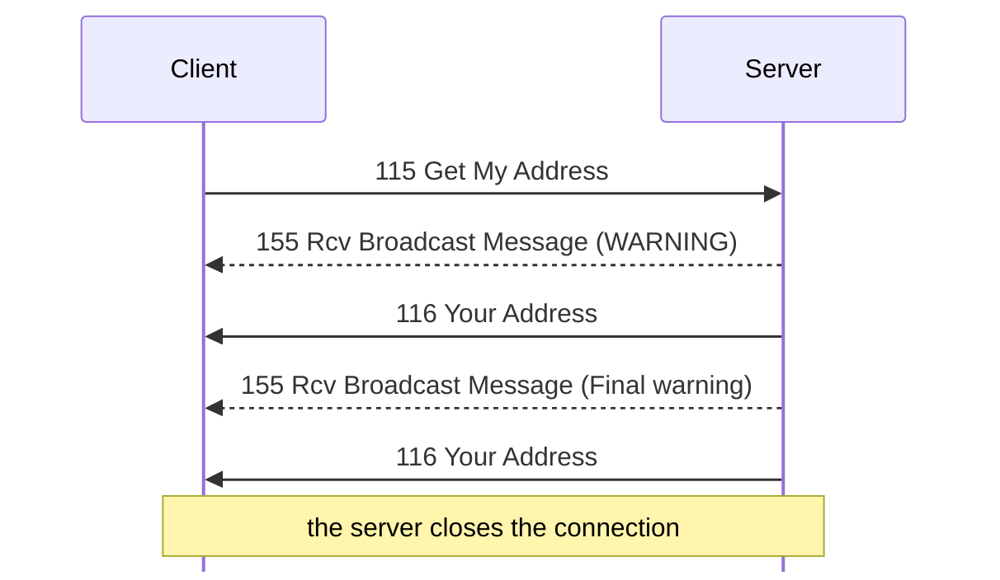
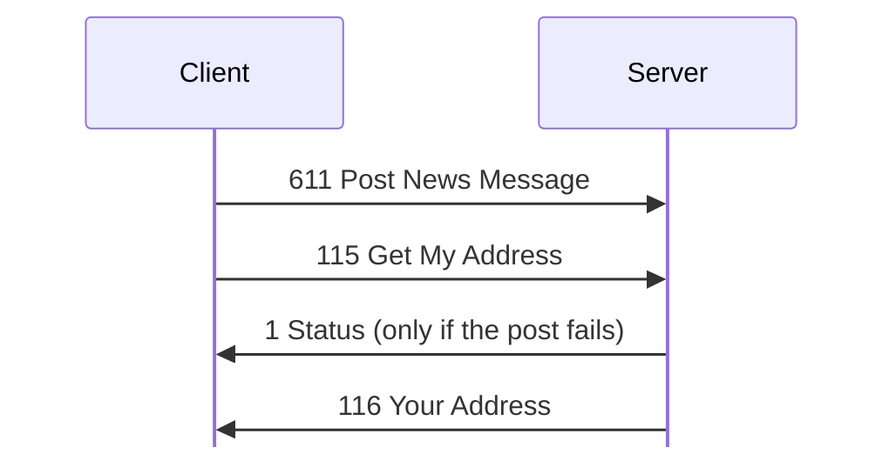
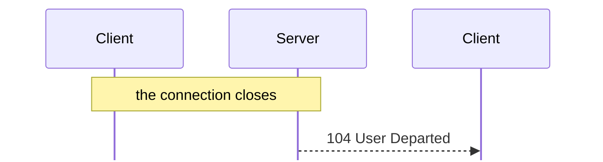

# Transaction sequences

For hex and field notation, see [Conventions](README.md#conventions).

This page gives some complete exchanges, in order.

## Login

1. The client and the server exchange hellos and proofs; see
   [handshake.md](handshake.md).
2. The client sends [100 Set Identity](messages/session.md#m100).
3. The server sends no reply to 100. Instead, it sends these messages with its
   own txids: <!-- [O `captures/first-connect.pcapng` frames 23, 24] -->
   - [101 User List](messages/session.md#m101) and [105 Server
     Info](messages/session.md#m105)
   - [107 Server Greeting](messages/session.md#m107), unless the account has
     Don't Show Greeting
   - [106 Server Icon](messages/session.md#m106), if the server has one
   - [213 Must Join Chat](messages/chat.md#m213), if the account joins chat when
     it connects; see [100 Set Identity](messages/session.md#m100)

   All other users get [103 User Joined](messages/session.md#m103). 4. Then the
   client asks for the data it shows. In `captures/first-connect.pcapng`, the
   server sends only [101 User List](messages/session.md#m101) and [105 Server
   Info](messages/session.md#m105), in frames 23 and 24. The user's later
   actions bring [300 Send Private Message](messages/private-messages.md#m300)
   twice, [605 Get Newsgroup List](messages/news.md#m605), and [607 Get News
   Messages](messages/news.md#m607). <!-- [O] -->

## Flood ban

After 30 connections from 127.0.0.1 in about a minute, the server logged "Banned
for flooding. (ID 4/119)". Then it closed each new connection before it sent its
hello. The ban lasted at least five minutes, and ended when the server
restarted. <!-- [O `captures/kdx-accounts.pcapng`] the connections after frame
467 -->

This limit is in the network layer that the server, tracker, and client share.
The client applies it to its DCC listener. The server checks it each time it
accepts a connection. <!-- [S server `FUN_08071c90`, server `FUN_08097e80`,
tracker `FUN_0806bbac`, client `FUN_080ca7cc`] --> For each source address, it
counts the accepted connections in a window of 300 seconds. The 31st connection
in a window puts the address on a block list for 3600 seconds, and logs 0x40077.
While the address is blocked, each new connection from it closes at once. The
limits, 30 and 300, are defaults that nothing changes. This block list, unlike
the server's own ban list, also blocks 127.0.0.1.

Two more limits apply when the server accepts a connection. <!-- [S
`FUN_08052ad0`] --> If an address already has 6 open connections, the server
closes the new one and says nothing. If the address is on the server's ban list,
the server rejects the connection and logs it. Bans come from [150 Disconnect
User](messages/administration.md#m150) and from the flood bans below. The ban
list never matches 127.0.0.1. <!-- [S `FUN_08061398`] -->

The server also counts the requests on each connection. <!-- [S `FUN_0804fc40`]
--> The limit L is the account class's flood protection byte, at offset 0x25 of
[503 Account Class Info](messages/accounts.md#m503). A connection with no class
yet gets 40. The client's menu names the values: <!-- [S] at file offset 0xf6cd8
of the client's resources -->

| Name | L |
|---|---:|
| Very Strict | 20 |
| Strict | 40 |
| Average | 60 |
| Relaxed | 80 |
| Very Relaxed | 120 |
| Total Slacker | 200 |
| Off | 0 |

With 0, there is no check.

Each request adds 1 to the count, starting with the [100 Set
Identity](messages/session.md#m100) of the login. <!-- [O
`captures/linux-accounts-folder-access.pcapng`] --> When the count gets to L,
the server looks at the time since the window started. At 121 seconds or more,
it sets the count to zero and starts a new window. If not, it does these things:

- At count L, it sends [155 Rcv Broadcast
  Message](messages/administration.md#m155) "WARNING: The server has detected
  that you are flooding it. If you continue to flood the server, you will be
  banned."
- At L + 4, it sends "Final warning: If you continue to flood the server, you
  will be banned."
- Above L + 8, it bans the address for 2 hours (7200000 ms) with the reason
  "Auto-banned this bastard for flooding.", and closes the connection with
  0x640004. <!-- [S `FUN_0804a8c0`] -->

The observed case, with [115 Get My Address](messages/session.md#m115) as the
repeated request:

With Very Strict (0x14), a client logged in and then sent [115 Get My
Address](messages/session.md#m115) every 300 ms. It got the WARNING before the
reply to its 19th request, and the Final warning before the reply to its 23rd.
It got no reply to its 28th, because the server closed the connection. <!-- [O]
frames 147, 161, 178 --> Each [155 Rcv Broadcast
Message](messages/administration.md#m155) is 16 zero bytes and the text. The
server logged "Auto-banned for flooding!" and "Banned for flooding!". The ban
did not block 127.0.0.1: the same account logged in again 12 seconds later. <!--
[O] frame 188 -->

Server 1.52's upgrade notes say that flood protection became a setting of each
class in that version. It is off for classes made before then.

## Posting news

Some requests, such as [611 Post News Message](messages/news.md#m611), get no
reply when they succeed. To confirm such a request, a client sends [115 Get My
Address](messages/session.md#m115) after it. The server handles the requests on
a connection in order, so if the post fails, the error arrives before [116 Your
Address](messages/session.md#m116). <!-- [O `captures/kdx-news.pcapng` frames
356 to 361] -->

This is a failed post, with the client's confirmation request after it:

## Logout

When a connection closes, the other users get [104 User
Departed](messages/session.md#m104), and the server writes a [185
Disconnected](messages/administration.md#m185) history record:

