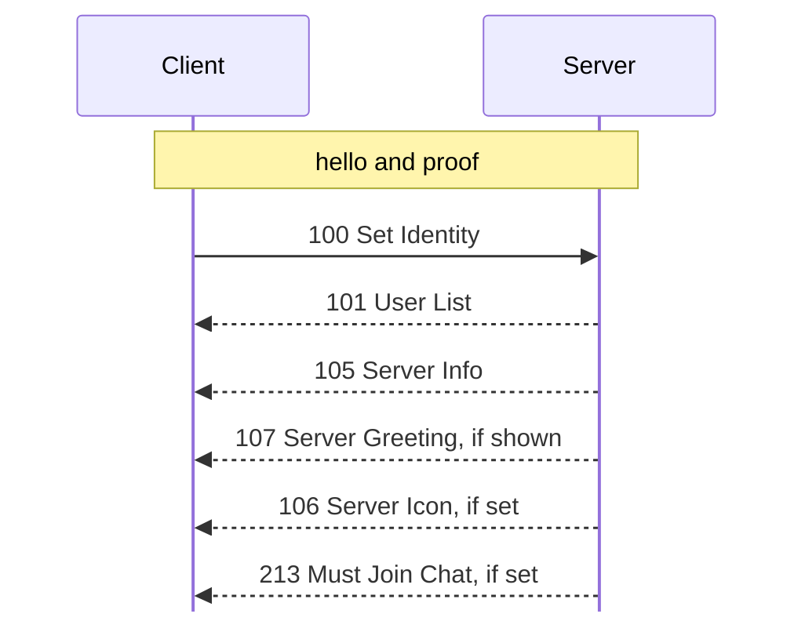
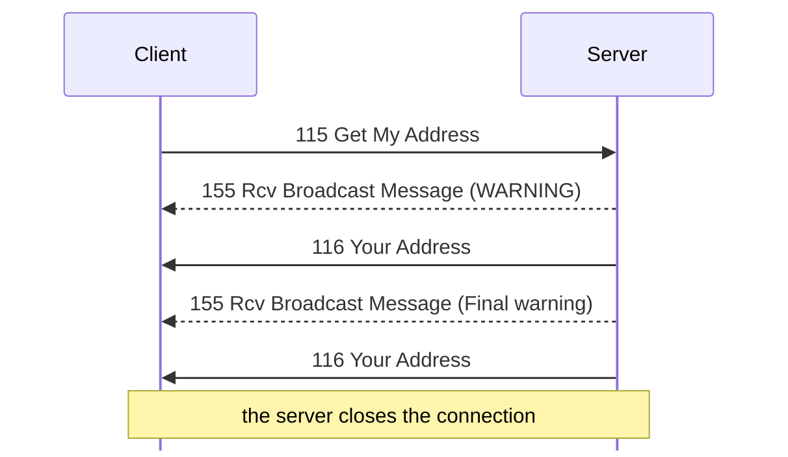
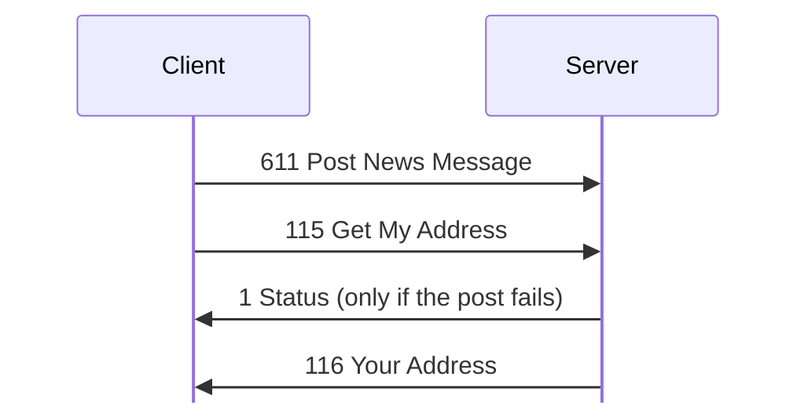
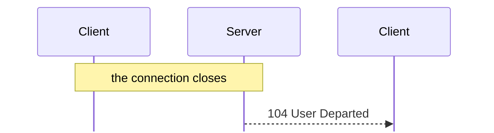

# Transaction sequences

Tags, hex, and field notation: see [Conventions](README.md#conventions).

Complete exchanges, in order.

## Login

1. Client and server exchange hellos and proofs
   ([handshake.md](handshake.md)).
2. The client sends **[100 Set Identity](messages/session.md#m100)**.
3. The server sends no reply to 100. It sends
   [101 User List](messages/session.md#m101) and
   [105 Server Info](messages/session.md#m105) with its own txids
   (`captures/first-connect.pcapng` frames 23-24) **[O]**, then
   [107 Server Greeting](messages/session.md#m107) unless the account has Don't
   Show Greeting, [106 Server Icon](messages/session.md#m106) if one is set, and
   [213 Must Join Chat](messages/chat.md#m213) when the account joins chat on
   connect (see [100 Set Identity](messages/session.md#m100)). Everyone else
   receives [103 User Joined](messages/session.md#m103).
4. The client then asks for whatever it shows. In
   `captures/first-connect.pcapng` the server sends only 101 and 105 (frames
   23-24), and the user's later actions bring
   [300 Send Private Message](messages/private-messages.md#m300) twice,
   [605 Get Newsgroup List](messages/news.md#m605), and
   [607 Get News Messages](messages/news.md#m607) **[O]**.

## Flood ban

After 30 connections from 127.0.0.1 in about a minute, the server logged
"Banned for flooding. (ID 4/119)" and then closed each new connection
before sending its hello (`captures/kdx-accounts.pcapng`, the connections
after frame 467) **[O]**. The ban lasted at least five minutes and ended
when the server restarted.

That limit is in the network layer that Server, Tracker, and Client share (the
client applies it to its DCC listener). The server's copy, `FUN_08071c90`, is
called from accept `FUN_08097e80` **[S server `FUN_08071c90`, server
`FUN_08097e80`, tracker `FUN_0806bbac`, client `FUN_080ca7cc`]**. Per
source address it counts accepted connections in a window of 300 seconds. The
31st within a window adds the address to a block list for 3600 seconds and logs
0x40077; while blocked, each new connection is closed at once. The limits (30
and 300) are defaults that nothing changes. Unlike the server's own ban list,
this one also blocks 127.0.0.1.

Two more limits apply at accept **[S `FUN_08052ad0`]**. An address with 6
connections already open gets its new one closed without a word. And an address
on the server's ban list (bans from
[150 Disconnect User](messages/administration.md#m150), and the flood bans
below) is rejected and logged, except 127.0.0.1, which the ban list never
matches **[S `FUN_08061398`]**.

The server also counts each connection's requests, calling `FUN_0804fc40` per
message from the session loop **[S `FUN_0804fc40`]**. The limit L is the account
class's flood protection byte
([503 Account Class Info](messages/accounts.md#m503) offset 0x25); a connection
with no class yet gets 40. The client's menu names the values, at file offset
0xf6cd8 of the client's resources **[S]**: Very Strict 20, Strict 40, Average
60, Relaxed 80, Very Relaxed 120, Total Slacker 200, Off 0. With 0 there is no
check.

Each request adds 1 to the count, starting with the login's
[100 Set Identity](messages/session.md#m100) **[O
`captures/linux-accounts-folder-access.pcapng`]**. When the count reaches L, the
server looks at the time since the window started. At 121 seconds or more, it
resets the count and starts a new window. Otherwise:

- at count L, it sends
  [155 Rcv Broadcast Message](messages/administration.md#m155) "WARNING: The
  server has detected that you are flooding it. If you continue to flood the
  server, you will be banned.";
- at L + 4, "Final warning: If you continue to flood the server, you will
  be banned.";
- above L + 8, it adds a 2-hour ban (7200000 ms) on the address, with the
  reason "Auto-banned this bastard for flooding.", and closes the
  connection with 0x640004 (`FUN_0804a8c0`).

The observed case, with 115 as the repeated request:

With Very Strict (0x14), a client that logged in and then sent
[115 Get My Address](messages/session.md#m115) every 300 ms got the WARNING
before the reply to its 19th request, the Final warning before the reply to its
23rd, and no reply to its 28th: the server closed the connection (frames 147,
161, 178) **[O]**. Each 155 is 16 zero bytes and the text. The server logged
"Auto-banned for flooding!" and "Banned for flooding!". The ban did not block
127.0.0.1: the same account logged in again 12 seconds later (frame 188)
**[O]**.

The server's 1.52 upgrade notes say that flood protection became a
per-class setting then, and is off for classes that predate it.

## Posting news

A client confirms a request that has no success reply, such as
[611 Post News Message](messages/news.md#m611), by sending
[115 Get My Address](messages/session.md#m115) after it. The server handles one
connection's requests in order, so an error for the post arrives before
[116 Your Address](messages/session.md#m116) **[O `captures/kdx-news.pcapng`
frames 356 to 361]**.

A failed post, with the client's confirmation request after it:

## Logout

When a connection closes, the other users receive
**[104 User Departed](messages/session.md#m104)**, and the server writes a
[185 Disconnected](messages/administration.md#m185) history record.

A closing connection, and the notice to the others:

