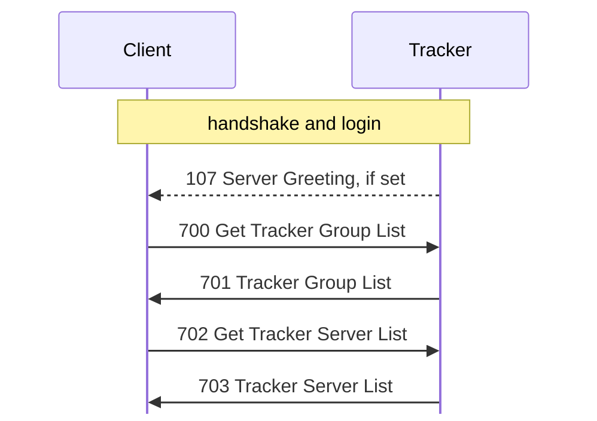

# Tracker

For hex and field notation, see [Conventions](README.md#conventions).

A tracker lists servers in named groups. Servers register over UDP, and clients
browse over TCP. In `captures/linux-tracker.pcapng`, Server 1.620 registers with
Tracker 1.110, and Client 1.620 beta 5 browses and administers the tracker, all
on Linux. <!-- [O] --> Frame numbers on this page are from that capture.

The static evidence comes from these Ghidra projects; see `re/README.md`:

- `kdxtracker`: `KDXTrackerServ.lexe`, Tracker 1.110 for Linux
- `kdx`: `KDXServer.lexe`, Server 1.620 for Linux
- `kdxlnxclient`: `KDXClient.lexe`, Client 1.620 beta 5 for Linux

## Ports

The tracker opens TCP and UDP on the same port, 10800 (0x2a30) by
default. <!-- [S tracker `FUN_0804c540`, tracker `FUN_0804c7a8`] -->
FUN_0804c540 sets it, with the default in FUN_0804c7a8

If a tracker address has no `:port`, the server adds `:10800` before it sends a
registration. <!-- [S server `FUN_08060e4c`] --> The client picks the default
port from the connection type: <!-- [S client `FUN_0804bac0`] -->

| Type | Port |
|---:|---:|
| 1, Server | 10700 |
| 2, Client (DCC) | 10600 |
| 3, Tracker | 10800 |
| 4, GConsole, a Haxial remote console; see [gconsole.md](gconsole.md) | 10900 |

## Registration (UDP)

A server registers with one UDP datagram for each tracker. This is a different
protocol from the TCP connections; see [udp.md](udp.md).

## Browsing (TCP)

### Connection

The handshake and framing are the same as for a server, with the same challenge
table; see [handshake.md](handshake.md) and [framing.md](framing.md). <!-- [S
tracker `FUN_0804bd9c`] --> The tracker sends sub-version 0x30. Like the server,
it accepts only sub-protocol `%KDX` with sub-version exactly 0x10. It gives
0x40071 for another sub-protocol, and 0x40072 or 0x40073 for a lower or higher
sub-version. <!-- [S `FUN_0804bb4c`] -->

The login works like this: <!-- [S `FUN_0804bb78`] -->

- For an empty login, the tracker checks the proof against the key of the empty
  password (guest).
- Any other login must be the tracker's admin login, compared without case
  (`FUN_0808244c` with its case flag set), with the admin password. It sets
  admin bit 0 at connection +0x2e. [710 Get TrackerServ
  Settings](messages/tracker.md#m710), [712 Set TrackerServ
  Settings](messages/tracker.md#m712), and [720 Get TrackerServ
  Statistics](messages/tracker.md#m720) need this bit, and give 0x10014 without
  it. <!-- [O] --> frames 61 and 164, for a guest's 710 and 720
- With a wrong password, the proof fails with status 1, in the error form that
  [handshake.md](handshake.md#proof) describes: `auth` is zero except for its
  key word. <!-- [O] --> frame 104

After the login, if the tracker has a greeting, it sends [107 Server
Greeting](messages/session.md#m107) before the client's [700 Get Tracker Group
List](messages/tracker.md#m700). <!-- [S `FUN_0804bbf8`; O frame 117] --> Each
IP address can have 5 connections. The tracker closes a sixth at once, but
counts it in the connection counter of 720. The tracker closes a connection that
is idle for more than 1200 (0x4b0), probably seconds. <!-- [S `FUN_0804bd9c`,
`FUN_0804bbf8`; I] --> The receive cap is 0x10000 bytes. <!-- [S `FUN_0804bd9c`]
-->

This is a browse after the login, as the client's tracker window does it:

The tracker's dispatcher, `FUN_0804b378`, handles [115 Get My
Address](messages/session.md#m115), [700 Get Tracker Group
List](messages/tracker.md#m700), [702 Get Tracker Server
List](messages/tracker.md#m702), 710, 712, and 720. It ignores all other types,
and sends no reply. <!-- [S] --> The client's tracker connection,
`FUN_08069578`, sends 700 as soon as it logs in. It handles [1
Status](messages/status.md#m1), 107, [116 Your
Address](messages/session.md#m116), [701 Tracker Group
List](messages/tracker.md#m701), [703 Tracker Server
List](messages/tracker.md#m703), [711 TrackerServ Settings
Info](messages/tracker.md#m711), [713 Set TrackerServ Settings
Done](messages/tracker.md#m713), and [721 TrackerServ
Statistics](messages/tracker.md#m721). <!-- [S; O frames 33, 75] -->

`kdx-tracker` replays the requests of the `linux-tracker` capture, and its
replies match those of Tracker 1.110 byte for byte, except for the times when a
server was first seen. <!-- [O] --> 701 at 34, 234, and 247; 703 at 37, 58, 244,
250, and 257; 711 at 80 and 237; 713 at 83 and 241; and the Status at 61
(crates/kdx-tracker/src/tests.rs) In `captures/kdx-tracker.pcapng`, Server 1.620
registers with `kdx-tracker` (frame 16), and a 703 lists it (frame 34). In
`captures/kdx-tracker-gui.pcapng`, Client 1.620 beta 5 lists it (frames 15 and
33). <!-- [O] -->

[messages/tracker.md](messages/tracker.md) describes the messages.

## Open questions

- What are the units of the sweep values 850 and 600, and of the idle limit
  1200?
