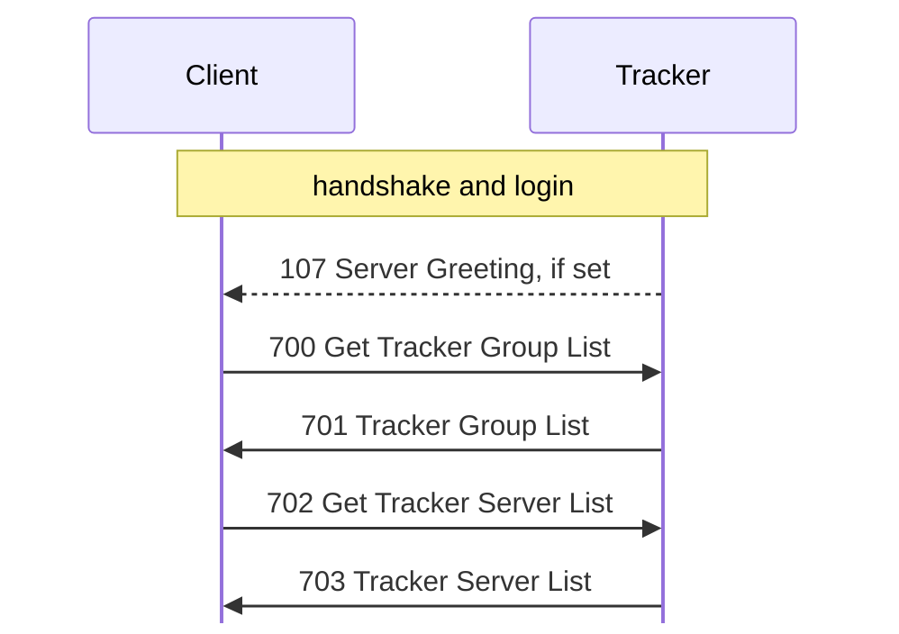

# Tracker

Tags, hex, and field notation: see [Conventions](README.md#conventions).

A tracker lists servers in named groups. Servers register over UDP; clients
browse over TCP. `captures/linux-tracker.pcapng` has Server 1.620
registering with Tracker 1.110 and Client 1.620 beta 5 browsing and
administering it, all Linux; **[O]** tags below cite its frames.

Evidence tags as in [handshake.md](handshake.md). Static sources, by Ghidra
project (`re/README.md`):

- `kdxtracker`: `KDXTrackerServ.lexe`, Tracker 1.110 Linux.
- `kdx`: `KDXServer.lexe`, Server 1.620 Linux.
- `kdxlnxclient`: `KDXClient.lexe`, Client 1.620 beta 5 Linux.

All multi-byte integers are big-endian.

## Ports

The tracker opens TCP and UDP on the same port, 10800 (0x2a30) by default,
set in `FUN_0804c540` with the default in `FUN_0804c7a8` **[S tracker
`FUN_0804c540`, tracker `FUN_0804c7a8`]**.

When a tracker address has no `:port`, the server appends `:10800` before
sending a registration **[S server `FUN_08060e4c`]**. The client picks the
default port by connection type: 1 → 10700 (Server), 2 → 10600 (Client,
DCC), 3 → 10800 (Tracker), 4 → 10900 (GConsole, a Haxial remote console;
see [gconsole.md](gconsole.md)) **[S client `FUN_0804bac0`]**.

## Registration (UDP)

Servers register with one UDP datagram per tracker. It is a different protocol
from the TCP connections, described in [udp.md](udp.md).

## Browsing (TCP)

### Connection

The handshake and framing are the same as for a server
([handshake.md](handshake.md), [framing.md](framing.md)), with the same
challenge table **[S tracker `FUN_0804bd9c`]**. The tracker sends sub-version
0x30. Like the server, it accepts only sub-protocol `%KDX` with sub-version
exactly 0x10 (0x40071 for another sub-protocol, 0x40072 / 0x40073 for a lower /
higher sub-version) **[S `FUN_0804bb4c`]**.

Login **[S `FUN_0804bb78`]**:

- An empty login checks the proof against the empty password's key (guest).
- Any other login must be the tracker's admin login, compared ignoring case
  (`FUN_0808244c` with its case flag set), with the admin password. It sets
  admin bit 0 at connection +0x2e, which
  [710 Get TrackerServ Settings](messages/tracker.md#m710),
  [712 Set TrackerServ Settings](messages/tracker.md#m712), and
  [720 Get TrackerServ Statistics](messages/tracker.md#m720) require (else
  0x10014; **[O]** frames 61 and 164 for a guest's 710 and 720). A wrong
  password fails the proof with status 1 (frame 104) **[O]**, in the error form
  of [handshake.md](handshake.md): `auth` is zero but for its key word.

After login the tracker sends [107 Server Greeting](messages/session.md#m107),
if it has one set, before the client's
[700 Get Tracker Group List](messages/tracker.md#m700) **[S `FUN_0804bbf8`; O
frame 117]**. Each IP may hold 5 connections; the tracker closes a sixth at
once, but counts it in 720's connection counter. A connection idle for more than
1200 (0x4b0, probably seconds **[I]**) is closed **[S `FUN_0804bd9c`,
`FUN_0804bbf8`]**. The receive cap is 0x10000 bytes **[S `FUN_0804bd9c`]**.

A browse after the login, as the client's tracker window runs it:

The tracker's dispatcher `FUN_0804b378` handles
[115 Get My Address](messages/session.md#m115),
[700 Get Tracker Group List](messages/tracker.md#m700),
[702 Get Tracker Server List](messages/tracker.md#m702), 710, 712, and 720, and
ignores any other type without a reply **[S]**. The client's tracker connection
`FUN_08069578` sends 700 as soon as it logs in and handles
[1 Status](messages/status.md#m1), 107,
[116 Your Address](messages/session.md#m116),
[701 Tracker Group List](messages/tracker.md#m701),
[703 Tracker Server List](messages/tracker.md#m703),
[711 TrackerServ Settings Info](messages/tracker.md#m711),
[713 Set TrackerServ Settings Done](messages/tracker.md#m713), and
[721 TrackerServ Statistics](messages/tracker.md#m721) **[S; O frames 33, 75]**.

Verified: `kdx-tracker` replays the requests of the `linux-tracker` capture and
its replies match Tracker 1.110's byte for byte, but for the first-seen times:
701 at 34, 234, and 247; 703 at 37, 58, 244, 250, and 257; 711 at 80 and 237;
713 at 83 and 241; and the Status at 61 (`crates/kdx-tracker/src/tests.rs`)
**[O]**. `captures/kdx-tracker.pcapng` has Server 1.620 registering with
`kdx-tracker` (frame 16) and the 703 that lists it (frame 34), and
`captures/kdx-tracker-gui.pcapng` has Client 1.620 beta 5 listing it
(frames 15 and 33) **[O]**.

The messages are described in [messages/tracker.md](messages/tracker.md).

## Open questions

- The units of the 850 and 600 sweep values and the 1200 idle limit.
