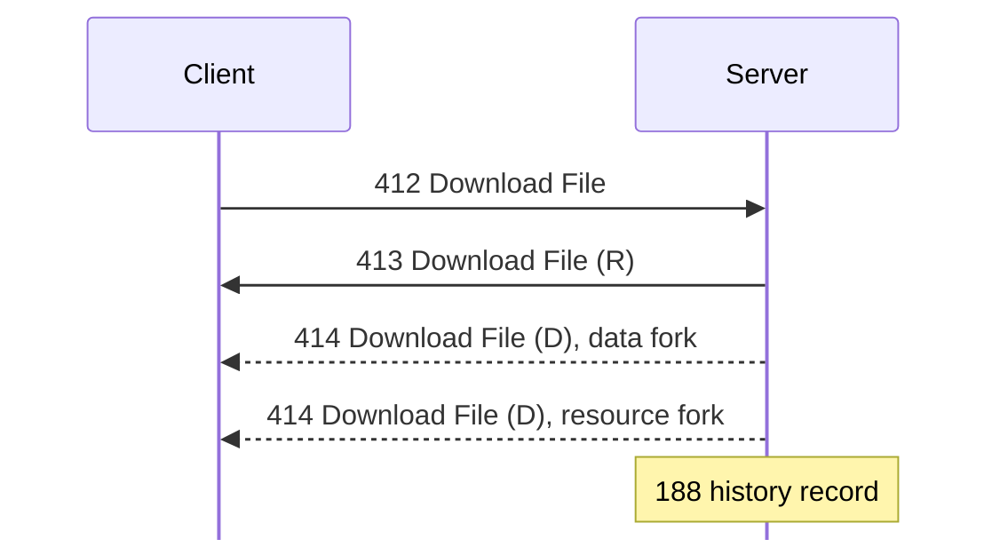
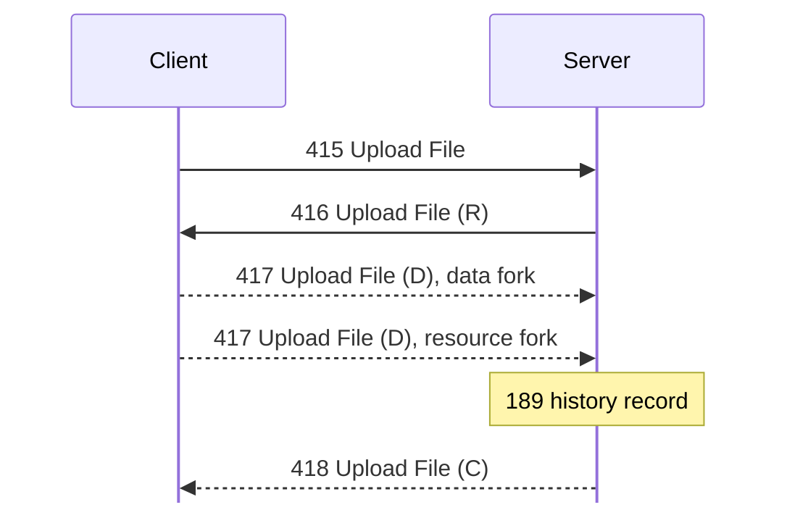

# Transfer connections

This page describes how a download or an upload runs on its own connection. For
hex and field notation, see [Conventions](README.md#conventions). That
connection carries [412 Download File](messages/files.md#m412) through [418
Upload File (C)](messages/files.md#m418), and [900 Open View
Display](messages/view-display.md#m900). The server sends [419 Notify Speed
Limit](messages/files.md#m419) on the main connection.

## Connecting

Files move on a second connection to the same port. This connection attaches to
a user who is already logged in. <!-- [S `FUN_0805270c`, `FUN_080528c8`,
`FUN_08052194`; O] seen with kdx-probe --attach --> If [105 Server
Info](messages/session.md#m105) names a file transfer port, the client connects
to that port instead. <!-- [S client `FUN_08052cc0`] -->

1. The client connects and does the normal handshake with a special login:
   - The login name is 5 bytes: `00`, then the u32 user ID from 105 Server Info
     offset 0x24.
   - The account key is the 32 bytes at 105 Server Info offset 0x00, not a
     password hash.
2. The server accepts the login only if that user is logged in, connects from
   the same IP address, and is not itself an attached connection. The attached
   connection gets its own user ID, but it has the privileges and base folder of
   its parent. The server log calls it a transfer, and logs `Transfer
   Disconnect` when it closes. <!-- [O] -->
3. On this connection, the server handles only these messages, and ignores all
   others, including [108 Ping](messages/session.md#m108): <!-- [S; O] -->
   - [400 Get File List](messages/files.md#m400)
   - [402 Create Folder](messages/files.md#m402)
   - [412 Download File](messages/files.md#m412)
   - [415 Upload File](messages/files.md#m415)
   - [900 Open View Display](messages/view-display.md#m900), [904 View Display
     Mouse](messages/view-display.md#m904), and [905 View Display
     Keyboard](messages/view-display.md#m905), for view display
4. A connection runs one transfer at a time. If a second 412 Download File or
   415 Upload File arrives during a transfer, the server replies [1
   Status](messages/status.md#m1) 0x10003. When the transfer ends, the
   connection accepts requests again. <!-- [S] -->

## Download

The client sends [412 Download File](messages/files.md#m412). The server replies
[413 Download File (R)](messages/files.md#m413), then sends one [414 Download
File (D)](messages/files.md#m414) for each fork. Then it writes a [188 Finished
File Download](messages/administration.md#m188) history record.

## Upload

The client sends [415 Upload File](messages/files.md#m415). The server replies
[416 Upload File (R)](messages/files.md#m416), and the client sends one [417
Upload File (D)](messages/files.md#m417) for each fork. Then the server writes a
[189 Finished File Upload](messages/administration.md#m189) history record and
sends [418 Upload File (C)](messages/files.md#m418).

## Encryption

The data stream is encrypted, unless the client asks for plain mode. To ask, it
sets bit 0 of request offset 0x17. Plain mode needs privilege bit 65, which is
probably Disable Encryption. <!-- [I] -->

Encrypted data has the same framing as a message: a header whose length gives
the byte count, then that many bytes in 16-byte Twofish blocks. Thus a client
can read the data with its normal receive path. <!-- [O] --> Nobody has tested
plain mode yet.
