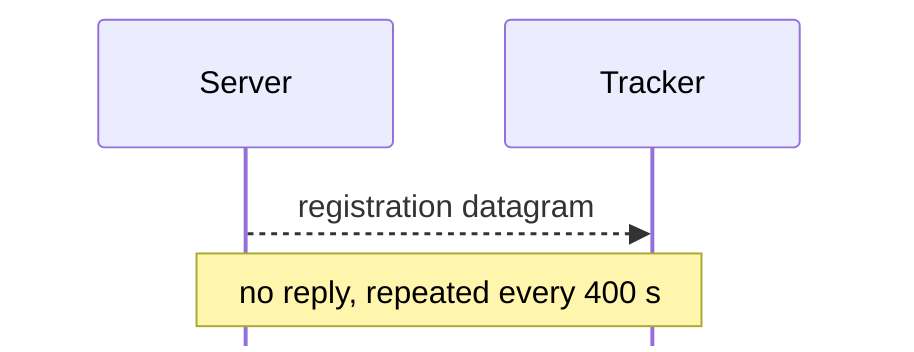

# UDP: tracker registration

For hex and field notation, see [Conventions](README.md#conventions).

A server tells a tracker that it exists with one UDP datagram. This is a
separate protocol from the TCP connections in [framing.md](framing.md). The
datagram has no handshake, no message header, and no reply, and it has a
different cipher and checksum. [tracker.md](tracker.md) describes the TCP side
of the tracker, where clients browse. Frame numbers on this page are from
`captures/linux-tracker.pcapng`.

A server sends one datagram to each tracker in its settings. <!-- [S server
`FUN_08060e4c`] --> It registers when it starts or when its settings are saved.
Then it registers again every 400000 ms, while its Register with Trackers flag
(settings +0x27c) is on. Frames 23, 78, 146, and 239 are 400 s apart, and frame
255 comes right after the [172 Set Server
Settings](messages/administration.md#m172) in frame 252. <!-- [S server
`FUN_0805f638`, `FUN_08061230`; O frames 23, 78, 146, 239, 255] --> A tracker
sends the same datagram to its own upstream trackers, with flags bit 0
set. <!-- [S tracker `FUN_0804df70`] --> Neither waits for a reply, and the
tracker sends none:



## Encryption

The whole datagram is XORed, word by word, with an LCG stream: <!-- [S server
`FUN_0804a454`, tracker `FUN_0804a370`, tracker `FUN_0804a3d0`; O frame 23] -->

```
s = 0xa5a16c4a
for each 32-bit big-endian word w[i]:
    w[i] ^= s
    s = s * 0x41d28485 + 0x322b    (mod 2^32)
```

Only whole words are XORed, so the sender pads the datagram to a multiple of 4.

`kdx-proto` decodes registrations 23, 78, and 255, and encodes them again byte
for byte. <!-- [O] crates/kdx-proto/tests/linux_tracker.rs -->

## Layout

The datagram is a 64-byte header, then the strings with no length bytes between
them, then padding to a multiple of 4. Frame 23 is 92 bytes: server port 0x29cc,
1 user, the Login `trk-login`, the name `Lab Server`, and one group, `Lab,
Lab2`. <!-- [O] --> The client's Groups field is one text field, sent as group 0
as typed. The server does not send Comments, Address, or the password. <!-- [O]
--> Server 1.620 does not clear the padding: frame 255 is 86 bytes of header and
strings, then `12 22`. <!-- [O] -->

Struct `Registration` (dynamic):<a id="sRegistration"></a>

| Off | Size | Type | Field | Notes |
|---|---|---|---|---|
| 0x00 | 4 | `char[4]` | `protocol` | not stored. `"%KDX"` (0x254b4458) <!-- [S tracker `FUN_0804c048`; O frame 23] --> |
| 0x04 | 2 | `u16` | `version` | not stored. 0x0010. The tracker drops any other value. <!-- [S tracker `FUN_0804c048`; O frame 23] --> |
| 0x06 | 2 | `u16` | `flags` | Bit 0 is set if the sender is a tracker. Server 1.620 sends 0, and Tracker 1.110 sends 1. <!-- [O frames 23, 78] --> |
| 0x08 | 4 | `u32` | `checksum` | not stored. See [Checksum](#checksum). |
| 0x0c | 12 | `u96` | `server_id` | The first time Server 1.620 runs, it fills this with three random words, and keeps them in its settings. <!-- [S server `FUN_080535b4`] --> Tracker 1.110 ignores it. |
| 0x18 | 4 | `u32` | `server_port` | The server's TCP port, which a tracker forwards without change. In Server 1.620, it is at settings +0x258, and 10700 by default. |
| 0x1c | 8 | `u8[8]` | `ignored_1c` | 0 as sent |
| 0x24 | 2 | `u16` | `users` | The number of users logged in. The server keeps it XORed with 0x2ba9 in memory, and sends it plain. <!-- [S server `FUN_080528c8`, `FUN_0804a930`] --> |
| 0x26 | 13 | `u8[13]` | `ignored_26` | 0 as sent |
| 0x33 | 1 | `u8` | `string0_len` |  |
| 0x34 | 1 | `u8` | `login_len` |  |
| 0x35 | 1 | `u8` | `name_len` |  |
| 0x36 | 1 | `u8` | `description_len` |  |
| 0x37 | 1 | `u8` | `string4_len` |  |
| 0x38 | 6 | `u8[6]` | `groups_len` |  |
| 0x3e | 1 | `u8` | `string11_len` |  |
| 0x3f | 1 | `u8` | `string12_len` |  |
| 0x40 | `string0_len` | `str` | `string0` | Empty from Server 1.620 |
|  | `login_len` | `str` | `login` | The Login of the tracker entry in the server's settings. The tracker skips it. |
|  | `name_len` | `str` | `name` | The server name. |
|  | `description_len` | `str` | `description` | The server description. |
|  | `string4_len` | `str` | `string4` | Empty from Server 1.620 |
|  | `groups_len` | `str[6]` | `groups` | The group names of the tracker entry. Server 1.620 sends its Groups field as group 0, as typed. |
|  | `string11_len` | `str` | `string11` | not stored. Empty from Server 1.620 |
|  | `string12_len` | `str` | `string12` | not stored. Empty from Server 1.620 |
|  | pad4 | `u8[]` | `padding` | The datagram is padded to a multiple of 4. Server 1.620 does not clear the padding. |

## Checksum

The checksum is CRC-32 with polynomial 0x04c11db7, MSB first (entry 1 of the
table is `0x04c11db7`), initial value 0xdeadbeef, and no final XOR. The sender
sets the checksum field to the bytes `ca d3 1e cc` (0xcc1ed3ca stored
little-endian), and computes the CRC over the padded datagram. Then it stores
the result in the field, big-endian. `kdx-proto` verifies this. <!-- [S server
`FUN_08060e4c`, server `FUN_0806fa28`, tracker `FUN_08067ee4`; O frames 23, 78,
255] --> With the placeholder stored big-endian, the checksum of frame 23 does
not match.

## What the tracker checks

The client's Edit Tracker dialog edits the server's tracker entry: Name,
Comments, Address, Login, Password, and up to six Groups. <!-- [S client
`FUN_0808b290`, `FUN_0808b4d4`] --> The server's settings store Name, Comments,
Address, Login, a 32-byte password key, an unused string, and the
groups. <!-- [S] --> The registration sends only the Login and the groups. No
password or key goes on the wire.

The tracker decrypts the datagram, and keeps it only if all of these are
true: <!-- [S tracker `FUN_0804c048`] -->

- The length is more than 0x40.
- The protocol is `%KDX`, and the version is 0x0010.
- The 13 length bytes at 0x33 to 0x3f are not all 0, and 0x40 plus their sum
  fits in the datagram.
- The checksum, computed over the received length, matches.

## Tracker side

The tracker identifies each server by its source IP address and the port
field: <!-- [S tracker `FUN_0804b960`] -->

- A new server gets a new record, but only while the IP address has fewer than 5
  records. <!-- [S `FUN_0804b494`, `FUN_0804b604`] -->
- For a known server whose name, description, and group names have not changed,
  the tracker updates the users, flags, and last-seen time.
- If not, the tracker makes the record again from the datagram, and keeps its
  first-seen time. <!-- [S `FUN_0804b960`] -->
- A registration with an empty name makes no record, and removes a known
  one. <!-- [S `FUN_0804b604`] -->

The tracker cuts the name to 64 bytes, and keeps the whole description. It lists
the record in each of the record's groups that the tracker has, compared byte
for byte. <!-- [S `FUN_0806774c`] --> A group whose flag (+0x0c) is set takes
only records with flags bit 0 set. A record with no matching group goes into a
default group, <!-- [S `FUN_0804b604`] --> which is General: the tracker listed
`Lab, Lab2` there in frame 37. <!-- [O] --> After the tracker had a group `Lab`,
it listed the registration with group `Lab` (frame 255) in that group (frame
257). <!-- [O] -->

A new group list from [712 Set TrackerServ Settings](messages/tracker.md#m712)
removes all records. Frame 244 is an empty General, right after the group edit
in frame 240. <!-- [S `FUN_0804ab2c`; O frame 244] --> So frame 257 gives the
arrival time of frame 255, not of frame 23. <!-- [O] -->

The tracker removes records that it has not seen for more than 850 (0x352). The
sweep runs from the [700 Get Tracker Group List](messages/tracker.md#m700)
handler, at most once every 600. <!-- [S `FUN_0804abf4`] --> Both are probably
seconds. <!-- [I] -->
